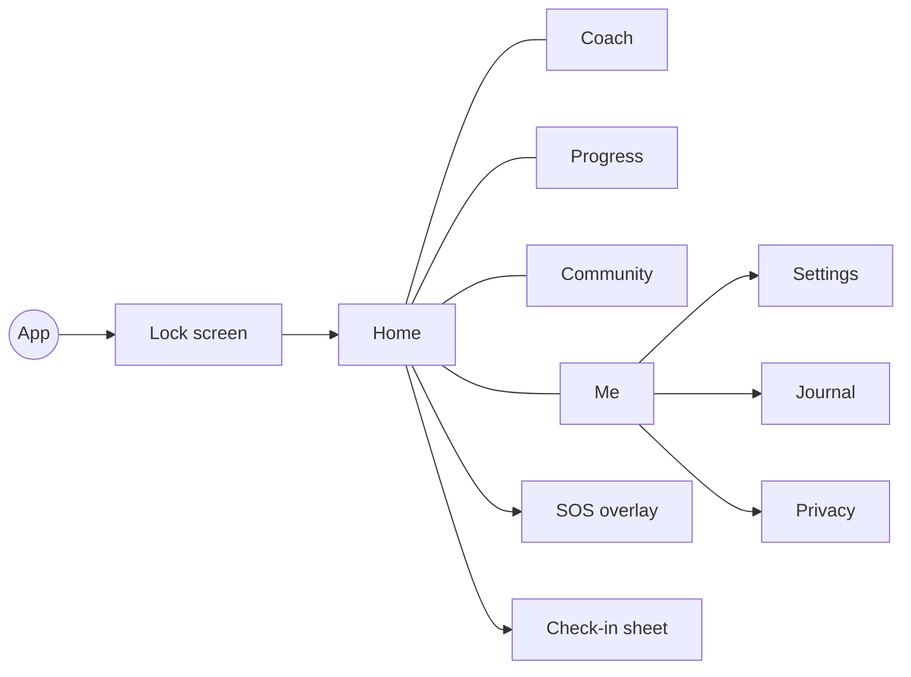

# 00 — Product overview

## 1. One-liner

**TurnWell** is the one place a person can be fully honest about what they struggle with, and get daily,
personal help to change it: tracking, a proactive AI coach, an SOS flow for urges, and anonymous peer support,
built on stronger privacy than any social or wellness app.

## 2. Principles (check every feature against these)

1. **Trust first** — minimum data, encrypted by default, no real identity in community, no ads, no data selling.
2. **No shame** — a slip is data, not failure. No red, no reset-to-zero streak as the main number.
3. **Prevent, don't punish** — the coach steps in *before* risky moments.
4. **Human connection over dependency** — the coach pushes toward community, partners, trusted people.
5. **Safe by design** — crisis detection, strict community rules, 18+ only.
6. **Not a therapist** — evidence-based techniques (CBT, MI, ACT, urge surfing), never diagnoses.
7. **Faith-respectful, not preachy** — Sins mode suggests well-established Islamic practices, never rulings.

## 3. Users

18+ worldwide. Personas: Yacine (24, Algiers, porn + missed prayers, Sins mode), Laura (31, Madrid, smoking +
doomscrolling, Habits mode), Omar (38, Paris, anger + gambling, both), Amina (27, London, backbiting + emotional
eating, Sins mode).

## 4. Modes

| | Sins mode (`SINS`) | Bad Habits mode (`HABITS`) |
| --- | --- | --- |
| Framing | Sin, tawbah, closeness to Allah | Habit, behaviour change, wellbeing |
| Coach adds | Dhikr, salah, Qur'an, du'a, fasting | — |
| Vocabulary | "sin", "slip", "return" | "habit", "slip", "reset" |
| Reactions | Support, Same here, Praying for you | Support, Same here |

A user can enable both; each tracked item belongs to one mode. Sins mode shows a one-line notice that it is
Islamic-guided; non-Muslims can switch anytime.

## 5. Categories (`ItemCategory`)

`SEXUAL`, `SUBSTANCES`, `DIGITAL`, `SPEECH`, `EMOTIONAL`, `FINANCIAL`, `WORSHIP` (Sins mode only), `BODY`,
`PRODUCTIVITY`, `CUSTOM`. The onboarding AI maps free text onto these.

## 6. Feature list (F-IDs)

| ID | Feature | Module | Release |
| --- | --- | --- | --- |
| F-01 | Sign-up (email, Google, Apple) + 18+ gate | M01 | v1 |
| F-02 | App lock (PIN / biometric, auto-lock) | M02 | v1 |
| F-03 | Language auto-detect, 4 UI languages | M16 | v1 |
| F-04 | Mode choice | M03 | v1 |
| F-05 | Coach setup (gender, voice, name) | M03 / M14 | v1 |
| F-06 | Onboarding conversation | M03 | v1 |
| F-07 | Trusted contact | M09 | v1 |
| F-08 | Community pseudonym | M12 | v1 |
| F-10 | Tracked items | M04 | v1 |
| F-11 | Daily check-in | M04 | v1 |
| F-12 | Slip log | M04 | v1 |
| F-13 | Progress view | M04 | v1 |
| F-14 | Growth art | M04 | v2 |
| F-15 | Journal (+ on-device voice transcription) | M05 | v1 |
| F-16 | Replacement habits | M04 | v2 |
| F-17 | Positive practices (Sins mode) | M04 | v2 |
| F-18 | Home-screen widget | M04 | v2 |
| F-20 | Coach chat (15 msg/day free) | M07 | v1 |
| F-21 | Proactive nudges | M11 | v1 |
| F-22 | Personal plan | M03 / M07 | v1 |
| F-23 | Weekly reflection | M07 | v2 |
| F-24 | Voice conversation | M07 | v2 |
| F-25 | Tone setting | M14 | v1 |
| F-26 | Learning modules | — | v3 |
| F-30 | SOS button | M10 | v1 |
| F-31 | Urge flow | M10 | v1 |
| F-32 | Urge outcome | M10 | v1 |
| F-33 | Crisis path | M09 | v1 |
| F-40 | Reach-out posts | M12 | v1 |
| F-41 | Supportive replies + reactions | M12 | v1 |
| F-42 | Circles | M12 | v2 |
| F-43 | Direct messages | M12 | v2 |
| F-44 | Accountability partner | M12 | v2 |
| F-45 | Milestones | M12 | v2 |
| F-46 | Verified mentors | M12 | v3 |
| F-50 | App disguise (alt icon) | M02 | v1 |
| F-51 | Decoy PIN | M02 | v1 |
| F-52 | Discreet notifications | M11 | v1 |
| F-53 | Panic wipe | M17 | v1 |
| F-54 | Export + delete account | M17 | v1 |
| F-55 | Privacy dashboard | M17 | v2 |
| F-60 | Themes (Dawn, Night Sanctuary; Oasis v2) | M14 | v1 |
| F-61 | Coach settings | M14 | v1 |
| F-62 | Prayer times | M11 | v2 |
| F-70 | Free limits | M15 | v1 |
| F-71 | Premium | M15 | v2 |
| F-80 | AI pre-moderation | M13 | v1 |
| F-81 | Report | M13 | v1 |
| F-82 | Moderator console | M13 | v1 basic |
| F-90 | Local reminders | M11 | v1 |
| F-91 | Push notifications | M11 | v1 |

## 7. Navigation (bottom bar, 5 tabs)

## 8. Success metrics (3 months after launch)

Onboarding completion 70%, D7 retention 35%, D30 20%, 50% of actives with 3+ check-ins/week, 60% of urges
"passed", < 0.1% harmful content seen by others, AI cost < 0.15 USD per MAU.
