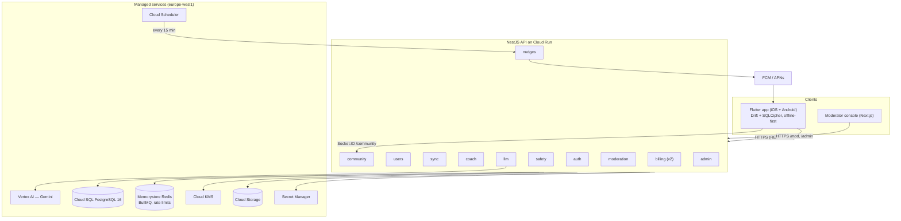
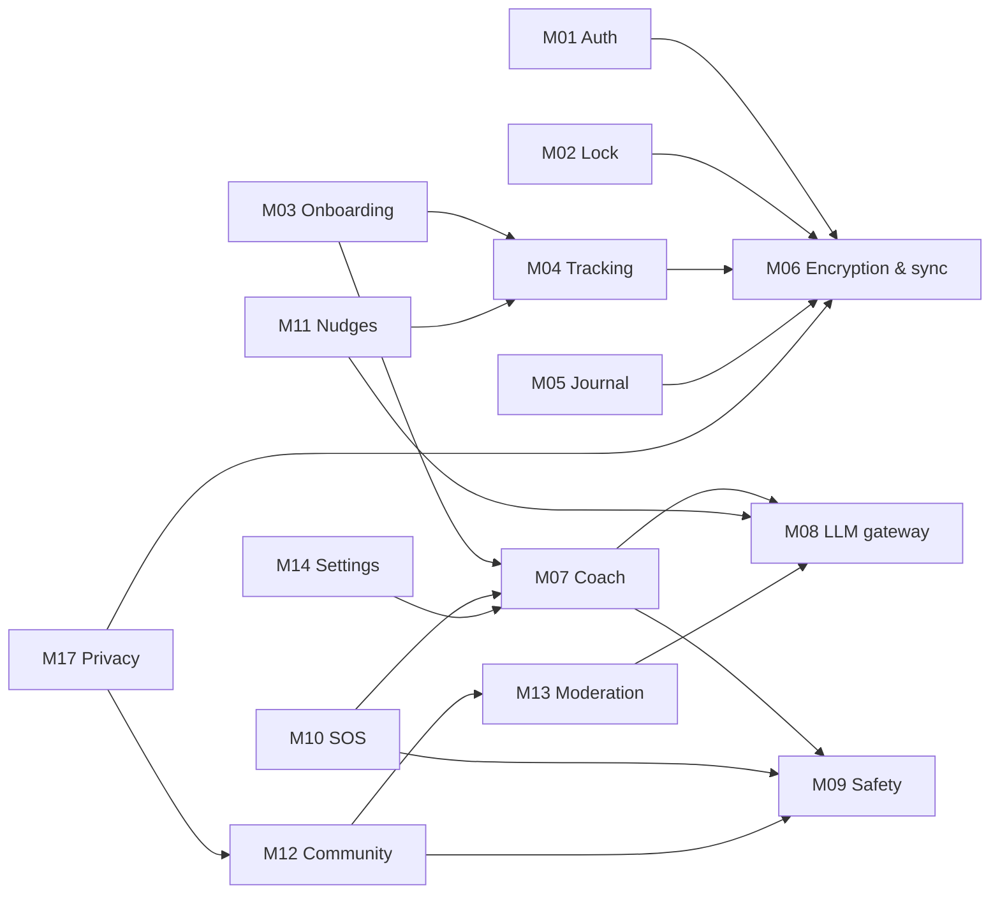
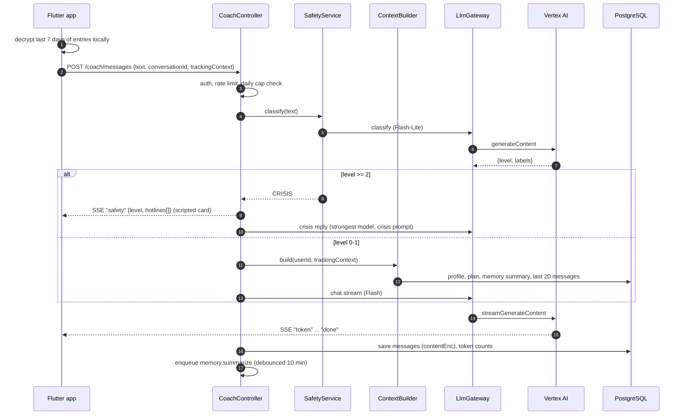

# 01 — Architecture

TurnWell is one Flutter app + one NestJS modular monolith on Cloud Run + managed GCP services.
Private data is encrypted on the device; the API stores ciphertext, community data and nudge metadata.

## 1. System diagram

## 2. Module map

| ID | Module | Backend module | Flutter feature | Release |
| --- | --- | --- | --- | --- |
| M01 | Auth & accounts | `auth`, `users` | `auth` | v1 |
| M02 | App lock & disguise | — | `lock` | v1 |
| M03 | Onboarding & plan | `coach` (onboarding service) | `onboarding` | v1 |
| M04 | Tracking | `sync` (metadata) | `tracking` | v1 |
| M05 | Journal | `sync` | `journal` | v1 |
| M06 | Encryption & sync | `sync` | `core/crypto`, `core/db`, `sync` | v1 |
| M07 | AI coach | `coach` | `coach` | v1 |
| M08 | LLM gateway | `llm` | — | v1 |
| M09 | Safety & crisis | `safety` | `safety` | v1 |
| M10 | SOS | `coach` (SOS conversation) | `sos` | v1 |
| M11 | Nudges & notifications | `nudges` | `notifications` | v1 |
| M12 | Community | `community` | `community` | v1 (posts) / v2 (circles, DMs) |
| M13 | Moderation & console | `moderation`, `admin` | `apps/admin` | v1 basic |
| M14 | Settings & personalization | `users` | `settings` | v1 |
| M15 | Subscriptions | `billing` | `paywall` | v2 |
| M16 | Localization | — | `core/l10n` | v1 |
| M17 | Privacy: export, delete, panic wipe | `users` | `privacy` | v1 |
| M18 | Infrastructure & DevOps | — | — | v1 |

## 3. Module dependencies

## 4. Request lifecycle — coach message (the most important path)

## 5. Environments

| Env | API | DB | AI | Notes |
| --- | --- | --- | --- | --- |
| local | `localhost:3000` | Docker Postgres 16 + Redis | `LLM_PROVIDER=fake` (deterministic stub) or Vertex dev project | Seed script with hotlines + test users |
| staging | Cloud Run `turnwell-api-staging` | Cloud SQL small | Vertex (staging project) | TestFlight / Play internal builds |
| prod | Cloud Run `turnwell-api` (min 1 instance) | Cloud SQL HA later | Vertex (prod project) | |

## 6. Key cross-cutting services (backend `common/`)

| Service | Purpose |
| --- | --- |
| `CryptoService` | KMS envelope encryption: `encrypt(userId, plaintext)`, `decrypt(userId, ciphertext)`; DEK cache 5 min |
| `RedactingLogger` | pino with redaction paths |
| `RateLimitGuard` | Redis-backed throttler with per-route overrides |
| `ClockService` | User-timezone day math (`todayFor(userId)`) |
| `IdService` | UUIDv7 |
| `AuditService` | Writes `system.audit_logs` |
| `FeatureFlags` | Config-table flags (`community.enabled`, `coach.model`) |
