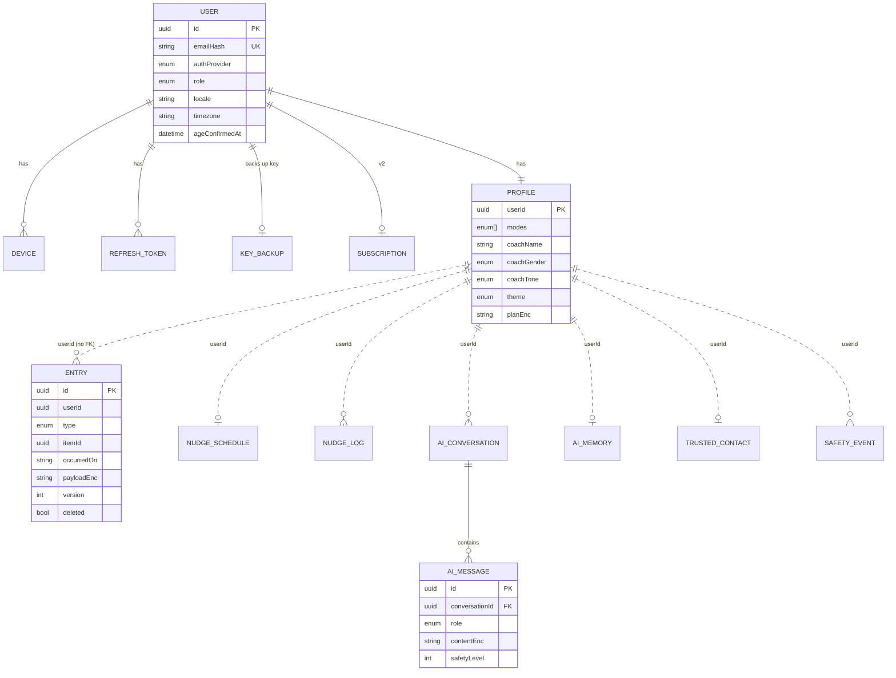
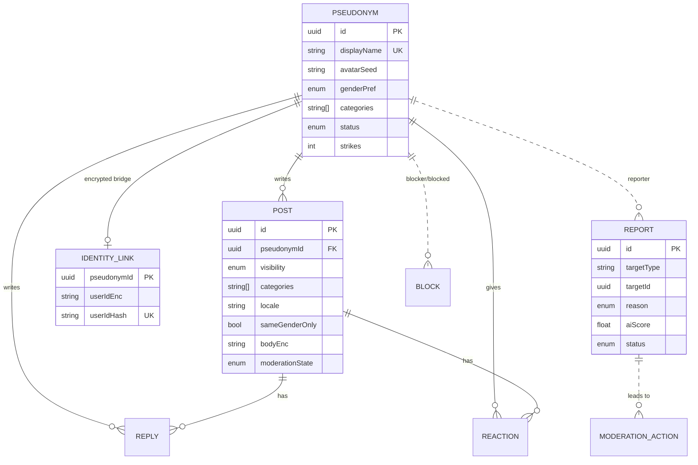

# 03 — Data model

**Source of truth:** [`schema/schema.prisma`](schema/schema.prisma). This file explains it.

PostgreSQL 16 holds four schemas so that a bug in one area cannot expose another:

| Schema | Holds | Readable by humans? |
| --- | --- | --- |
| `account` | Login, devices, tokens, key backup, subscription | Admin only, audited |
| `private` | Profile, encrypted entries, AI conversations, nudge metadata, trusted contact, safety events | Never (no admin UI) |
| `community` | Pseudonyms, posts, replies, reactions, reports, moderation | Moderators (reported items only) |
| `system` | Hotlines, audit log | Admin |

## 1. Data classes and encryption

| Class | Example fields | Encryption | Key owner |
| --- | --- | --- | --- |
| A — Private journal | `Entry.payloadEnc` (type `JOURNAL`) | E2E, XChaCha20-Poly1305 on device | User master key (device) |
| B — Tracking | `Entry.payloadEnc` (types `CHECK_IN`, `SLIP`, `URGE`, `ITEM`) | E2E | User master key |
| C — AI | `AiMessage.contentEnc`, `AiMemory.summaryEnc`, `Profile.profileEnc/planEnc` | Envelope encryption, Cloud KMS | Server, per-user DEK |
| D — Community | `Post.bodyEnc`, `Reply.bodyEnc` | Envelope encryption, Cloud KMS | Server |
| E — Account | `User.emailEnc`, `TrustedContact.*Enc` | Envelope encryption, Cloud KMS | Server |
| Link | `IdentityLink.userIdEnc` | Separate KMS key ring `identity-link` | Server, audited |

Plaintext metadata intentionally kept (needed for nudges, counts, sorting): `Entry.type`, `Entry.itemId`,
`Entry.occurredOn`, `NudgeSchedule.*`, `Post.categories/locale/visibility`.

## 2. Account + private schemas



Private tables reference `userId` without a foreign key on purpose: the `private` schema can be moved to another
database later and deletion is handled by the `DeleteAccountJob` (M17), not by cascades.

## 3. Community schema



## 4. Encrypted payload shapes (inside `Entry.payloadEnc`, after decryption on device)

```jsonc
// type = ITEM
{ "label": "Pornography", "category": "SEXUAL", "mode": "SINS", "goal": "QUIT",
  "targetPerWeek": null, "motivation": "Feel clean before my marriage", "replacements": [], "archived": false }

// type = CHECK_IN   (one per item per day)
{ "status": "CLEAN" /* CLEAN | SLIPPED | PARTIAL */, "mood": 4, "note": "Hard evening but ok" }

// type = SLIP
{ "time": "23:40", "place": "bedroom", "moodBefore": 2, "triggers": ["alone", "stress"],
  "triggerText": "argument with brother", "with": "alone", "note": "" }

// type = URGE   (from SOS)
{ "startedAt": "2026-11-20T22:10:00Z", "tool": "RIDE_URGE", "durationSec": 600,
  "intensityBefore": 8, "intensityAfter": 3, "outcome": "PASSED" /* PASSED | SLIPPED | UNKNOWN */ }

// type = JOURNAL
{ "text": "...", "voiceTranscript": true, "mood": 3, "tags": ["family"] }
```

## 5. Module-specific columns (added during module specification)

| Table | Columns | Module |
| --- | --- | --- |
| `account.users` | `totpSecretEnc` (staff TOTP), `legalHold` | M13, M17 |
| `account.notify_tokens` | `token` → `userId` (community reply pushes without identity link) | M12 |
| `private.profiles` | `onboardingStep` | M03 |
| `private.nudge_schedules` | `templateKey/Title/Body`, `checkInReminder`, `lastMilestone`, `kinds` | M11, M14 |
| `private.nudge_logs` | `messageId`, kind `SAFETY_FOLLOW_UP` | M11 |
| `community.pseudonyms` | `notifyToken`, `lastRenamedAt` | M12 |
| `community.posts` | GIN index on `categories` | M12 |
| `community.reports` | `priority`, `claimedUntil` | M13 |
| `community.moderation_actions` | `undoneAt` | M13 |
| `system.escalations` | Un-mask requests with two approvers | M13 |
| `system.llm_usage_daily` | Daily token + cost accounting per task/model | M08 |

## 6. Retention

| Data | Kept | Deleted by |
| --- | --- | --- |
| `AiMessage` | 90 days | `ai.cleanup` daily job |
| `AiMemory`, `Profile` | Until account deletion | `DeleteAccountJob` |
| `Entry` | Until user deletes / account deletion | Sync tombstones, `DeleteAccountJob` |
| Soft-deleted `User` | 30 days | `account.hardDelete` daily job |
| `SafetyEvent` | 1 year (no content) | `safety.cleanup` |
| `Post`/`Reply` of deleted account | Anonymised immediately (body replaced by "[deleted]") | `DeleteAccountJob` |
| `ModerationAction`, `AuditLog` | 3 years | manual |

## 7. Local (device) database — Drift + SQLCipher

| Table | Mirrors | Notes |
| --- | --- | --- |
| `local_entries` | `Entry` (decrypted columns + `syncState`) | Decrypted inside the SQLCipher DB; re-encrypted per record for upload |
| `local_items` | `ITEM` entries, denormalised | For fast UI |
| `outbox` | Pending sync ops | Retried with backoff |
| `kv` | Settings, last sync cursor | |

SQLCipher key = HKDF(masterKey, "turnwell-localdb-v1"). See M06.
