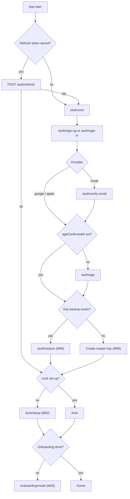
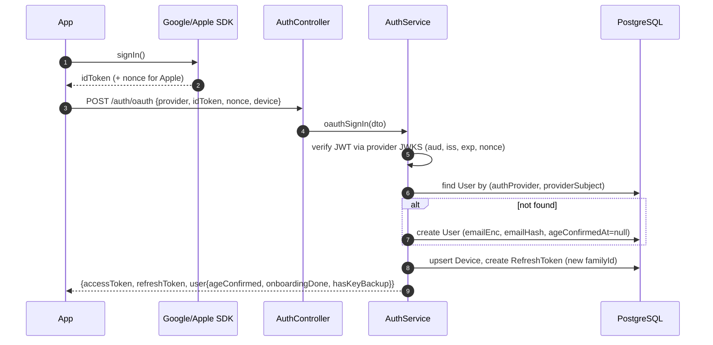
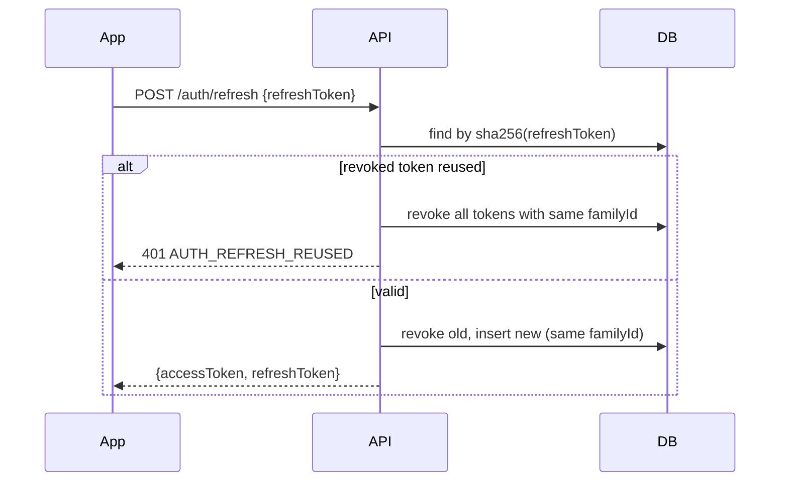
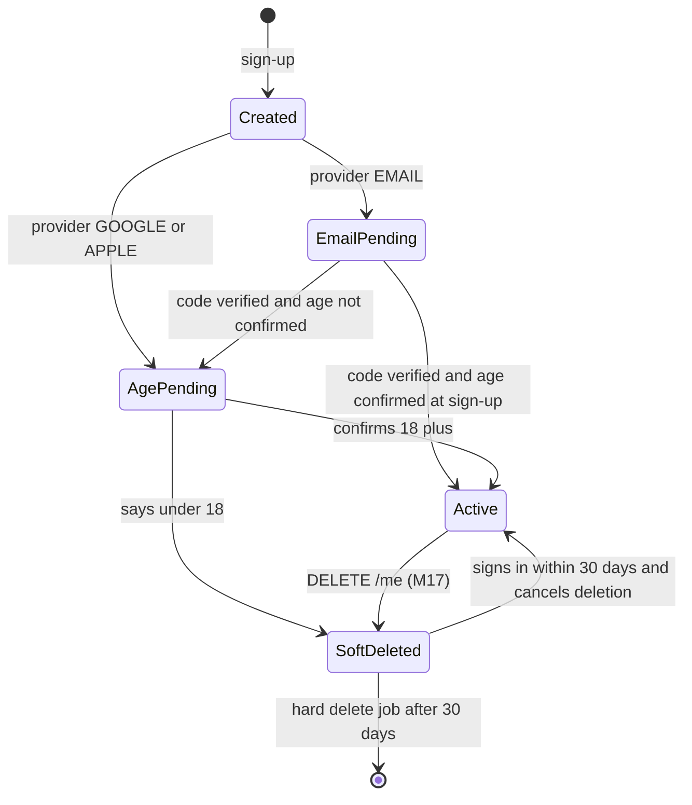

# M01 — Auth & accounts

## 1. Header

| Field | Value |
| --- | --- |
| ID | M01 |
| Name | Auth & accounts |
| Release | v1 |
| Features | F-01 (sign-up + 18+ gate) |
| Backend | `apps/api/src/modules/auth`, `apps/api/src/modules/users` |
| Flutter | `lib/features/auth` |
| Depends on | M06 (master key creation after first sign-up), M16 (locale), M18 (Secret Manager, KMS) |
| Used by | Every authenticated module |

## 2. Purpose

Let a person create an account with email + password, Google or Apple, confirm they are 18+, and obtain
short-lived access tokens. The account identity (`account.users`) is the only place that knows who the person is;
it is never exposed to the community (M12) or to the AI (M08). Email is stored encrypted (`emailEnc`) with a
keyed hash (`emailHash`) for lookup.

## 3. User stories & acceptance criteria

**US-01.1 Sign up with email**
- Given I am on `/auth/sign-up` and enter a valid email, a password of ≥ 10 chars and tick "I am 18 or older"
- When I tap "Create account"
- Then an account is created (`authProvider = EMAIL`, `ageConfirmedAt = now`), a 6-digit code is emailed, and I land on `/auth/verify-email`.

**US-01.2 Verify email**
- Given I received a 6-digit code (valid 15 min, max 5 attempts)
- When I enter it
- Then `emailVerifiedAt` is set and I continue to `/lock/setup`.
- And after 5 wrong attempts the code is invalidated (`AUTH_CODE_LOCKED`) and I can request a new one after 60 s.

**US-01.3 Sign in with Google / Apple**
- Given I tap "Continue with Google" (or Apple)
- When the provider returns an ID token
- Then the API verifies it (audience, issuer, signature, expiry), finds or creates the user by `(authProvider, providerSubject)`, and returns tokens.
- And if the user is new, the 18+ confirmation screen is shown before any other screen (`AGE_NOT_CONFIRMED` on every other endpoint until confirmed).

**US-01.4 18+ gate**
- Given a user without `ageConfirmedAt`
- When they call any endpoint except `/auth/*`, `/me/age-confirmation`, `DELETE /me`
- Then the API returns `403 AGE_NOT_CONFIRMED`.
- Given the user taps "I am under 18" → account is soft-deleted immediately and a kind screen explains the app is for adults.

**US-01.5 Session refresh**
- Given my access token expired
- When the Dio interceptor calls `/auth/refresh` with my refresh token
- Then I get a new pair; the old refresh token is revoked.
- And if a revoked refresh token is reused, the whole `familyId` is revoked and I must sign in again (token theft protection).

**US-01.6 Sign in on a new device**
- Given I sign in on a new phone
- When tokens are issued
- Then the app checks `GET /me/key-backup`; if a backup exists it routes to `/auth/restore` (M06 passphrase restore); otherwise it creates a new master key.

**US-01.7 Sign out**
- When I tap Sign out in Me → Settings
- Then the refresh token family is revoked, the push token is detached from the device, local DB is closed (not deleted) and I return to `/welcome`.

**US-01.8 Password reset**
- Given I forgot my password
- When I request a reset
- Then a 6-digit code is emailed; the response is identical whether the email exists or not (no account enumeration).

## 4. Screens

| Route | Screen | Notes |
| --- | --- | --- |
| `/welcome` | Privacy promise | 3 points, "Get started", "I have an account" |
| `/auth/sign-up` | Sign up | Email, password, 18+ checkbox, Google, Apple |
| `/auth/sign-in` | Sign in | Email/password, Google, Apple, "Forgot password" |
| `/auth/verify-email` | 6-digit code | Auto-submit at 6 digits, resend after 60 s |
| `/auth/age` | Age confirmation | Only for social sign-ups without `ageConfirmedAt` |
| `/auth/reset` | Password reset | Email → code → new password |
| `/auth/restore` | Key restore | Owned by M06, entered from here |

### `/welcome`

```
┌──────────────────────────────────────┐
│          (TurnWell sunrise mark)      │
│                                      │
│   A private place to turn well.      │  ← title
│ ╭──────────────────────────────────╮ │
│ │ 🔒  Only you can read your journal│ │  ← 3 GlassCards, icons are line icons
│ ╰──────────────────────────────────╯ │
│ ╭──────────────────────────────────╮ │
│ │ ◎  The community never knows who │ │
│ │    you are                       │ │
│ ╰──────────────────────────────────╯ │
│ ╭──────────────────────────────────╮ │
│ │ ✦  No ads. Your data is never    │ │
│ │    sold.                         │ │
│ ╰──────────────────────────────────╯ │
│                                      │
│  [        Get started         ]      │  ← GlassButton primary
│        I have an account             │  ← tertiary
└──────────────────────────────────────┘
```
RTL: icons move to the right edge of each card; text right-aligned.

### `/auth/sign-up`

```
┌──────────────────────────────────────┐
│ ←  Create your account               │
│ ╭──────────────────────────────────╮ │
│ │ Email                            │ │  ← GlassInput
│ │ [ you@example.com             ]  │ │
│ │ Password (10+ characters)        │ │
│ │ [ ••••••••••            (👁) ]  │ │
│ │ ☐ I am 18 or older               │ │  ← required, links to Terms
│ ╰──────────────────────────────────╯ │
│  [       Create account        ]     │  ← disabled until valid
│  ───────────── or ─────────────      │
│  [  Continue with Apple   ]          │  ← iOS: Apple first (App Store rule)
│  [  Continue with Google  ]          │
│                                      │
│  Your email is never shown to anyone.│  ← caption
└──────────────────────────────────────┘
```

### `/auth/verify-email`

```
┌──────────────────────────────────────┐
│ ←  Check your email                  │
│  We sent a 6-digit code to y•••@e••  │  ← masked
│ ╭───╮╭───╮╭───╮╭───╮╭───╮╭───╮       │
│ │ 4 ││ 8 ││ 1 ││   ││   ││   │       │  ← autofill (oneTimeCode)
│ ╰───╯╰───╯╰───╯╰───╯╰───╯╰───╯       │
│  Resend code in 0:42                 │
└──────────────────────────────────────┘
```
Digits stay LTR even in Arabic (`Directionality(textDirection: TextDirection.ltr)` around the code row).

### `/auth/age`

```
┌──────────────────────────────────────┐
│  One quick check                     │
│ ╭──────────────────────────────────╮ │
│ │ TurnWell is for adults (18+).    │ │
│ │ It talks openly about sensitive  │ │
│ │ topics.                          │ │
│ ╰──────────────────────────────────╯ │
│  [     I am 18 or older      ]       │
│        I am under 18                 │  ← tertiary → soft-delete + info
└──────────────────────────────────────┘
```

## 5. Flows

### Sign-up and first launch routing



### Social sign-in



### Refresh token rotation



## 6. State machine — account



## 7. Data

Tables (see `03-data-model.md`): `account.users`, `account.refresh_tokens`, `account.devices`, `account.key_backups` (read-only here), `private.profiles` (created empty at first sign-in).

| Field | Rule |
| --- | --- |
| `User.emailEnc` | `CryptoService.encrypt('system', lowercase(trim(email)))` |
| `User.emailHash` | `HMAC-SHA256(EMAIL_HASH_SECRET, lowercase(trim(email)))`, hex |
| `User.passwordHash` | argon2id (`m=19456, t=2, p=1`) via `@node-rs/argon2` |
| `User.locale` | From `Accept-Language` at sign-up, updatable (M14) |
| `User.timezone` | From `X-Timezone`, updated on each `/auth/refresh` if changed |
| `RefreshToken.tokenHash` | `sha256(token)`; token = 32 random bytes base64url |
| Verification codes | Redis only: `auth:code:<purpose>:<emailHash>` → `{codeHash, attempts}`, TTL 15 min |

Local (device): `flutter_secure_storage` keys `tw.refreshToken`, `tw.userId`. Access token kept in memory only.

## 8. API

| Method | Path | Auth | Purpose |
| --- | --- | --- | --- |
| POST | `/auth/sign-up` | none | Email sign-up |
| POST | `/auth/verify-email` | none | Verify 6-digit code |
| POST | `/auth/resend-code` | none | Resend (60 s cooldown) |
| POST | `/auth/sign-in` | none | Email sign-in |
| POST | `/auth/oauth` | none | Google / Apple |
| POST | `/auth/refresh` | none (refresh token) | Rotate tokens |
| POST | `/auth/sign-out` | bearer | Revoke family, detach push token |
| POST | `/auth/password/forgot` | none | Send reset code |
| POST | `/auth/password/reset` | none | Code + new password |
| GET | `/me` | bearer | Account + status flags |
| POST | `/devices/current/push-token` | bearer | Register / refresh FCM token for this device: `{ "deviceId": "…", "platform": "IOS", "pushToken": "…", "appVersion": "1.0.0" }` → `204` (used by M11) |
| POST | `/me/age-confirmation` | bearer | `{confirmed: true}` or `{confirmed: false}` |
| PUT | `/me/device` | bearer | Register/update device + push token |

### POST `/auth/sign-up`

```json
// request
{ "email": "yacine@example.com", "password": "correct-horse-42", "ageConfirmed": true,
  "device": { "id": "0193…", "platform": "ANDROID", "appVersion": "1.0.0" } }
// 201 response
{ "userId": "0193…", "next": "VERIFY_EMAIL" }
```

Errors: `VALIDATION_FAILED`, `AUTH_EMAIL_TAKEN` (409; only returned at sign-up, acceptable trade-off), `AGE_NOT_CONFIRMED` (if `ageConfirmed=false`), `RATE_LIMITED` (5/hour/IP).

### POST `/auth/verify-email`

```json
// request
{ "email": "yacine@example.com", "code": "481920" }
// 200 response
{ "accessToken": "eyJ…", "refreshToken": "q8Z…", "expiresIn": 900,
  "user": { "id": "0193…", "ageConfirmed": true, "onboardingDone": false, "hasKeyBackup": false, "role": "USER" } }
```
Errors: `AUTH_CODE_INVALID` (400, `details.attemptsLeft`), `AUTH_CODE_EXPIRED`, `AUTH_CODE_LOCKED`.

### POST `/auth/oauth`

```json
{ "provider": "APPLE", "idToken": "eyJ…", "nonce": "raw-nonce", "fullNameIgnored": true,
  "device": { "id": "0193…", "platform": "IOS", "appVersion": "1.0.0" } }
```
Response same shape as verify-email. Errors: `AUTH_OAUTH_INVALID`, `AUTH_PROVIDER_MISMATCH` (email already used with another provider → app shows "Sign in with Google instead").
Apple full name is **not stored** (privacy).

### POST `/auth/refresh`

```json
{ "refreshToken": "q8Z…" }
// 200
{ "accessToken": "eyJ…", "refreshToken": "n1P…", "expiresIn": 900 }
```
Errors: `AUTH_INVALID`, `AUTH_REFRESH_REUSED`.

### GET `/me`

```json
{ "id": "0193…", "role": "USER", "locale": "ar", "timezone": "Africa/Algiers",
  "ageConfirmed": true, "emailVerified": true, "onboardingDone": true, "hasKeyBackup": true,
  "deletionScheduledAt": null, "entitlements": { "premium": false, "aiDailyLimit": 15 } }
```
Email is not returned (the app shows the masked email from a separate `GET /me/email-masked` only in settings).

### JWT access token claims

```json
{ "sub": "0193…", "role": "USER", "age": true, "iat": 1762000000, "exp": 1762000900, "iss": "turnwell-api", "aud": "turnwell-app" }
```
Signed with `EdDSA` (Ed25519) key from Secret Manager; `kid` header for rotation.

## 9. Backend design

```ts
// auth.service.ts
signUp(dto: SignUpDto, ctx: RequestCtx): Promise<{ userId: string; next: 'VERIFY_EMAIL' }>;
verifyEmail(dto: VerifyEmailDto, ctx: RequestCtx): Promise<AuthResult>;
resendCode(email: string, purpose: 'VERIFY' | 'RESET'): Promise<void>;
signIn(dto: SignInDto, ctx: RequestCtx): Promise<AuthResult>;
oauthSignIn(dto: OAuthDto, ctx: RequestCtx): Promise<AuthResult>;
refresh(refreshToken: string, ctx: RequestCtx): Promise<TokenPair>;
signOut(userId: string, deviceId: string): Promise<void>;
forgotPassword(email: string): Promise<void>;           // always resolves
resetPassword(dto: ResetPasswordDto): Promise<void>;     // revokes all refresh tokens

// token.service.ts
issuePair(user: User, familyId?: string): Promise<TokenPair>;
verifyAccess(jwt: string): AccessClaims;

// users.service.ts
getMe(userId: string): Promise<MeDto>;
confirmAge(userId: string, confirmed: boolean): Promise<void>;
upsertDevice(userId: string, dto: DeviceDto): Promise<void>;
```

Guards: `JwtAuthGuard` (global, `@Public()` to skip), `AgeConfirmedGuard` (global after JWT, `@AllowWithoutAge()` to skip), `RolesGuard`.
Mail: transactional email provider via `MailService.sendCode(email, code, locale)` (templates in 4 languages; plain text, no app content).
Rate limits: sign-up 5/h/IP, sign-in 10/15 min per emailHash, verify 5 attempts per code, oauth 20/h/IP.
On first successful auth: create empty `Profile` row lazily in M03 (not here) — `onboardingDone = profile?.onboardingDoneAt != null`.

## 10. Flutter design

```
lib/features/auth/
├── data/
│   ├── auth_api.dart              # generated client wrapper
│   ├── auth_repository.dart       # signUp, verify, oauth, refresh, signOut
│   └── token_storage.dart         # secure storage (refresh) + memory (access)
├── domain/
│   ├── auth_state.dart            # freezed: unknown | signedOut | signedIn(MeDto)
│   └── me.dart
└── presentation/
    ├── welcome_screen.dart
    ├── sign_up_screen.dart
    ├── sign_in_screen.dart
    ├── verify_email_screen.dart
    ├── age_screen.dart
    ├── reset_password_screen.dart
    └── providers/
        ├── auth_controller.dart   # @riverpod class AuthController extends _$AuthController
        └── sign_up_form.dart
```

| Provider | Type | Purpose |
| --- | --- | --- |
| `authControllerProvider` | `AsyncNotifier<AuthState>` | Source of truth for router guards |
| `meProvider` | `FutureProvider<Me>` | `/me` cached, invalidated on change |
| `dioProvider` | `Provider<Dio>` | Adds headers, `AuthInterceptor` (refresh on 401 with a single-flight lock) |

Router redirect order (in `core/router`): `auth → age → keys (M06) → lock (M02) → onboarding (M03) → home`.

Packages: `google_sign_in`, `sign_in_with_apple` (with SHA-256 nonce), `flutter_secure_storage`.

## 11. Edge cases

- Apple "Hide my email" relay address: treat as a normal email; never ask for real email.
- User signs up with email then tries Google with the same address → `AUTH_PROVIDER_MISMATCH`; account linking is v2.
- Clock skew on device: rely on server `expiresIn`, not device time, for refresh scheduling.
- Offline at launch with a valid refresh token: allow entry to the app (local data, lock screen) and refresh later; show an offline banner.
- Two concurrent 401s: the interceptor queues requests behind one refresh call.
- Soft-deleted user signs in within 30 days → show "Your account is scheduled for deletion on <date>. Keep it?" (M17).

## 12. Security & privacy

- Never log email, password, codes, tokens; pino redaction covers `email`, `password`, `code`, `*Token`.
- Responses for forgot-password are identical in time and body (constant-time path, dummy hash when not found).
- Passwords checked against a top-100k breached-password list (bundled bloom filter).
- Apple/Google ID tokens verified server-side only; never trust client-provided email.
- `AuditService` records `ADMIN_LOGIN` and role changes; user logins are not audited individually (privacy).
- Email is the only PII and is KMS-encrypted; staff cannot search by email without an audited admin action.

## 13. Analytics events

| Event | Properties |
| --- | --- |
| `auth.sign_up_started` | `provider` |
| `auth.sign_up_completed` | `provider` |
| `auth.email_verified` | — |
| `auth.age_declined` | — |
| `auth.sign_in_completed` | `provider`, `newDevice` |
| `auth.sign_out` | — |

## 14. Tests

- Unit: password policy; argon2 verify; HMAC email hash normalisation; refresh rotation; reuse detection revokes family.
- E2E: sign-up → verify → `/me`; wrong code ×5 → locked; Google token with wrong `aud` → `AUTH_OAUTH_INVALID`; endpoint without age → `AGE_NOT_CONFIRMED`; forgot-password for unknown email returns 200.
- Flutter: router redirects for each `AuthState`; interceptor single-flight refresh; sign-up form validation in RTL; golden tests of welcome + sign-up (Dawn, Night, AR, EN).

## 15. Open questions

- Transactional email provider (Postmark vs SendGrid vs GCP-friendly option) — needs EU data processing.
- Account linking (same email across providers) — v2.
- Do we offer passkeys? Proposed v2.
