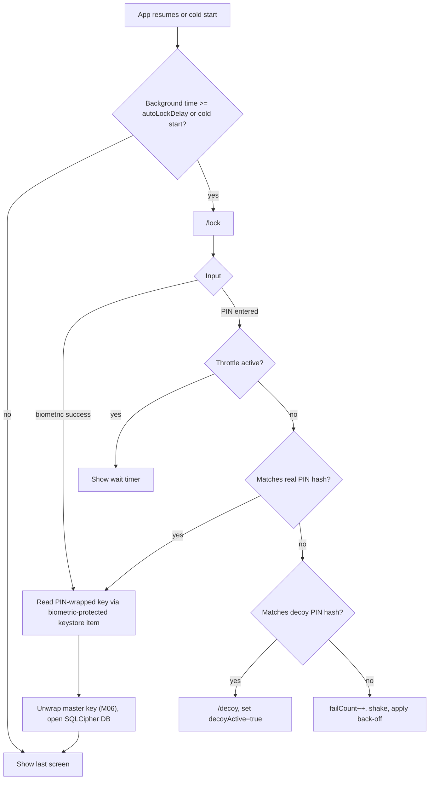
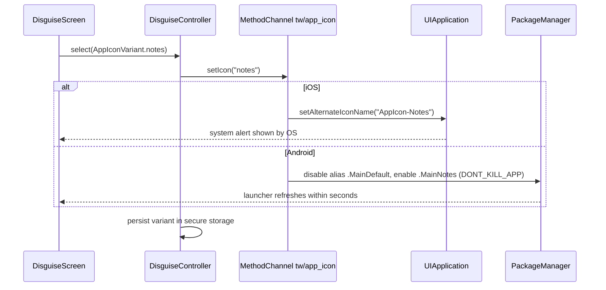
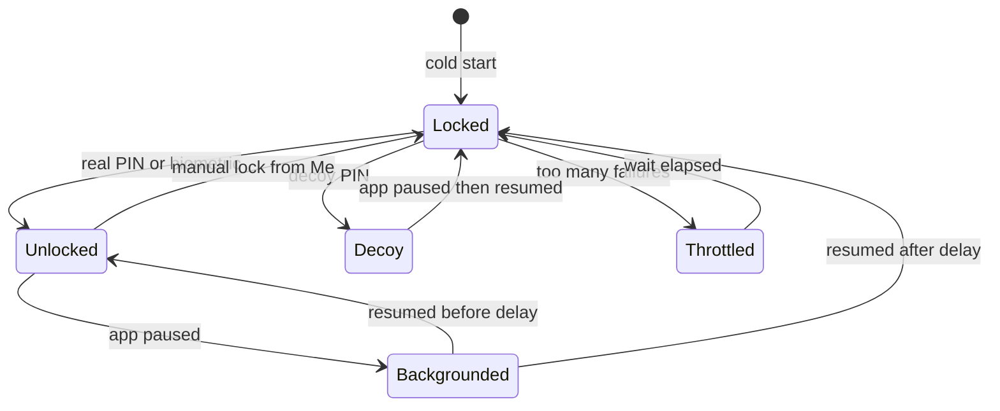

# M02 — App lock & disguise

## 1. Header

| Field | Value |
| --- | --- |
| ID | M02 |
| Name | App lock & disguise |
| Release | v1 |
| Features | F-02 (PIN / biometric, auto-lock), F-50 (alternate icon + name), F-51 (decoy PIN) |
| Backend | None (100% on device) |
| Flutter | `lib/features/lock` |
| Depends on | M06 (master key unwrap is gated behind the lock), M14 (settings screens), M16 (strings) |
| Used by | Router (`LockGuard`), M11 (notification templates live next to disguise settings), M17 (panic wipe gesture) |

## 2. Purpose

Make sure nobody who picks up the phone can see TurnWell's content or even recognise the app. A 6-digit PIN
(plus optional Face ID / fingerprint) is required at launch and after a period in background. The app can show a
neutral icon and name ("Daily Notes", "Calculator", "Weather+"). A second **decoy PIN** opens a harmless to-do list.
No server is involved; nothing about the lock is ever sent to the API.

## 3. User stories & acceptance criteria

**US-02.1 Set up PIN (mandatory)**
- Given I finished sign-up
- When I reach `/lock/setup`
- Then I must enter a 6-digit PIN twice; weak PINs (`000000`, `123456`, all same digit, straight sequences) are rejected with a friendly hint.
- And I am offered biometric unlock if the device supports it (can skip).

**US-02.2 Unlock**
- Given the app is locked
- When I enter the correct PIN or pass biometric
- Then the master key is unwrapped (M06) and I return to the screen I was on.

**US-02.3 Auto-lock**
- Given auto-lock is "1 minute" (default; options: immediately, 1, 5, 15 min)
- When the app has been in background ≥ that duration
- Then on resume the lock screen is shown before any content is drawn.
- And the app switcher snapshot never shows content (privacy overlay on `inactive`).

**US-02.4 Wrong PIN back-off**
- Given I enter wrong PINs
- Then after 5 failures I wait 30 s, after 8 → 5 min, after 10 → 30 min (delays persist across restarts).
- And the screen never says how many attempts remain before a wipe (there is no auto-wipe in v1).

**US-02.5 Forgot PIN**
- Given I forgot my PIN
- When I tap "Forgot PIN"
- Then I must sign in again (password / Google / Apple) and, if the device key is not usable, restore with my recovery passphrase (M06). Then I set a new PIN.

**US-02.6 Alternate icon**
- Given I open Me → Privacy → Disguise
- When I choose "Daily Notes"
- Then the home-screen icon and label change to the neutral one (iOS shows the system confirmation alert; Android swaps the launcher alias).

**US-02.7 Decoy PIN**
- Given I set a decoy PIN (must differ from the real PIN)
- When someone enters the decoy PIN on the lock screen
- Then a fully working, local-only to-do list appears (`/decoy`) with no TurnWell branding, no nav bar, no network calls, and no way to reach real content except going to background and unlocking with the real PIN.
- And all TurnWell notifications are suppressed while the decoy is open.

## 4. Screens

| Route | Screen |
| --- | --- |
| `/lock/setup` | Create PIN (2 steps) + biometric offer |
| `/lock` | Unlock |
| `/decoy` | Decoy to-do list |
| `/me/privacy/disguise` | Icon + app name picker, decoy PIN setup |
| `/me/privacy/lock` | Change PIN, auto-lock delay, biometric toggle |

### `/lock` (unlock)

```
┌──────────────────────────────────────┐
│                                      │
│               ( ◐ )                  │  ← neutral mark; if disguised, the disguise icon
│          Enter your PIN              │
│           ●  ●  ●  ○  ○  ○           │
│                                      │
│        ╭───╮  ╭───╮  ╭───╮           │
│        │ 1 │  │ 2 │  │ 3 │           │  ← glass keypad, 72×72 keys
│        ╰───╯  ╰───╯  ╰───╯           │
│        ╭───╮  ╭───╮  ╭───╮           │
│        │ 4 │  │ 5 │  │ 6 │           │
│        ╰───╯  ╰───╯  ╰───╯           │
│        ╭───╮  ╭───╮  ╭───╮           │
│        │ 7 │  │ 8 │  │ 9 │           │
│        ╰───╯  ╰───╯  ╰───╯           │
│        ╭───╮  ╭───╮  ╭───╮           │
│        │ ◉ │  │ 0 │  │ ⌫ │           │  ← ◉ = biometric
│        ╰───╯  ╰───╯  ╰───╯           │
│            Forgot PIN?               │
└──────────────────────────────────────┘
```
- Keypad layout is **never mirrored** in RTL (digit order stays 1-2-3). Labels use Western digits.
- When disguise is active, the lock screen title reads "Enter passcode" and uses no TurnWell branding.
- Wrong PIN: dots shake 300 ms + light haptic; no red.

### `/lock/setup`

```
┌──────────────────────────────────────┐
│  Protect your space                  │
│  Choose a 6-digit PIN. Only you      │
│  will be able to open TurnWell.      │
│           ○  ○  ○  ○  ○  ○           │
│       (keypad as /lock)              │
│                                      │
│  Step 1 of 2                         │
└──────────────────────────────────────┘
then
┌──────────────────────────────────────┐
│ ╭──────────────────────────────────╮ │
│ │ Use Face ID to unlock?           │ │
│ │ [ Turn on ]        Not now       │ │
│ ╰──────────────────────────────────╯ │
└──────────────────────────────────────┘
```

### `/me/privacy/disguise`

```
┌──────────────────────────────────────┐
│ ←  Disguise                          │
│ ╭──────────────────────────────────╮ │
│ │ App icon                         │ │
│ │ (TW)  (📝)   (🧮)   (☁)          │ │  ← 4 GlassChips with icon previews
│ │ Turn  Daily  Calcu- Weather+     │ │
│ │ Well  Notes  lator               │ │
│ ╰──────────────────────────────────╯ │
│ ╭──────────────────────────────────╮ │
│ │ Decoy PIN                  [Set] │ │
│ │ Opens a simple to-do list if     │ │
│ │ someone asks you to unlock.      │ │
│ ╰──────────────────────────────────╯ │
│ ╭──────────────────────────────────╮ │
│ │ Notification text          [ › ] │ │  ← goes to M11 template editor
│ ╰──────────────────────────────────╯ │
└──────────────────────────────────────┘
```

### `/decoy`

```
┌──────────────────────────────────────┐
│  To-do                         ( + ) │  ← plain Material, light theme, NOT glass
│  ☐ Buy milk                          │
│  ☐ Call the bank                     │
│  ☑ Pay electricity                   │
│                                      │
└──────────────────────────────────────┘
```
Pre-seeded with 3 harmless items in the user's language. Edits are stored in a separate unencrypted Hive/SharedPreferences box (never in the real DB).

## 5. Flows

### Unlock decision



### Alternate icon switch



## 6. State machine — lock



## 7. Data

All on device. Nothing is sent to the API.

| Key (flutter_secure_storage) | Value |
| --- | --- |
| `tw.lock.pinHash` | Argon2id(PIN, salt, m=19456, t=2, p=1) base64 + salt |
| `tw.lock.decoyHash` | Same format, optional |
| `tw.lock.wrappedKey.pin` | Master key wrapped with KEK = Argon2id(PIN) — see M06 key hierarchy |
| `tw.lock.wrappedKey.bio` | Master key stored in a **biometric-protected** keystore item (iOS `kSecAccessControlBiometryCurrentSet`, Android `setUserAuthenticationRequired(true)` + BiometricPrompt `CryptoObject`) |
| `tw.lock.failCount`, `tw.lock.lockedUntil` | Throttle state (survives restarts) |
| `tw.lock.autoLockSec` | `0`, `60` (default), `300`, `900` |
| `tw.lock.biometric` | `true`/`false` |
| `tw.disguise.icon` | `default` \| `notes` \| `calculator` \| `weather` |

Decoy to-dos: `SharedPreferences` key `decoy.todos` (JSON list). Intentionally not encrypted, not synced.

## 8. API

N/A — this module makes no network calls. (The router's `LockGuard` runs before any API call that would reveal content.)

## 9. Backend design

N/A.

## 10. Flutter design

```
lib/features/lock/
├── data/
│   ├── lock_store.dart              # secure storage read/write, throttle math
│   ├── pin_hasher.dart              # Argon2id via `cryptography`
│   └── app_icon_channel.dart        # MethodChannel('tw/app_icon')
├── domain/
│   ├── lock_state.dart              # freezed: locked | unlocked | decoy | throttled(until)
│   └── app_icon_variant.dart        # enum default, notes, calculator, weather
└── presentation/
    ├── lock_screen.dart
    ├── lock_setup_screen.dart
    ├── decoy_screen.dart
    ├── disguise_screen.dart
    ├── lock_settings_screen.dart
    ├── widgets/pin_keypad.dart
    ├── widgets/pin_dots.dart
    └── providers/
        ├── lock_controller.dart     # AsyncNotifier<LockState>
        ├── auto_lock_observer.dart  # WidgetsBindingObserver
        └── disguise_controller.dart
```

### Auto-lock observer

```dart
class AutoLockObserver with WidgetsBindingObserver {
  AutoLockObserver(this.ref);
  final Ref ref;
  DateTime? _pausedAt;

  @override
  void didChangeAppLifecycleState(AppLifecycleState state) {
    switch (state) {
      case AppLifecycleState.inactive:
        ref.read(privacyOverlayProvider.notifier).show(); // blur cover for app switcher
      case AppLifecycleState.paused:
        _pausedAt = DateTime.now();
        if (ref.read(lockControllerProvider).value is LockDecoy) {
          ref.read(lockControllerProvider.notifier).lock();
        }
      case AppLifecycleState.resumed:
        final delay = ref.read(autoLockDelayProvider); // Duration
        if (_pausedAt != null && DateTime.now().difference(_pausedAt!) >= delay) {
          ref.read(lockControllerProvider.notifier).lock(); // drops master key from memory (M06)
        }
        ref.read(privacyOverlayProvider.notifier).hide();
      default:
        break;
    }
  }
}
```
Android: also set `FLAG_SECURE` on the activity (blocks screenshots and recents thumbnails). iOS: privacy overlay
widget on `inactive` (iOS cannot block screenshots).

### PIN check (timing-safe, decoy last)

```dart
Future<UnlockResult> submitPin(String pin) async {
  if (await store.isThrottled()) return UnlockResult.throttled(await store.lockedUntil());
  final isReal = await hasher.verify(pin, await store.pinHash());
  final isDecoy = !isReal && await store.hasDecoy() && await hasher.verify(pin, await store.decoyHash());
  if (isReal) { await store.resetFails(); return UnlockResult.real(await keyManager.unwrapWithPin(pin)); }
  if (isDecoy) { await store.resetFails(); return const UnlockResult.decoy(); }
  final fails = await store.incrementFails(); // 5→30s, 8→5min, 10+→30min
  return UnlockResult.wrong(fails);
}
```
Always run both hashes when a decoy exists so timing does not reveal which PIN matched.

### Alternate icons — native setup

- **iOS**: add `AppIcon-Notes`, `AppIcon-Calculator`, `AppIcon-Weather` to `Info.plist` under
  `CFBundleIcons > CFBundleAlternateIcons` (and `CFBundleIcons~ipad`). Call `UIApplication.shared.setAlternateIconName`.
  The home-screen **label** cannot change on iOS; only the icon. Document this in the UI ("Icon only on iPhone").
- **Android**: in `AndroidManifest.xml`, one `<activity-alias>` per variant targeting `MainActivity`, each with its
  own `android:icon` and `android:label` ("Daily Notes", …). Exactly one alias enabled at a time via
  `PackageManager.setComponentEnabledSetting(..., DONT_KILL_APP)`.

| Provider | Purpose |
| --- | --- |
| `lockControllerProvider` | Lock state; exposes `lock()`, `submitPin()`, `unlockWithBiometric()` |
| `autoLockDelayProvider` | Reads `tw.lock.autoLockSec` |
| `privacyOverlayProvider` | Bool, shows full-screen blur cover |
| `disguiseControllerProvider` | Current icon variant, `select()` |
| `decoyTodosProvider` | Decoy list (SharedPreferences) |

## 11. Edge cases

- Biometrics changed on the device (new fingerprint): biometric keystore item is invalidated → fall back to PIN and re-enrol.
- User disables device biometrics: toggle auto-off, PIN still works.
- App killed while throttled: `lockedUntil` persisted, enforced on restart.
- Push notification tapped while locked: open `/lock` first, then deep-link target after unlock.
- Decoy PIN equal to real PIN or weak → rejected at setup.
- Android launcher caches icons; show "may take a few seconds to update".
- Accessibility: screen readers announce "Digit 1"… and "4 of 6 entered"; never speak the digits typed.

## 12. Security & privacy

- PIN never leaves the device, never logged, never in analytics.
- Master key exists in memory only while unlocked; `lock()` zeroes the key buffer and closes the SQLCipher DB.
- The decoy screen has no route back into the real app and no network access (Dio interceptor rejects requests when `decoyActive`).
- Notifications are suppressed in decoy mode (local notifications cancelled for 10 min; push handler drops display).
- PIN back-off is enforced locally; an attacker with a jailbroken device could bypass it, but data remains encrypted by a key that requires the PIN-derived KEK or biometric.

## 13. Analytics events

| Event | Properties |
| --- | --- |
| `lock.setup_completed` | `biometric` (bool) |
| `lock.auto_lock_changed` | `seconds` |
| `lock.disguise_changed` | `variant` |
| `lock.decoy_enabled` | — |

Never send unlock success/failure events or anything that reveals decoy use.

## 14. Tests

- Unit: weak-PIN rules; back-off schedule (5/8/10 failures); timing-safe dual verification; decoy never matches real.
- Widget: keypad not mirrored in RTL; dots semantics; throttled timer view; golden tests Dawn/Night.
- Integration: background 61 s → locked; background 30 s → not locked (default 60 s); decoy PIN → `/decoy` with no network calls (mock Dio asserts zero requests).
- Manual QA: alternate icons on iOS 17+/Android 10+; FLAG_SECURE blocks screenshots.

## 15. Open questions

- Should we offer an alphanumeric passphrase instead of 6 digits for advanced users? Proposed v2.
- Optional auto-wipe after N failures? Excluded from v1 (risk of accidental data loss).
- Android 13+ themed icons for disguise variants — provide monochrome layers.
