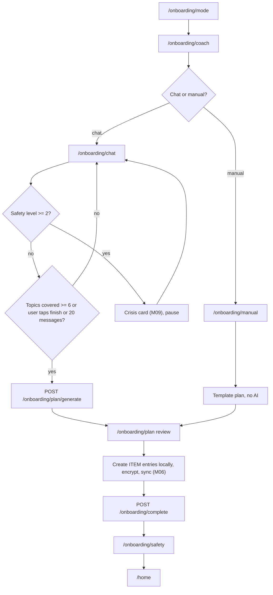
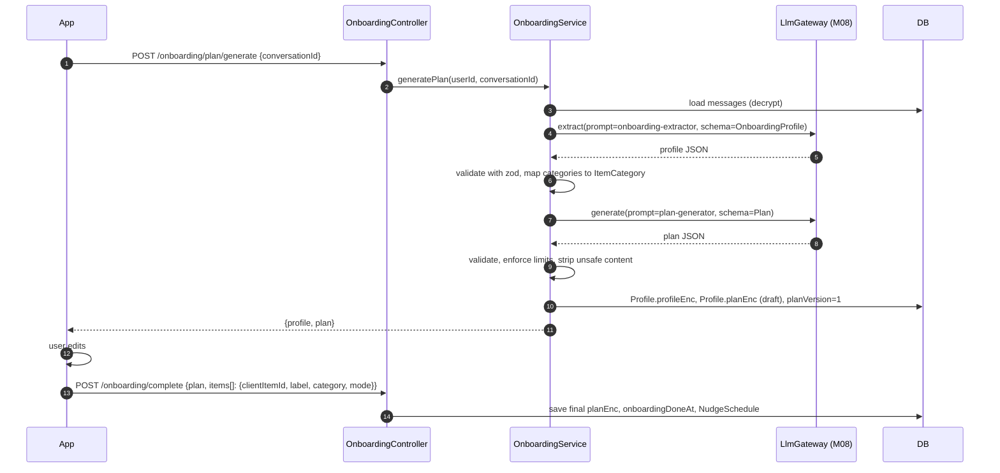
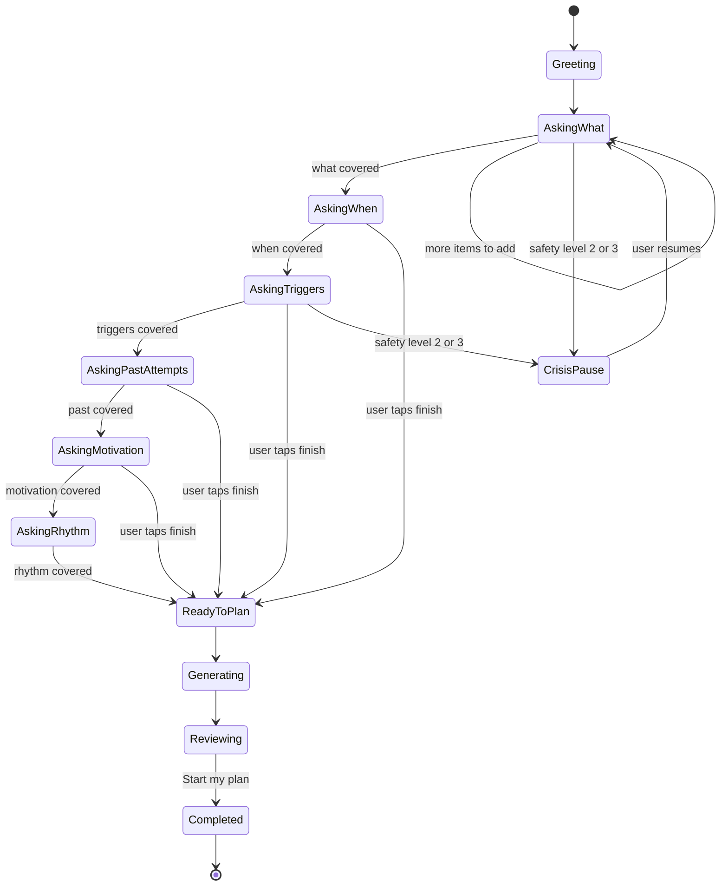

# M03 — Onboarding & personal plan

## 1. Header

| Field | Value |
| --- | --- |
| ID | M03 |
| Name | Onboarding & personal plan |
| Release | v1 |
| Features | F-04 (mode choice), F-05 (coach setup), F-06 (onboarding conversation), F-22 (personal plan) |
| Backend | `apps/api/src/modules/coach` → `OnboardingService`, `PlanService` |
| Flutter | `lib/features/onboarding` |
| Depends on | M01 (auth), M06 (creating encrypted ITEM entries), M07 (chat UI + streaming), M08 (LLM), M09 (safety on every message), M11 (nudge schedule from plan), M16 (locale) |
| Used by | M04 (items), M07 (plan + profile in context), M11 (check-in time) |

## 2. Purpose

Turn a first-time user into someone with a concrete, personal plan in under 10 minutes. The user picks what affects
them more (sins, bad habits, or both), sets up their coach (gender, voice, name), then has a short guided
conversation. The AI extracts a structured profile and generates a plan the user can edit before accepting.
Accepted items become encrypted tracked items (M04); the plan is stored KMS-encrypted for the coach (M07).

## 3. User stories & acceptance criteria

**US-03.1 Mode choice**
- Given I am new and unlocked
- When I see `/onboarding/mode`
- Then I can pick "Sins", "Bad habits" or "Both"; picking Sins shows the notice "Sins mode is guided by Islamic practices. You can switch anytime."
- And my choice is saved to `Profile.modes`.

**US-03.2 Coach setup**
- Given I chose a mode
- When I'm on `/onboarding/coach`
- Then I choose a coach gender (Male / Female), a voice preview (2 voices per gender per language; preview plays a 3 s sample), and a name (prefilled suggestion per language and gender, editable, 2–20 chars, letters/spaces only).
- And names that impersonate religious or medical authority ("Sheikh", "Dr", "Imam", "Therapist") are rejected with a soft message.

**US-03.3 Onboarding conversation**
- Given my coach is set up
- When I open `/onboarding/chat`
- Then the coach greets me by its name, explains privacy in one sentence, and asks open questions covering 6 topics: *what to change, when it happens, triggers, past attempts, motivation, daily rhythm*.
- And a progress indicator shows topics covered (●●●○○○).
- And I can answer by typing or by on-device dictation.
- And I can tap "That's enough, make my plan" after at least the first 2 topics are covered.
- And the conversation ends automatically after all 6 topics or 20 user messages.

**US-03.4 Safety during onboarding**
- Given I write something that the safety classifier rates level ≥ 2
- Then the crisis card (M09) is shown immediately and onboarding pauses; I can resume afterwards.

**US-03.5 Plan review**
- Given the conversation ended
- When the plan is generated (≤ 15 s, skeleton loader shown)
- Then I see: tracked items (label, mode, goal), risky times, if-then rules, a daily routine (3–6 actions), and a check-in time.
- And I can edit, delete, or add any element; at least 1 tracked item is required.
- When I tap "Start my plan"
- Then items are created as encrypted `ITEM` entries (M06), the plan is saved, the nudge schedule is created (M11), `Profile.onboardingDoneAt` is set, and I continue to `/onboarding/safety`.

**US-03.6 Skip path**
- Given I don't want to chat
- When I tap "Set up manually"
- Then I can pick items from the taxonomy list, set goals and a check-in time; a default plan is generated from templates (no AI call).

**US-03.7 Resume**
- Given I closed the app mid-onboarding
- When I come back
- Then I resume at the same step with the conversation history.

## 4. Screens

| Route | Screen |
| --- | --- |
| `/onboarding/mode` | Mode choice |
| `/onboarding/coach` | Coach setup |
| `/onboarding/chat` | Onboarding conversation |
| `/onboarding/manual` | Manual item picker (skip path) |
| `/onboarding/plan` | Plan review / edit |
| `/onboarding/safety` | Trusted contact (M09) + recovery passphrase (M06) |

### `/onboarding/mode`

```
┌──────────────────────────────────────┐
│  What would you like to work on?     │
│ ╭──────────────────────────────────╮ │
│ │ ☾  Sins                          │ │  ← selectable GlassCard
│ │    Come back to Allah, step by   │ │
│ │    step. Islamic-guided.         │ │
│ ╰──────────────────────────────────╯ │
│ ╭──────────────────────────────────╮ │
│ │ ↻  Bad habits                    │ │
│ │    Change habits that hold you   │ │
│ │    back.                         │ │
│ ╰──────────────────────────────────╯ │
│ ╭──────────────────────────────────╮ │
│ │ ✦  Both                          │ │
│ ╰──────────────────────────────────╯ │
│  [          Continue          ]      │
│  Step 1 of 4                         │
└──────────────────────────────────────┘
```

### `/onboarding/coach`

```
┌──────────────────────────────────────┐
│  Meet your coach                     │
│ ╭──────────────────────────────────╮ │
│ │   (avatar orb, accent glow)      │ │
│ │ Coach   ( Female )( Male )       │ │  ← GlassChips
│ │ Voice   ( Warm ▶ )( Calm ▶ )     │ │  ← ▶ plays preview (cloud TTS sample, bundled)
│ │ Name    [ Noor              ]    │ │
│ ╰──────────────────────────────────╯ │
│  Your coach is an AI. It is not a    │  ← caption, required disclaimer
│  therapist or a religious scholar.   │
│  [          Continue          ]      │
└──────────────────────────────────────┘
```

Default name suggestions:

| Locale | Female | Male |
| --- | --- | --- |
| en | Noor, Maya | Sam, Adam |
| ar | نور, سلمى | آدم, يوسف |
| fr | Noor, Léa | Adam, Sami |
| es | Noor, Lucía | Adam, Leo |

### `/onboarding/chat`

```
┌──────────────────────────────────────┐
│ ←  Noor              ●●●○○○  3 of 6   │  ← topic progress
│                                      │
│ (N)╭──────────────────────────╮      │
│    │ Hi, I'm Noor. Everything │      │  ← CoachBubble (glass)
│    │ you share stays private. │      │
│    │ What would you like to   │      │
│    │ change first?            │      │
│    ╰──────────────────────────╯      │
│      ╭──────────────────────────╮    │
│      │ I watch porn late at     │    │  ← UserBubble (accent 22%)
│      │ night and I hate it      │    │
│      ╰──────────────────────────╯    │
│ (N)╭──────────────────────────╮      │
│    │ Thank you for trusting me│      │
│    │ with that. When does it  │      │
│    │ usually happen?          │      │
│    ╰──────────────────────────╯      │
│  ( Late at night )( When stressed )  │  ← quick-reply chips (AI-suggested)
│ ╭──────────────────────────────╮ 🎤 ➤│
│ │ Type here…                   │     │
│ ╰──────────────────────────────╯     │
│     That's enough, make my plan      │  ← visible after topic 2
└──────────────────────────────────────┘
```
RTL: bubbles swap sides; progress dots fill right-to-left.

### `/onboarding/plan`

```
┌──────────────────────────────────────┐
│  Your plan                     Edit  │
│ ╭──────────────────────────────────╮ │
│ │ What you're working on           │ │
│ │ ☾ Pornography — quit        [✎]  │ │
│ │ ↻ Smoking — reduce to 3/wk  [✎]  │ │
│ │ + Add something                  │ │
│ ╰──────────────────────────────────╯ │
│ ╭──────────────────────────────────╮ │
│ │ Hardest times                    │ │
│ │ ◔ 23:00–01:00, weeknights        │ │
│ ╰──────────────────────────────────╯ │
│ ╭──────────────────────────────────╮ │
│ │ If… then…                        │ │
│ │ If an urge comes at night, open  │ │
│ │ SOS and leave the room.          │ │
│ ╰──────────────────────────────────╯ │
│ ╭──────────────────────────────────╮ │
│ │ Daily routine                    │ │
│ │ ☐ Phone out of bedroom at 22:30  │ │
│ │ ☐ Isha + 5 min dhikr             │ │
│ │ ☐ 10 min walk after work         │ │
│ ╰──────────────────────────────────╯ │
│ ╭──────────────────────────────────╮ │
│ │ Daily check-in        [ 21:30 ]  │ │
│ ╰──────────────────────────────────╯ │
│  [        Start my plan       ]      │
└──────────────────────────────────────┘
```

## 5. Flows

### Onboarding end-to-end



### Plan generation



## 6. State machine — onboarding conversation

The server stores the resume point in the plaintext `Profile.onboardingStep` (`MODE | COACH | CHAT | PLAN | SAFETY | DONE`, no content) and the conversation details (covered topics, message count) in `profileEnc` draft, so onboarding can resume.



Topic coverage is decided by the model: each coach turn returns a JSON control block alongside the text
(see M08 structured output), e.g. `{"covered": ["what","when"], "nextTopic": "triggers", "quickReplies": ["When stressed","Alone at night"]}`.
The backend keeps `covered` monotonic (never removes a topic).

## 7. Data

- `private.profiles`: `modes`, `coachName`, `coachGender`, `coachVoiceId`, `coachTone`, `profileEnc`, `planEnc`, `planVersion`, `onboardingStep`, `onboardingDoneAt`.
- `private.ai_conversations` (`kind = ONBOARDING`) + `private.ai_messages`.
- `private.nudge_schedules`: created on complete (`checkInTime`, `riskyWindows` from plan, `timezone`).
- Device: `ITEM` entries created via `TrackingRepository.createItem()` (M04/M06) with the `clientItemId` used in the plan.

### `OnboardingProfile` (extracted, stored in `profileEnc`)

```json
{
  "version": 1,
  "items": [
    { "label": "Pornography", "category": "SEXUAL", "mode": "SINS",
      "frequency": "4-5 times a week", "riskyTimes": ["23:00-01:00"], "triggers": ["alone in bed", "stress", "phone in bedroom"],
      "pastAttempts": "Tried deleting apps, lasted 2 weeks", "motivation": "Feel clean before my marriage" }
  ],
  "rhythm": { "wake": "07:00", "sleep": "00:30", "work": "09:00-17:00", "prays": true },
  "supportPeople": "none mentioned",
  "languageStyle": "short messages, Darija mixed with French",
  "onboardingState": { "covered": ["what","when","triggers","past","motivation","rhythm"], "messageCount": 14 }
}
```

### `Plan` JSON schema (zod, stored in `planEnc`)

```ts
export const PlanSchema = z.object({
  version: z.literal(1),
  items: z.array(z.object({
    clientItemId: z.string().uuid(),          // created by the app; equals the ITEM entry id
    label: z.string().min(1).max(60),
    category: z.enum(['SEXUAL','SUBSTANCES','DIGITAL','SPEECH','EMOTIONAL','FINANCIAL','WORSHIP','BODY','PRODUCTIVITY','CUSTOM']),
    mode: z.enum(['SINS','HABITS']),
    goal: z.enum(['QUIT','REDUCE']),
    targetPerWeek: z.number().int().min(0).max(50).nullable(), // only for REDUCE
    motivation: z.string().max(200).optional(),
  })).min(1).max(8),
  riskyWindows: z.array(z.object({
    dow: z.array(z.number().int().min(1).max(7)).min(1),   // ISO weekday 1=Mon
    start: z.string().regex(/^\d{2}:\d{2}$/),
    end: z.string().regex(/^\d{2}:\d{2}$/),                 // may wrap past midnight
    itemIds: z.array(z.string().uuid()).optional(),
  })).max(6),
  ifThen: z.array(z.object({ if: z.string().max(120), then: z.string().max(160) })).max(6),
  dailyRoutine: z.array(z.object({
    id: z.string(), text: z.string().max(80),
    time: z.string().regex(/^\d{2}:\d{2}$/).optional(),
    faith: z.boolean().default(false),                       // Sins-mode practice
  })).min(1).max(6),
  checkInTime: z.string().regex(/^\d{2}:\d{2}$/),
  generatedAt: z.string().datetime(),
  source: z.enum(['AI','TEMPLATE','USER_EDITED']),
});
```

Rules enforced after generation:
- Remove any `faith: true` routine items if `Profile.modes` does not include `SINS`.
- Max 6 routine items; each ≤ 80 chars; no medical advice (blocked keywords list: medication names, "pill", "dose").
- `WORSHIP` category only allowed with `SINS` mode.
- If the model fails validation twice → fall back to the template plan for the extracted categories.

### Template plans (no-AI fallback)

`packages/prompts/templates/plans/<category>.<mode>.json` — one per category × mode, in 4 languages. Each gives 2 if-then rules and 3 routine items.

## 8. API

| Method | Path | Purpose |
| --- | --- | --- |
| PUT | `/onboarding/setup` | Save modes + coach settings |
| POST | `/onboarding/chat` | Send a user message, SSE coach reply |
| GET | `/onboarding/state` | Resume: step, conversationId, messages, covered topics |
| POST | `/onboarding/plan/generate` | Extract profile + generate plan |
| POST | `/onboarding/plan/template` | Template plan for manual path |
| POST | `/onboarding/complete` | Save final plan, create nudge schedule |
| GET | `/plan` | Current plan (used by M07 and Home) |
| PUT | `/plan` | Update plan (from Home "Edit plan" later) |

### PUT `/onboarding/setup`

```json
{ "modes": ["SINS", "HABITS"], "coachName": "Noor", "coachGender": "FEMALE", "coachVoiceId": "ar-female-warm-1" }
// 200
{ "step": "CHAT" }
```
Errors: `ONBOARDING_INVALID_COACH_NAME`.

### POST `/onboarding/chat` (SSE)

```json
// request
{ "conversationId": null, "text": "I watch porn late at night and I hate it", "clientMessageId": "0193…" }
```
```
event: meta
data: {"conversationId":"0193…","messageId":"0193…"}

event: token
data: {"t":"Thank you for trusting me with that. "}

event: token
data: {"t":"When does it usually happen?"}

event: control
data: {"covered":["what"],"nextTopic":"when","quickReplies":["Late at night","When I'm stressed"],"canFinish":false}

event: done
data: {"messageId":"0193…"}
```
If safety level ≥ 2: `event: safety` with `{level, hotlines:[...]}` (M09) instead of tokens.
Errors: `ONBOARDING_ALREADY_DONE`, `AI_UNAVAILABLE` (app offers manual path), `RATE_LIMITED` (30 msgs / 10 min).
Onboarding messages do **not** count toward the daily coach limit (F-20).

### POST `/onboarding/plan/generate`

```json
// request
{ "conversationId": "0193…", "clientItemIds": ["0193a…", "0193b…", "0193c…", "0193d…"] }
// 200
{ "profile": { "items": [ … ] }, "plan": { "version": 1, "items": [ … ], "riskyWindows": [ … ], "ifThen": [ … ],
  "dailyRoutine": [ … ], "checkInTime": "21:30", "generatedAt": "2026-11-20T20:10:00Z", "source": "AI" } }
```
The app pre-generates 8 UUIDv7s (`clientItemIds`) so items can be created locally with the same ids.
Errors: `ONBOARDING_NOT_ENOUGH_INFO` (fewer than 2 topics), `AI_UNAVAILABLE`, `PLAN_GENERATION_FAILED` (after fallback also failed).

### POST `/onboarding/complete`

```json
{ "plan": { …Plan, "source": "USER_EDITED" }, "timezone": "Africa/Algiers" }
// 200
{ "onboardingDone": true, "planVersion": 1 }
```
Server validates `PlanSchema`, writes `planEnc`, creates `NudgeSchedule` (`checkInTime`, `riskyWindows`, `maxPerDay=3`, quiet 23:00–07:00).

## 9. Backend design

```ts
// onboarding.service.ts
saveSetup(userId: string, dto: OnboardingSetupDto): Promise<void>;
chat(userId: string, dto: OnboardingChatDto): AsyncIterable<SseEvent>;  // runs SafetyService first
getState(userId: string): Promise<OnboardingStateDto>;
generatePlan(userId: string, dto: GeneratePlanDto): Promise<{ profile: OnboardingProfile; plan: Plan }>;
templatePlan(userId: string, dto: TemplatePlanDto): Promise<Plan>;
complete(userId: string, dto: CompleteOnboardingDto): Promise<void>;

// plan.service.ts
get(userId: string): Promise<Plan | null>;
update(userId: string, plan: Plan): Promise<{ planVersion: number }>;   // also updates NudgeSchedule
sanitize(plan: Plan, modes: Mode[]): Plan;
```

Prompts used (in `prompts/`): `coach/core.md`, `coach/persona.md`, `coach/mode-sins.md` or `mode-habits.md`,
`onboarding/interviewer.md`, `onboarding/extractor.md`, `onboarding/plan-generator.md`.
Models: interviewer → Flash; extractor + plan → Flash with JSON schema output (`responseMimeType: application/json`).

## 10. Flutter design

```
lib/features/onboarding/
├── data/
│   ├── onboarding_api.dart
│   └── onboarding_repository.dart      # SSE parsing, resume
├── domain/
│   ├── plan.dart                       # freezed mirror of PlanSchema
│   ├── onboarding_profile.dart
│   └── onboarding_step.dart            # enum mode, coach, chat, plan, safety, done
└── presentation/
    ├── mode_screen.dart
    ├── coach_setup_screen.dart
    ├── onboarding_chat_screen.dart     # reuses CoachBubble, ChatComposer from features/coach
    ├── manual_setup_screen.dart
    ├── plan_review_screen.dart
    ├── widgets/plan_item_editor.dart
    ├── widgets/topic_progress.dart
    └── providers/
        ├── onboarding_controller.dart  # AsyncNotifier<OnboardingStep>
        ├── onboarding_chat_controller.dart
        └── plan_draft_controller.dart  # Notifier<Plan> (local edits)
```

On "Start my plan": `planDraftController.commit()` → for each item `trackingRepository.createItem(id: clientItemId, …)` (M04, encrypted) → `POST /onboarding/complete` → schedule local check-in reminder (M11) → route to `/onboarding/safety`.

## 11. Edge cases

- AI unavailable at chat start → show "Set up manually" prominently; nothing blocks the user.
- User writes in a language different from UI → coach replies in the user's language (detected per message).
- User lists > 8 things → plan keeps the top 3 by user emphasis; the rest saved as "later" suggestions in the profile.
- Ambiguous category ("my phone") → `DIGITAL`; unknown → `CUSTOM` with the user's label.
- User picks Habits mode but mentions prayers → coach does not push faith content; category maps to `CUSTOM`.
- App killed during plan generation → `GET /onboarding/state` returns the generated draft if it exists.
- Timezone change during onboarding → `checkInTime` stays local; schedule uses the new `timezone`.

## 12. Security & privacy

- Onboarding messages are stored KMS-encrypted (`contentEnc`) and follow the 90-day retention (M07).
- No email, account id or real name in prompts; the coach name is the only name used.
- Plan text is class C (KMS). Tracked items are class B (E2E) once created on the device.
- Every user message passes `SafetyService.classify` before the interviewer prompt (M09).
- Coach-name blocklist prevents impersonating clergy/clinicians.

## 13. Analytics events

| Event | Properties |
| --- | --- |
| `onboarding.mode_selected` | `modes` |
| `onboarding.coach_configured` | `gender`, `voiceChanged` (bool), `nameEdited` (bool) |
| `onboarding.chat_message_sent` | `index` |
| `onboarding.plan_generated` | `source`, `itemCount`, `durationMs` |
| `onboarding.plan_edited` | `fieldsChanged` (count) |
| `onboarding.completed` | `itemCount`, `minutesSpent`, `path` (`chat`/`manual`) |

## 14. Tests

- Unit: `PlanSchema` validation; `sanitize()` removes faith items in Habits-only; template fallback after 2 invalid outputs; coach-name blocklist (4 languages).
- Prompt tests: 12 onboarding scripts (2 per persona × modes) → extracted categories match expected; no medical advice; no rulings.
- E2E: setup → chat (fake LLM) → generate → complete → `/plan` returns plan; `NudgeSchedule` row created.
- Flutter: resume mid-chat; quick-reply chips; plan editor add/remove; RTL goldens for chat and plan.

## 15. Open questions

- Which TTS voices per language for previews (depends on M07 v2 voice provider) — v1 uses bundled samples only.
- Should the user be able to redo onboarding from Settings? Proposed: "Rebuild my plan" in v1.1.
