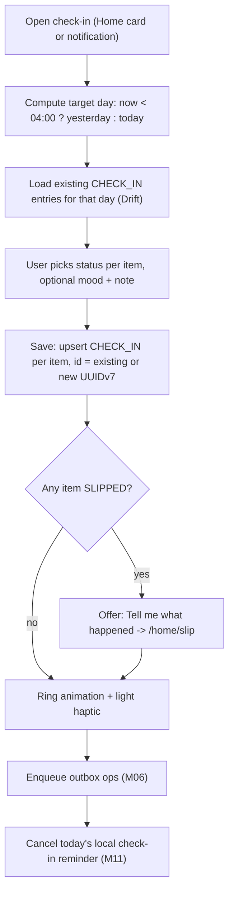
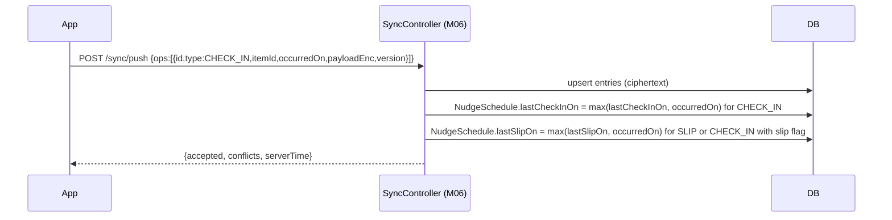
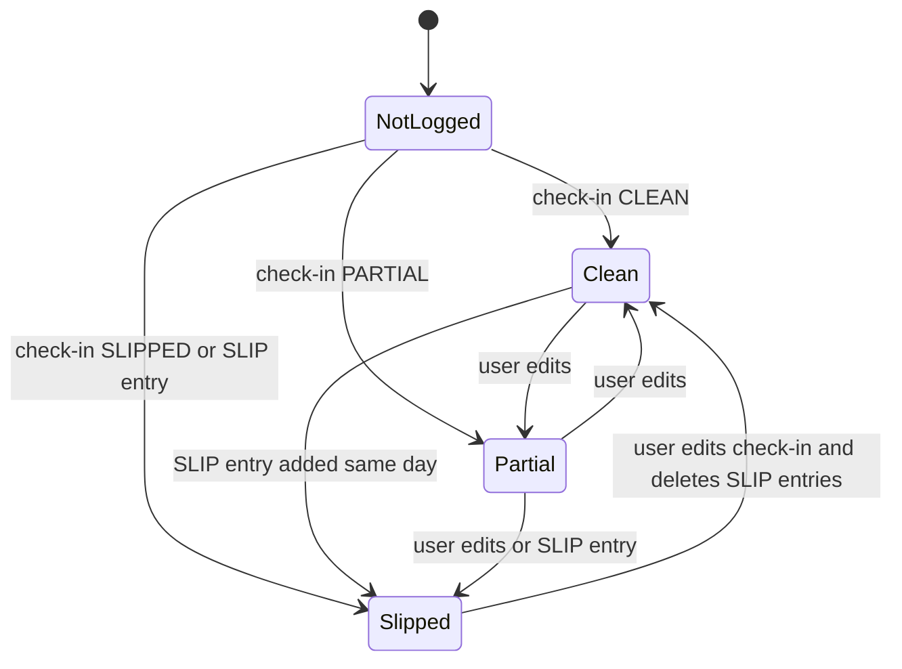

# M04 — Tracking (items, check-ins, slips, progress)

## 1. Header

| Field | Value |
| --- | --- |
| ID | M04 |
| Name | Tracking |
| Release | v1 (F-10, F-11, F-12, F-13) · v2 extension points (F-14 growth art, F-16 replacements, F-17 positive practices, F-18 widget) |
| Backend | `apps/api/src/modules/sync` (stores ciphertext + updates nudge metadata) |
| Flutter | `lib/features/tracking` (Home, check-in, slip, progress) |
| Depends on | M06 (encrypted local DB + sync), M03 (items from plan), M14 (theme), M16 (strings) |
| Used by | M07 (tracking context sent with coach messages), M10 (URGE entries), M11 (lastCheckInOn / lastSlipOn, risky windows) |

## 2. Purpose

Let the user record, in under 20 seconds a day, how each tracked item went, log slips with optional context, and
see progress in a way that motivates instead of shames. All tracking content is end-to-end encrypted on the device;
the server only sees entry type, item id, and local date (needed for nudges).

## 3. User stories & acceptance criteria

**US-04.1 Tracked items**
- Given I finished onboarding
- Then my items appear on Home; I can add (max 8 active), edit (label, goal, target, motivation) or archive items from Progress → item → Edit.
- Archiving keeps history; archived items disappear from Home and check-ins.

**US-04.2 Daily check-in**
- Given it is my check-in time or later
- When I open the check-in sheet from Home or a notification
- Then I see one row per active item with three choices: **Clean**, **Partly**, **Slipped**, plus optional mood (1–5) and a note.
- And "Save" writes one `CHECK_IN` entry per item for that local day; re-saving the same day updates the entries (same ids).
- And the whole flow takes ≤ 3 taps for a user with 2 items who is clean on both.

**US-04.3 Day boundary**
- Given I check in between 00:00 and 03:59 local time
- Then the check-in defaults to **yesterday** (label "For Wednesday" with a toggle to switch to today).
- And I can back-fill any of the last 7 days; older days are read-only.

**US-04.4 Slip log**
- Given I choose "Slipped" (or tap "Log a slip" any time)
- Then a slip sheet opens with optional fields: time (prefilled now), place (chips), mood before (1–5), triggers (chips + free text), who was around, note.
- And the copy is warm: "Slipped today? That's okay. What happened?"
- And I can save with zero optional fields filled.
- And after saving, the coach offers a follow-up (M07) — never automatically sends a message.

**US-04.5 Progress view**
- Given I open Progress
- Then I see per item and overall: % clean days for 7 / 30 / 90 days, the trend vs the previous window, total clean days, best run, urges passed (from SOS, M10), and a 30-day calendar strip (clean = accent, partly = accent 40%, slipped = neutral grey, not logged = empty outline).
- And no "streak lost" or reset-to-zero counter is the main metric.

**US-04.6 Offline**
- Given I'm offline
- Then check-ins, slips and progress work fully; sync happens later (M06).

## 4. Screens

| Route | Screen |
| --- | --- |
| `/home` | Today (ring, check-in card, coach preview, urges, plan) |
| `/home/check-in` | Check-in sheet |
| `/home/slip` | Slip sheet |
| `/progress` | Overview + items list |
| `/progress/item/:id` | Item detail + calendar + edit |
| `/progress/item/:id/edit` | Edit / archive item |

Home layout: see `04-design-system.md` §6.

### `/home/check-in` (GlassSheet)

```
┌──────────────────────────────────────┐
│               ───                    │  ← drag handle
│  How did today go?                   │
│  For Thursday, 20 Nov    [Change ▾]  │
│ ╭──────────────────────────────────╮ │
│ │ Pornography                      │ │
│ │ ( Clean ✓ )( Partly )( Slipped ) │ │  ← GlassChips; Clean preselected = none
│ ╰──────────────────────────────────╯ │
│ ╭──────────────────────────────────╮ │
│ │ Smoking   (reduce to 3/week)     │ │
│ │ ( Clean )( Partly )( Slipped ✓ ) │ │
│ ╰──────────────────────────────────╯ │
│  Mood   ○  ○  ◉  ○  ○                │  ← MoodPicker (optional)
│ ╭──────────────────────────────────╮ │
│ │ Add a note (only you can read it)│ │
│ ╰──────────────────────────────────╯ │
│  [            Save            ]      │
└──────────────────────────────────────┘
```
"All clean" shortcut chip appears at top when ≥ 2 items. Selecting **Slipped** on any item shows a secondary button "Tell me what happened" → slip sheet for that item (optional).

### `/home/slip`

```
┌──────────────────────────────────────┐
│  Slipped today? That's okay.         │
│  What happened? (all optional)       │
│ ╭──────────────────────────────────╮ │
│ │ When        [ 23:40 ]            │ │
│ │ Where   (Bedroom)(Home)(Work)(+) │ │
│ │ Feeling before  ○ ◉ ○ ○ ○        │ │
│ │ Triggers (Alone)(Stress)(Bored)  │ │
│ │          (Tired)(Argument)(+)    │ │
│ │ With    (Alone)(Others)          │ │
│ │ [ Anything else?              ]  │ │
│ ╰──────────────────────────────────╯ │
│  [            Save            ]      │
│  Skip details                        │
└──────────────────────────────────────┘
```

### `/progress`

```
┌──────────────────────────────────────┐
│  Progress          ( 7d )(30d)( 90d )│
│ ╭──────────────────────────────────╮ │
│ │   ◯ 78%   clean days             │ │  ← ProgressRing
│ │   ↗ +14 pts vs previous 30 days  │ │
│ │   41 clean days in total         │ │
│ │   4 urges passed this week       │ │
│ ╰──────────────────────────────────╯ │
│ ╭──────────────────────────────────╮ │
│ │ Pornography              82%  ›  │ │
│ │ ▮▮▮▮▯▮▮▮▮▮▮▯▮▮▮▮▮▮▮▮▯▮▮▮▮▮▮▮▮▮    │ │  ← 30-day strip, ▯ = neutral grey
│ ╰──────────────────────────────────╯ │
│ ╭──────────────────────────────────╮ │
│ │ Smoking (3/week)   2 of 4 weeks ›│ │
│ ╰──────────────────────────────────╯ │
└──────────────────────────────────────┘
```
RTL: calendar strip runs right-to-left (most recent day at the left edge in RTL, right edge in LTR).

## 5. Flows

### Check-in



### Sync of tracking metadata



The server cannot see the check-in status (it's encrypted). To let M11 send "follow-up after a slip" nudges, the
app sends a plaintext hint **only for slips**: a `SLIP` entry is created when the user logs a slip *or* selects
"Slipped" (a minimal SLIP entry with empty optional fields). The entry type itself is the signal.

## 6. State machine — a day's status for one item



Resolution rule: if any non-deleted `SLIP` entry exists for (item, day) the day is **Slipped**, regardless of check-in.

## 7. Data

Entries (encrypted payloads, see `03-data-model.md` §4): `ITEM`, `CHECK_IN`, `SLIP`; `URGE` read-only here (from M10).

### Local Drift tables (decrypted, inside SQLCipher)

```dart
class LocalItems extends Table {
  TextColumn get id => text()();                 // = Entry.id of the ITEM entry
  TextColumn get label => text()();
  TextColumn get category => text()();           // ItemCategory
  TextColumn get mode => text()();               // SINS | HABITS
  TextColumn get goal => text()();               // QUIT | REDUCE
  IntColumn get targetPerWeek => integer().nullable()();
  TextColumn get motivation => text().nullable()();
  BoolColumn get archived => boolean().withDefault(const Constant(false))();
  TextColumn get createdOn => text()();          // YYYY-MM-DD
  IntColumn get version => integer()();
  @override Set<Column> get primaryKey => {id};
}

class LocalEntries extends Table {
  TextColumn get id => text()();
  TextColumn get type => text()();               // CHECK_IN | SLIP | URGE | JOURNAL
  TextColumn get itemId => text().nullable()();
  TextColumn get occurredOn => text()();
  TextColumn get payloadJson => text()();        // decrypted JSON
  IntColumn get version => integer()();
  BoolColumn get deleted => boolean().withDefault(const Constant(false))();
  TextColumn get syncState => text()();          // SYNCED | PENDING | CONFLICT
  DateTimeColumn get clientUpdatedAt => dateTime()();
  @override Set<Column> get primaryKey => {id};
}
```
Index: `(type, itemId, occurredOn)`.

Uniqueness rule: at most one non-deleted `CHECK_IN` per `(itemId, occurredOn)`. Enforced by the repository: the
check-in id is deterministic per device session lookup (query first, reuse id).

### Progress formulas

For item *i*, window *W* ∈ {7, 30, 90} days ending at the current target day *T*:

```
days(i, W)  = local dates d with max(i.createdOn, T − W + 1) ≤ d ≤ T
status(d)   = SLIPPED  if any SLIP(i, d) not deleted
            = check-in status if CHECK_IN(i, d) exists
            = NOT_LOGGED otherwise
logged      = { d ∈ days : status(d) ≠ NOT_LOGGED }
score(d)    = 1 for CLEAN, 0.5 for PARTIAL, 0 for SLIPPED
cleanPct(i) = round(100 × Σ score(d) / |logged|)     (null if |logged| = 0 → show "Not enough check-ins yet")
```

- Unlogged days are **excluded** (not counted as failures).
- `REDUCE` goal items: show weeks on target instead: a week (Mon–Sun, ISO) is on target if slips in that week ≤ `targetPerWeek`. Display "2 of 4 weeks".
- Overall ring = Σ over QUIT items of Σscore / Σ|logged| (weighted by logged days). REDUCE items are excluded from the ring and shown separately.
- Trend = cleanPct(W) − cleanPct(previous W days), shown only if both windows have ≥ 3 logged days. Positive: "↗ +14 pts"; negative: "↘ a harder month — that's useful to know" (no red).
- Best run = longest sequence of consecutive *logged* CLEAN days (gaps of unlogged days break it). Shown as a secondary stat.
- Total clean days = count of CLEAN days all-time.
- Urges passed = count of `URGE` entries with `outcome = PASSED` in window.

```dart
// lib/features/tracking/domain/progress_calculator.dart
ProgressStats compute(List<DayStatus> days) {
  final logged = days.where((d) => d.status != DayStatus.notLogged).toList();
  if (logged.isEmpty) return ProgressStats.empty();
  final score = logged.fold<double>(0, (s, d) => s + switch (d.status) {
    DayStatusKind.clean => 1.0, DayStatusKind.partial => 0.5, _ => 0.0,
  });
  return ProgressStats(cleanPct: (100 * score / logged.length).round(), loggedDays: logged.length);
}
```

## 8. API

No dedicated endpoints. Tracking uses M06:

| Method | Path | Use here |
| --- | --- | --- |
| POST | `/sync/push` | Upload ITEM / CHECK_IN / SLIP ops |
| GET | `/sync/pull?since=` | Download changes from other devices |

Server-side effect specific to M04: `SyncService.applyMetadata()` updates `NudgeSchedule.lastCheckInOn` and `lastSlipOn`.

## 9. Backend design

```ts
// sync.service.ts (tracking-specific part)
private async applyMetadata(userId: string, ops: AcceptedOp[]): Promise<void> {
  const checkIns = ops.filter(o => o.type === 'CHECK_IN' && !o.deleted).map(o => o.occurredOn);
  const slips    = ops.filter(o => o.type === 'SLIP' && !o.deleted).map(o => o.occurredOn);
  await this.prisma.nudgeSchedule.updateMany({
    where: { userId },
    data: {
      ...(checkIns.length && { lastCheckInOn: maxDate(checkIns) }),
      ...(slips.length && { lastSlipOn: maxDate(slips) }),
      ignoredStreak: checkIns.length ? 0 : undefined, // user is active → reset nudge back-off (M11)
    },
  });
}
```
Validation: `occurredOn` must be within [today − 400 days, today + 1 day] in the user's timezone; else `VALIDATION_FAILED`.

## 10. Flutter design

```
lib/features/tracking/
├── data/
│   ├── tracking_repository.dart   # createItem, updateItem, archiveItem, saveCheckIns, logSlip, watch*
│   └── tracking_dao.dart          # Drift queries
├── domain/
│   ├── tracked_item.dart          # freezed
│   ├── check_in.dart              # status enum CLEAN | PARTIAL | SLIPPED
│   ├── slip.dart
│   ├── day_status.dart
│   ├── target_day.dart            # 04:00 rollover logic
│   └── progress_calculator.dart
└── presentation/
    ├── home_screen.dart
    ├── check_in_sheet.dart
    ├── slip_sheet.dart
    ├── progress_screen.dart
    ├── item_detail_screen.dart
    ├── item_edit_screen.dart
    ├── widgets/progress_ring.dart
    ├── widgets/day_strip.dart
    ├── widgets/today_check_in_card.dart
    └── providers/
        ├── items_provider.dart            # Stream<List<TrackedItem>> (active)
        ├── today_check_ins_provider.dart  # Stream<Map<itemId, CheckIn?>>
        ├── progress_provider.dart         # family(window, itemId?)
        └── check_in_form.dart             # Notifier
```

```dart
// target_day.dart
LocalDate targetDay(DateTime nowLocal) =>
    nowLocal.hour < 4 ? LocalDate.fromDateTime(nowLocal).minusDays(1) : LocalDate.fromDateTime(nowLocal);
```

Routes: `/home/check-in` and `/home/slip?itemId=…&day=…` are `GlassSheet` routes (go_router `pageBuilder` with modal sheet page).

v2 extension points: `TrackedItem.replacements` (F-16), `EntryType.PRACTICE` for positive practices (F-17, add to enum in v2), `ProgressArt` widget slot on Home (F-14), `home_widget` package data writer (F-18).

## 11. Edge cases

- Timezone travel: `occurredOn` uses the device's current timezone at save time; past entries are not shifted.
- Item created today: windows start from `createdOn`, so a new item does not show 0%.
- Same day edited on two devices: conflict resolved by M06 (last-write-wins on `clientUpdatedAt`).
- User archives then re-adds the same label → new item; history stays with the archived one.
- Item deleted (not archived) → tombstone all its entries after a confirmation ("This removes its history").
- DST change at 02:00–03:00: rollover at 04:00 is unaffected.
- 8-item cap: the "+ Add" button explains the limit kindly.

## 12. Security & privacy

- All labels, notes, triggers, statuses are encrypted (class B). Server sees only `type`, `itemId`, `occurredOn`.
- No analytics event includes item labels or categories.
- Home widget (v2) must show only neutral text ("Check in") — never item names.

## 13. Analytics events

| Event | Properties |
| --- | --- |
| `tracking.check_in_saved` | `itemCount`, `backfilled` (bool), `secondsToSave` |
| `tracking.slip_logged` | `fieldsFilled` (count) |
| `tracking.item_added` | `source` (`onboarding`/`manual`) |
| `tracking.item_archived` | — |
| `tracking.progress_viewed` | `window` |

## 14. Tests

- Unit: `targetDay` at 03:59 / 04:00; `cleanPct` with unlogged gaps, partial, SLIP override; REDUCE weeks on target; best run with gaps; trend threshold (≥ 3 logged days).
- Repository: one CHECK_IN per item per day; slip creates SLIP entry; archive hides from Home.
- Backend: `applyMetadata` updates lastCheckInOn/lastSlipOn and resets `ignoredStreak`; out-of-range `occurredOn` rejected.
- Widget/golden: Home, check-in sheet, slip sheet, progress (LTR/RTL, Dawn/Night, text scale 2.0).
- Integration: offline check-in → online → pushed once.

## 15. Open questions

- Should "Partly" exist for QUIT items or only REDUCE? v1 keeps it for both (users asked for nuance).
- Home-screen widget content policy for v2 (privacy vs usefulness).
