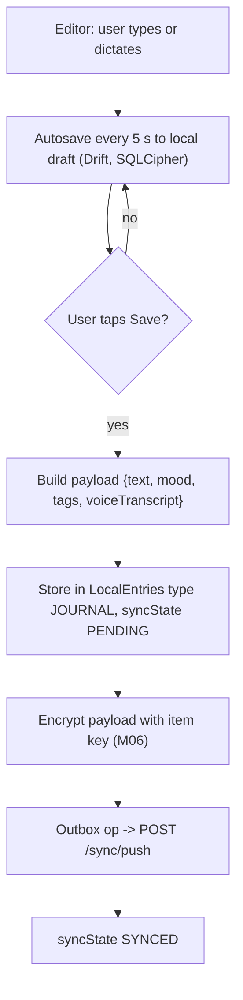
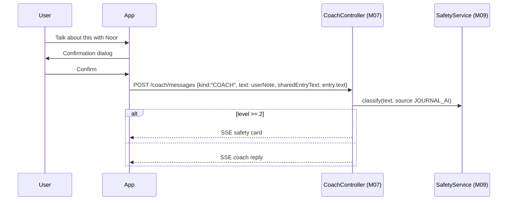
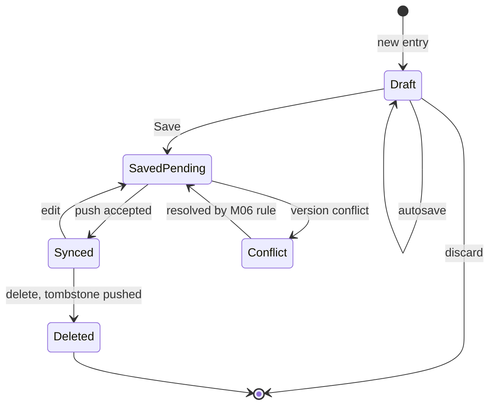

# M05 — Journal

## 1. Header

| Field | Value |
| --- | --- |
| ID | M05 |
| Name | Journal |
| Release | v1 (text + on-device voice transcription) · v2 (encrypted audio attachments, prompts of the day) |
| Features | F-15 |
| Backend | `apps/api/src/modules/sync` (ciphertext only) |
| Flutter | `lib/features/journal` |
| Depends on | M06 (E2E encryption + sync), M07 (optional "Talk about this with my coach"), M09 (safety on text shared with the coach), M16 |
| Used by | M17 (export) |

## 2. Purpose

A private diary that only the user can read. Entries are written or dictated (speech-to-text runs **on the device**),
optionally tagged with a mood and tags, and encrypted end-to-end (class A). The coach never reads the journal unless
the user explicitly shares a specific entry.

## 3. User stories & acceptance criteria

**US-05.1 Write an entry**
- Given I'm on `/me/journal`
- When I tap "New entry", type text (max 10,000 chars) and tap Save
- Then a `JOURNAL` entry is encrypted and stored locally, then synced.
- And autosave runs every 5 s while typing (draft kept locally if I leave).

**US-05.2 Dictate**
- Given I tap the microphone
- When I speak
- Then the text appears live, transcribed on-device (`speech_to_text` with `onDevice: true` where supported); no audio is uploaded or stored in v1.
- And if on-device recognition is unavailable for my language, the mic button explains "Voice typing isn't available offline for this language" and uses the OS keyboard dictation instead (user's choice).

**US-05.3 Browse and search**
- Given I have entries
- Then I see them newest first, grouped by month, with the first line, mood and tags.
- And search works on the decrypted local DB (full-text, accent-insensitive, Arabic normalisation).

**US-05.4 Share with the coach (opt-in)**
- Given I'm reading an entry
- When I tap "Talk about this with Noor"
- Then a confirmation explains "Noor will read this entry to help you. It is processed by AI and never read by people."
- And on confirm, a new coach conversation opens with the entry text as the first user message (counts toward the daily limit, passes safety M09).

**US-05.5 Edit / delete**
- Editing keeps the same id (version++). Deleting creates a tombstone and removes the entry from all devices after sync.

## 4. Screens

| Route | Screen |
| --- | --- |
| `/me/journal` | List + search |
| `/me/journal/new` | Editor |
| `/me/journal/:id` | Read view (edit, delete, share with coach) |

### `/me/journal`

```
┌──────────────────────────────────────┐
│ ←  Journal                   ( + )   │
│ ╭──────────────────────────────────╮ │
│ │ 🔍 Search your journal           │ │
│ ╰──────────────────────────────────╯ │
│  🔒 Only you can read this.          │  ← caption, always visible
│  NOVEMBER                            │
│ ╭──────────────────────────────────╮ │
│ │ Thu 20 · ◉ calm                  │ │
│ │ Hard evening but I left the room │ │
│ │ #family  #night                  │ │
│ ╰──────────────────────────────────╯ │
│ ╭──────────────────────────────────╮ │
│ │ Tue 18 · ○ low                   │ │
│ │ I keep thinking about what my…   │ │
│ ╰──────────────────────────────────╯ │
└──────────────────────────────────────┘
```

### `/me/journal/new`

```
┌──────────────────────────────────────┐
│ ✕  Thursday, 20 November     Save    │
│ ╭──────────────────────────────────╮ │
│ │ Write anything…                  │ │  ← multiline GlassInput, auto-grow
│ │                                  │ │
│ │                                  │ │
│ ╰──────────────────────────────────╯ │
│  Mood   ○  ○  ◉  ○  ○                │
│  Tags   (#family)(#night)( + )       │
│                                      │
│              ╭────╮                  │
│              │ 🎤 │  Tap to speak     │  ← on-device dictation
│              ╰────╯                  │
└──────────────────────────────────────┘
```
Text direction follows the content (`TextDirection` auto-detected per paragraph with `Bidi`), not only the UI locale.

## 5. Flows

### Save entry



### Share an entry with the coach



## 6. State machine — entry



## 7. Data

- Server: `private.entries` rows with `type = JOURNAL`, `itemId = null`, `occurredOn` = local date, `payloadEnc`.
- Payload (decrypted): `{ "text": "...", "voiceTranscript": false, "mood": 3, "tags": ["family"] }` (`03-data-model.md` §4).
- Local: `LocalEntries` (type `JOURNAL`) + a Drift FTS5 virtual table `journal_fts(id, text, tags)` maintained by triggers.
- Drafts: `LocalJournalDrafts(id, text, mood, tags, updatedAt)` — never synced.
- Arabic normalisation for search: strip tashkeel, unify alef forms (أ إ آ → ا), ى → ي, ة → ه.

## 8. API

No dedicated endpoints. Uses `POST /sync/push` and `GET /sync/pull` (M06). Sharing uses `POST /coach/messages` (M07) with the entry text in `sharedEntryText` (sent once, decrypted on device; the server treats it like a coach message and stores it KMS-encrypted).

## 9. Backend design

N/A beyond M06. `SyncService` enforces `payloadEnc` max size 64 KB for `JOURNAL` (`ENTRY_TOO_LARGE`).

## 10. Flutter design

```
lib/features/journal/
├── data/
│   ├── journal_repository.dart   # create, update, delete, watchAll, search
│   ├── journal_dao.dart          # Drift + FTS5
│   └── arabic_normalizer.dart
├── domain/
│   └── journal_entry.dart        # freezed {id, date, text, mood, tags, voiceTranscript}
└── presentation/
    ├── journal_list_screen.dart
    ├── journal_editor_screen.dart
    ├── journal_read_screen.dart
    ├── widgets/dictation_button.dart
    └── providers/
        ├── journal_list_provider.dart     # Stream, grouped by month
        ├── journal_search_provider.dart   # family(query), debounced 250 ms
        └── journal_editor_controller.dart # autosave timer
```

Package: `speech_to_text` (locale from the user's current language; `onDevice: true` on iOS 13+/Android 13+).

## 11. Edge cases

- Very long dictation (> 60 s): recognition restarts automatically; text appended.
- App locked (M02) while editing: draft saved before the lock overlay appears.
- Device out of storage: save fails with a clear message; draft kept in memory until retry.
- Mixed-language entries: each paragraph gets its own text direction.
- Deleting an entry already shared with the coach: the coach conversation copy is not deleted automatically; the confirmation tells the user and offers to delete that conversation too (M07).

## 12. Security & privacy

- Class A: encrypted on device before sync; the server and staff cannot read it.
- No journal text in analytics, logs, crash reports, or notifications.
- On-device dictation only; v1 never uploads audio.
- Clipboard: copying text is allowed (user choice); the app does not auto-copy.
- Screenshots blocked on Android via `FLAG_SECURE` (M02).

## 13. Analytics events

| Event | Properties |
| --- | --- |
| `journal.entry_saved` | `lengthBucket` (`<100`, `100-500`, `>500` chars), `dictated` (bool), `hasMood` |
| `journal.entry_shared_with_coach` | — |
| `journal.search_used` | — |

## 14. Tests

- Unit: Arabic normalizer; FTS search with accents; autosave timer; payload size limit.
- Repository: edit keeps id and increments version; delete creates tombstone.
- Widget/golden: list (empty, populated), editor RTL with mixed text, read view.
- Integration: dictation mocked → text inserted; share flow shows confirmation and opens coach with the text.

## 15. Open questions

- v2: encrypted audio attachments (client-side encrypted file → Cloud Storage signed URL upload).
- v2: optional daily journaling prompts chosen by the coach.
