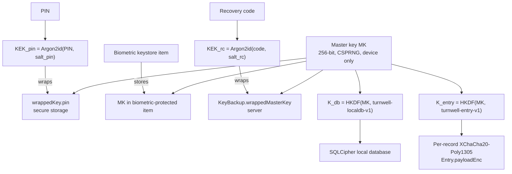
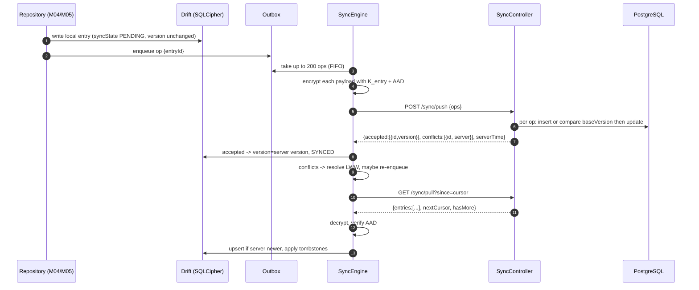
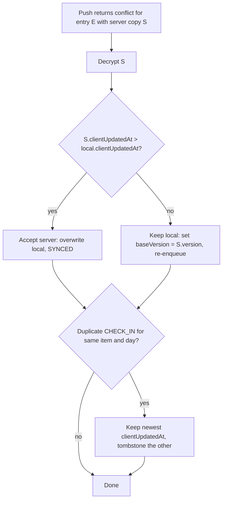
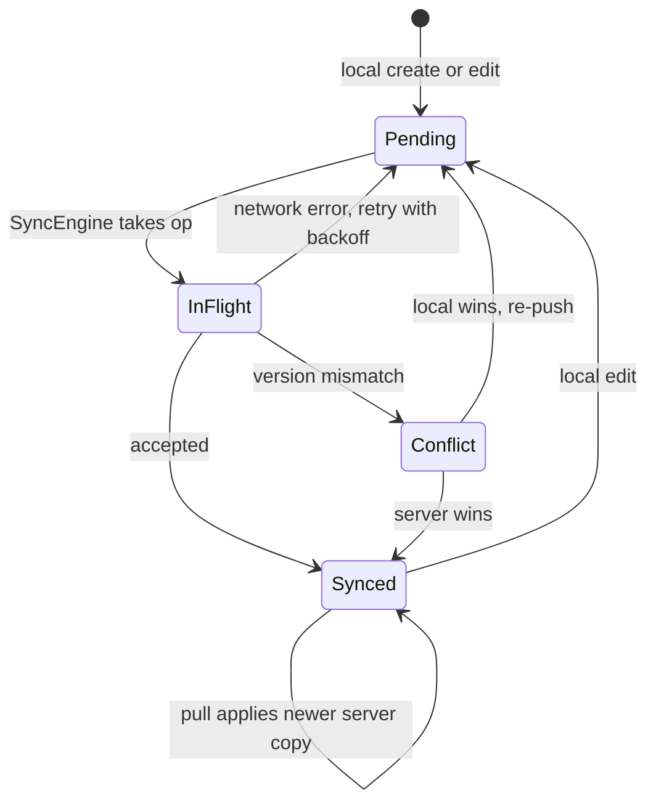

# M06 — Encryption & sync

## 1. Header

| Field | Value |
| --- | --- |
| ID | M06 |
| Name | End-to-end encryption, key management, offline-first sync |
| Release | v1 |
| Features | Foundation for F-10–F-15 (tracking, journal), F-53 (panic wipe uses it), recovery on a new phone |
| Backend | `apps/api/src/modules/sync` (+ `users` for key backup) |
| Flutter | `lib/core/crypto`, `lib/core/db`, `lib/features/sync`, `lib/features/onboarding` (recovery code step) |
| Depends on | M01 (identity, tokens), M02 (PIN / biometric unlock wraps the master key) |
| Used by | M04, M05, M10 (URGE entries), M17 (export, delete, panic wipe) |

## 2. Purpose

Guarantee the privacy promise: **the journal and tracking are encrypted so only the user can read them.**
Data is created and read in an encrypted local database (Drift + SQLCipher). Each record is encrypted again with
a key derived from the user's **master key** before upload. The server only stores ciphertext plus the minimal
metadata needed for nudges. A **recovery code** lets the user restore on a new phone; without it, data cannot be
recovered by anyone, including TurnWell.

## 3. User stories & acceptance criteria

**US-06.1 Master key creation**
- Given I just signed up and have no key backup
- When the app reaches the key step (after M01, before `/lock/setup`)
- Then a 256-bit master key is generated on the device with a CSPRNG and never sent to the server in plaintext.

**US-06.2 Recovery code**
- Given I'm on `/onboarding/safety`
- When I choose "Create recovery code"
- Then the app shows a 24-character code (`K7QF-9M2D-…`, 6 groups of 4, Crockford base32, 120 bits), asks me to save it (copy / write down / save to password manager), and asks me to re-type the last group to confirm.
- And a wrapped master key is uploaded to `PUT /me/key-backup`.
- And if I skip, a persistent (dismissible weekly) card on Me reminds me: "Without a recovery code, a new phone can't open your journal."

**US-06.3 Restore on a new phone**
- Given I sign in on a new device and a key backup exists
- When I enter my recovery code on `/auth/restore`
- Then the master key is unwrapped locally, I set a PIN (M02), and a full pull downloads and decrypts my entries.
- And a wrong code shows "That code doesn't match" with back-off after 5 attempts (60 s, then 5 min).
- And "I lost my code" explains clearly that encrypted history can't be recovered and offers to **start fresh** (deletes server ciphertext, keeps account, coach memory and community pseudonym).

**US-06.4 Offline-first**
- Given I'm offline
- When I create, edit or delete entries
- Then everything works locally; ops wait in the outbox and are pushed when online, in order, exactly once.

**US-06.5 Multi-device consistency**
- Given I use two phones
- When I edit the same entry on both
- Then the version with the latest `clientUpdatedAt` wins on both devices after sync; the other is discarded silently (no user-facing conflict UI in v1).

**US-06.6 Lock drops keys**
- When the app locks (M02)
- Then the master key and derived keys are zeroed from memory and the SQLCipher database is closed.

## 4. Screens

| Route | Screen |
| --- | --- |
| `/onboarding/safety` (recovery part) | Create / show / confirm recovery code |
| `/auth/restore` | Enter recovery code |
| `/auth/restore/lost` | Start fresh explanation |
| `/me/privacy/recovery` | View status, regenerate code (requires PIN) |
| Global | Sync status indicator (small cloud icon on Me tab: synced / pending / offline) |

### Recovery code

```
┌──────────────────────────────────────┐
│  Your recovery code                  │
│  If you change phones, this code is  │
│  the only way to open your journal.  │
│  We can't recover it for you.        │
│ ╭──────────────────────────────────╮ │
│ │   K7QF - 9M2D - X4TA             │ │  ← monospace, LTR even in Arabic
│ │   WP8N - 3HRE - 6CZB             │ │
│ ╰──────────────────────────────────╯ │
│  [ Copy ]  [ Save to password app ]  │
│  ☐ I saved it somewhere safe         │
│  [          Continue          ]      │
│            Skip for now              │
└──────────────────────────────────────┘
```
Next screen: "Type the last group to confirm: [ ____ ]".

### `/auth/restore`

```
┌──────────────────────────────────────┐
│  Welcome back                        │
│  Enter your recovery code to open    │
│  your journal on this phone.         │
│ ╭──────────────────────────────────╮ │
│ │ [ XXXX-XXXX-XXXX-XXXX-XXXX-XXXX ]│ │  ← auto-uppercase, auto-dash, O→0 I→1
│ ╰──────────────────────────────────╯ │
│  [          Restore           ]      │
│          I lost my code              │
└──────────────────────────────────────┘
```

## 5. Flows

### Key hierarchy



### Push / pull cycle



### Conflict resolution



## 6. State machine — local record sync state



## 7. Data

### Crypto parameters

| Item | Value |
| --- | --- |
| Master key | 32 bytes from `SecureRandom` (`cryptography` → `SecretKeyData.random(length: 32)`) |
| AEAD | XChaCha20-Poly1305 (24-byte nonce, 16-byte tag) |
| KDF for PIN | Argon2id m=19456 KiB, t=2, p=1, 16-byte salt (mobile-friendly; PIN is also rate-limited by M02) |
| KDF for recovery code | Argon2id m=65536 KiB, t=3, p=1, 16-byte salt (stored in `KeyBackup.kdfSalt`, `kdfParams`) |
| Subkeys | HKDF-SHA256(MK, salt = empty, info = `"turnwell-localdb-v1"` / `"turnwell-entry-v1"`), 32 bytes |
| Recovery code | 120 random bits → Crockford base32, 24 chars, 6 groups of 4 |
| `encVersion` | `1` (bump when algorithms or key change) |

### `payloadEnc` wire format (base64url, no padding)

```
byte 0        : format version (0x01)
bytes 1..24   : nonce (24 bytes, random per encryption)
bytes 25..end : ciphertext || Poly1305 tag (16 bytes)

AAD = utf8("tw|v1|" + userId + "|" + entryId + "|" + type + "|" + (itemId ?? "-") + "|" + occurredOn)
```
AAD binds ciphertext to its metadata: the server cannot move a payload to another entry, type, day or user without decryption failing.

### `KeyBackup.wrappedMasterKey`

`base64url(0x01 || nonce(24) || XChaCha20-Poly1305(MK, KEK_rc, aad = utf8("tw|kb|v1|" + userId)))`

### Local tables (Drift)

- `LocalEntries`, `LocalItems` (see M04) — decrypted content, protected by SQLCipher.
- `Outbox(id INTEGER PK AUTOINCREMENT, entryId TEXT, enqueuedAt, attempts INT, nextAttemptAt)`.
- `SyncState(key TEXT PK, value TEXT)` — `pullCursor`, `lastPushAt`, `lastPullAt`.

### Server limits

| Type | Max `payloadEnc` size |
| --- | --- |
| `JOURNAL` | 64 KB |
| `ITEM`, `CHECK_IN`, `SLIP`, `URGE` | 4 KB |
| Ops per push | 200 |
| Entries per pull page | 500 |

## 8. API

| Method | Path | Purpose |
| --- | --- | --- |
| POST | `/sync/push` | Upload a batch of ops |
| GET | `/sync/pull?since=<cursor>&limit=500` | Download changes |
| GET | `/me/key-backup` | Fetch wrapped master key (for restore) |
| PUT | `/me/key-backup` | Create / replace backup |
| POST | `/sync/reset` | "Start fresh": delete all entries of the user (requires recent sign-in < 5 min) |

### POST `/sync/push`

```json
{
  "deviceId": "0193…",
  "ops": [
    { "id": "0193f1…", "type": "CHECK_IN", "itemId": "0193a…", "occurredOn": "2026-11-20",
      "payloadEnc": "AQ3k…", "encVersion": 1, "baseVersion": 0, "deleted": false,
      "clientUpdatedAt": "2026-11-20T20:31:05.120Z" },
    { "id": "0193f2…", "type": "JOURNAL", "itemId": null, "occurredOn": "2026-11-20",
      "payloadEnc": "AQx9…", "encVersion": 1, "baseVersion": 3, "deleted": false,
      "clientUpdatedAt": "2026-11-20T20:35:00.000Z" }
  ]
}
```
```json
// 200
{
  "accepted": [ { "id": "0193f1…", "version": 1 } ],
  "conflicts": [
    { "id": "0193f2…", "server": { "id": "0193f2…", "type": "JOURNAL", "itemId": null, "occurredOn": "2026-11-20",
      "payloadEnc": "AQab…", "encVersion": 1, "version": 5, "deleted": false,
      "clientUpdatedAt": "2026-11-20T20:36:10.000Z" } }
  ],
  "serverTime": "2026-11-20T20:36:12.004Z"
}
```

Server rules per op:
1. `baseVersion = 0` and no row → insert with `version = 1`.
2. `baseVersion = 0` and row exists with same id → conflict (idempotent replay: if `payloadEnc` and `clientUpdatedAt` are identical, treat as accepted).
3. Row exists and `baseVersion = row.version` → update, `version = row.version + 1`.
4. Otherwise → conflict with server copy.
5. A row owned by another user with the same id → `NOT_FOUND` for that op (reported in `rejected`, never leaks existence).

Errors (whole request): `VALIDATION_FAILED`, `SYNC_BATCH_TOO_LARGE`, `ENTRY_TOO_LARGE` (`details.ids`), `RATE_LIMITED` (30 pushes/min).

### GET `/sync/pull`

```json
{
  "entries": [
    { "id": "0193f1…", "type": "CHECK_IN", "itemId": "0193a…", "occurredOn": "2026-11-20",
      "payloadEnc": "AQ3k…", "encVersion": 1, "version": 1, "deleted": false,
      "clientUpdatedAt": "2026-11-20T20:31:05.120Z", "serverUpdatedAt": "2026-11-20T20:31:06.002Z" }
  ],
  "nextCursor": "eyJ0IjoiMjAyNi0xMS0yMFQyMDozMTowNi4wMDJaIiwiaSI6IjAxOTNmMSJ9",
  "hasMore": false
}
```
Ordering: `(serverUpdatedAt, id)` ascending. Cursor = base64url JSON `{t, i}`. `since` absent = full pull.

### PUT `/me/key-backup`

```json
{ "wrappedMasterKey": "AV9…", "kdfSalt": "b64…", "kdfParams": { "alg": "argon2id", "m": 65536, "t": 3, "p": 1 }, "keyVersion": 1 }
```
Requires a fresh access token issued < 10 min ago (`AUTH_REAUTH_REQUIRED` otherwise). Overwrites previous backup.

### GET `/me/key-backup`

```json
{ "wrappedMasterKey": "AV9…", "kdfSalt": "b64…", "kdfParams": { "alg": "argon2id", "m": 65536, "t": 3, "p": 1 }, "keyVersion": 1 }
```
404 `NOT_FOUND` if none. Rate limit: 10/hour per user (offline guessing still requires Argon2 work per guess; 120-bit code makes it infeasible).

## 9. Backend design

```ts
// sync.service.ts
push(userId: string, dto: PushDto): Promise<PushResult>;          // single transaction per batch
pull(userId: string, since?: string, limit = 500): Promise<PullResult>;
reset(userId: string): Promise<void>;                               // deletes entries + nudge metadata dates
private applyMetadata(userId: string, ops: AcceptedOp[]): Promise<void>; // see M04

// key-backup.service.ts (users module)
get(userId: string): Promise<KeyBackupDto | null>;
put(userId: string, dto: KeyBackupDto, tokenIssuedAt: Date): Promise<void>;
```

```ts
// push core (inside prisma.$transaction, SERIALIZABLE not required; use row lock)
for (const op of dto.ops) {
  const row = await tx.$queryRaw<Entry[]>`SELECT * FROM private.entries WHERE id = ${op.id} FOR UPDATE`;
  const existing = row[0];
  if (existing && existing.userId !== userId) { rejected.push({ id: op.id, code: 'NOT_FOUND' }); continue; }
  if (!existing) {
    if (op.baseVersion !== 0) { conflicts.push({ id: op.id, server: null }); continue; } // deleted server-side by reset
    await tx.entry.create({ data: { ...map(op), userId, version: 1 } });
    accepted.push({ id: op.id, version: 1 });
  } else if (existing.version === op.baseVersion) {
    await tx.entry.update({ where: { id: op.id }, data: { ...map(op), version: existing.version + 1 } });
    accepted.push({ id: op.id, version: existing.version + 1 });
  } else if (isReplay(existing, op)) {
    accepted.push({ id: op.id, version: existing.version });
  } else {
    conflicts.push({ id: op.id, server: toDto(existing) });
  }
}
```
Tombstones are kept 180 days, then purged by `sync.purgeTombstones` (devices offline longer do a full pull).

## 10. Flutter design

```
lib/core/crypto/
├── key_manager.dart          # create, unwrapWithPin, unwrapWithBiometric, unwrapWithRecovery, lock()
├── entry_cipher.dart         # encrypt(entry) / decrypt(remote) with AAD
├── recovery_code.dart        # generate, format, normalise (O→0, I/L→1), parse
└── secure_bytes.dart         # zeroing helper
lib/core/db/
├── app_database.dart         # Drift, opened with SQLCipher key from K_db
└── tables/…                  # LocalEntries, LocalItems, Outbox, SyncState, journal_fts
lib/features/sync/
├── sync_engine.dart          # push/pull loop, backoff, triggers
├── sync_api.dart
└── providers/
    ├── sync_status_provider.dart   # synced | pending(n) | offline | error
    └── sync_engine_provider.dart
```

```dart
// key_manager.dart (excerpt)
class KeyManager {
  SecretKey? _mk; // in memory only while unlocked

  Future<void> createMasterKey() async {
    _mk = await SecretKeyData.random(length: 32);
  }

  Future<void> wrapForPin(String pin) async {
    final salt = randomBytes(16);
    final kek = await Argon2id(memory: 19456, iterations: 2, parallelism: 1, hashLength: 32)
        .deriveKeyFromPassword(password: pin, nonce: salt);
    final box = await Xchacha20.poly1305Aead().encrypt(await _mk!.extractBytes(),
        secretKey: kek, nonce: randomBytes(24), aad: utf8.encode('tw|pin|v1'));
    await storage.write(key: 'tw.lock.wrappedKey.pin', value: encodeBox(salt, box));
  }

  Future<SecretKey> entryKey() => Hkdf(hmac: Hmac.sha256(), outputLength: 32)
      .deriveKey(secretKey: _mk!, info: utf8.encode('turnwell-entry-v1'), nonce: const []);

  void lock() { /* overwrite extracted byte buffers, _mk = null, close database */ }
}
```

```dart
// sync_engine.dart — triggers and backoff
// Triggers: unlock, local write (debounce 3 s), connectivity regained, every 15 min in foreground,
// background task (workmanager, min 30 min, Android only; iOS BGAppRefresh best effort).
// Backoff per op: 5 s, 30 s, 2 min, 10 min, 1 h (max). Never drop ops.
Future<void> runOnce() async {
  if (!keyManager.isUnlocked || !connectivity.online) return;
  await _pushAll();   // loop batches of 200 until outbox empty
  await _pullAll();   // loop pages until hasMore == false
  await _dedupeCheckIns();
}
```

Background sync runs only if the app is unlocked in memory (keys present); otherwise it waits for the next unlock (keys are never persisted unwrapped).

## 11. Edge cases

- User skips recovery code and loses phone → "Start fresh" path; coach memory (class C), plan and community identity remain.
- App reinstalled on the same phone → keystore items may be wiped (iOS keeps Keychain by default; Android does not) → restore with recovery code.
- Server reset (`/sync/reset`) while another device is offline → that device receives conflicts with `server: null`; it must tombstone local copies only after asking the user ("Your data was reset from another device").
- Clock wrong on device → LWW uses `clientUpdatedAt`; if device time is > 24 h ahead of `serverTime`, the app clamps `clientUpdatedAt` to `serverTime + 1 s` and logs a non-content warning.
- Decryption failure (AAD mismatch) → mark record `CORRUPT`, exclude from UI, report a count-only event `sync.decrypt_failed`.
- Very large outbox after long offline period (> 5,000 ops) → push in batches, show "Syncing 2,340 changes…".

## 12. Security & privacy

- Plaintext MK never leaves the device; the server only ever receives MK wrapped with a 120-bit recovery code KEK.
- Server-visible metadata per entry: `type`, `itemId`, `occurredOn`, sizes, timestamps. Documented in the privacy policy.
- No crypto code is written from scratch; only `cryptography` primitives with the parameters above.
- Zeroing: Dart cannot guarantee memory wiping; minimise copies, keep keys as `SecretKey` objects, null references on lock.
- Panic wipe (M17) deletes: SQLCipher DB file, secure storage keys, outbox. Server ciphertext remains (decryptable only with the recovery code).
- `PUT /me/key-backup` requires re-authentication to prevent a stolen session replacing the backup.

## 13. Analytics events

| Event | Properties |
| --- | --- |
| `sync.recovery_code_created` | — |
| `sync.recovery_code_skipped` | — |
| `sync.restore_completed` | `entriesCount` (bucketed) |
| `sync.restore_failed` | `reason` (`WRONG_CODE`, `NO_BACKUP`) |
| `sync.start_fresh` | — |
| `sync.decrypt_failed` | `count` |

## 14. Tests

- Crypto unit: encrypt → decrypt round-trip; tampered AAD fails; tampered ciphertext fails; recovery code normalisation (O/0, I/1, lowercase, missing dashes); Argon2 params match spec.
- Known-answer test vectors in `test/crypto/vectors.json` (shared by Dart and a TS verifier script).
- Sync engine: offline queue order preserved; retry backoff; conflict LWW both directions; duplicate CHECK_IN dedupe; tombstone propagation; cursor pagination across 1,200 entries.
- Backend e2e: push insert / update / conflict / replay idempotency; other user's id → rejected; size limits; pull ordering; key-backup requires fresh token.
- Integration: two simulated devices editing the same entry converge.

## 15. Open questions

- Key rotation (`encVersion = 2`) design is v2: re-encrypt all entries in background after a new MK.
- Should the recovery code also be exportable as a QR code for printing? Proposed v1.1.
- iOS background sync reliability — acceptable to sync only in foreground in v1.
