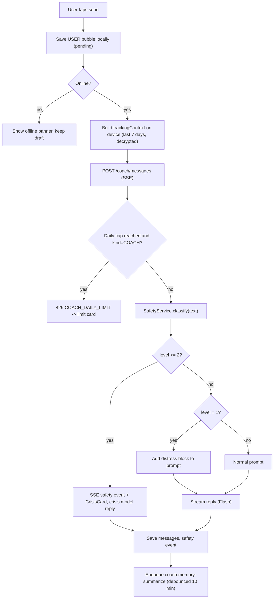
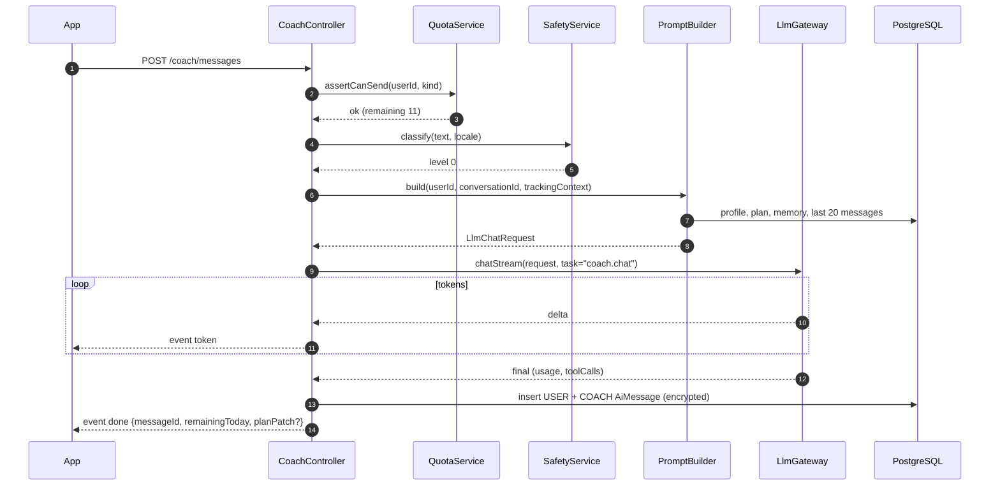
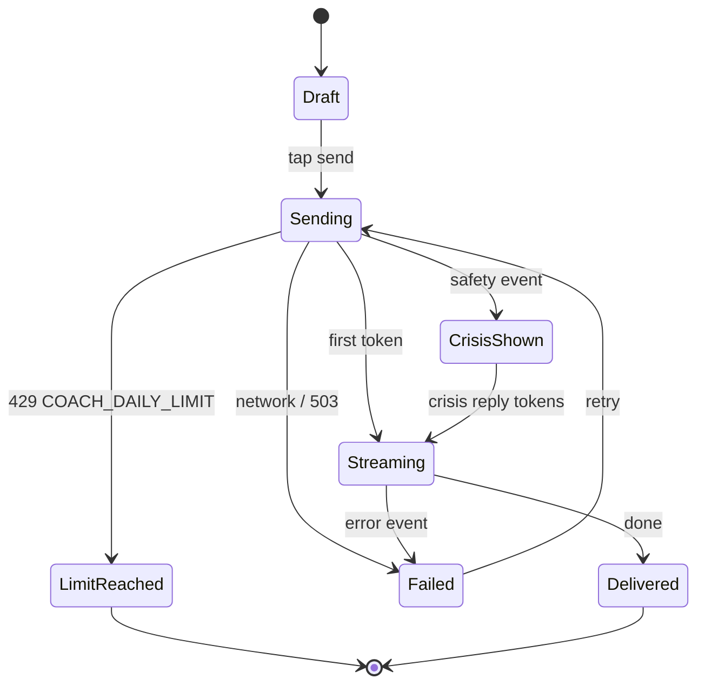

# M07 — AI coach

## 1. Header

| Field | Value |
| --- | --- |
| ID | M07 |
| Name | AI coach (chat, plan updates, memory) |
| Release | v1 (F-20, F-22 updates, F-25); v2 extension points: F-23 weekly reflection, F-24 voice |
| Feature IDs | F-20, F-22, F-25 (F-23, F-24 v2) |
| Backend module | `apps/api/src/modules/coach` |
| Flutter feature | `apps/mobile/lib/features/coach` |
| Dependencies | M08 LLM gateway, M09 Safety, M03 Onboarding (plan + profile), M06 Encryption & sync (tracking context), M14 Settings (persona, tone), M15 (entitlement check, v1 = free limit only) |

## 2. Purpose

The coach is a warm, honest recovery companion with the name, gender and voice the user chose. It talks with the
user in their language, uses evidence-based techniques (CBT, Motivational Interviewing, ACT, urge surfing,
implementation intentions), knows the user's plan and recent progress, and pushes toward real people. It is **not a
therapist**, never diagnoses, never gives medical or medication advice, and never issues religious rulings. Every user
message passes the safety layer (M09) before the coach answers.

## 3. User stories & acceptance criteria

**US-07.1 Send a message and get a streamed reply**
- Given an onboarded user with fewer than 15 coach messages today (free tier)
- When they send "I almost slipped tonight"
- Then the message appears immediately in the chat, a typing indicator shows within 300 ms, the first token streams
  within 2.5 s (p95), and the full reply is saved encrypted (`AiMessage.contentEnc`).

**US-07.2 Daily free limit**
- Given a free user has sent 15 messages today (user timezone day)
- When they send another message
- Then the API returns `429 COACH_DAILY_LIMIT` with `details.limit=15` and `details.resetsAt`, the app shows a glass
  card "You've used today's 15 messages. SOS and check-ins stay free." with the reset time, and the SOS button stays enabled.
- And messages sent from the SOS flow (`kind=SOS`) and crisis replies **do not count** toward the limit.

**US-07.3 Coach knows context**
- Given the user logged a slip yesterday at 23:40 with trigger "stress"
- When they open the coach and say "hi"
- Then the reply may reference that yesterday was hard (from the decrypted tracking context sent by the app), without
  quoting private notes verbatim unless the user brings them up.

**US-07.4 Crisis interruption**
- Given a user writes a message classified level ≥ 2
- When the coach would reply
- Then the app receives an SSE `safety` event **before** any token, shows the `CrisisCard` (M09) inline, and the
  coach reply uses the crisis prompt; the hotline card is shown even if the model call fails.

**US-07.5 Persona and tone**
- Given the user named the coach "Noor", chose FEMALE and tone GENTLE, language AR
- When the coach replies
- Then it speaks in Arabic, uses feminine self-reference grammar, signs nothing, and the header shows "Noor".

**US-07.6 Offline**
- Given the device is offline
- When the user opens the coach
- Then previous messages (cached in the local DB) are readable, the composer is disabled with "Coach needs a connection.
  SOS tools work offline." and a button to open SOS.

**US-07.7 Plan update suggestion**
- Given the coach and user agree on a change ("phone out of bedroom at 22:00 instead of 22:30")
- When the model emits a `plan_patch` tool call
- Then the app shows a confirmation chip "Update my plan?"; only on tap is `PATCH /coach/plan` called and `planVersion` incremented.

**US-07.8 Not a therapist**
- Given the user asks "Can you diagnose me with depression?"
- Then the coach declines to diagnose, explains it is a coach, suggests a professional, and continues to support.

**US-07.9 Delete what the coach remembers**
- Given the user taps "What my coach remembers" in Settings
- When they tap "Forget everything"
- Then `AiMemory` is deleted, all `AiMessage` rows of COACH conversations are deleted, and the next reply has no history.

## 4. Screens

| Screen | Route | Notes |
| --- | --- | --- |
| Coach chat | `/coach`, `/coach/:conversationId` | Main tab; opens the latest COACH conversation |
| Conversation list | `/coach/history` | Past conversations by date (titles generated locally: date + first words) |
| Limit reached card | inline in chat | Glass card, no paywall in v1 |
| Plan update chip | inline in chat | Accept / Not now |
| Memory view | `/me/settings/coach/memory` | Shows the plain-language summary + Forget button (M14 entry point) |

### Coach chat wireframe

```
┌──────────────────────────────────────┐
│ ←  (N) Noor              ⋯  ⟲ history│  ← header: avatar, coach name, menu
│     your coach · gentle              │
│──────────────────────────────────────│
│ ╭──────────────────────────╮         │
│ │ Evenings have been hard  │  21:02  │  ← CoachBubble (glass)
│ │ lately. Want to plan     │         │
│ │ tonight together?        │         │
│ ╰──────────────────────────╯         │
│          ╭─────────────────────────╮ │
│   21:03  │ yes. I'm alone at home  │ │  ← UserBubble (accent 22%)
│          ╰─────────────────────────╯ │
│ ╭──────────────────────────╮         │
│ │ Okay. Two small steps:   │         │
│ │ 1. Phone charges in the  │         │
│ │    kitchen at 22:00 …    │         │
│ ╰──────────────────────────╯         │
│ ╭──────────────────────────────────╮ │
│ │ ✎ Update my plan: phone out at   │ │  ← plan_patch chip
│ │   22:00     [Update]  [Not now]  │ │
│ ╰──────────────────────────────────╯ │
│  ● ● ●                               │  ← typing indicator
│──────────────────────────────────────│
│ ╭────────────────────────────╮ ╭───╮ │
│ │ Write to Noor…             │ │ ↑ │ │  ← GlassInput + send
│ ╰────────────────────────────╯ ╰───╯ │
│  12 of 15 messages left today        │  ← caption, free tier only
└──────────────────────────────────────┘
```

### Limit reached wireframe

```
╭──────────────────────────────────────╮
│  You've used today's 15 messages.    │
│  Noor will be back at 00:00.         │
│  SOS, check-ins and journal stay     │
│  free and unlimited.                 │
│  [ Open SOS ]   [ Write in journal ] │
╰──────────────────────────────────────╯
```

### Memory view wireframe

```
┌──────────────────────────────────────┐
│ ←  What Noor remembers               │
│ ╭──────────────────────────────────╮ │
│ │ You're working on two things…    │ │  ← decrypted summary (plain text)
│ │ Nights after 23:00 are hardest…  │ │
│ ╰──────────────────────────────────╯ │
│  Raw messages are deleted after 90   │
│  days. Only this summary is kept.    │
│  [ Forget everything ]  (danger)     │
└──────────────────────────────────────┘
```

## 5. Flows

### 5.1 Send message (happy path + crisis + limit)



### 5.2 Sequence



## 6. State machine — conversation message lifecycle (app side)



## 7. Data

Server tables (see `03-data-model.md`): `private.ai_conversations` (`kind` = `COACH`), `private.ai_messages`,
`private.ai_memory`, `private.profiles` (`coachName`, `coachGender`, `coachTone`, `planEnc`, `planVersion`,
`dailyAiMessageCount`, `dailyAiCountDate`), `private.safety_events`.

Local Drift tables:

| Table | Columns | Notes |
| --- | --- | --- |
| `local_coach_messages` | `id`, `conversationId`, `role`, `text`, `createdAt`, `status` (`PENDING`/`DELIVERED`/`FAILED`) | Inside SQLCipher DB; last 200 messages cached |
| `local_coach_conversations` | `id`, `kind`, `updatedAt`, `title` | Title generated locally |

Field rules:
- Message text max 2,000 characters (client + DTO). Longer → `VALIDATION_FAILED`.
- `trackingContext` max 8 KB JSON; the server never stores it.
- Daily count resets at 00:00 in `User.timezone`; computed with `ClockService.todayFor(userId)`.

### trackingContext (built on device)

```json
{
  "today": "2026-11-20",
  "items": [
    { "itemId": "0193…", "label": "Pornography", "category": "SEXUAL", "mode": "SINS", "goal": "QUIT",
      "cleanPct30d": 0.78, "last7": ["CLEAN","CLEAN","SLIPPED","CLEAN","CLEAN","PARTIAL","CLEAN"] }
  ],
  "recentSlips": [ { "occurredOn": "2026-11-19", "time": "23:40", "triggers": ["stress", "alone"] } ],
  "urges7d": { "passed": 4, "slipped": 1 },
  "moodAvg7d": 3.2
}
```

Slip `note` and journal text are **not** included unless the user taps "Share this with Noor" on a specific entry (then
sent once as `sharedEntryText`).

## 8. API

| Method | Path | Purpose | Auth |
| --- | --- | --- | --- |
| POST | `/coach/messages` | Send a message, stream reply (SSE) | USER |
| GET | `/coach/conversations?cursor=&limit=20` | List conversations | USER |
| GET | `/coach/conversations/:id/messages?cursor=&limit=50` | Messages (decrypted server-side) | USER |
| POST | `/coach/conversations` | Start a new COACH conversation | USER |
| GET | `/coach/quota` | `{ limit, used, remaining, resetsAt, unlimited }` | USER |
| PATCH | `/coach/plan` | Apply an accepted plan patch | USER |
| GET | `/coach/memory` | Decrypted memory summary | USER |
| DELETE | `/coach/memory` | Forget everything (memory + coach messages) | USER |

### POST /coach/messages

Request:
```json
{
  "conversationId": "0193a0b2-…",
  "clientMessageId": "0193a0b3-…",
  "kind": "COACH",
  "text": "I almost slipped tonight",
  "trackingContext": { "...": "see §7" },
  "sharedEntryText": null
}
```

Response: `200 text/event-stream`:

```
event: ack
data: {"userMessageId":"0193a0b3-…","conversationId":"0193a0b2-…"}

event: token
data: {"t":"That sounds "}

event: token
data: {"t":"really hard. "}

event: done
data: {"coachMessageId":"0193a0b4-…","remainingToday":11,"planPatch":null,"safetyLevel":0}
```

Crisis variant (sent before any `token`):
```
event: safety
data: {"level":2,"card":{"title":"You don't have to go through this alone","hotlines":[{"name":"…","phone":"…","url":"…"}],"emergency":{"name":"Emergency","phone":"112"},"trustedContact":true}}
```

Error event mid-stream:
```
event: error
data: {"code":"AI_UNAVAILABLE","message":"Model timeout"}
```

`planPatch` shape (when the model proposes one):
```json
{ "op": "replace", "path": "/dailyRoutine/0/text", "value": "Phone charges in the kitchen at 22:00", "reason": "Agreed tonight" }
```

### PATCH /coach/plan
```json
{ "baseVersion": 3, "patches": [ { "op": "replace", "path": "/dailyRoutine/0/text", "value": "Phone charges in the kitchen at 22:00" } ] }
```
→ `200 { "planVersion": 4, "plan": { … } }` · `409 CONFLICT` if `baseVersion` ≠ current.

### Error codes

| HTTP | Code | When |
| --- | --- | --- |
| 429 | `COACH_DAILY_LIMIT` | 15 messages used today (free), `kind=COACH` |
| 429 | `RATE_LIMITED` | > 10 messages / minute |
| 400 | `VALIDATION_FAILED` | Text empty / > 2,000 chars, context > 8 KB |
| 404 | `NOT_FOUND` | Conversation not owned |
| 409 | `CONFLICT` | Plan version mismatch |
| 412 | `ONBOARDING_REQUIRED` | No `onboardingDoneAt` |
| 503 | `AI_UNAVAILABLE` | Gateway failed after fallbacks (crisis card still sent if level ≥ 2) |

## 9. Backend design

```ts
// coach.service.ts
export class CoachService {
  sendMessage(userId: string, dto: SendCoachMessageDto, sse: SseWriter): Promise<void>;
  listConversations(userId: string, cursor?: string, limit?: number): Promise<Page<ConversationDto>>;
  listMessages(userId: string, conversationId: string, cursor?: string): Promise<Page<CoachMessageDto>>;
  applyPlanPatch(userId: string, dto: PlanPatchDto): Promise<PlanDto>;
  getMemory(userId: string): Promise<{ summary: string | null; updatedAt: string | null }>;
  forgetEverything(userId: string): Promise<void>;
}

// quota.service.ts
export class QuotaService {
  static readonly FREE_DAILY_LIMIT = 15;
  assertCanSend(userId: string, kind: ConversationKind): Promise<{ remaining: number | null }>; // SOS/CRISIS exempt
  increment(userId: string): Promise<number>; // atomic UPDATE … RETURNING with day reset
  getQuota(userId: string): Promise<QuotaDto>;
}

// prompt-builder.service.ts
export class PromptBuilder {
  build(input: {
    userId: string;
    conversationId: string;
    kind: ConversationKind;
    safetyLevel: 0 | 1;
    trackingContext?: TrackingContextDto;
    sharedEntryText?: string;
  }): Promise<LlmChatRequest>; // assembles prompts/coach-*.md blocks (see prompts/README.md)
}

// memory.processor.ts — BullMQ queue "coach.memory-summarize"
// job data: { userId } ; debounce: jobId = `mem:${userId}`, delay 10 min, replaced on each message
```

Rules:
- `sendMessage` order: quota → safety classify → persist USER message → build prompt → stream → persist COACH message →
  increment quota (only after a successful `done`; failed calls do not consume quota).
- History window: last 20 messages of the conversation + memory summary.
- `plan_patch` is exposed to the model as a function declaration (`proposePlanPatch`) via M08 tools; the server
  validates paths against the plan JSON schema (`prompts/onboarding-extractor.md`).
- Persona fields come from `Profile`; the coach name is user-chosen text — sanitise (max 24 chars, letters/spaces) before
  inserting into the prompt.
- SSE: set `X-Accel-Buffering: no`, heartbeat comment `: ping` every 15 s, abort the LLM stream when the client disconnects
  and persist partial reply with suffix flag `truncated=true` (not shown to model next turn).
- Message retention job `ai.cleanup` (daily 03:00 UTC) deletes `AiMessage` older than 90 days.
- v2: `coach.weekly-reflection` job (Sunday 18:00 local) and voice (`POST /coach/voice` with on-device STT text + TTS
  audio URL) — leave `kind` and controller structure ready, do not build.

## 10. Flutter design

```
features/coach/
├── data/
│   ├── coach_api.dart              # SSE client (dio ResponseType.stream → line parser)
│   ├── coach_repository.dart       # sendMessage() → Stream<CoachEvent>
│   ├── tracking_context_builder.dart
│   └── local_coach_dao.dart
├── domain/
│   ├── coach_message.dart          # freezed
│   ├── coach_event.dart            # sealed: Ack, Token, Safety, Done, Error
│   └── quota.dart
└── presentation/
    ├── coach_screen.dart
    ├── coach_history_screen.dart
    ├── coach_memory_screen.dart
    ├── widgets/coach_bubble.dart, user_bubble.dart, typing_indicator.dart,
    │          plan_patch_chip.dart, limit_card.dart, coach_composer.dart
    └── providers/
        ├── coach_conversation_provider.dart   # @riverpod class CoachConversation extends _$CoachConversation
        ├── coach_quota_provider.dart
        └── coach_memory_provider.dart
```

- `CoachConversation` notifier holds `List<CoachMessage>` + `streamingText`; appends tokens, flushes UI at most every 50 ms.
- On `Safety` event: push `CrisisCard` widget into the list (M09 widget) and call `crisisControllerProvider.notify(level)`.
- Typing indicator appears on send and is replaced by the bubble on first token.
- Composer: max 2,000 chars, counter after 1,800; send disabled when empty/offline.
- Auto-scroll only if the user is within 120 px of the bottom.
- Persona header reads `profileProvider` (coach name, gender avatar, tone label).

## 11. Edge cases

| Case | Behaviour |
| --- | --- |
| App killed mid-stream | Partial reply saved server-side; on reopen, `GET messages` returns it; local pending → DELIVERED |
| Duplicate send (retry) | `clientMessageId` unique per user; server returns the existing reply (idempotent) |
| Timezone change | Quota day uses `User.timezone`, updated from `X-Timezone` at most once per day |
| User writes in a new language | Reply in the language of the user's latest message; UI locale unchanged |
| Model returns empty/blocked | Fallback reply from scripted pool (`prompts/coach-guardrails.md` §Fallbacks), quota not consumed |
| Safety classifier down | Fail-safe: run keyword pre-filter (M09) and treat the message as level 1 |
| Plan patch with invalid path | Dropped silently server-side, logged as count metric only |
| Conversation older than 90 days | Messages gone; summary remains; show "Older messages were removed for your privacy" |

## 12. Security & privacy

- Message text never logged (redaction paths `*.text`, `*.t`); SSE payloads excluded from request logging.
- `contentEnc` via `CryptoService` (per-user DEK, KMS). Decrypted only in memory for the prompt and for `GET messages`.
- Prompts contain no email, account ID, phone or real name — only coach name, mode, categories, plan and context.
- No human/admin endpoint can read coach messages. `DELETE /coach/memory` is permanent.
- Vertex AI paid tier, `europe-west1`. No prompt caching that stores user content beyond the request (only the static
  system prefix is cached).

## 13. Analytics events

| Event | Properties |
| --- | --- |
| `coach.message_sent` | `kind`, `lengthBucket` (`<50`,`<200`,`<1000`,`1000+`), `hasSharedEntry` |
| `coach.reply_received` | `latencyMsBucket`, `safetyLevel`, `model` |
| `coach.limit_reached` | — |
| `coach.plan_patch_shown` / `coach.plan_patch_accepted` | — |
| `coach.memory_forgotten` | — |
| `coach.offline_blocked` | — |

## 14. Tests

- Unit: `QuotaService` resets at user midnight (Algiers, New York, Tokyo); SOS/CRISIS exempt; increment only on `done`.
- Unit: `PromptBuilder` output contains persona name, mode block, no email/userId (assert regex for `@` and UUIDs).
- E2E: SSE happy path (fake provider) → events `ack`, `token`×n, `done`; messages persisted encrypted (ciphertext ≠ text).
- E2E: 16th message → `429 COACH_DAILY_LIMIT` with `resetsAt`.
- E2E: level-2 text → first event is `safety` with ≥ 1 hotline; even when fake provider throws.
- E2E: `clientMessageId` replay returns the same `coachMessageId`.
- E2E: `DELETE /coach/memory` removes memory and coach messages.
- Prompt tests: `prompts/tests/coach-cases.yaml` all pass.
- Widget: chat in LTR/RTL, Dawn/Night goldens; limit card; plan patch chip; offline composer.

## 15. Open questions

- Should the free limit be 15 per day or 100 per month (smoother for heavy days)? v1 = 15/day.
- Coach avatar: abstract monogram (v1) vs illustrated persona (v2)?
- Do we let users pin conversations? (not v1)
