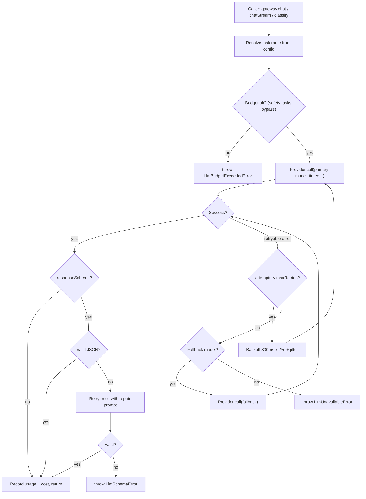
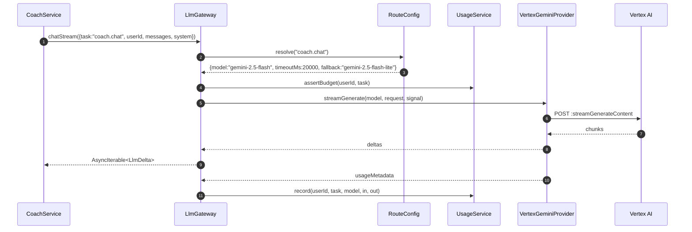
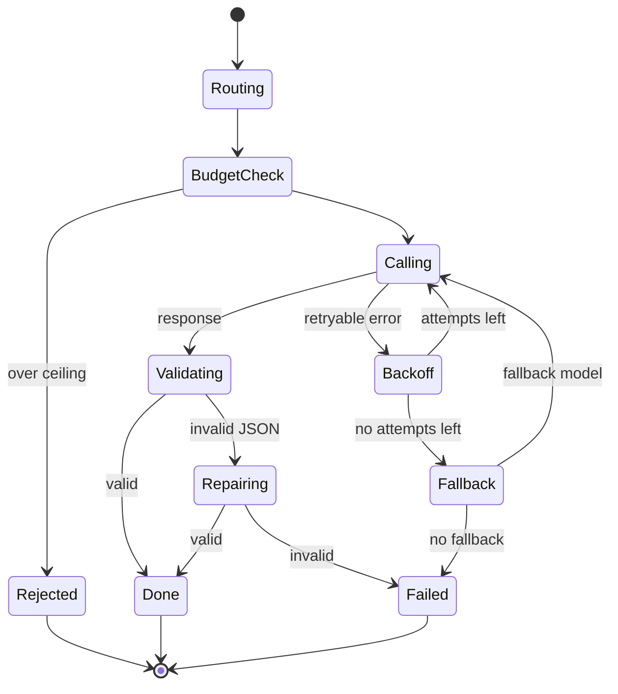

# M08 — LLM gateway

## 1. Header

| Field | Value |
| --- | --- |
| ID | M08 |
| Name | LLM gateway (provider abstraction, routing, cost accounting) |
| Release | v1 |
| Feature IDs | Supports F-06, F-20, F-21, F-31, F-33, F-80 |
| Backend module | `apps/api/src/modules/llm` |
| Flutter feature | — (server only) |
| Dependencies | M18 (Vertex AI project, Secret Manager, service account), `common/RedactingLogger` |
| Used by | M03, M07, M09, M10, M11, M13 |

## 2. Purpose

One internal gateway through which **every** AI call passes. It hides the provider (Gemini on Vertex AI in v1),
routes each *task* to a model tier from config, enforces timeouts, retries and fallbacks, validates structured
outputs, counts tokens and cost, and offers a deterministic fake provider for tests. Changing provider or model must be
a config change, never a code change in feature modules.

## 3. User stories & acceptance criteria

**US-08.1 Task routing** — Given config maps `coach.chat → gemini-2.5-flash`, When CoachService calls
`gateway.chatStream({task: 'coach.chat'})`, Then the Vertex model `gemini-2.5-flash` is used and the call is logged
with `task`, `model`, latency, token counts — never content.

**US-08.2 Fallback** — Given the primary model times out twice, When the task has a `fallback`, Then the gateway retries
once on the fallback model and returns `meta.fallbackUsed=true`. If all fail it throws `LlmUnavailableError` → HTTP 503
`AI_UNAVAILABLE`.

**US-08.3 Structured output** — Given a task with `responseSchema` (e.g. `safety.classify`), When the model returns
invalid JSON, Then the gateway retries once with a repair instruction; if still invalid it throws
`LlmSchemaError` and the caller applies its fail-safe.

**US-08.4 Cost ceiling** — Given a user consumed more than `perUserDailyTokenCeiling` (default 200k tokens), When a
non-safety task is requested, Then the gateway throws `LlmBudgetExceededError` (caller maps to `COACH_DAILY_LIMIT`) and
safety/crisis tasks are still allowed.

**US-08.5 Fake provider** — Given `LLM_PROVIDER=fake`, When tests run, Then responses are deterministic from fixtures
keyed by task + input hash, streaming yields fixed chunks, and no network call is made.

**US-08.6 No free tier** — Given `NODE_ENV=production|staging`, When the configured provider is `gemini-ai-studio`,
Then the app refuses to boot (config validation error).

## 4. Screens

N/A (server-only). Admin visibility is in M13 console → "AI usage" page (v1: totals per day per task, no content).

```
┌────────────────── AI usage (admin) ───────────────────┐
│ Date        Task              Calls  In tok  Out tok $│
│ 2026-11-20  coach.chat         1,204  3.9M   0.41M 2.2│
│ 2026-11-20  safety.classify    2,980  1.2M   0.06M 0.1│
│ 2026-11-20  moderation.class.    410  0.2M   0.01M 0.0│
│ Fallbacks: 3   Errors: 1   p95 latency coach: 2.1 s   │
└───────────────────────────────────────────────────────┘
```

## 5. Flows





## 6. State machine — single call attempt



## 7. Data

No content is stored by this module. Usage is aggregated in Redis and flushed hourly to a table.

**Table** (`system.llm_usage_daily`, in `schema.prisma`):

| Table | Columns |
| --- | --- |
| `system.llm_usage_daily` | `day` (date), `task`, `model`, `calls`, `inputTokens`, `outputTokens`, `costMicros` (BigInt), `fallbacks`, `errors`; PK (`day`,`task`,`model`) |

Per-user daily token counter: Redis key `llm:tok:{userId}:{YYYY-MM-DD}` (TTL 48 h). Per-message tokens are also written
to `AiMessage.inputTokens/outputTokens/model` by callers.

### Model routing config (`apps/api/src/modules/llm/llm.routes.ts`, overridable by env JSON `LLM_ROUTES`)

```ts
export const LLM_ROUTES: Record<LlmTask, LlmRoute> = {
  'safety.classify':      { model: 'gemini-2.5-flash-lite', timeoutMs: 4000,  maxRetries: 1, fallback: 'gemini-2.5-flash', temperature: 0,   json: true,  bypassBudget: true },
  'moderation.classify':  { model: 'gemini-2.5-flash-lite', timeoutMs: 5000,  maxRetries: 1, fallback: 'gemini-2.5-flash', temperature: 0,   json: true,  bypassBudget: true },
  'coach.chat':           { model: 'gemini-2.5-flash',      timeoutMs: 20000, maxRetries: 1, fallback: 'gemini-2.5-flash-lite', temperature: 0.7, maxOutputTokens: 700 },
  'coach.crisis':         { model: 'gemini-2.5-pro',        timeoutMs: 25000, maxRetries: 1, fallback: 'gemini-2.5-flash', temperature: 0.3, maxOutputTokens: 500, bypassBudget: true },
  'coach.sos':            { model: 'gemini-2.5-flash',      timeoutMs: 15000, maxRetries: 1, fallback: 'gemini-2.5-flash-lite', temperature: 0.6, maxOutputTokens: 250, bypassBudget: true },
  'onboarding.chat':      { model: 'gemini-2.5-flash',      timeoutMs: 20000, maxRetries: 1, fallback: 'gemini-2.5-flash-lite', temperature: 0.7, maxOutputTokens: 500 },
  'onboarding.extract':   { model: 'gemini-2.5-flash',      timeoutMs: 30000, maxRetries: 1, fallback: null, temperature: 0.2, json: true },
  'memory.summarize':     { model: 'gemini-2.5-flash',      timeoutMs: 30000, maxRetries: 2, fallback: 'gemini-2.5-flash-lite', temperature: 0.2, maxOutputTokens: 1600 },
  'nudge.write':          { model: 'gemini-2.5-flash-lite', timeoutMs: 8000,  maxRetries: 1, fallback: null, temperature: 0.8, maxOutputTokens: 120, json: true },
};
```

Model names are examples; the exact current Vertex model IDs are set in env at deploy time.

### Price table (`llm.prices.ts`, USD per 1M tokens, config — verify against the official pricing page before launch)

```ts
export const PRICES: Record<string, { in: number; out: number }> = {
  'gemini-2.5-flash-lite': { in: 0.10, out: 0.40 },
  'gemini-2.5-flash':      { in: 0.30, out: 2.50 },
  'gemini-2.5-pro':        { in: 1.25, out: 10.00 },
};
// costMicros = round((in * price.in + out * price.out) / 1e6 * 1e6)
```

## 8. API

Internal TypeScript API only. No HTTP endpoints except admin read-only:

| Method | Path | Purpose | Auth |
| --- | --- | --- | --- |
| GET | `/admin/llm/usage?from=2026-11-01&to=2026-11-30` | Aggregated usage rows | ADMIN |

### The interface

```ts
// llm.types.ts
export type LlmTask =
  | 'safety.classify' | 'moderation.classify' | 'coach.chat' | 'coach.crisis' | 'coach.sos'
  | 'onboarding.chat' | 'onboarding.extract' | 'memory.summarize' | 'nudge.write';

export interface LlmMessage { role: 'user' | 'model'; text: string }

export interface LlmToolDecl { name: string; description: string; parameters: JSONSchema7 }

export interface LlmRequest {
  task: LlmTask;
  userId?: string;              // for budget only — NEVER placed into the prompt
  system: string;               // assembled system prompt
  messages: LlmMessage[];
  tools?: LlmToolDecl[];
  responseSchema?: JSONSchema7; // forces JSON mode + validation (ajv)
  locale?: string;
  signal?: AbortSignal;
}

export interface LlmUsage { inputTokens: number; outputTokens: number; costMicros: number }

export interface LlmResult<T = string> {
  text: string;
  json?: T;
  toolCalls: { name: string; args: unknown }[];
  usage: LlmUsage;
  meta: { model: string; latencyMs: number; fallbackUsed: boolean; finishReason: 'STOP' | 'MAX_TOKENS' | 'SAFETY' | 'OTHER' };
}

export type LlmDelta =
  | { type: 'text'; text: string }
  | { type: 'tool'; name: string; args: unknown }
  | { type: 'end'; result: Omit<LlmResult, 'text'> & { text: string } };

export interface LlmProvider {
  readonly name: 'vertex-gemini' | 'fake';
  generate(model: string, req: LlmRequest, opts: { timeoutMs: number; temperature: number; maxOutputTokens?: number }): Promise<LlmResult>;
  stream(model: string, req: LlmRequest, opts: { timeoutMs: number; temperature: number; maxOutputTokens?: number }): AsyncIterable<LlmDelta>;
  countTokens?(model: string, req: LlmRequest): Promise<number>;
}

// llm.gateway.ts
export class LlmGateway {
  chat<T = string>(req: LlmRequest): Promise<LlmResult<T>>;
  chatStream(req: LlmRequest): AsyncIterable<LlmDelta>;
  classify<T>(task: 'safety.classify' | 'moderation.classify', input: { system: string; text: string; locale?: string; schema: JSONSchema7 }): Promise<T>;
}

export class LlmUnavailableError extends Error {}
export class LlmSchemaError extends Error {}
export class LlmBudgetExceededError extends Error {}
```

## 9. Backend design

| Class | Responsibility |
| --- | --- |
| `LlmModule` | Provides `LLM_PROVIDER` token chosen by `LLM_PROVIDER` env (`vertex` / `fake`) |
| `VertexGeminiProvider` | `@google-cloud/vertexai` (or `@google/genai` with `vertexai: true`), region `europe-west1`, ADC service account `llm-invoker@` |
| `FakeLlmProvider` | Fixtures in `test/fixtures/llm/*.json`; key = `${task}:${sha256(lastUserText)}`; default echo template per task |
| `LlmGateway` | Routing, budget, retries, fallback, schema validation (ajv), usage recording |
| `UsageService` | Redis counters, hourly flush job `llm.usage-flush`, `assertBudget()` |
| `RouteConfig` | Loads `LLM_ROUTES` + env overrides, zod-validated at boot |

Retry policy: retry on 429, 500, 503, `DEADLINE_EXCEEDED`, network reset. Backoff `300ms × 2^attempt + rand(0..200)`.
Never retry after the first streamed token has been forwarded to the client (fallback only before first token).

Safety settings sent to Vertex: provider safety filters at `BLOCK_ONLY_HIGH` for harassment/hate/dangerous so that users
can describe their struggles (sexual habits, self-harm thoughts) without the provider silently blocking; our own M09
layer is responsible for safety. A `finishReason=SAFETY` result → caller fallback script.

Prompt caching: the static system prefix (core + methods + guardrails) uses Vertex context caching when > 1,024 tokens;
user context is never cached.

Logging (pino): `{ task, model, latencyMs, inputTokens, outputTokens, fallbackUsed, finishReason, error.code }` only.

Boot validation: refuse to start when `NODE_ENV` ∈ {`staging`,`production`} and (`LLM_PROVIDER=fake` or an AI Studio
API key env `GEMINI_API_KEY` is set).

## 10. Flutter design

N/A. The app never calls the LLM directly and ships no AI keys.

## 11. Edge cases

| Case | Behaviour |
| --- | --- |
| Stream breaks after first token | Emit `{type:'end', finishReason:'OTHER'}`; caller marks reply truncated; no retry |
| Model returns tool call with bad args | Validate with ajv; drop the call; count metric `llm.tool_invalid` |
| `MAX_TOKENS` | Return what was produced; coach UI shows it normally |
| Region outage | Fallback model in the same region; no cross-region routing (data residency) |
| Clock skew on daily counters | Day key uses UTC; per-user quotas in M07 use user tz separately |
| Price table missing a model | `costMicros=0` + warning metric; never crash |

## 12. Security & privacy

- `userId` is used for budgeting only and must not appear in `system` or `messages` — enforced by a unit test that
  scans requests for UUID patterns and `@`.
- Vertex AI paid tier, data-processing terms accepted; no AI Studio keys in staging/prod.
- Service account has only `roles/aiplatform.user`.
- No content in logs, traces or Sentry (`beforeSend` strips `extra`).

## 13. Analytics events

Server metrics (Cloud Monitoring), not product analytics:
`llm.calls{task,model}`, `llm.latency_ms{task}`, `llm.tokens_in/out{task}`, `llm.cost_micros{task}`,
`llm.fallbacks{task}`, `llm.errors{task,code}`, `llm.schema_failures{task}`, `llm.budget_rejections`.
Alert: daily cost > 80% of `LLM_MONTHLY_BUDGET_USD / 30`.

## 14. Tests

- Unit: routing resolves each task; env override JSON works; invalid config fails boot.
- Unit: retry on 503 then success; fallback after max retries; no retry after first token.
- Unit: JSON schema repair path (fake returns invalid then valid).
- Unit: budget ceiling blocks `coach.chat` but not `safety.classify` / `coach.crisis`.
- Unit: cost calculation for each model.
- Unit: request scanner rejects prompts containing a UUID or email.
- Integration (staging only, tagged `@vertex`): one real call per task returns valid output.

## 15. Open questions

- `system.llm_usage_daily` is in `schema.prisma`.
- Confirm exact Vertex model IDs and whether Pro is affordable for crisis at scale (fallback to Flash is acceptable).
- Vertex abuse-monitoring logging / zero data retention settings to confirm before launch.
