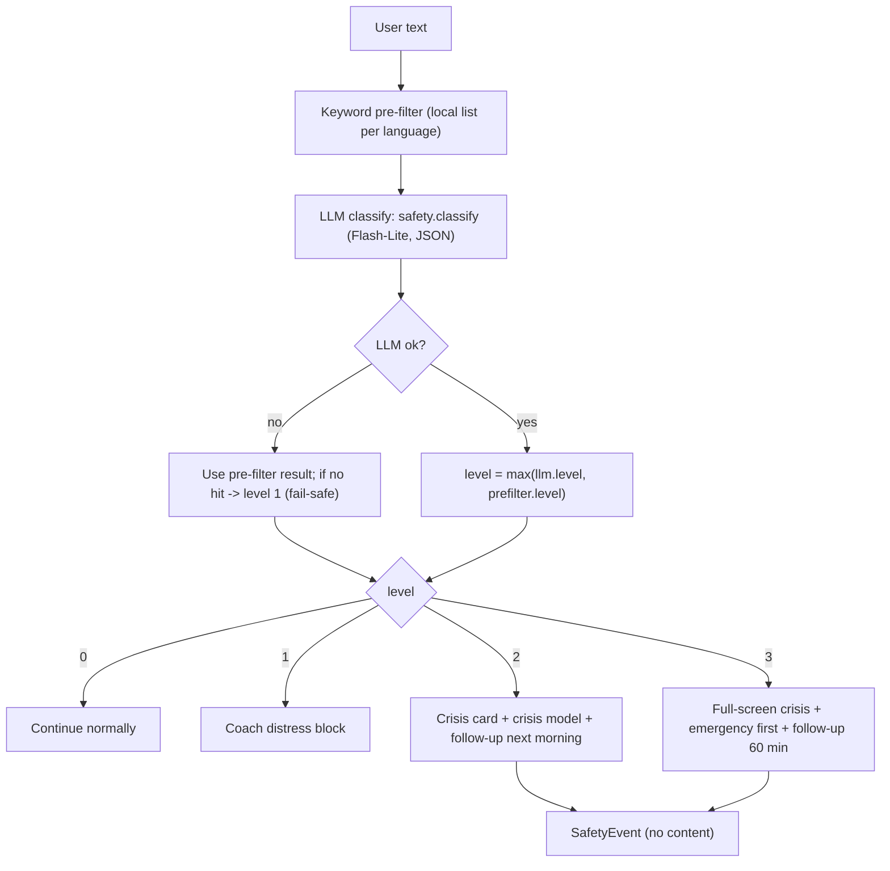
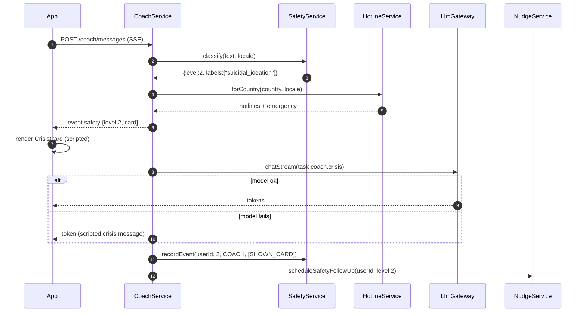
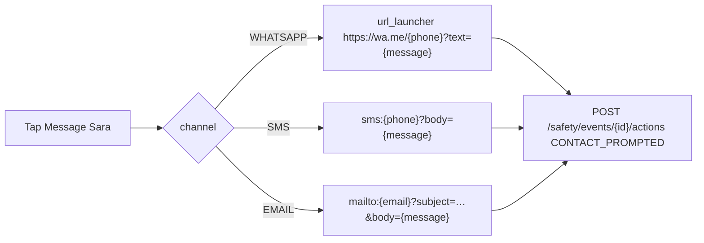
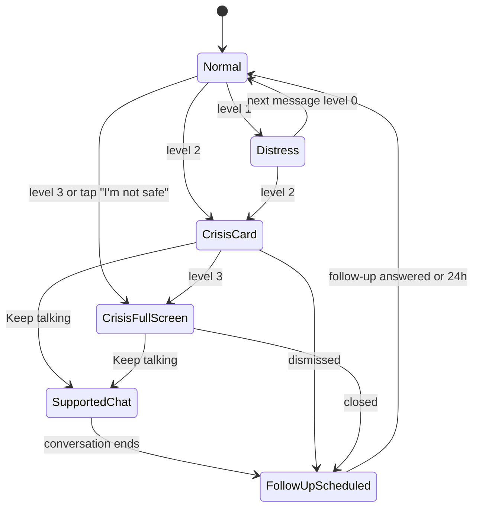

# M09 — Safety & crisis

## 1. Header

| Field | Value |
| --- | --- |
| ID | M09 |
| Name | Safety classification, crisis protocol, trusted contact |
| Release | v1 |
| Feature IDs | F-07 (trusted contact), F-33 (crisis path); supports F-20, F-31, F-40, F-41 |
| Backend module | `apps/api/src/modules/safety` |
| Flutter feature | `apps/mobile/lib/features/safety` |
| Dependencies | M08 LLM gateway, M11 (follow-up push), M16 (localized scripts), M18 (hotline seed data) |
| Used by | M07 coach, M10 SOS, M12 community, M05 journal (only when shared with coach) |

## 2. Purpose

Detect distress and risk of self-harm or suicide in anything a user writes to the coach, in SOS, or in the community,
and respond with a fixed, tested protocol: a scripted crisis card with the right local hotlines, a one-tap message to
the user's trusted contact, a calm coach conversation using the strongest model, and a follow-up check-in. The
hotline card **never depends on the model**. TurnWell never contacts anyone without the user's tap, and never promises
confidentiality from emergency services.

## 3. User stories & acceptance criteria

**US-09.1 Classification on every message** — Given any user text sent to `POST /coach/messages`, `POST /sos/...`
coach turns, `POST /community/posts` or replies, When it reaches the API, Then `SafetyService.classify()` returns a
level 0–3 within 1.5 s p95 before any reply or publication.

**US-09.2 Level 2 in coach** — Given "I keep thinking everyone would be better off without me", Then the API emits SSE
`safety` `{level:2}` first; the app shows the `CrisisCard` with the country hotline(s), "Message my trusted contact"
(if set up) and "Keep talking with Noor"; the coach reply uses `coach.crisis`; a `SafetyEvent` is stored with
actions `["SHOWN_CARD"]`; a follow-up nudge is scheduled for the next morning 09:00 local (respecting quiet hours).

**US-09.3 Level 3** — Given a message stating plan, means or timing, Then the app opens the full-screen `/crisis`
route with the emergency number first (e.g. 112 / 911 / local), then hotlines, then trusted contact; follow-up push in
60 minutes, ignoring quiet hours once.

**US-09.4 Model failure** — Given Vertex is down, When a level-2 keyword pre-filter hit occurs, Then the crisis card is
still shown (scripted, from cached hotlines) and the coach shows the scripted crisis message from
`prompts/crisis-response.md` in the user's language.

**US-09.5 Community post at level ≥ 2** — Given a post classified level 2, Then `moderationState=HIDDEN_CRISIS`, it is
not visible to others, the author sees "Your post is saved privately. We're here for you." with the crisis card.

**US-09.6 Trusted contact one-tap** — Given a trusted contact (WhatsApp) is set up, When the user taps "Message
Sara", Then the native WhatsApp composer opens pre-filled with the user's pre-written message; TurnWell sends nothing
itself; `SafetyEvent.actions` gains `CONTACT_PROMPTED` (and `CONTACT_SENT` if the composer returned success where the OS
reports it).

**US-09.7 Offline crisis** — Given no network, When the user opens SOS → "I'm not safe", Then the cached hotline list
for their country shows from the local DB (refreshed at most every 7 days).

**US-09.8 Level 1 distress** — Given "I feel so ashamed, I'm disgusting", Then no card is forced; the coach prompt adds
the distress block (validate, de-shame, suggest talking to someone, offer trusted contact softly).

**US-09.9 Minor signal** — Given the classifier returns label `minor_signal` (e.g. "I'm 15"), Then the account is
flagged (`AuditLog action=MINOR_SIGNAL`), community access is paused pending review (M13), the coach continues safely.

## 4. Screens

| Screen | Route | Notes |
| --- | --- | --- |
| Inline crisis card | inside coach / SOS / composer | Solid (not glass), high contrast |
| Full-screen crisis | `/crisis` | Level 3 or "I'm not safe" button |
| Trusted contact setup | `/onboarding/safety`, `/me/settings/trusted-contact` | Name, channel, value, message |
| Post held privately | in community composer result | M12 shows it, M09 provides the card |

### Inline crisis card

```
╭──────────────────────────────────────╮   solid surface #FFFFFF / #111827
│ You don't have to go through this    │
│ alone.                               │
│                                      │
│ ☎  Talk to someone now               │
│ ┌──────────────────────────────────┐ │
│ │ Algeria — SOS Amitié      Call ▸ │ │  ← hotline rows (country first)
│ │ International — Befrienders  ▸   │ │
│ └──────────────────────────────────┘ │
│ [ 💬 Message Sara ]                  │  ← trusted contact (if set)
│ [ Keep talking with Noor ]           │
│ If you're in danger now, call 14.    │  ← emergency line
╰──────────────────────────────────────╯
```

### Full-screen crisis (`/crisis`)

```
┌──────────────────────────────────────┐
│                               ✕ close│
│                                      │
│   Your safety matters most           │
│   right now.                         │
│                                      │
│ ┌──────────────────────────────────┐ │
│ │  📞  Call emergency  14          │ │  ← biggest button, first
│ └──────────────────────────────────┘ │
│ ┌──────────────────────────────────┐ │
│ │  SOS Amitié Alger     Call       │ │
│ └──────────────────────────────────┘ │
│ ┌──────────────────────────────────┐ │
│ │  💬 Message Sara                 │ │
│ └──────────────────────────────────┘ │
│                                      │
│  Breathe with me  ◯  (4-7-8 guide)   │  ← link to SOS breathe tool
│  Keep talking with Noor →            │
└──────────────────────────────────────┘
```

### Trusted contact setup

```
┌──────────────────────────────────────┐
│ ←  Someone you trust                 │
│ If a moment gets really hard, you    │
│ can message them with one tap.       │
│ We never contact them for you.       │
│ ╭──────────────────────────────────╮ │
│ │ Name        [ Sara            ]  │ │
│ │ Reach via   (WhatsApp)(SMS)(Email)│ │
│ │ Number      [ +213 5…         ]  │ │
│ │ Message     [ I'm having a hard  │ │
│ │              time. Can you call  │ │
│ │              me? ]               │ │
│ ╰──────────────────────────────────╯ │
│ [ Save ]            [ Skip for now ] │
└──────────────────────────────────────┘
```

## 5. Flows

### 5.1 Classification pipeline



Pre-filter hits can only **raise** the level (pre-filter max = 2; only the LLM can return 3, or the user tapping "I'm not safe").

### 5.2 Crisis sequence in coach



### 5.3 Trusted contact one-tap



## 6. State machine — crisis session (app)



While in `SupportedChat`, every coach message keeps using `coach.crisis` until 3 consecutive messages classify ≤ 1.

## 7. Data

Server: `private.safety_events` (no content), `private.trusted_contacts` (all fields KMS-encrypted),
`system.hotlines`, `system.audit_logs` (minor signals). Crisis coach messages are stored like other coach messages
(`AiConversation.kind = CRISIS` when started from `/crisis`, otherwise inside the COACH conversation with
`AiMessage.safetyLevel`).

Local: `local_hotlines` (country, name, phone, sms, url, isEmergency, fetchedAt) and `local_trusted_contact` (decrypted,
inside SQLCipher) so the crisis UI works offline.

### Level definitions

| Level | Name | Signals (examples) | Action |
| --- | --- | --- | --- |
| 0 | None | Ordinary struggle, slips, urges, anger, shame without hopelessness | Continue |
| 1 | Distress | Intense shame, hopelessness about change ("I'll never change"), crying, panic, loneliness | Coach distress block; soft mention of trusted contact |
| 2 | Risk | Passive or active suicidal thoughts, self-harm thoughts or recent self-harm, "better off without me" | Crisis card + crisis model + follow-up next morning |
| 3 | Imminent | Plan, means, timing, goodbye messages, "tonight", self-harm in progress | Full-screen crisis, emergency number first, follow-up in 60 min |

Additional labels (not levels): `abuse_disclosure` (being harmed by someone → show relevant hotline type if available),
`minor_signal`, `harm_to_others` (→ level 3 handling with emergency number; coach does not help with plans).

### Hotline lookup algorithm

```ts
async forCountry(countryHint: string | null, locale: string): Promise<CrisisCardDto> {
  // 1. Country: X-Country header (device region) → user setting override → Cloud LB geo header → 'ZZ'
  const country = normalize(countryHint) ?? 'ZZ';
  // 2. Rows for country, verified within 365 days
  let rows = await repo.find({ countryCode: country, verifiedAt: { gte: daysAgo(365) } });
  // 3. Order: isEmergency first (separate field), then rows whose languages include locale, then others
  const emergency = rows.find(r => r.isEmergency) ?? DEFAULT_EMERGENCY[country] ?? null;
  let lines = rows.filter(r => !r.isEmergency).sort(byLanguageMatch(locale)).slice(0, 3);
  // 4. Always append the global fallback (ZZ) if fewer than 2 lines
  if (lines.length < 2) lines = [...lines, ...(await repo.find({ countryCode: 'ZZ' }))].slice(0, 3);
  return { emergency, hotlines: lines, trustedContact: await contacts.exists(userId) };
}
```

The app caches the result per country for 7 days and pre-fetches it right after onboarding.

## 8. API

| Method | Path | Purpose | Auth |
| --- | --- | --- | --- |
| GET | `/safety/hotlines?country=DZ` | Hotlines + emergency for a country (cacheable 24 h) | USER |
| GET | `/safety/trusted-contact` | Decrypted trusted contact | USER |
| PUT | `/safety/trusted-contact` | Create/replace | USER |
| DELETE | `/safety/trusted-contact` | Remove | USER |
| POST | `/safety/events` | App-initiated event (tap "I'm not safe") | USER |
| POST | `/safety/events/:id/actions` | Append action `CONTACT_PROMPTED` / `CONTACT_SENT` | USER |
| POST | `/safety/follow-up/:eventId/answer` | User answered follow-up ("I'm okay" / "Still hard") | USER |
| GET | `/admin/hotlines` / PUT `/admin/hotlines/:id` | Maintain directory | ADMIN |

`GET /safety/hotlines?country=DZ`
```json
{
  "country": "DZ",
  "emergency": { "name": "Emergency (Protection civile)", "phone": "14" },
  "hotlines": [
    { "id": "0193…", "name": "SOS Amitié Alger", "phone": "+213 …", "url": "https://…", "languages": ["fr","ar"] },
    { "id": "0193…", "name": "Befrienders Worldwide", "url": "https://befrienders.org", "languages": ["en","fr","ar","es"] }
  ],
  "fetchedAt": "2026-11-20T21:00:00Z"
}
```
Numbers in this spec are placeholders; the directory is seeded from verified sources (M18 seed script) and each row has
`verifiedAt`.

`PUT /safety/trusted-contact`
```json
{ "name": "Sara", "channel": "WHATSAPP", "value": "+2135…", "message": "I'm having a hard time. Can you call me?" }
```
→ `200 { "name": "Sara", "channel": "WHATSAPP", "valueMasked": "+213 5•• ••• •12", "message": "…" }`

`POST /safety/events`
```json
{ "level": 3, "source": "SOS", "action": "SHOWN_CARD" }
```
→ `201 { "eventId": "0193…", "followUpAt": "2026-11-20T22:15:00Z" }`

Errors: `VALIDATION_FAILED` (phone must be E.164, email valid, message ≤ 300 chars, name ≤ 40), `NOT_FOUND`.

## 9. Backend design

```ts
export interface SafetyResult {
  level: 0 | 1 | 2 | 3;
  labels: ('suicidal_ideation' | 'self_harm' | 'plan_or_means' | 'hopelessness' | 'shame' | 'panic'
         | 'abuse_disclosure' | 'harm_to_others' | 'minor_signal')[];
  source: 'llm' | 'prefilter' | 'failsafe';
}

export class SafetyService {
  classify(text: string, locale: string): Promise<SafetyResult>;
  recordEvent(userId: string, level: number, source: SafetySource, actions: SafetyAction[]): Promise<{ eventId: string }>;
  appendAction(userId: string, eventId: string, action: SafetyAction): Promise<void>;
  handleMinorSignal(userId: string): Promise<void>; // audit + community pause (M13 hook)
}

export class KeywordPrefilter {
  // Lists in packages/prompts/safety-keywords/{en,ar,fr,es}.txt, normalised (lowercase, diacritics/tashkeel removed,
  // Arabic letter variants unified: أإآ→ا, ة→ه, ى→ي). Returns level 2 on hit, else 0.
  scan(text: string, locale: string): { level: 0 | 2; hits: number };
}

export class HotlineService { forCountry(country: string | null, locale: string, userId: string): Promise<CrisisCardDto>; }
export class TrustedContactService { get(userId): Promise<TrustedContactDto | null>; put(userId, dto); delete(userId); }
export class SafetyFollowUpService {
  // level 2 → next day 09:00 local (or after quiet hours end if later); level 3 → now + 60 min, may override quiet hours once
  schedule(userId: string, eventId: string, level: 2 | 3): Promise<Date>;
}
```

- Classifier prompt: `prompts/safety-classifier.md`; crisis prompt + scripts: `prompts/crisis-response.md`.
- `classify` runs prefilter and LLM **in parallel**; total timeout 1.5 s for LLM, then fail-safe.
- Follow-up uses BullMQ delayed job `safety.follow-up` → M11 `PushService.sendDiscreet(userId, 'SAFETY_FOLLOW_UP')`;
  the follow-up opens the coach with "Checking in after last night. How are you now?" (scripted, localized).
- `SafetyEvent` retention 1 year (`safety.cleanup`).

## 10. Flutter design

```
features/safety/
├── data/
│   ├── safety_api.dart
│   ├── hotline_repository.dart       # cache in local_hotlines, refresh every 7 days
│   └── trusted_contact_repository.dart
├── domain/ crisis_card.dart, hotline.dart, trusted_contact.dart
└── presentation/
    ├── crisis_card.dart              # solid, never blurred, used by coach/sos/community
    ├── crisis_screen.dart            # /crisis
    ├── trusted_contact_screen.dart
    └── providers/
        ├── crisis_controller.dart    # @riverpod: current level, notify(level), open full screen on 3
        └── hotlines_provider.dart
```

- `CrisisCard` buttons use `url_launcher` (`tel:`, `sms:`, `https://wa.me/`, `mailto:`). Large text safe; min 56 px rows.
- `/crisis` is reachable from: SOS "I'm not safe", level-3 event, follow-up notification "Still hard".
- No haptics, no animations other than a 150 ms fade. Not dismissible by swipe; close button top corner.

## 11. Edge cases

| Case | Behaviour |
| --- | --- |
| User writes about the past ("two years ago I wanted to die, now I'm better") | Classifier prompt distinguishes past/resolved → level 1 at most |
| Quoting lyrics / jokes ("this exam is killing me") | Level 0 (idioms list in prompt examples) |
| Sins-mode statement "I deserve hell" | Level 1 (shame/hopelessness), coach responds with mercy framing, not rulings |
| Repeated level-2 messages | One follow-up per 12 h max; card shown each time but collapsed after the 2nd in a session |
| Country unknown | Global fallback (ZZ) + generic "call your local emergency number" |
| Trusted contact not set | Card shows "Add someone you trust" link instead (not during level 3) |
| Third party at risk | Treat as `harm_to_others` → emergency number, coach does not engage with plans |

## 12. Security & privacy

- `SafetyEvent` stores level, source and actions only — never text.
- Trusted contact fields KMS-encrypted; masked in responses after creation except to the owner's device.
- TurnWell never sends messages to the trusted contact server-side and never calls emergency services itself.
- Copy never states "this is confidential" or "nobody will be told"; it says "We never contact anyone for you."
- Minor-signal handling is audited (`AuditLog`).

## 13. Analytics events

| Event | Properties |
| --- | --- |
| `safety.card_shown` | `level`, `source` |
| `safety.hotline_tapped` | `isEmergency`, `country` |
| `safety.contact_prompted` | `channel` |
| `safety.followup_answered` | `answer` (`OK` / `STILL_HARD`) |
| `safety.classifier_failsafe` | — |

## 14. Tests

- Prompt suite: `prompts/tests/safety-cases.yaml` (≥ 20 cases, 4 languages) — every expected level met, 0 false negatives
  on level 2–3 cases (CI blocks merge).
- Unit: prefilter normalisation (Arabic variants, French accents); prefilter can raise but not lower.
- Unit: hotline ordering (emergency separate, language match first, ZZ fallback when < 2).
- Unit: follow-up times (quiet hours, level 3 override, max 1 per 12 h).
- E2E: coach level-2 → `safety` event before tokens even when fake LLM throws.
- E2E: community post level 2 → `HIDDEN_CRISIS`, not in feed.
- Widget: crisis card in AR (RTL) with 200% text, no overflow; `/crisis` emergency button first.

## 15. Open questions

- Source and review cadence of the hotline directory (proposal: quarterly review, `verifiedAt` displayed in admin).
- Should level 3 also offer one-tap "Share my location with Sara"? (Not v1.)
- Legal review of crisis copy per market before launch.
