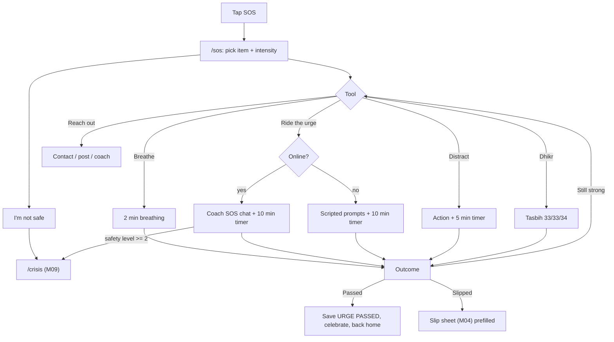
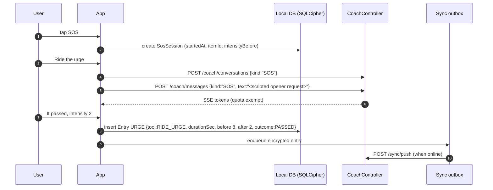
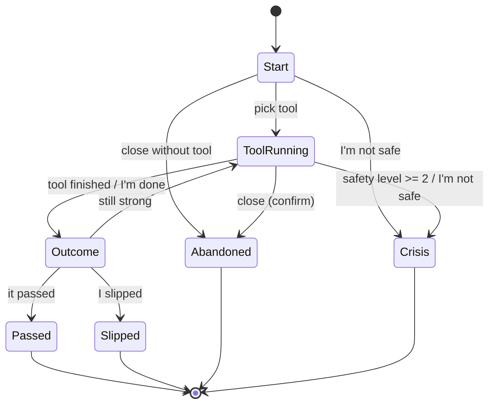

# M10 — SOS (urge help)

## 1. Header

| Field | Value |
| --- | --- |
| ID | M10 |
| Name | SOS button, urge flow, urge outcome |
| Release | v1 |
| Feature IDs | F-30, F-31, F-32 (F-33 crisis path handed to M09) |
| Backend module | `coach` (SOS conversations, `kind=SOS`) + `sync` (URGE entries) |
| Flutter feature | `apps/mobile/lib/features/sos` |
| Dependencies | M07 coach (streaming, exempt from quota), M09 safety (crisis), M04/M06 (URGE entry saved E2E), M04 items, M14 (mode, coach persona), M16 |

## 2. Purpose

When an urge hits, one tap on the always-visible SOS button opens a calm, full-screen flow with five tools: **Breathe**,
**Ride the urge** (timer + coach), **Distract**, **Dhikr** (Sins mode) and **Reach out**, plus an "I'm not safe" exit to
the crisis screen. At the end the user says whether the urge passed; a passed urge is logged as a **win** and counts in
progress. Every tool except the coach works fully offline.

## 3. User stories & acceptance criteria

**US-10.1 One tap** — Given any main tab is visible, When the user taps the SOS button, Then `/sos` opens in < 300 ms
with no network call blocking the UI, and a light haptic fires.

**US-10.2 Choose item and intensity** — Given the SOS start screen, When the user picks the item ("which urge?", skippable
if only one item) and an intensity 0–10 (default 7), Then the tool grid shows; Dhikr is visible only if the item's
mode is `SINS` or the user has Sins mode enabled.

**US-10.3 Breathe** — Given the user taps Breathe, Then a 2-minute guided breathing animation runs (4 s in, 4 s hold,
6 s out = 14 s cycle, ~9 cycles), with optional haptic pulse on each phase, then shows the outcome screen.

**US-10.4 Ride the urge** — Given online, When the user taps Ride the urge, Then a 10-minute timer starts and a coach
SOS conversation (`kind=SOS`) opens with a scripted first message; messages here never count toward the 15/day limit.
Given offline, Then the timer runs with scripted prompts at 0:00, 2:00, 5:00, 8:00 (from `assets/sos_scripts/<lang>.json`).

**US-10.5 Distract** — Given Distract, Then 6 quick action cards show (change room, walk 5 minutes, drink a glass of
water, 20 squats or push-ups, call or text a friend, open journal); tapping one starts a 5-minute soft timer.

**US-10.6 Dhikr** — Given Sins mode, When the user taps Dhikr, Then a tasbih counter guides 33 × SubhanAllah,
33 × Alhamdulillah, 34 × Allahu Akbar (Arabic text + transliteration + translation in UI language), tap anywhere to count,
haptic each tap, stronger haptic at each 33.

**US-10.7 Reach out** — Given Reach out, Then options show: message trusted contact (M09 one-tap), write a community post
(opens composer with visibility "People like me"), talk to coach. (Accountability partner is v2.)

**US-10.8 Outcome** — Given any tool finished or the user taps "I'm done", Then the outcome screen asks "Did the urge
pass?" (Passed / Still strong / I slipped) + intensity after (0–10). Passed → URGE entry `outcome=PASSED`, celebration
animation, progress counts a win. Still strong → offer another tool. I slipped → opens the slip sheet (M04) pre-filled,
copy "That's okay. Let's learn from it."

**US-10.9 I'm not safe** — Given the SOS screen, When the user taps "I'm not safe" (always visible, bottom), Then
`/crisis` opens (M09) and `POST /safety/events {level:3, source:"SOS"}` is sent (queued if offline).

**US-10.10 Interruption** — Given the app goes to background during a timer, Then the timer continues (wall-clock based)
and a local notification (discreet template) fires when it ends.

## 4. Screens

| Screen | Route | Notes |
| --- | --- | --- |
| SOS start | `/sos` | Full-screen overlay, darker background, glass cards |
| Breathe | `/sos/breathe` | Expanding/contracting circle |
| Ride the urge | `/sos/ride` | Timer + chat (online) or scripted prompts (offline) |
| Distract | `/sos/distract` | 6 action cards + 5-min timer |
| Dhikr | `/sos/dhikr` | Tasbih counter |
| Reach out | `/sos/reach-out` | Trusted contact / post / coach |
| Outcome | `/sos/outcome` | Passed / still strong / slipped + intensity |

### SOS start

```
┌──────────────────────────────────────┐
│ ✕                                    │
│   Let's get through this together.   │
│   Urges rise and fall, usually       │
│   within 15 minutes.                 │
│                                      │
│ Which urge?  (Pornography)(Smoking)  │  ← GlassChip, skip if one item
│ How strong?  0 ───────●── 10   7     │  ← slider
│                                      │
│ ╭────────────╮  ╭────────────╮       │
│ │ ◯ Breathe  │  │ ⏱ Ride the │       │
│ │   2 min    │  │   urge 10m │       │
│ ╰────────────╯  ╰────────────╯       │
│ ╭────────────╮  ╭────────────╮       │
│ │ ↺ Distract │  │ ✧ Dhikr    │       │  ← Dhikr only in Sins mode
│ │   5 min    │  │   3 min    │       │
│ ╰────────────╯  ╰────────────╯       │
│ ╭──────────────────────────────╮     │
│ │ ☏ Reach out                  │     │
│ ╰──────────────────────────────╯     │
│                                      │
│        I'm not safe →                │  ← always visible, to /crisis
└──────────────────────────────────────┘
```

### Breathe

```
┌──────────────────────────────────────┐
│ ✕                          1:24 left │
│                                      │
│              ╭───────╮               │
│           ╭──┤       ├──╮            │  ← circle scales 0.6 → 1.0
│           │  │ Breathe│  │           │
│           ╰──┤  in    ├──╯           │
│              ╰───────╯               │
│                4                     │  ← phase countdown
│                                      │
│        [ I'm done ]                  │
└──────────────────────────────────────┘
```

### Ride the urge (online)

```
┌──────────────────────────────────────┐
│ ✕   Ride the urge           07:42    │  ← timer ring in header
│──────────────────────────────────────│
│ ╭────────────────────────────╮       │
│ │ I'm here. Notice where you │       │  ← coach (kind=SOS)
│ │ feel the urge in your body.│       │
│ ╰────────────────────────────╯       │
│               ╭─────────────────────╮│
│               │ chest. it's strong  ││
│               ╰─────────────────────╯│
│ ╭────────────────────────────╮       │
│ │ Good. It's a wave. Breathe │       │
│ │ out slowly and rate it…    │       │
│ ╰────────────────────────────╯       │
│ Intensity now: 0 ──●────── 10   4    │  ← quick slider, logged locally
│ ╭────────────────────────────╮ ╭───╮ │
│ │ Write…                     │ │ ↑ │ │
│ ╰────────────────────────────╯ ╰───╯ │
│        [ The urge passed ]           │
└──────────────────────────────────────┘
```

### Dhikr

```
┌──────────────────────────────────────┐
│ ✕                       2 of 3       │
│                                      │
│          سُبْحَانَ ٱللَّٰهِ              │
│          SubhanAllah                 │
│          Glory be to God             │
│                                      │
│              ╭─────╮                 │
│              │ 21  │  / 33           │  ← tap anywhere to count
│              ╰─────╯                 │
│        ● ● ● ○ ○ ○ (progress)        │
│                                      │
│        [ I'm done ]                  │
└──────────────────────────────────────┘
```

### Outcome

```
┌──────────────────────────────────────┐
│   Did the urge pass?                 │
│ ╭──────────────────────────────────╮ │
│ │  ✓  It passed                    │ │  → win + sunrise sparkle
│ ╰──────────────────────────────────╯ │
│ ╭──────────────────────────────────╮ │
│ │  ~  Still strong — try another   │ │  → back to tools
│ ╰──────────────────────────────────╯ │
│ ╭──────────────────────────────────╮ │
│ │  ·  I slipped                    │ │  → slip sheet (neutral grey)
│ ╰──────────────────────────────────╯ │
│ How strong is it now? 0 ─●──── 10  2 │
└──────────────────────────────────────┘
```

### Tool timings

| Tool | Duration | Steps / states | Offline |
| --- | --- | --- | --- |
| Breathe | 120 s (9 × 14 s cycle: in 4, hold 4, out 6), last partial cycle trimmed | `intro(3s) → cycling → done` | Yes |
| Ride the urge | 600 s; scripted prompts at 0:00, 2:00, 5:00, 8:00 if offline; coach chat if online | `starting → riding → (minute 10) prompt outcome` | Partial (scripted) |
| Distract | Pick action → 300 s soft timer | `choosing → doing → done` | Yes |
| Dhikr | Counts 33 / 33 / 34 (≈ 2–4 min) | `set1 → set2 → set3 → done` | Yes |
| Reach out | Immediate | `choosing → external app / composer / coach` | Contact: yes; post/coach: online |

## 5. Flows





## 6. State machine — SOS session



`Abandoned` sessions with a tool started are saved with `outcome=UNKNOWN` (they still show that the user reached out).

## 7. Data

Encrypted `Entry` of type `URGE` (payload shape in `03-data-model.md` §4):

```json
{ "startedAt": "2026-11-20T22:10:00Z", "tool": "RIDE_URGE", "durationSec": 600,
  "intensityBefore": 8, "intensityAfter": 2, "outcome": "PASSED" }
```

- `tool` enum: `BREATHE`, `RIDE_URGE`, `DISTRACT`, `DHIKR`, `REACH_OUT`, `MULTIPLE` (if > 1 tool used; first tool kept in
  `tools[]` array for v2 analytics).
- `itemId` stored in plaintext column (`Entry.itemId`) so wins can be counted per item without content.
- `occurredOn` = local day of `startedAt`.
- Coach SOS messages: `AiConversation.kind = SOS`, quota-exempt.

Local only: `sos_sessions` (in-progress state for resume: `id`, `toolState`, `timerEndsAt`), cleared after outcome.

Offline scripts: `assets/sos_scripts/{en,ar,fr,es}.json`:
```json
{ "ride": { "0": "Notice the urge. Where do you feel it in your body?", "120": "…", "300": "…", "480": "…" },
  "distract": ["Change room", "Walk 5 minutes", "Drink a glass of water", "20 squats or push-ups", "Call or text a friend", "Open your journal"] }
```

## 8. API

No SOS-specific endpoints. Uses:

| Method | Path | From | Notes |
| --- | --- | --- | --- |
| POST | `/coach/conversations` | M07 | `{ "kind": "SOS" }` |
| POST | `/coach/messages` | M07 | `kind: "SOS"`; quota exempt; task `coach.sos` (`maxOutputTokens` 250, short replies) |
| POST | `/sync/push` | M06 | URGE entries |
| POST | `/safety/events` | M09 | "I'm not safe" → `{level:3, source:"SOS", action:"SHOWN_CARD"}` |
| GET | `/safety/hotlines` | M09 | Cached for offline |

SOS coach opener: the app sends `text` = `"[SOS_START intensity=8 item=SEXUAL]"`; the server recognises the
`SOS_START` marker only when `kind=SOS`, strips it, and builds the opener from the SOS prompt block (user never sees
the marker). Errors as M07; on `AI_UNAVAILABLE` the app switches to offline scripts silently.

## 9. Backend design

- `CoachService.sendMessage` handles `kind=SOS`: skip quota, task `coach.sos`, add the SOS block to the system prompt
  (short sentences, one instruction at a time, body awareness, urge surfing, no lectures, Sins mode may suggest dhikr or
  wudu), still classify every message (M09).
- `SosStartMarkerParser` (strict regex `^\[SOS_START intensity=(\d{1,2}) item=([A-Z_]+)\]$`).
- No server state for timers.

## 10. Flutter design

```
features/sos/
├── data/ sos_scripts_loader.dart, urge_repository.dart (writes URGE entries via M06 EntryRepository)
├── domain/ sos_session.dart (freezed), sos_tool.dart (enum), urge_outcome.dart
└── presentation/
    ├── sos_button.dart            # global floating button, mounted in the shell scaffold
    ├── sos_start_screen.dart
    ├── breathe_screen.dart        # AnimationController 14 s cycle
    ├── ride_urge_screen.dart      # embeds CoachChatView(kind: SOS) or ScriptedPromptsView
    ├── distract_screen.dart
    ├── dhikr_screen.dart
    ├── reach_out_screen.dart
    ├── outcome_screen.dart
    └── providers/ sos_session_controller.dart  # @riverpod, persists to sos_sessions for resume
```

- Timers use `DateTime` end times (not `Timer` ticks) so background/foreground stays accurate; local notification
  scheduled via `flutter_local_notifications` at `timerEndsAt` with the discreet template.
- `SosButton`: mounted in the `ShellRoute` scaffold, hidden on `/sos*`, `/crisis`, `/lock`, `/decoy`; position
  bottom-end above the nav bar (mirrors in RTL); semantics label "SOS, get help with an urge".
- Background for SOS: theme gradient darkened 30%, `MeshBackground` slowed to 60 s loop.
- Celebration on Passed: progress-art step (sun rises one notch / a star lights) + `HapticFeedback.mediumImpact`.

## 11. Edge cases

| Case | Behaviour |
| --- | --- |
| No tracked items yet | Skip item picker; entry saved with `itemId=null` |
| App killed during tool | On next open within 30 min: "Still riding the urge?" resume card; after 30 min: saved as `UNKNOWN` |
| Multiple SOS within 10 min | Same session continues (tools appended) |
| Coach reply slow (> 4 s) | Show scripted prompt immediately, coach text follows |
| Dhikr in Habits-only user | Tool hidden |
| Phone call interrupts | Timers continue; no audio used in v1 |
| Accessibility: reduce motion | Breathe shows a text countdown + progress bar instead of scaling circle |

## 12. Security & privacy

- URGE entries E2E encrypted (M06). Server sees only type, itemId and day.
- SOS coach messages stored like coach messages (encrypted, 90-day retention).
- Local notification text: discreet template only (e.g. "Your timer is done").
- "I'm not safe" is never hidden behind any other step.

## 13. Analytics events

| Event | Properties |
| --- | --- |
| `sos.flow_started` | `intensityBucket` (`0-3`,`4-6`,`7-10`), `hasItem` |
| `sos.tool_started` | `tool`, `online` |
| `sos.tool_completed` | `tool`, `durationBucket` |
| `sos.outcome` | `outcome`, `delta` (before − after) |
| `sos.not_safe_tapped` | — |

## 14. Tests

- Unit: breathe cycle math (120 s → 8 full cycles + trimmed final), dhikr counter transitions 33/33/34.
- Unit: `SosStartMarkerParser` accepts only exact format; ignored when `kind≠SOS`.
- Unit: session resume logic (< 30 min resume, ≥ 30 min UNKNOWN).
- E2E (API): `kind=SOS` messages do not change quota; still classified (level 2 → `safety` event).
- Widget: SOS start in RTL; Dhikr hidden for HABITS; "I'm not safe" visible at 200% text.
- Integration: offline SOS → URGE saved locally → synced after reconnect.

## 15. Open questions

- Should Breathe offer 4-7-8 as an alternative pattern (setting)? v1: one pattern.
- Audio guidance (v2, with voice).
- Accountability partner alert from Reach out (v2, F-44).
