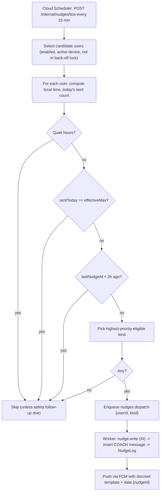
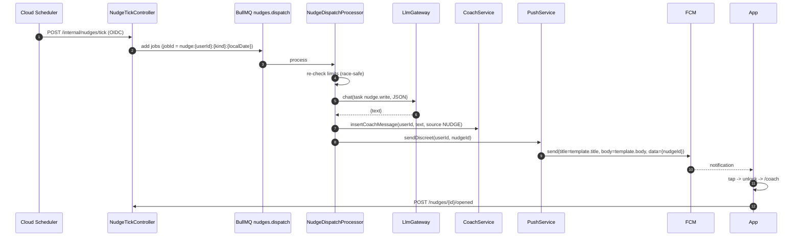
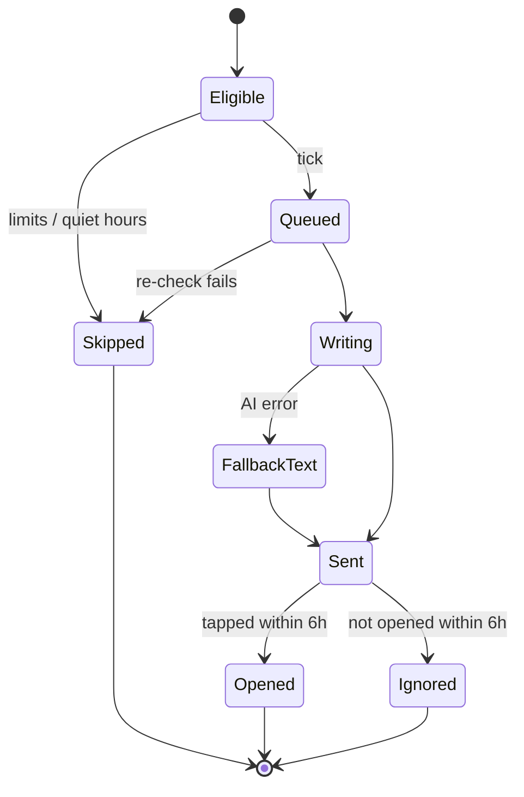

# M11 — Nudges & notifications

## 1. Header

| Field | Value |
| --- | --- |
| ID | M11 |
| Name | Proactive nudge engine, local reminders, push, discreet notifications |
| Release | v1 (F-21, F-52, F-90, F-91); v2: F-62 prayer-time nudges, weekly reflection push |
| Feature IDs | F-21, F-52, F-90, F-91 |
| Backend module | `apps/api/src/modules/nudges` |
| Flutter feature | `apps/mobile/lib/features/notifications` |
| Dependencies | M01 (devices + push tokens), M04 (check-in time, items), M06 (entry metadata: types + days), M07 (nudge inserted into coach conversation), M08 (`nudge.write`), M09 (safety follow-ups), M14 (settings UI entry) |

## 2. Purpose

The coach reaches out first, at the right moment and never too often. A server scheduler runs every 15 minutes, picks
users who should receive a nudge (missed check-in, upcoming risky window, day after a slip, a milestone), writes a short
personal message with AI, inserts it into the user's coach conversation, and sends a push whose lock-screen text is
**always the user's discreet template**. Daily check-in reminders are scheduled **locally** on the device so they work
offline. Limits: default 3 nudges/day (user range 0–6), quiet hours (default 23:00–07:00), at least 2 hours between
nudges, back-off after 5 ignored nudges.

## 3. User stories & acceptance criteria

**US-11.1 Local check-in reminder** — Given check-in time 21:30, When it is 21:30 local and no check-in exists for today,
Then a local notification shows the discreet template; if the user already checked in, today's reminder was cancelled.
Works in airplane mode.

**US-11.2 Missed check-in nudge** — Given no CHECK_IN entry synced for today by 23:00 (check-in time + 90 min), and limits
allow, When the scheduler runs, Then a `CHECK_IN` nudge is generated and pushed.

**US-11.3 Pre-trigger nudge** — Given `riskyWindows` contains Mon–Fri 23:00–01:00, When it is 22:30 on Tuesday (window start
− 30 min, allowed range 15–30 min before), Then a `PRE_TRIGGER` nudge is sent unless quiet hours or limits block it.
If the window starts inside quiet hours, the nudge is sent at the last allowed minute before quiet hours if ≥ 15 min
before the window, otherwise skipped.

**US-11.4 Follow-up after slip** — Given a SLIP entry for yesterday, When it is 10:00–12:00 local today, Then a
`FOLLOW_UP` nudge is sent once ("Yesterday was tough. One small step today?").

**US-11.5 Encouragement** — Given 7, 30, 90 or 180 consecutive days with a check-in and no SLIP entry (from metadata),
When the scheduler runs between 17:00–20:00, Then an `ENCOURAGEMENT` nudge is sent once per milestone.

**US-11.6 Limits** — Given `maxPerDay=3`, When 3 nudges were already sent today (user tz), Then no more are sent
(safety follow-ups excepted). Given the last nudge was < 2 h ago, Then the next is postponed. Given quiet hours, Then
nothing is sent except a level-3 safety follow-up (M09).

**US-11.7 Back-off** — Given 5 consecutive nudges not opened within 6 h each, Then the user gets at most 1 nudge/day until
they open the app; opening the app resets `ignoredStreak` to 0.

**US-11.8 Discreet text** — Given template "Daily Notes / You have a new reminder", When any push arrives, Then the
lock-screen title and body are exactly the template; the AI text is visible only after unlocking TurnWell.

**US-11.9 Open a nudge** — Given the user taps the notification, When the app unlocks (PIN/biometric, M02), Then it opens
`/coach` scrolled to the nudge message and records `openedAt`.

**US-11.10 Turn off** — Given `maxPerDay=0`, Then no proactive nudges are sent; local check-in reminders follow their own
toggle; safety follow-ups still send (explained in the UI).

## 4. Screens

| Screen | Route | Notes |
| --- | --- | --- |
| Notifications settings | `/me/settings/notifications` | Max/day, quiet hours, check-in time, reminder toggle, template |
| Template picker | `/me/settings/notifications/template` | Presets per language + custom |
| Nudge preview on Home | Home card (M04) | Latest unread nudge |
| OS permission primer | `/onboarding/plan` step + settings | Explains why before the OS prompt |

### Notifications settings

```
┌──────────────────────────────────────┐
│ ←  Reminders & nudges                │
│ ╭──────────────────────────────────╮ │
│ │ Daily check-in reminder   [ ●  ] │ │
│ │ Time                      21:30 ▸│ │
│ ╰──────────────────────────────────╯ │
│ ╭──────────────────────────────────╮ │
│ │ Messages from Noor               │ │
│ │ Up to  [−]  3  [+]  per day      │ │  ← 0–6
│ │ Quiet hours   23:00 → 07:00     ▸│ │
│ ╰──────────────────────────────────╯ │
│ ╭──────────────────────────────────╮ │
│ │ What your lock screen shows      │ │
│ │ ┌──────────────────────────────┐ │ │
│ │ │ Daily Notes                  │ │ │  ← live preview
│ │ │ You have a new reminder      │ │ │
│ │ └──────────────────────────────┘ │ │
│ │ Change ▸                         │ │
│ ╰──────────────────────────────────╯ │
│ Safety check-ins after a hard        │
│ moment are always sent.              │
└──────────────────────────────────────┘
```

### Template picker

```
┌──────────────────────────────────────┐
│ ←  Lock screen text                  │
│ ( ) Daily Notes · You have a new     │
│     reminder                         │
│ ( ) Reminder · Time for a quick      │
│     check                            │
│ ( ) Calendar · Event update          │
│ (•) Custom                           │
│     Title [ Notes            ]  ≤24  │
│     Text  [ New note         ]  ≤40  │
│ Never include words you don't want   │
│ others to see.                       │
│ [ Save ]                             │
└──────────────────────────────────────┘
```

## 5. Flows

### 5.1 Scheduler tick



### 5.2 Dispatch sequence



## 6. State machine — nudge



## 7. Data

Server: `private.nudge_schedules`, `private.nudge_logs`, `private.ai_messages` (nudge text saved as a COACH message),
`account.devices` (push tokens).

`NudgeSchedule` fields used: `checkInTime`, `riskyWindows`, `maxPerDay` (0–6), `quietStart`, `quietEnd`, `timezone`,
`enabled`, `ignoredStreak`, `lastNudgeAt`, `lastCheckInOn`, `lastSlipOn`.
`lastCheckInOn` / `lastSlipOn` are updated by `SyncService` from plaintext `Entry.type` + `occurredOn` (never payload).

`riskyWindows` are computed **on the device** from decrypted slips (≥ 3 slips in the same 2-hour band on the same
weekday group in the last 28 days) and pushed with `PUT /nudges/schedule`:

```json
[ { "dow": [1,2,3,4,5], "start": "23:00", "end": "01:00" } ]
```

### Nudge kinds and priority

| Priority | Kind | Eligible when | Local time window | Once per |
| --- | --- | --- | --- | --- |
| 0 | `SAFETY_FOLLOW_UP` | Scheduled by M09 | Any (level 3 may override quiet hours once) | event |
| 1 | `PRE_TRIGGER` | Risky window starts in 15–30 min | Before quiet hours | window/day |
| 2 | `FOLLOW_UP` | SLIP entry yesterday | 10:00–12:00 | day |
| 3 | `CHECK_IN` | No CHECK_IN today and now ≥ checkInTime + 90 min | until quiet start | day |
| 4 | `ENCOURAGEMENT` | Clean-day milestone 7/30/90/180 reached | 17:00–20:00 | milestone |
| — | `FAITH` | v2 (prayer times, F-62) | — | — |

### Selection pseudocode

```ts
function pickNudge(u: UserNudgeState, now: ZonedDateTime): NudgeKind | null {
  if (!u.enabled) return u.safetyDue ? 'SAFETY_FOLLOW_UP' : null;
  if (u.safetyDue) return 'SAFETY_FOLLOW_UP';               // bypasses all limits except 1 per 12h (M09)

  const effectiveMax = u.ignoredStreak >= 5 ? Math.min(1, u.maxPerDay) : u.maxPerDay;
  if (effectiveMax === 0) return null;
  if (inQuietHours(now, u.quietStart, u.quietEnd)) return null;
  if (u.sentToday >= effectiveMax) return null;
  if (u.lastNudgeAt && minutesBetween(u.lastNudgeAt, now) < 120) return null;

  const candidates: NudgeKind[] = [];
  const nextWindow = nextRiskyWindowStart(u.riskyWindows, now);
  if (nextWindow && between(minutesUntil(now, nextWindow), 15, 30) && !u.sentKindToday('PRE_TRIGGER')) candidates.push('PRE_TRIGGER');
  if (u.lastSlipOn === yesterday(now) && between(now.hour, 10, 11) && !u.sentKindToday('FOLLOW_UP')) candidates.push('FOLLOW_UP');
  if (u.lastCheckInOn !== today(now) && now >= at(u.checkInTime).plusMinutes(90) && !u.sentKindToday('CHECK_IN')) candidates.push('CHECK_IN');
  if (u.pendingMilestone && between(now.hour, 17, 19) ) candidates.push('ENCOURAGEMENT');

  return candidates.sort(byPriority)[0] ?? null;
}
// Special case: PRE_TRIGGER whose window begins inside quiet hours → evaluated at (quietStart − 15 min) if that is
// still ≥ 15 min before the window; otherwise skipped.
```

Milestone detection (server, metadata only): consecutive local days up to yesterday where a CHECK_IN entry exists and no
SLIP entry exists, compared with `[7, 30, 90, 180]`; the last celebrated milestone is stored in
`NudgeSchedule.lastMilestone`.

### Discreet templates (localized presets)

| Key | EN title / body | FR | ES | AR |
| --- | --- | --- | --- | --- |
| `NOTES` (default) | Daily Notes / You have a new reminder | Notes du jour / Vous avez un nouveau rappel | Notas diarias / Tienes un nuevo recordatorio | ملاحظات يومية / لديك تذكير جديد |
| `REMINDER` | Reminder / Time for a quick check | Rappel / Petit moment pour vérifier | Recordatorio / Momento de revisar | تذكير / وقت لمراجعة سريعة |
| `CALENDAR` | Calendar / Event update | Agenda / Mise à jour | Calendario / Actualización | التقويم / تحديث |
| `CUSTOM` | user text (title ≤ 24, body ≤ 40) | | | |

Custom text is validated: no URLs, max lengths, and a soft warning (client-side) if it contains words from the
category keyword list ("porn", "gambling", …).

## 8. API

| Method | Path | Purpose | Auth |
| --- | --- | --- | --- |
| GET | `/nudges/settings` | Settings incl. template | USER |
| PUT | `/nudges/settings` | Update max/day, quiet hours, check-in time, template, enabled | USER |
| PUT | `/nudges/schedule` | Device-computed `riskyWindows` | USER |
| POST | `/nudges/:id/opened` | Mark opened (resets `ignoredStreak`) | USER |
| POST | `/devices/current/push-token` | Register/refresh FCM token (M01 owns `Device`) | USER |
| POST | `/internal/nudges/tick` | Scheduler entry point | Cloud Scheduler OIDC only |

`PUT /nudges/settings`
```json
{
  "enabled": true,
  "maxPerDay": 3,
  "quietStart": "23:00",
  "quietEnd": "07:00",
  "checkInTime": "21:30",
  "checkInReminder": true,
  "template": { "key": "CUSTOM", "title": "Notes", "body": "New note" }
}
```
→ `200` same shape. Errors: `VALIDATION_FAILED` (`maxPerDay` 0–6, times `HH:mm`, title ≤ 24, body ≤ 40, no URL).

Push payload (FCM HTTP v1):
```json
{
  "message": {
    "token": "<fcm token>",
    "notification": { "title": "Daily Notes", "body": "You have a new reminder" },
    "data": { "type": "NUDGE", "nudgeId": "0193…" },
    "apns": { "payload": { "aps": { "sound": "default", "thread-id": "tw" } } },
    "android": { "notification": { "channel_id": "reminders", "visibility": "PRIVATE" } }
  }
}
```

## 9. Backend design

```ts
export class NudgeTickController { tick(): Promise<{ queued: number }>; } // guarded by OidcSchedulerGuard

export class NudgeSelector {
  pickNudge(state: UserNudgeState, now: ZonedDateTime): NudgeKind | null; // pure function, fully unit-tested
}

export class NudgeDispatchProcessor { // BullMQ "nudges.dispatch", concurrency 10
  process(job: Job<{ userId: string; kind: NudgeKind; localDate: string }>): Promise<void>;
}

export class NudgeWriter {
  // prompts/nudge-writer.md; input: kind, coach persona, mode, language, minimal context (counts, item categories)
  write(userId: string, kind: NudgeKind): Promise<string>; // ≤ 160 chars; fallback to scripted pool on error
}

export class PushService {
  sendDiscreet(userId: string, data: { type: 'NUDGE' | 'SAFETY_FOLLOW_UP' | 'REPLY'; id: string }): Promise<void>;
  // reads template from NudgeSchedule, sends to all active devices, removes tokens on UNREGISTERED
}

export class NudgeSettingsService { get(userId); update(userId, dto); updateSchedule(userId, riskyWindows); markOpened(userId, nudgeId); }

export class IgnoredNudgeJob { // repeatable every hour: Sent > 6h and openedAt null → ignoredStreak++ (once per nudge)
}
```

- Tick query uses an index on `nudge_schedules(enabled)` and processes in pages of 500.
- Job IDs make dispatch idempotent per user/kind/day.
- Nudge text is inserted into the user's most recent COACH conversation as `role=COACH` so replying continues the
  conversation; it does not count toward the user's message quota.
- Scripted fallback pool per kind and language in `packages/prompts/nudge-fallbacks.json`.
- App-open signal: any authenticated `GET /me` resets `ignoredStreak` (cheap update, debounced to once per hour).

## 10. Flutter design

```
features/notifications/
├── data/
│   ├── local_reminder_service.dart     # flutter_local_notifications, zonedSchedule daily at checkInTime
│   ├── push_service.dart               # firebase_messaging: token, onMessage, onMessageOpenedApp, getInitialMessage
│   ├── risky_window_calculator.dart    # from decrypted slips (pure Dart, unit-tested)
│   └── nudges_api.dart
├── domain/ nudge_settings.dart, discreet_template.dart
└── presentation/
    ├── notifications_settings_screen.dart
    ├── template_picker_screen.dart
    └── permission_primer_sheet.dart
```

- On check-in saved for today → cancel today's local reminder and re-schedule tomorrow.
- Foreground push: show nothing intrusive; refresh the Home nudge card.
- Tap handling: store `pendingDeepLink`, require unlock (M02), then navigate `/coach?focus={nudgeId}`.
- Android channel `reminders` with `NotificationVisibility.private`; iOS `UNNotificationCategory` without previews of content.
- `RiskyWindowCalculator` runs after each sync and at most daily; only pushes if changed.

## 11. Edge cases

| Case | Behaviour |
| --- | --- |
| Travel / timezone change | `X-Timezone` updates `NudgeSchedule.timezone`; local reminders rescheduled on app resume |
| Quiet hours across midnight (23:00–07:00) | `inQuietHours` handles wrap-around |
| Multiple devices | Push to all active devices; opened on any → mark opened |
| Push permission denied | Local reminders still try (they need permission too on iOS → show banner in settings) |
| User checked in offline | Server doesn't know yet → may send CHECK_IN nudge; app suppresses display if a local check-in exists and auto-marks opened |
| AI writer fails | Scripted fallback text |
| Daylight saving shift | Use zoned times (luxon / `timezone` package), never fixed offsets |

## 12. Security & privacy

- Lock-screen text is never AI-generated and never includes item names.
- Nudge AI prompt contains only: kind, coach persona, mode, language, item categories and counts — no notes.
- `/internal/nudges/tick` accepts only Cloud Scheduler OIDC tokens for the scheduler service account.
- Push tokens deleted when the device is removed or the account is deleted.

## 13. Analytics events

| Event | Properties |
| --- | --- |
| `nudges.sent` (server metric) | `kind`, `fallback` |
| `nudges.opened` | `kind`, `minutesToOpen` bucket |
| `nudges.settings_changed` | `maxPerDay`, `quietHoursChanged`, `templateKey` |
| `notifications.permission_result` | `granted` |
| `nudges.backoff_entered` (server) | — |

## 14. Tests

- Unit (`NudgeSelector`): quiet hours wrap; 2-hour gap; max/day; back-off to 1/day after 5 ignored; priority order;
  PRE_TRIGGER window inside quiet hours; DST day in Europe/Paris; `maxPerDay=0` still allows safety follow-ups.
- Unit: milestone detection from metadata sequences.
- Unit (Dart): `RiskyWindowCalculator` with synthetic slips.
- E2E: tick → job → coach message inserted → push mock called with template title/body only.
- E2E: `POST /nudges/:id/opened` resets `ignoredStreak`.
- E2E: `/internal/nudges/tick` rejects non-OIDC calls.
- Widget: template picker validation; settings in RTL.

## 15. Open questions

- Schema: `NudgeSchedule.templateKey/templateTitle/templateBody/checkInReminder/lastMilestone`, `NudgeLog.messageId` and the
  `SAFETY_FOLLOW_UP` kind are now in `schema.prisma`. Milestones use `NudgeSchedule.lastMilestone` (not Redis).
- v2: `FAITH` nudges from prayer times (F-62), weekly reflection push (F-23).
