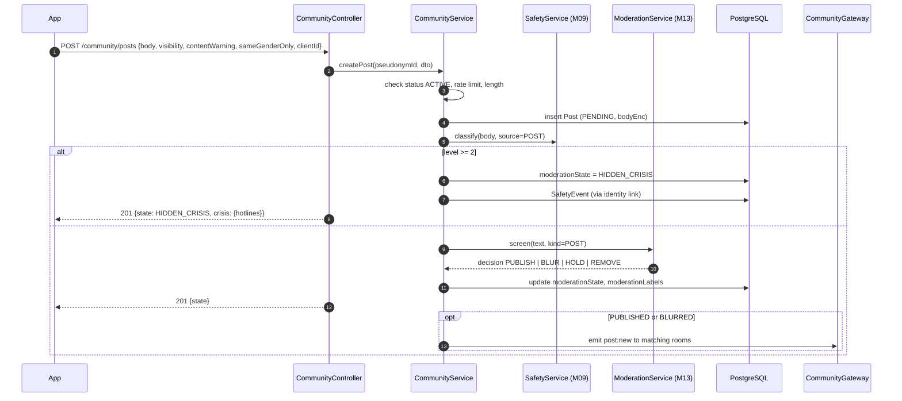
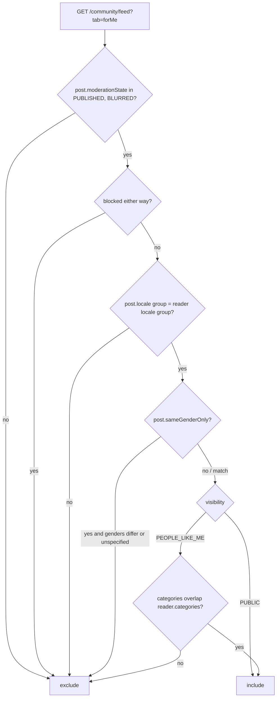
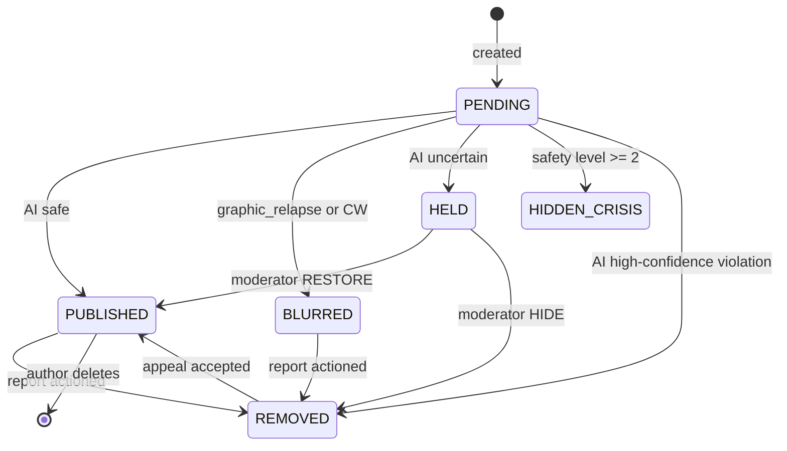
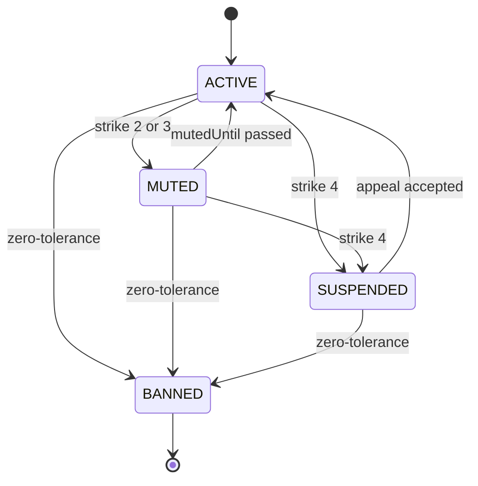

# M12 — Community

## 1. Header

| Field | Value |
| --- | --- |
| ID | M12 |
| Name | Community (pseudonyms, reach-out posts, replies, reactions, blocks; v2 circles, DMs, partners) |
| Release | **v1**: F-08, F-40, F-41 · **v2**: F-42, F-43, F-44, F-45 · **v3**: F-46 |
| Backend module | `apps/api/src/modules/community` (+ `CommunityGateway` Socket.IO) |
| Flutter feature | `lib/features/community` |
| Depends on | M01 (auth), M09 (safety classify + crisis card), M13 (moderation pipeline, reports), M16 (locale), M17 (anonymise on delete) |
| Used by | M13, M17 |

## 2. Purpose

Let people say how they really feel and receive support from others with the same struggles, without anyone
ever knowing who they are. Every community action is done as a **pseudonym** (`community.pseudonyms`); the
community schema never contains a `userId`. Every post and reply is screened by M13 before anyone else sees it.
Only supportive interactions exist: no downvotes, no follower counts, no public profiles beyond a name + abstract avatar.

## 3. User stories & acceptance criteria

**US-12.1 — Pseudonym creation (F-08)**
- Given a user opens the Community tab for the first time, When the intro sheet is accepted, Then the API creates
  a `Pseudonym` with a generated `displayName` + `avatarSeed`, an `IdentityLink` (encrypted), and returns it.
- Given a pseudonym exists, When the user re-opens Community, Then no new pseudonym is created (lookup by `IdentityLink.userIdHash`).
- Given the user taps "New name" (max 1 per 30 days), Then a new `displayName` is generated; all posts, old and new, show the current name.
- The pseudonym's `genderPref`, `categories` and `modes` are chosen by the user on the intro sheet ("Share with people like me": checkboxes of their tracked categories). Nothing is auto-shared.

**US-12.2 — Write a reach-out post (F-40)**
- Given the composer, When the user writes 10–2,000 characters, picks visibility `PUBLIC` or `PEOPLE_LIKE_ME`, optional content warning and optional "same gender only", Then `POST /community/posts` returns `201` with `moderationState` ∈ {`PUBLISHED`, `BLURRED`, `HELD`, `HIDDEN_CRISIS`, `REMOVED`}.
- When state is `PUBLISHED` or `BLURRED`, Then the post appears in the author's "My posts" immediately and in feeds within 2 s (Socket.IO `post:new`).
- When state is `HELD`, Then the author sees "Your post is being reviewed. This usually takes less than a day." and nobody else sees it.
- When state is `HIDDEN_CRISIS`, Then the author is navigated to `/crisis` with the scripted card (M09) and the post is visible only to the author with a gentle note.
- When state is `REMOVED`, Then the author sees a kind explanation keyed by label (no accusations), and the text stays in the composer so they can edit.
- Rate limit: 5 posts per 24 h per pseudonym → `COMMUNITY_POST_LIMIT`.

**US-12.3 — Read the feed**
- Given visibility filter `For me` (default), Then the feed shows `PUBLISHED`/`BLURRED` posts that are `PUBLIC`, plus `PEOPLE_LIKE_ME` posts whose `categories` overlap the reader's pseudonym `categories`; both filtered by reader locale group and same-gender rule (§9.3).
- `BLURRED` posts render blurred with "Contains details of a slip. Tap to read." Content-warning posts render the same way.
- Posts from blocked pseudonyms (either direction) never appear.
- Feed is newest-first, cursor-paginated, 20 per page.

**US-12.4 — Reply (F-41)**
- Given a published post, When a reader replies (2–1,000 chars), Then the reply goes through M13 screening and is visible to others only when `PUBLISHED`. The replier sees "Sending kindly…" for ≤ 2 s.
- The post author receives a discreet push (`community.reply`, template from M11) unless they muted notifications for this post.
- Max 30 replies per pseudonym per 24 h → `COMMUNITY_REPLY_LIMIT`.

**US-12.5 — React (F-41)**
- Given a post, When the reader taps a reaction, Then one reaction per pseudonym per post is stored (tap again on same = remove, tap another = switch).
- Reaction set: `SUPPORT`, `SAME_HERE` for every post; `PRAYING` shown only when the **post** `mode = SINS` and the **reader** has `SINS` in their pseudonym `modes`.
- Counts are shown as "12 people sent support" (never a ranking).

**US-12.6 — Block**
- Given any post/reply, When the user taps Block, Then a `Block` row is created; both pseudonyms stop seeing each other's content immediately (including existing replies), and future replies between them are rejected with `NOT_FOUND`.
- Blocks are silent (the blocked person is never notified).

**US-12.7 — Report** → handled by M13 (`POST /community/reports`), entry points live in this module's UI.

**US-12.8 — Delete own content**
- Authors can delete their posts/replies at any time; body is replaced by `[deleted]` server-side, reactions/replies on a deleted post are hidden.

## 4. Screens

| Route | Screen | Notes |
| --- | --- | --- |
| `/community` | Feed | Tabs: `For me` · `Everyone` · `My posts` |
| `/community/intro` (sheet) | First-time intro + pseudonym setup | Shown once |
| `/community/compose` | Composer | Full-screen sheet |
| `/community/post/:id` | Post detail + replies | Reply input pinned |
| `/community/me` (sheet) | My pseudonym | Name, avatar, sharing categories, "New name" |

### 4.1 Intro sheet

```
╭──────────────────────────────────────╮
│ ───                                  │
│  You're anonymous here               │
│                                      │
│  (◐)  QuietCedar42                   │ ← generated name + abstract avatar
│       [ ↻ another name ]             │   (3 rerolls allowed here)
│                                      │
│  • Nobody can see your email, name   │
│    or what you track.                │
│  • Posts are checked before others   │
│    see them.                         │
│  • Be kind. Report anything unsafe.  │
│                                      │
│  Show my posts to "people like me"   │
│  in:  [✓ Sexual] [✓ Digital] [ Speech]│ ← GlassChip, only user's own categories
│                                      │
│  Circles & replies:                  │
│  ( ) Anyone  (•) Same gender: [Male▾]│ ← genderPref
│                                      │
│  [        Join the community       ] │
╰──────────────────────────────────────╯
```

### 4.2 Feed

```
┌──────────────────────────────────────┐
│ Community                     (◐) ⋯  │
│ ╭ For me ╮  Everyone   My posts      │ ← segmented glass control
│ ╭──────────────────────────────────╮ │
│ │ (◑) SilentRiver7 · 2h · people   │ │
│ │     like me                      │ │
│ │ I'm 12 days in and tonight is    │ │
│ │ really hard. Everything feels... │ │
│ │ ♡ 14 support · 3 same here  💬 5 │ │
│ ╰──────────────────────────────────╯ │
│ ╭──────────────────────────────────╮ │
│ │ (◒) NightOwl88 · 5h              │ │
│ │ ░░░░░░░░░░░░░░░░░░░░░░░░░░░░░░░░ │ │ ← BLURRED
│ │ Contains details of a slip.      │ │
│ │ [ Tap to read ]                  │ │
│ ╰──────────────────────────────────╯ │
│                        ╭───────────╮ │
│                        │ ✎ Share   │ │ ← compose FAB (SOS stays on Home only)
│                        ╰───────────╯ │
│ [ nav bar ]                          │
└──────────────────────────────────────┘
```

### 4.3 Composer

```
┌──────────────────────────────────────┐
│ ✕  Share how you feel        [Post]  │ ← Post disabled < 10 chars
│ ╭──────────────────────────────────╮ │
│ │ What's on your heart?            │ │ ← GlassInput, multiline, 2000 max
│ │                                  │ │
│ │                                  │ │
│ ╰──────────────────────────────────╯ │
│                          0 / 2000    │
│ Who can see this?                    │
│ (•) People like me  ( ) Everyone     │
│ [ ] Same gender only                 │
│ [ ] Content warning (details of a    │
│     slip or something heavy)         │
│                                      │
│ ⓘ Don't share names, phone numbers,  │
│   or places. Posts are checked.      │
└──────────────────────────────────────┘
```

### 4.4 Post detail

```
┌──────────────────────────────────────┐
│ ←  Post                         ⋯    │ ← ⋯ = Report · Block · Mute notifications · Delete (own)
│ (◑) SilentRiver7 · 2h                │
│ I'm 12 days in and tonight is really │
│ hard. Everything feels heavy...      │
│ [♡ Support 14] [≈ Same here 3]       │
│ [🤲 Praying 6]  ← Sins-mode only      │
│ ─────────────────────────────────────│
│ (◓) MorningDew · 1h                  │
│ 12 days is real. Get out of your     │
│ room for 10 minutes, it helps me. ⋯  │
│ (◔) You · now · Sending kindly…      │ ← PENDING (own only)
│ ╭──────────────────────────────╮ [➤] │
│ │ Write something supportive…  │     │
│ ╰──────────────────────────────╯     │
└──────────────────────────────────────┘
```

## 5. Flows

### 5.1 Posting pipeline



### 5.2 Feed query decision



## 6. State machine

### 6.1 Post / reply moderation state



### 6.2 Pseudonym status



## 7. Data

Tables (see `03-data-model.md` §3): `community.pseudonyms`, `community.identity_links`, `community.posts`,
`community.replies`, `community.reactions`, `community.blocks`, `community.reports` (M13),
`community.moderation_actions` (M13); v2: `community.dm_threads`, `community.dm_messages`.

Field rules:

| Field | Rule |
| --- | --- |
| `Pseudonym.displayName` | Generated (§9.1), unique, 6–24 chars, never user-typed in v1 |
| `Pseudonym.categories` | Subset of the user's own tracked categories (client sends; server validates enum values only — it cannot see items) |
| `Pseudonym.genderPref` | `MALE` / `FEMALE` / `UNSPECIFIED` |
| `Post.categories`, `Post.mode`, `Post.authorGender` | Snapshot from pseudonym at post time |
| `Post.locale` | Stored as the author's **locale group**: `ar`, `fr`, `es`, `en` (all other locales → `en`) |
| `Post.bodyEnc` / `Reply.bodyEnc` | `CryptoService.encrypt('community', text)` — community uses a shared community DEK, not a per-user key |
| `Post.replyCount`, `reactionCount` | Updated in the same transaction; count only `PUBLISHED`/`BLURRED` replies |

No local Drift tables: the feed is online-only, cached in memory (`keepAlive` provider, 5 min). Composer drafts are
stored in `kv` (`community.draft`) — plaintext inside SQLCipher.

## 8. API

| Method | Path | Purpose | Auth |
| --- | --- | --- | --- |
| GET | `/community/me` | Get my pseudonym (404 if none) | USER |
| POST | `/community/me` | Create pseudonym | USER |
| PATCH | `/community/me` | Update `categories`, `genderPref`, `modes` | USER |
| POST | `/community/me/rename` | New generated name (1 / 30 days) | USER |
| POST | `/community/me/name-suggestions` | 3 candidate names (intro only) | USER |
| GET | `/community/feed?tab=forMe\|everyone&cursor&limit` | Feed | USER + pseudonym |
| GET | `/community/posts/mine?cursor` | My posts (all states except REMOVED shown with note) | USER |
| POST | `/community/posts` | Create post | USER + ACTIVE |
| GET | `/community/posts/:id` | Post detail | USER |
| DELETE | `/community/posts/:id` | Delete own post | owner |
| GET | `/community/posts/:id/replies?cursor` | Replies (oldest first) | USER |
| POST | `/community/posts/:id/replies` | Reply | USER + ACTIVE |
| DELETE | `/community/replies/:id` | Delete own reply | owner |
| PUT | `/community/posts/:id/reaction` | Set reaction `{type}` | USER + ACTIVE |
| DELETE | `/community/posts/:id/reaction` | Remove reaction | USER |
| POST | `/community/blocks` | Block `{pseudonymId}` | USER |
| DELETE | `/community/blocks/:pseudonymId` | Unblock | USER |
| GET | `/community/blocks` | My blocks | USER |
| POST | `/community/posts/:id/mute` | Mute reply notifications | owner |

### Examples

```http
POST /v1/community/me
{ "displayName": "QuietCedar42", "avatarSeed": "a91f3c", "genderPref": "MALE",
  "categories": ["SEXUAL", "DIGITAL"], "modes": ["SINS"] }
```
```json
201 { "id": "0193…", "displayName": "QuietCedar42", "avatarSeed": "a91f3c", "genderPref": "MALE",
      "categories": ["SEXUAL","DIGITAL"], "modes": ["SINS"], "status": "ACTIVE", "createdAt": "2026-11-20T21:00:00Z" }
```
`displayName` must be one of the server's last issued suggestions (stored in Redis 15 min) → else `COMMUNITY_NAME_INVALID`.

```http
POST /v1/community/posts
{ "clientId": "0193…", "body": "I'm 12 days in and tonight is really hard…",
  "visibility": "PEOPLE_LIKE_ME", "contentWarning": false, "sameGenderOnly": true }
```
```json
201 { "id": "0193…", "moderationState": "PUBLISHED", "createdAt": "2026-11-20T21:02:00Z" }
201 { "id": "0193…", "moderationState": "HIDDEN_CRISIS",
      "crisis": { "level": 2, "hotlines": [ { "name": "…", "phone": "…", "url": "…" } ] } }
201 { "id": "0193…", "moderationState": "REMOVED", "reasonKey": "CONTACT_SHARING" }
```
`clientId` makes the call idempotent (Redis key 24 h).

```http
GET /v1/community/feed?tab=forMe&limit=20
```
```json
{ "items": [ { "id": "0193…", "author": { "id": "0193…", "displayName": "SilentRiver7", "avatarSeed": "77b2e0" },
    "body": "I'm 12 days in…", "blurred": false, "contentWarning": false, "visibility": "PEOPLE_LIKE_ME",
    "mode": "SINS", "reactions": { "SUPPORT": 14, "SAME_HERE": 3, "PRAYING": 6 }, "myReaction": "SUPPORT",
    "replyCount": 5, "isMine": false, "createdAt": "2026-11-20T19:00:00Z" } ],
  "nextCursor": "eyJ0IjoiMjAyNi0xMS0yMFQxOTowMDowMFoiLCJpZCI6IjAxOTMifQ" }
```

```http
PUT /v1/community/posts/0193…/reaction   { "type": "PRAYING" }
```
→ `204`. `PRAYING` on a non-`SINS` post or by a reader without `SINS` → `400 COMMUNITY_REACTION_NOT_ALLOWED`.

### Error codes

| HTTP | Code | When |
| --- | --- | --- |
| 404 | `COMMUNITY_NO_PSEUDONYM` | Feature used before `POST /community/me` |
| 409 | `COMMUNITY_PSEUDONYM_EXISTS` | Second create |
| 400 | `COMMUNITY_NAME_INVALID` | Name not from suggestions |
| 429 | `COMMUNITY_RENAME_TOO_SOON` | < 30 days since last rename (`details.availableAt`) |
| 423 | `COMMUNITY_RESTRICTED` | Status MUTED/SUSPENDED/BANNED (`details.status`, `details.until`) |
| 429 | `COMMUNITY_POST_LIMIT` / `COMMUNITY_REPLY_LIMIT` | Daily caps |
| 400 | `COMMUNITY_REACTION_NOT_ALLOWED` | PRAYING rule |
| 404 | `NOT_FOUND` | Missing, removed, blocked, or not visible to reader |

### Socket.IO — namespace `/community`

Connect with `auth: { token: <accessJwt> }`. Server joins the socket to rooms:
`feed:<localeGroup>`, `cat:<category>` for each of the reader's categories, `post:<id>` when a post detail is open,
`me:<pseudonymId>`.

| Direction | Event | Payload | Notes |
| --- | --- | --- | --- |
| C→S | `post:subscribe` | `{ postId }` | Join `post:<id>` |
| C→S | `post:unsubscribe` | `{ postId }` | |
| S→C | `post:new` | `{ id }` | Client fetches via REST (keeps filtering server-side). Emitted to `feed:<loc>` for PUBLIC, `cat:<c>` for PEOPLE_LIKE_ME |
| S→C | `post:updated` | `{ id, moderationState, reactions, replyCount }` | |
| S→C | `reply:new` | `{ postId, replyId }` | To `post:<id>` |
| S→C | `reply:state` | `{ replyId, moderationState }` | To `me:<pseudonymId>` (author of the reply) |
| S→C | `pseudonym:restricted` | `{ status, until }` | To `me:<pseudonymId>` |

The gateway never pushes post bodies; clients re-fetch so block and gender filters are always applied by REST.

## 9. Backend design

### 9.1 Pseudonym generation

```ts
// community/pseudonym-generator.ts
// displayName = Adjective + Noun + 1–3 digit number, PascalCase, e.g. "QuietCedar42".
// Word lists: 200 calm adjectives × 300 nature nouns (English only, readable in all locales),
// curated to avoid religious, sexual, violent, or identity terms. Stored in packages/contracts/wordlists.json.
generate(): string {
  const adj = pick(ADJECTIVES), noun = pick(NOUNS), n = randomInt(1, 999);
  return `${adj}${noun}${n}`;
}
// suggestions(): 3 candidates not present in pseudonyms.displayName, cached in Redis key
// community:names:<userIdHash> for 15 min. avatarSeed = 6 hex chars (crypto.randomBytes(3)).
// Avatar is rendered on device from the seed: 2–3 overlapping soft circles in theme-accent hues (no faces).
```

### 9.2 Services

```ts
@Injectable() export class PseudonymService {
  getForUser(userId: string): Promise<Pseudonym | null>;            // via IdentityLink.userIdHash
  create(userId: string, dto: CreatePseudonymDto): Promise<Pseudonym>; // writes Pseudonym + IdentityLink in one tx
  update(pseudonymId: string, dto: UpdatePseudonymDto): Promise<Pseudonym>;
  rename(pseudonymId: string): Promise<Pseudonym>;
  suggestions(userId: string): Promise<string[]>;
  assertActive(p: Pseudonym): void;                                  // throws COMMUNITY_RESTRICTED
}

@Injectable() export class PostService {
  create(p: Pseudonym, dto: CreatePostDto): Promise<PostResult>;
  feed(reader: Pseudonym, tab: 'forMe' | 'everyone', cursor?: string, limit = 20): Promise<Page<PostView>>;
  mine(p: Pseudonym, cursor?: string): Promise<Page<PostView>>;
  get(reader: Pseudonym, postId: string): Promise<PostView>;         // NOT_FOUND if not visible
  delete(p: Pseudonym, postId: string): Promise<void>;
}

@Injectable() export class ReplyService {
  create(p: Pseudonym, postId: string, dto: CreateReplyDto): Promise<ReplyResult>;
  list(reader: Pseudonym, postId: string, cursor?: string): Promise<Page<ReplyView>>;
  delete(p: Pseudonym, replyId: string): Promise<void>;
}

@Injectable() export class ReactionService {
  set(p: Pseudonym, postId: string, type: ReactionType): Promise<void>;
  remove(p: Pseudonym, postId: string): Promise<void>;
}

@Injectable() export class BlockService {
  block(p: Pseudonym, targetId: string): Promise<void>;
  unblock(p: Pseudonym, targetId: string): Promise<void>;
  blockedIds(p: Pseudonym): Promise<Set<string>>; // both directions, cached in Redis 60 s
}
```

`PseudonymGuard` resolves `req.pseudonym` from `req.user.id` (cached 60 s) for all `/community/*` routes except `/community/me` create/get.

### 9.3 Feed query (Prisma, `forMe`)

```ts
const localeGroup = toLocaleGroup(reader.locale); // ar | fr | es | en
const blocked = [...await blocks.blockedIds(reader)];
prisma.post.findMany({
  where: {
    moderationState: { in: ['PUBLISHED', 'BLURRED'] },
    deletedAt: null,
    locale: localeGroup,
    pseudonymId: { notIn: blocked },
    AND: [
      { OR: [ { sameGenderOnly: false },
              reader.genderPref === 'UNSPECIFIED'
                ? { id: '00000000-0000-0000-0000-000000000000' } // never matches
                : { authorGender: reader.genderPref } ] },
      { OR: [ { visibility: 'PUBLIC' },
              { visibility: 'PEOPLE_LIKE_ME', categories: { hasSome: reader.categories } } ] },
    ],
    ...cursorWhere(cursor), // (createdAt, id) < cursor
  },
  orderBy: [{ createdAt: 'desc' }, { id: 'desc' }],
  take: limit + 1,
});
```
`everyone` tab = same but only `visibility: 'PUBLIC'`. Readers with `genderPref = UNSPECIFIED` never see `sameGenderOnly` posts. Authors always see their own posts in `mine`.
Index used: `posts(moderationState, visibility, locale, createdAt)`; add a GIN index on `categories` (see schema note).

### 9.4 Reply visibility rule

A reply is visible to reader R if `moderationState ∈ {PUBLISHED}` (replies are never BLURRED — graphic replies are HELD) and the reply author is not blocked either way; the reply author always sees their own reply with its state.

### 9.5 Notifications

On reply `PUBLISHED`: enqueue `nudges.communityReply` (M11) with `{ notifyToken: author.notifyToken, postId }`. `NotificationBridgeService` resolves `account.notify_tokens` → devices (§12). Push text = discreet template; payload contains only `postId`. Coalesce: max 1 push per post per 30 min.

### 9.6 Rate limits

| Action | Limit |
| --- | --- |
| Create post | 5 / 24 h / pseudonym |
| Reply | 30 / 24 h / pseudonym; 1 per 10 s |
| Reaction set | 120 / h |
| Block | 50 / day |

### 9.7 v2 extension points (do not build in v1)

| Feature | Extension point |
| --- | --- |
| **Circles (F-42)** | `Post.circleId` already exists. `Circle` table: id, category, mode, localeGroup, sameGender, memberCount (max 500 → auto-split). Feed tab `Circles` + room `circle:<id>`. |
| **DMs (F-43)** | `DmThread` / `DmMessage` tables exist. Rules: (1) mutual opt-in — `REQUESTED` until recipient taps Accept; (2) text only, 1–1,000 chars, no images/attachments; (3) M13 fast rules block phone numbers, emails, URLs, social handles, payment requests *before* delivery; (4) AI screens every message for `grooming`, `sexual`, `scam`, `contact_sharing`; (5) a report sets `consentState = FROZEN`; (6) either side can block; (7) DMs disabled for pseudonyms with any strike in last 30 days; (8) max 5 open requests per day. Events: `dm:request`, `dm:message`, `dm:state`. |
| **Accountability partner (F-44)** | `PartnerPair` table (pseudonymA, pseudonymB, sharedFields JSON, status). Shares only what each user toggles (check-in status today, % clean). SOS "message partner" sends a fixed text. |
| **Milestones (F-45)** | Post subtype `MILESTONE` with templated body ("7 days clean of a struggle"), no free text → no moderation needed. |
| **Mentors (F-46, v3)** | `Pseudonym.badge` field. |

## 10. Flutter design

```
lib/features/community/
├── data/
│   ├── community_api.dart            # generated client wrapper
│   ├── community_socket.dart         # Socket.IO client, reconnect w/ backoff
│   ├── community_repository.dart
│   └── draft_store.dart              # kv 'community.draft'
├── domain/
│   ├── pseudonym.dart                # freezed
│   ├── post_view.dart
│   ├── reply_view.dart
│   └── reaction_type.dart
└── presentation/
    ├── providers/
    │   ├── my_pseudonym_provider.dart      # AsyncValue<Pseudonym?>
    │   ├── feed_provider.dart              # family(tab) — paginated AsyncNotifier
    │   ├── post_detail_provider.dart       # family(postId)
    │   ├── replies_provider.dart           # family(postId)
    │   └── composer_controller.dart        # Notifier, validation + submit
    ├── screens/
    │   ├── community_screen.dart
    │   ├── community_intro_sheet.dart
    │   ├── compose_screen.dart
    │   ├── post_detail_screen.dart
    │   └── my_pseudonym_sheet.dart
    └── widgets/
        ├── post_card.dart                  # GlassCard; blurred variant uses ImageFiltered
        ├── reaction_bar.dart               # shows PRAYING only per rule
        ├── pseudonym_avatar.dart           # CustomPainter from avatarSeed
        ├── reply_tile.dart
        └── post_actions_menu.dart          # Report (→ M13 sheet), Block, Mute, Delete
```

Routes: `/community`, `/community/intro`, `/community/compose`, `/community/post/:id`, `/community/me`.
`CommunityGuard`: redirects to `/community/intro` when `myPseudonymProvider` returns null.

Key providers:

```dart
@riverpod
class Feed extends _$Feed {
  @override
  Future<FeedPage> build(FeedTab tab) => ref.watch(communityRepositoryProvider).feed(tab);
  Future<void> loadMore() async { /* append nextCursor page */ }
  void onSocketNewPost(String id) { /* show "New posts ↑" pill; refresh on tap */ }
}
```

The feed never auto-inserts new posts under the user's finger — a "New posts" pill appears instead.

## 11. Edge cases

| Case | Behaviour |
| --- | --- |
| User deletes account | M17 anonymises: pseudonym `displayName` → `Former member`, bodies → `[deleted]`, IdentityLink deleted |
| Post moderated while author offline | Author sees state in `My posts`; `reply:state`/`post:updated` delivered on reconnect via REST refresh |
| Reader changes categories | Feed provider invalidated; socket rooms rejoined |
| Muted pseudonym tries to reply | `423 COMMUNITY_RESTRICTED`; composer disabled with "You can post again on {date}" |
| Reaction on deleted post | `404 NOT_FOUND` |
| Same text posted twice within 1 h | Second returns `409 CONFLICT` (hash of normalised text in Redis) |
| Locale not ar/fr/es | Grouped into `en` feed |
| Offline | Feed shows cached page with offline banner; composer saves draft, "Post" disabled |
| Crisis post | Never shown to others, never in `everyone`; author gets crisis card every time they open it within 24 h |

## 12. Security & privacy

- No `userId` in any community table, DTO, socket payload, or log. `PseudonymGuard` is the only place a user is mapped to a pseudonym, using `IdentityLink.userIdHash` (HMAC, secret `IDENTITY_HMAC_KEY`).
- `IdentityLink.userIdEnc` decrypt is allowed only in `SafetyService` and `LegalEscalationService` (M13) and writes `AuditLog(action=IDENTITY_LINK_READ)`.
- Reply notifications use an opaque **notify token**: `Pseudonym.notifyToken` (random 32 bytes) maps to the user only in `account.notify_tokens` (token → userId). The community module emits `{notifyToken, postId}`; `NotificationBridgeService` in the account side resolves devices. Community never learns the user, and no identity-link decrypt is needed. (In `schema.prisma`.)
- Post bodies are encrypted at rest; moderators see bodies only for reported/HELD items (M13).
- Client strips EXIF/location (no media in v1 anyway). Text is never logged; feed logs contain counts only.
- Abstract avatars only — no photo upload in any release.

## 13. Analytics events

| Event | Properties |
| --- | --- |
| `community.intro_completed` | `categoriesCount`, `genderPrefSet` (bool) |
| `community.post_created` | `visibility`, `contentWarning`, `sameGenderOnly`, `state` |
| `community.reply_created` | `state` |
| `community.reaction_set` | `type` |
| `community.block` | — |
| `community.feed_viewed` | `tab`, `itemsLoaded` |
| `community.crisis_post` | `level` |

Never include text, names, or ids of other pseudonyms.

## 14. Tests

- Unit: pseudonym generator uniqueness + wordlist safety; feed filter matrix (visibility × categories × gender × block × locale) — at least 16 cases; PRAYING rule; rate limits; idempotent `clientId`.
- E2E: create pseudonym → post → appears in another reader's `forMe` only with overlapping category; blocked reader never sees it; muted pseudonym gets 423; crisis post returns HIDDEN_CRISIS and is absent from all feeds.
- Security test: grep-based CI check that no file under `modules/community` imports `User` model or references `userId` except `pseudonym.service.ts` hash path.
- Socket: `post:new` emitted to correct rooms only; payload contains no body.
- Flutter widget: PostCard blurred/unblurred, RTL, reaction bar in both modes, composer validation, offline draft restore. Golden tests Dawn + Night.

## 15. Open questions

- Should `Everyone` tab exist at launch, or only `For me`, to reduce exposure of new users? (Default: exists.)
- Name reroll limit (3 at intro, 1 rename / 30 days) — confirm.
- Word lists: localized names later? (v1: English words only.)
- Schema: `Pseudonym.notifyToken`, `Pseudonym.lastRenamedAt`, `account.notify_tokens` and the GIN index on `Post.categories` are now in `schema.prisma`.
