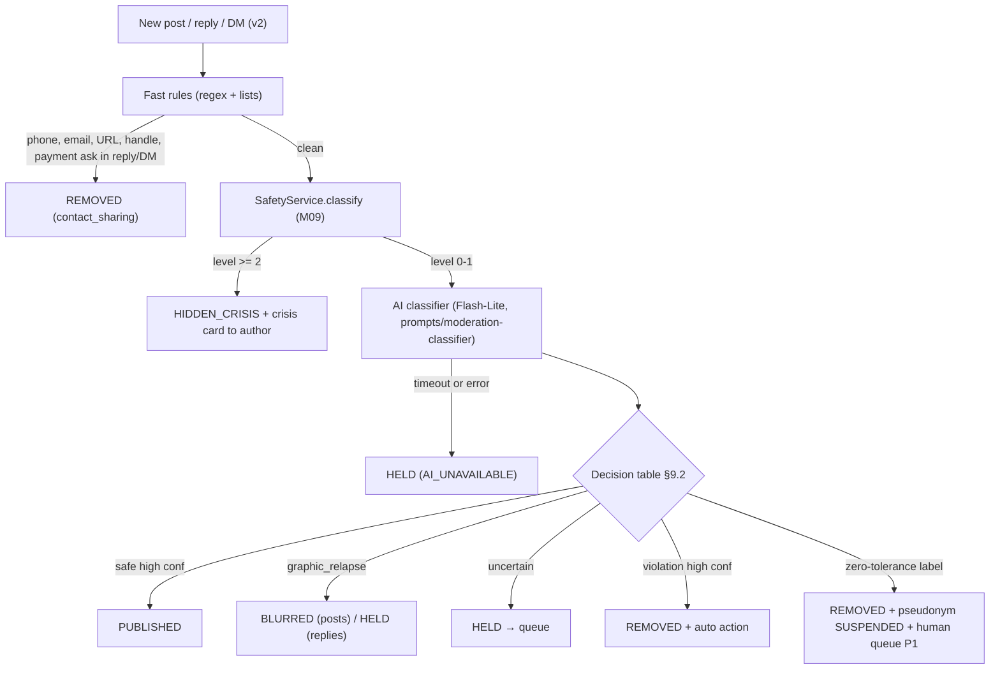
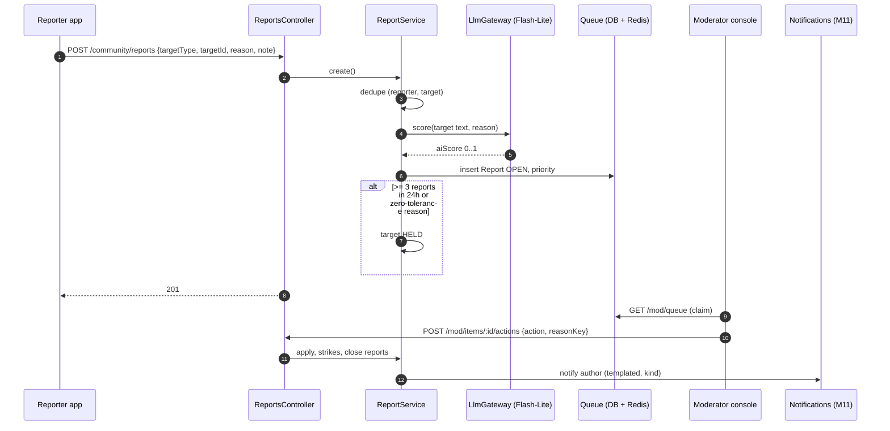
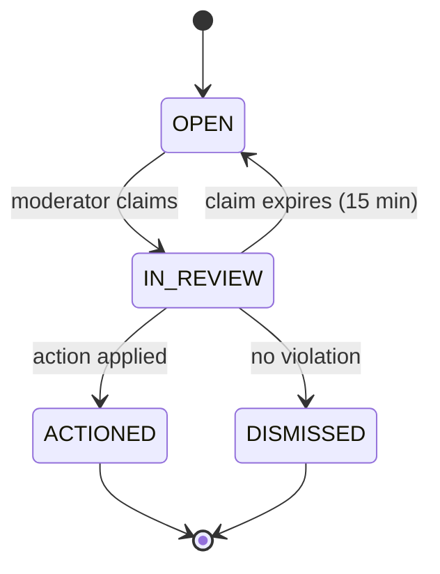
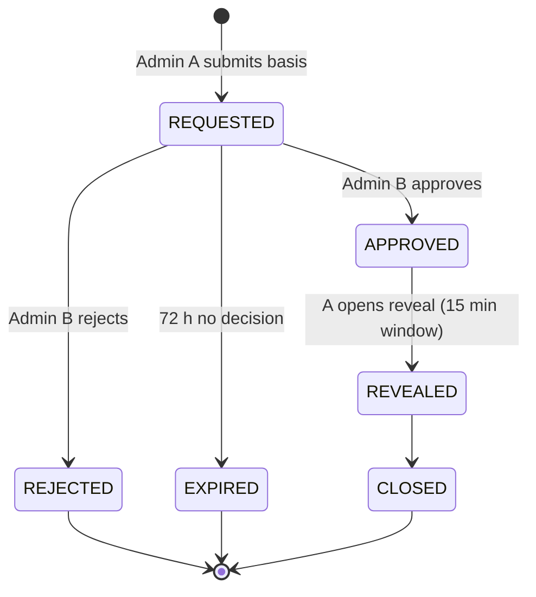

# M13 — Moderation & Moderator console

## 1. Header

| Field | Value |
| --- | --- |
| ID | M13 |
| Name | Moderation pipeline, reports, enforcement, Moderator console |
| Release | **v1**: F-80 (AI pre-moderation), F-81 (report), F-82 (basic console) · **v2**: appeals UI in app, DM moderation, console analytics |
| Backend modules | `apps/api/src/modules/moderation`, `apps/api/src/modules/admin` |
| Frontend | `apps/admin` (Next.js 14 App Router, TypeScript, Tailwind) + report sheet in `lib/features/community` |
| Depends on | M08 (LLM gateway, Flash-Lite classification), M09 (crisis level), M12 (content), M01 (staff auth + roles), M11 (notify author of action) |
| Used by | M12 |

## 2. Purpose

Keep the community safe without ever exposing who people are. AI screens **every** post, reply (and v2 DM)
**before** delivery; humans with the `MODERATOR` role handle uncertain items, reports and appeals. Moderators see
pseudonyms only. Revealing a real identity (`UNMASK`) is possible only for valid legal requests or imminent harm,
needs two `ADMIN` approvals, and is audit-logged.

## 3. User stories & acceptance criteria

**US-13.1 — Pre-moderation (F-80)**
- Given a new post/reply, When `ModerationService.screen()` runs, Then a decision is returned in ≤ 2 s p95 and the item's `moderationState` + `moderationLabels` are stored.
- Given the AI provider fails or times out (> 3 s), Then the item is `HELD` (fail closed) and enters the queue with `source = AI_UNAVAILABLE`.
- Given a decision `REMOVED`, Then a `ModerationAction(moderatorId = null, action = HIDE, reason = <label>)` row is written.

**US-13.2 — Report (F-81)**
- Given any post, reply or pseudonym, When the user taps Report, picks a reason and (optional) note ≤ 500 chars, Then `POST /community/reports` creates a `Report(status = OPEN)` and returns `201` within 1 s; the reporter sees "Thank you. We'll look at this."
- The same reporter reporting the same target twice → `200` idempotent (no duplicate).
- Reasons `GROOMING`, `MINOR`, `SELF_HARM` are always routed to a human; `SELF_HARM` also triggers M09 for the **target author** (crisis card on their next open).
- When a target gets ≥ 3 distinct reports within 24 h, Then it is auto-`HELD` pending review.

**US-13.3 — Moderator reviews queue (F-82)**
- Given a moderator signs in to the console with 2FA, When they open Queue, Then items are sorted by priority score (§9.3), showing pseudonym, content, thread context (parent post + 3 neighbouring replies), AI labels, report reasons, pseudonym strikes.
- When the moderator chooses an action, Then the item state changes, a `ModerationAction` is written, strikes are applied per ladder (§9.4), the author is notified with a kind message, and the report(s) become `ACTIONED` or `DISMISSED`.
- A moderator never sees email, account ID, journal, coach chats, or tracking. No UI or endpoint exists for that.

**US-13.4 — Enforcement**
- Strikes follow the ladder in §9.4; zero-tolerance labels apply `BAN_ACCOUNT` immediately after human confirmation (AI alone can only `HOLD` + `SUSPEND` pending review).
- Banned accounts keep access to tracking, journal and coach (privacy + wellbeing), only community is closed.

**US-13.5 — Appeal**
- Given a removed item or a strike, When the author taps "Ask for a review" (once per action), Then an appeal `Report(targetType=APPEAL)` enters the queue; outcome notified in app.

**US-13.6 — UNMASK (legal escalation)**
- Given a valid legal request or imminent-harm case, When Admin A requests unmask with reason + reference, And Admin B (different person) approves within 72 h, Then `LegalEscalationService` decrypts `IdentityLink.userIdEnc`, writes `ModerationAction(action=UNMASK, approvedBy)` + `AuditLog(IDENTITY_LINK_READ)`, and shows the account id + email to Admin A only for 15 minutes.

## 4. Screens

### 4.1 In-app report sheet (Flutter, M12 entry point)

```
╭──────────────────────────────────────╮
│ ───                                  │
│ Report this post                     │
│ What's wrong?                        │
│ ( ) Harassment or bullying           │
│ ( ) Sexual content                   │
│ ( ) Someone may be targeting minors  │ ← GROOMING
│ ( ) Scam or asking for money         │
│ ( ) Hate                             │
│ ( ) Sharing contact details          │
│ ( ) Spam                             │
│ ( ) I think this person is under 18  │ ← MINOR
│ ( ) I'm worried about this person    │ ← SELF_HARM (copy is caring)
│ ( ) Something else                   │
│ ╭──────────────────────────────────╮ │
│ │ Add a note (optional)            │ │
│ ╰──────────────────────────────────╯ │
│ [ ] Also block this person           │
│ [            Send report          ]  │
╰──────────────────────────────────────╯
```

### 4.2 Console — routes (Next.js `apps/admin`)

| Route | Screen | Role |
| --- | --- | --- |
| `/login` | Email + password + TOTP | staff |
| `/queue` | Priority queue | MODERATOR |
| `/queue/[itemId]` | Review item | MODERATOR |
| `/pseudonyms/[id]` | Pseudonym history (strikes, actions, recent content) | MODERATOR |
| `/actions` | My recent actions, undo within 10 min | MODERATOR |
| `/admin/moderators` | Manage staff | ADMIN |
| `/admin/rules` | Fast-rule patterns, thresholds | ADMIN |
| `/admin/hotlines` | Hotline directory (M09) | ADMIN |
| `/admin/escalations` | UNMASK requests + approvals | ADMIN |
| `/admin/audit` | Audit log viewer | ADMIN |

### 4.3 Queue

```
┌────────────────────────────────────────────────────────────────────────────┐
│ TurnWell Moderation        Queue (42)  Actions  Pseudonyms     mod: Sara ▾ │
├────────────────────────────────────────────────────────────────────────────┤
│ Filters: [All reasons ▾] [All locales ▾] [Source: report|held|appeal ▾]     │
│ ┌──────┬──────────┬──────────────┬───────────────────────┬──────┬────────┐ │
│ │ Prio │ Age      │ Type         │ Labels / reasons      │ Loc  │ SLA    │ │
│ ├──────┼──────────┼──────────────┼───────────────────────┼──────┼────────┤ │
│ │ 0.97 │ 12 min   │ REPLY        │ grooming · 2 reports  │ fr   │ 48 min │ │ ← red SLA badge < 1h items
│ │ 0.81 │ 1 h      │ POST         │ contact_sharing       │ ar   │ 23 h   │ │
│ │ 0.62 │ 3 h      │ POST (HELD)  │ uncertain: harassment │ en   │ 21 h   │ │
│ │ 0.40 │ 6 h      │ APPEAL       │ removed: spam         │ es   │ 18 h   │ │
│ └──────┴──────────┴──────────────┴───────────────────────┴──────┴────────┘ │
│ Claim next ▶                                                                │
└────────────────────────────────────────────────────────────────────────────┘
```

### 4.4 Review item

```
┌────────────────────────────────────────────────────────────────────────────┐
│ ← Queue   REPLY 0193…   claimed by you (14:59 left)                         │
├───────────────────────────────────────┬────────────────────────────────────┤
│ Context                               │ Signals                            │
│ ┌───────────────────────────────────┐ │ AI labels: grooming 0.91,          │
│ │ POST · SilentRiver7 · 2h          │ │            contact_sharing 0.64    │
│ │ "I'm 12 days in and tonight..."   │ │ Reports: 2 × GROOMING              │
│ └───────────────────────────────────┘ │ Author: NightFox19                 │
│   ▸ MorningDew: "12 days is real…"    │   strikes: 1 · created 3 days ago  │
│   ▶ NightFox19: "you seem young, add  │   status: ACTIVE                   │
│     me on snap so we can talk alone"  │   [ Open pseudonym history ]       │
│   ▸ SilentRiver7: "thanks"            │                                    │
├───────────────────────────────────────┴────────────────────────────────────┤
│ Action:  ( ) Restore  ( ) Hide  ( ) Hide + warn  ( ) Hide + strike          │
│          (•) Zero tolerance → ban account (grooming)                        │
│ Reason (shown to author, templated): [ Contact sharing / unsafe contact ▾ ] │
│ Internal note: [                                                       ]    │
│ [ Dismiss reports ]                                [ Apply action ]          │
└────────────────────────────────────────────────────────────────────────────┘
```

### 4.5 Escalations (ADMIN)

```
┌────────────────────────────────────────────────────────────────────────────┐
│ Escalations                                         [ + New unmask request ]│
│ ┌──────────┬───────────────┬──────────────────┬───────────┬──────────────┐ │
│ │ Created  │ Pseudonym     │ Basis            │ Requested │ Status       │ │
│ ├──────────┼───────────────┼──────────────────┼───────────┼──────────────┤ │
│ │ 21 Nov   │ NightFox19    │ Police req #4471 │ Admin A   │ Needs 2nd ✔  │ │
│ └──────────┴───────────────┴──────────────────┴───────────┴──────────────┘ │
│ Approving reveals the account email to the requester for 15 minutes.        │
│ [ Approve ] [ Reject ]   (disabled for the requester)                        │
└────────────────────────────────────────────────────────────────────────────┘
```

## 5. Flows

### 5.1 Screening pipeline



### 5.2 Report handling



## 6. State machine

### 6.1 Report



### 6.2 Unmask request



## 7. Data

Tables: `community.reports`, `community.moderation_actions`, `community.pseudonyms` (strikes, status, mutedUntil),
`community.posts`/`replies` (`moderationState`, `moderationLabels`), `community.identity_links` (UNMASK only),
`system.audit_logs`. Staff accounts are `account.users` with `role ∈ {MODERATOR, ADMIN}` and TOTP (`User.totpSecretEnc`).

`moderationLabels` JSON shape:

```json
{ "v": 1, "source": "AI", "model": "gemini-2.5-flash-lite",
  "labels": ["harassment"], "scores": { "harassment": 0.58, "safe": 0.31 },
  "rule": null, "decidedAt": "2026-11-20T21:02:01Z" }
```

`Report.targetType` values: `POST`, `REPLY`, `PSEUDONYM`, `DM_MESSAGE` (v2), `APPEAL`.

## 8. API

### App-facing

| Method | Path | Purpose |
| --- | --- | --- |
| POST | `/community/reports` | Create report |
| POST | `/community/appeals` | Appeal an action `{actionId}` |

```http
POST /v1/community/reports
{ "targetType": "REPLY", "targetId": "0193…", "reason": "GROOMING", "note": "asked to move to snapchat", "alsoBlock": true }
```
```json
201 { "id": "0193…", "status": "OPEN" }
```

### Console (`/mod/*` MODERATOR, `/admin/*` ADMIN; staff JWT with `amr: ["pwd","otp"]`)

| Method | Path | Purpose |
| --- | --- | --- |
| GET | `/mod/queue?source&reason&locale&cursor` | Queue items (aggregated per target) |
| POST | `/mod/queue/claim-next` | Claim highest priority unclaimed item (15 min lock) |
| GET | `/mod/items/:targetType/:targetId` | Item + context + signals |
| POST | `/mod/items/:targetType/:targetId/actions` | Apply action |
| POST | `/mod/actions/:id/undo` | Undo within 10 min |
| GET | `/mod/pseudonyms/:id` | History |
| GET/POST/PATCH | `/admin/moderators` | Staff management |
| GET/PUT | `/admin/rules` | Fast-rule patterns + thresholds |
| POST | `/admin/escalations` | Create UNMASK request `{pseudonymId, basis, reference}` |
| POST | `/admin/escalations/:id/approve` \| `/reject` | Second admin |
| POST | `/admin/escalations/:id/reveal` | Requester reveals (once, 15 min) |
| GET | `/admin/audit?action&from&to` | Audit log |

```http
POST /v1/mod/items/REPLY/0193…/actions
{ "action": "BAN_ACCOUNT", "reasonKey": "GROOMING", "note": "asked minor-sounding user to move off-platform", "reportIds": ["0193…"] }
```
```json
200 { "actionId": "0193…", "targetState": "REMOVED", "pseudonymStatus": "BANNED", "strikes": 2 }
```

Error codes: `MOD_CLAIM_EXPIRED` (409), `MOD_ALREADY_ACTIONED` (409), `MOD_UNDO_WINDOW_PASSED` (409),
`ESCALATION_SELF_APPROVAL` (403), `ESCALATION_EXPIRED` (410), `ESCALATION_ALREADY_REVEALED` (409), `REPORT_DUPLICATE` → returns 200 with existing id.

## 9. Backend design

### 9.1 Fast rules (before AI)

| Rule | Applies to | Pattern (examples, locale-aware) | Decision |
| --- | --- | --- | --- |
| `phone` | reply, DM, post | E.164-ish digit runs ≥ 8 with separators, Arabic-Indic digits normalised | REMOVE (`contact_sharing`) in reply/DM; BLUR→HOLD in post |
| `email` | all | RFC-ish email | same |
| `url` | reply, DM | `https?://`, `www.`, bare domains | REMOVE in reply/DM; HOLD in post |
| `handle` | all | `@\w{3,}`, "snap", "insta", "telegram", "whatsapp" + handle | REMOVE in reply/DM, HOLD in post |
| `payment` | all | IBAN, crypto address, "send money", CCP/BaridiMob numbers | REMOVE (`scam`) |
| `blocklist` | all | Admin-managed slur list per locale | REMOVE (`hate`) |

### 9.2 AI labels → decision

Labels returned by `prompts/moderation-classifier.md`: `safe`, `crisis`, `sexual`, `grooming`, `harassment`, `hate`,
`scam`, `contact_sharing`, `graphic_relapse`, `spam`, `religious_attack`, each with a 0–1 score.

| Top label | Score ≥ 0.85 | 0.5–0.85 | < 0.5 |
| --- | --- | --- | --- |
| `safe` | PUBLISHED | PUBLISHED | HELD |
| `graphic_relapse` | BLURRED (post) / HELD (reply) | BLURRED / HELD | PUBLISHED |
| `harassment`, `hate`, `religious_attack` | REMOVED + strike | HELD | PUBLISHED (if `safe` ≥ 0.5) |
| `sexual` | REMOVED + strike | HELD | HELD |
| `spam`, `scam`, `contact_sharing` | REMOVED + strike | HELD | PUBLISHED |
| `grooming` | REMOVED + SUSPEND + P1 queue | HELD + P1 queue | HELD |
| `crisis` | (handled by M09 first) HIDDEN_CRISIS | HIDDEN_CRISIS | PUBLISHED + gentle check-in to author |

Thresholds are stored in `/admin/rules` config, cached 60 s.

### 9.3 Priority score

```
priority = min(1,
    0.45 * maxAiViolationScore
  + 0.20 * min(distinctReports, 5) / 5
  + 0.20 * reasonWeight          // GROOMING/MINOR 1.0, SELF_HARM 0.9, SEXUAL/SCAM 0.7, HARASSMENT/HATE 0.6, other 0.3
  + 0.10 * min(authorStrikes, 3) / 3
  + 0.05 * ageFactor)            // grows to 1 at 20 h
```
P1 (SLA 1 h) when `reasonWeight ≥ 0.9` or label `grooming`; otherwise SLA 24 h. Appeals SLA 72 h.
Alerts (M18): any P1 older than 45 min → page on-call admin.

### 9.4 Enforcement ladder

| Strike # (within 90 days) | Automatic action |
| --- | --- |
| 1 | Content removed + warning |
| 2 | `MUTED`, `mutedUntil = now + 24 h` |
| 3 | `MUTED` 7 days, DMs disabled (v2) |
| 4 | `SUSPENDED` (community closed; appeal possible) |
| Zero tolerance | `BANNED` + account flag `communityBanned` |

**Zero tolerance:** grooming, sexual solicitation, any sexual content involving minors, a user who states they
are under 18 (→ account flagged for age review, not a "ban" message), doxxing (revealing someone's real identity),
credible threats of violence.

Strikes older than 90 days stop counting (kept for history).

### 9.5 Services

```ts
@Injectable() export class ModerationService {
  screen(input: { kind: 'POST' | 'REPLY' | 'DM'; text: string; locale: string; authorPseudonymId: string }):
    Promise<{ state: ModerationState; labels: ModerationLabels; autoAction?: ModAction }>;
}
@Injectable() export class FastRulesService { evaluate(kind: string, text: string, locale: string): RuleHit | null; }
@Injectable() export class ReportService {
  create(reporter: Pseudonym, dto: CreateReportDto): Promise<Report>;
  score(report: Report): Promise<number>;
}
@Injectable() export class QueueService {
  list(filter: QueueFilter, cursor?: string): Promise<Page<QueueItem>>;
  claimNext(moderatorId: string): Promise<QueueItem | null>;   // Redis lock mod:claim:<target> 15 min
  getItem(targetType: string, targetId: string): Promise<ReviewItem>;
}
@Injectable() export class EnforcementService {
  apply(moderatorId: string | null, target: Target, action: ModAction, reasonKey: string, reportIds: string[]): Promise<ActionResult>;
  undo(moderatorId: string, actionId: string): Promise<void>;
  addStrike(pseudonymId: string): Promise<PseudonymStatus>;
}
@Injectable() export class LegalEscalationService {
  request(adminId: string, dto: UnmaskRequestDto): Promise<Escalation>;
  approve(adminId: string, id: string): Promise<void>;          // adminId !== requester
  reveal(adminId: string, id: string): Promise<{ userId: string; email: string; expiresAt: string }>;
}
```

Escalations are stored in `system.escalations`. Reveal decrypts with KMS key ring
`identity-link` (M18) — the Cloud Run service account for `LegalEscalationService` is the only principal besides
`SafetyService` with `cloudkms.cryptoKeyDecrypter` on that key.

### 9.6 Author notification texts (templated, localized, kind)

| reasonKey | Text (EN) |
| --- | --- |
| `CONTACT_SHARING` | "To keep everyone safe, we removed your reply because it included contact details." |
| `HARASSMENT` | "We removed your post because it might hurt someone. You're welcome to share again kindly." |
| `SPAM` | "This looked like spam, so we removed it." |
| `MUTE_24H` | "You can post again tomorrow. Your tracking and coach are not affected." |

## 10. Frontend design

### 10.1 Flutter (report entry points in M12)

```
lib/features/community/presentation/widgets/report_sheet.dart
lib/features/community/data/reports_api.dart
lib/features/community/presentation/providers/report_controller.dart
```

### 10.2 Next.js console

```
apps/admin/
├── app/
│   ├── (auth)/login/page.tsx
│   ├── queue/page.tsx
│   ├── queue/[itemId]/page.tsx
│   ├── pseudonyms/[id]/page.tsx
│   ├── actions/page.tsx
│   └── admin/{moderators,rules,hotlines,escalations,audit}/page.tsx
├── components/{QueueTable,ContextThread,SignalsPanel,ActionForm,SlaBadge}.tsx
├── lib/api.ts            # generated TS client from packages/contracts
└── middleware.ts         # staff session + role check
```
Hosted on Cloud Run (`turnwell-admin`) behind IAP (Identity-Aware Proxy) **and** app login with TOTP.
No content is cached in the browser (`Cache-Control: no-store`); session timeout 30 min.

## 11. Edge cases

| Case | Behaviour |
| --- | --- |
| AI returns invalid JSON | Retry once; then HELD (`AI_UNAVAILABLE`) |
| Moderator's claim expires mid-review | Action returns `MOD_CLAIM_EXPIRED`; reload |
| Two moderators act on same target | Second gets `MOD_ALREADY_ACTIONED` |
| Report target already deleted by author | Report auto-`DISMISSED` |
| Self-report | Allowed (`reason=SELF_HARM` on own post → M09 path, no queue) |
| Mass reporting of one person (brigading) | Reports from pseudonyms < 24 h old weigh 0.5; > 10 reports by one reporter/day → reporter rate limited |
| Language the classifier is weak in | Locale outside ar/fr/es/en → threshold for PUBLISHED raised to `safe ≥ 0.9` |

## 12. Security & privacy

- Moderators see pseudonym, content, thread context, labels, strikes — never account data. Enforced by DTOs (no `userId` fields exist on community entities).
- Console: IAP + TOTP + role guard, IP allow-list optional, all actions audit-logged.
- UNMASK: two distinct admins, written basis, 15-minute reveal, audit row, quarterly review of all unmasks.
- Moderator wellbeing: graphic content blurred by default in the console with "show" toggle; max 4 h queue time per shift recommended.

## 13. Analytics events

`mod.screened {kind, state, topLabel, latencyMs}`, `mod.report_created {reason, targetType}`,
`mod.action_applied {action, auto(bool), slaMet(bool)}`, `mod.appeal_created`, `mod.appeal_outcome {outcome}`.
Server-side only; no content.

## 14. Tests

- Fast rules: phone/email/URL/handle detection in EN/AR (Arabic-Indic digits)/FR/ES — 40 fixtures incl. false positives (e.g. "I'm 24 days clean").
- Decision table: parameterised test over every label × score band.
- AI failure → HELD. Invalid JSON → retry → HELD.
- Ladder: strikes 1–4 transitions + 90-day expiry; zero-tolerance path requires human confirm for BAN.
- Escalation: requester cannot approve; reveal once; expires after 72 h; audit rows written.
- Prompt tests: `packages/prompts/tests/moderation.yaml` (≥ 60 cases, 4 languages).
- Console e2e (Playwright): claim → review → action → item leaves queue.

## 15. Open questions

- Use a dedicated moderation model (e.g. a safety API) in addition to Gemini? (v1: Gemini Flash-Lite only.)
- Moderator staffing for P1 SLA outside working hours at launch (founder on-call?).
- Schema: `User.totpSecretEnc`, `system.escalations`, `Report.priority`, `Report.claimedUntil` and `ModerationAction.undoneAt` are in `schema.prisma`.
