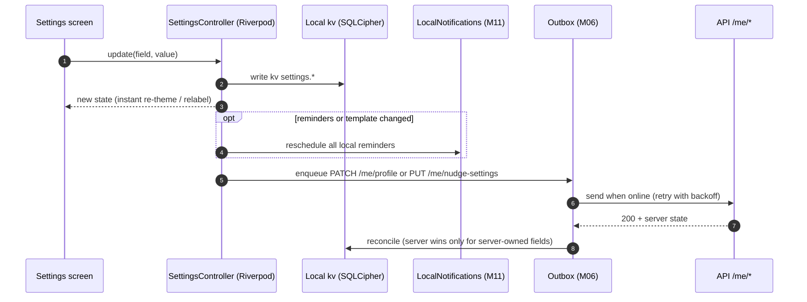
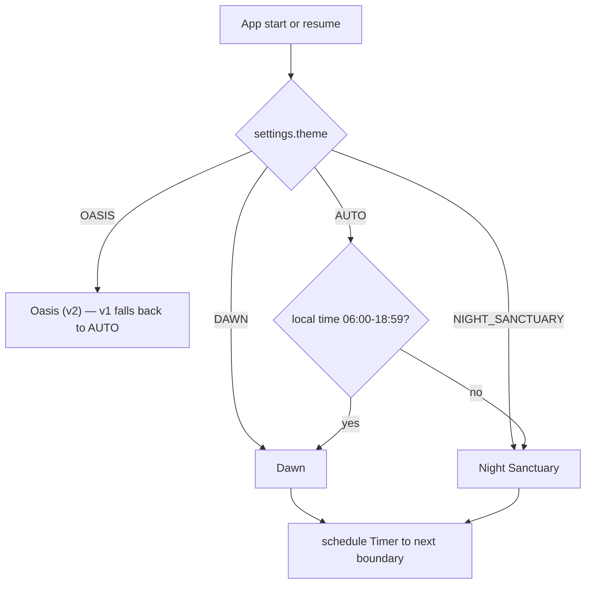
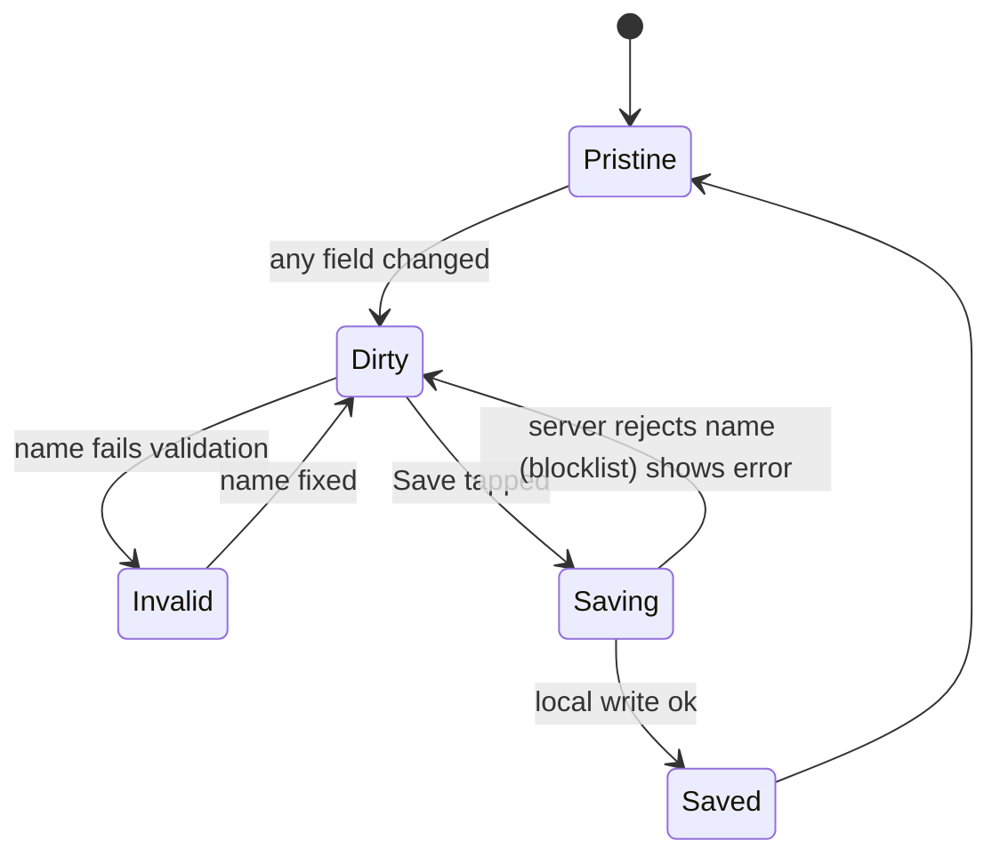

# M14 — Settings & personalization

## 1. Header

| Field | Value |
| --- | --- |
| ID | M14 |
| Name | Settings & personalization (themes, coach persona, nudges, notification template, language, modes) |
| Release | **v1**: F-25 (tone), F-60 (Dawn + Night Sanctuary + AUTO), F-61 (coach settings) · **v2**: Oasis theme, voice preview with real TTS, F-62 prayer-time settings |
| Backend module | `apps/api/src/modules/users` (`ProfileService`, `SettingsController`) + `nudges` (schedule) |
| Flutter feature | `lib/features/settings` |
| Depends on | M01 (user), M07 (coach uses persona/tone), M11 (nudge schedule, templates), M16 (language), M02 (lock + disguise settings live here as entries), M17 (privacy entries) |

## 2. Purpose

One calm place where the user shapes TurnWell to feel like *theirs*: how it looks (theme), who their coach is
(name, gender, voice, tone), how often it reaches out (nudges, quiet hours), what the lock screen says
(discreet notification template), language, and which modes are active. Every setting applies instantly
and works offline; server-relevant settings sync in the background.

## 3. User stories & acceptance criteria

**US-14.1 — Theme (F-60)**
- Given Settings › Appearance, When the user picks `Auto`, `Dawn`, or `Night Sanctuary`, Then the whole app re-themes within one frame with a 250 ms cross-fade, and `Profile.theme` syncs.
- Given `AUTO`, Then Dawn applies from 06:00 to 18:59 and Night Sanctuary from 19:00 to 05:59 in **device local time**; re-evaluated on app resume and by a timer at the next boundary.
- `OASIS` is visible with a "Coming soon" badge (v1) and not selectable.

**US-14.2 — Coach persona (F-61)**
- Given Settings › Your coach, When the user edits name (1–20 chars, letters/spaces/apostrophes in any script), Then the coach uses the new name from the next message; the name is validated against a small blocklist (slurs, "Allah", "Prophet", "Muhammad", "Jesus", "God", "doctor", "therapist") → `SETTINGS_COACH_NAME_NOT_ALLOWED`.
- When the user switches gender `MALE`/`FEMALE`, Then grammar in AR/FR copy and the coach prompt persona block switch, and the default voice changes to the matching voice unless a voice was picked explicitly.
- When the user picks a voice from the list for their language, Then `coachVoiceId` is saved (used by v2 voice coach; v1 uses it only for the preview sample).
- When the user picks tone `GENTLE` / `BALANCED` / `FIRM`, Then a one-line example of each is shown before saving, and the coach uses it from the next message.

**US-14.3 — Nudges**
- Given Settings › Reminders, Then the user can set: daily check-in time (default from onboarding plan, else 21:30), max coach nudges per day 0–6 (default 3), quiet hours start/end (default 23:00–07:00), and toggles per nudge kind: Check-in, Before hard moments, After a slip, Encouragement, Faith reminders (only if `SINS` mode).
- When saved, Then `PUT /me/nudge-settings` updates `NudgeSchedule` and local reminders are rescheduled (M11) immediately, even offline (local first, sync later).
- Setting max to 0 shows: "Your coach won't reach out first. Check-in reminders still work." (check-in reminder is separate).

**US-14.4 — Discreet notification template (F-52)**
- Given Settings › Notifications › Lock-screen text, When the user picks a preset or writes their own (≤ 60 chars, no emoji required), Then every push and local notification shows exactly that title and body ("TurnWell" may also be replaced by the disguise name, M02).
- Presets: "You have a new reminder" (default), "Time for your check-in", "Daily notes", "New message", "Reminder".
- A preview shows how it looks on the lock screen.

**US-14.5 — Language**
- Given Settings › Language, When the user picks English / العربية / Français / Español or "Use device language", Then UI switches instantly (RTL flip for Arabic) and `User.locale` syncs; the coach replies in the new language from the next message.

**US-14.6 — Modes**
- Given Settings › What I'm working on, When the user enables `SINS` or `HABITS`, Then the mode is added to `Profile.modes`; disabling a mode that still has active items asks: "Archive N items in this mode?" (items archived, never deleted).
- At least one mode must stay enabled → `SETTINGS_MODE_REQUIRED`.

**US-14.7 — Entry points to other modules**: App lock & disguise (M02), Privacy & data (M17), Trusted contact (M09), Recovery passphrase (M06), Community identity (M12), About & disclaimers.

## 4. Screens

| Route | Screen |
| --- | --- |
| `/me` | Me hub |
| `/me/settings` | Settings list |
| `/me/settings/appearance` | Theme |
| `/me/settings/coach` | Coach persona |
| `/me/settings/reminders` | Nudges + check-in |
| `/me/settings/notifications` | Lock-screen template |
| `/me/settings/language` | Language |
| `/me/settings/modes` | Modes |
| `/me/settings/about` | About, disclaimer, licenses |

### 4.1 Settings list

```
┌──────────────────────────────────────┐
│ ←  Settings                          │
│ ╭──────────────────────────────────╮ │
│ │ ◐ Appearance            Auto  ›  │ │
│ │ ✦ Your coach            Noor  ›  │ │
│ │ ⏰ Reminders        3/day 21:30 › │ │
│ │ 🔔 Lock-screen text           ›  │ │
│ │ 🌐 Language          English  ›  │ │
│ │ ◎ What I'm working on  Both   ›  │ │
│ ╰──────────────────────────────────╯ │
│ ╭──────────────────────────────────╮ │
│ │ 🔒 App lock & disguise         › │ │ → M02
│ │ 🛟 Trusted contact             › │ │ → M09
│ │ 🔑 Recovery passphrase         › │ │ → M06
│ │ 🛡 Privacy & data              › │ │ → M17
│ ╰──────────────────────────────────╯ │
│ ╭──────────────────────────────────╮ │
│ │ ⓘ About TurnWell               › │ │
│ ╰──────────────────────────────────╯ │
└──────────────────────────────────────┘
```

### 4.2 Appearance

```
┌──────────────────────────────────────┐
│ ←  Appearance                        │
│ ╭─────────╮ ╭─────────╮ ╭─────────╮  │
│ │ ░▒▓ sun │ │ ·  ✦  · │ │ 🌿      │  │ ← live mini previews (GlassCard on gradient)
│ │  Dawn   │ │  Night  │ │  Oasis  │  │
│ │   ( )   │ │   ( )   │ │  soon   │  │
│ ╰─────────╯ ╰─────────╯ ╰─────────╯  │
│ (•) Auto — Dawn by day, Night by     │
│     night (switches at 06:00/19:00)  │
│ Reduce motion          [ system ▾ ]  │
└──────────────────────────────────────┘
```

### 4.3 Your coach

```
┌──────────────────────────────────────┐
│ ←  Your coach                        │
│        ╭──────╮                      │
│        │  N   │  ← glass avatar, initial
│        ╰──────╯                      │
│ Name   ╭──────────────────────────╮  │
│        │ Noor                     │  │
│        ╰──────────────────────────╯  │
│ Coach  [ Female ] [ Male ]           │ ← GlassChip
│ Voice  ( ) Layla  ▶   (•) Noor  ▶    │ ← per language list, ▶ plays 4 s sample
│ Tone   [ Gentle ] [ Balanced ] [Firm]│
│ ╭──────────────────────────────────╮ │
│ │ "Slipped today? That's okay.     │ │ ← example line for selected tone
│ │  What happened right before?"    │ │
│ ╰──────────────────────────────────╯ │
│ [            Save                ]   │
└──────────────────────────────────────┘
```

### 4.4 Reminders

```
┌──────────────────────────────────────┐
│ ←  Reminders                         │
│ Daily check-in          [ 21:30 ]    │
│ Coach can reach out                  │
│   up to  [–]  3  [+]  times a day    │
│ Quiet hours        [23:00]–[07:00]   │
│ ── Kinds ──────────────────────────  │
│ Check-in reminder              (on)  │
│ Before hard moments            (on)  │
│ After a slip                   (on)  │
│ Encouragement                  (on)  │
│ Faith reminders (Sins mode)    (on)  │
└──────────────────────────────────────┘
```

### 4.5 Lock-screen text

```
┌──────────────────────────────────────┐
│ ←  Lock-screen text                  │
│ ╭──────────────────────────────────╮ │
│ │ 9:41                             │ │ ← preview
│ │ ┌ Daily Notes ────────── now ┐   │ │
│ │ │ You have a new reminder    │   │ │
│ │ └────────────────────────────┘   │ │
│ ╰──────────────────────────────────╯ │
│ (•) You have a new reminder          │
│ ( ) Time for your check-in           │
│ ( ) Daily notes                      │
│ ( ) Custom: ╭──────────────────────╮ │
│             │                      │ │
│             ╰──────────────────────╯ │
│ Never shows your coach's words or    │
│ anything you track.                  │
└──────────────────────────────────────┘
```

## 5. Flows

### 5.1 Settings change (offline-first)



### 5.2 AUTO theme resolution



## 6. State machine

Coach persona edit form:



## 7. Data

| Setting | Local kv key | Server field | Owner |
| --- | --- | --- | --- |
| Theme | `settings.theme` | `Profile.theme` (`ThemeChoice`) | local-first |
| Reduce motion | `settings.reduceMotion` (`system`/`on`/`off`) | — | local only |
| Coach name | `settings.coach.name` | `Profile.coachName` | server validates |
| Coach gender | `settings.coach.gender` | `Profile.coachGender` | |
| Coach voice | `settings.coach.voiceId` | `Profile.coachVoiceId` | |
| Tone | `settings.coach.tone` | `Profile.coachTone` | |
| Check-in time | `settings.checkInTime` | `NudgeSchedule.checkInTime` | |
| Max nudges | `settings.nudges.max` | `NudgeSchedule.maxPerDay` | |
| Quiet hours | `settings.quiet.start/end` | `NudgeSchedule.quietStart/quietEnd` | |
| Nudge kinds | `settings.nudges.kinds` | `NudgeSchedule.kinds` (JSON) | |
| Notification template | `settings.notif.key/title/body` | `NudgeSchedule.templateKey/templateTitle/templateBody` (via `PUT /nudges/settings`, M11) | cached locally for local reminders |
| Language | `settings.locale` | `User.locale` | |
| Modes | `settings.modes` | `Profile.modes` | |

Voices catalogue (v1 static JSON shipped in app, `assets/voices.json`):

```json
{ "en": [ { "id": "en-US-Neural2-F", "gender": "FEMALE", "label": "Noor" }, { "id": "en-US-Neural2-D", "gender": "MALE", "label": "Sami" } ],
  "ar": [ { "id": "ar-XA-Wavenet-A", "gender": "FEMALE", "label": "Layla" }, { "id": "ar-XA-Wavenet-B", "gender": "MALE", "label": "Karim" } ],
  "fr": [ { "id": "fr-FR-Neural2-A", "gender": "FEMALE", "label": "Inès" }, { "id": "fr-FR-Neural2-B", "gender": "MALE", "label": "Adam" } ],
  "es": [ { "id": "es-ES-Neural2-A", "gender": "FEMALE", "label": "Lucía" }, { "id": "es-ES-Neural2-B", "gender": "MALE", "label": "Hugo" } ] }
```
v1 samples are pre-rendered MP3s in `assets/voices/` (no network). Voice IDs are Google Cloud TTS names, to be confirmed in v2.

## 8. API

| Method | Path | Body | Returns |
| --- | --- | --- | --- |
| GET | `/me/profile` | — | Profile settings |
| PATCH | `/me/profile` | any of `coachName, coachGender, coachVoiceId, coachTone, theme, modes, locale` | Profile |
| GET | `/me/nudge-settings` | — | NudgeSchedule (settings fields) |
| PUT | `/me/nudge-settings` | `checkInTime, maxPerDay, quietStart, quietEnd, kinds, timezone` | NudgeSchedule |

```http
PATCH /v1/me/profile
{ "coachName": "Noor", "coachGender": "FEMALE", "coachTone": "GENTLE", "theme": "AUTO", "locale": "ar" }
```
```json
200 { "coachName": "Noor", "coachGender": "FEMALE", "coachVoiceId": "ar-XA-Wavenet-A", "coachTone": "GENTLE",
      "theme": "AUTO", "modes": ["SINS","HABITS"], "locale": "ar", "updatedAt": "2026-11-20T21:00:00Z" }
```

```http
PUT /v1/me/nudge-settings
{ "checkInTime": "21:30", "maxPerDay": 3, "quietStart": "23:00", "quietEnd": "07:00",
  "kinds": { "CHECK_IN": true, "PRE_TRIGGER": true, "FOLLOW_UP": true, "ENCOURAGEMENT": true, "FAITH": false },
  "timezone": "Africa/Algiers" }
```

| HTTP | Code | When |
| --- | --- | --- |
| 400 | `SETTINGS_COACH_NAME_NOT_ALLOWED` | Blocklisted or invalid chars |
| 400 | `SETTINGS_MODE_REQUIRED` | `modes` empty |
| 400 | `SETTINGS_THEME_UNAVAILABLE` | `OASIS` in v1 |
| 400 | `VALIDATION_FAILED` | `maxPerDay` outside 0–6, bad `HH:mm`, unknown timezone |

## 9. Backend design

```ts
@Injectable() export class ProfileService {
  get(userId: string): Promise<ProfileSettingsDto>;
  update(userId: string, dto: UpdateProfileDto): Promise<ProfileSettingsDto>; // validates coach name, theme flag
}
@Injectable() export class NudgeSettingsService { // in nudges module
  get(userId: string): Promise<NudgeSettingsDto>;
  put(userId: string, dto: PutNudgeSettingsDto): Promise<NudgeSettingsDto>; // recompute next dispatch slot
}
```
- `CoachNameValidator`: Unicode letters, spaces, `'`, `-`, length 1–20, NFKC-normalised, case-insensitive blocklist in all 4 languages.
- Changing `coachGender`/`coachTone`/`coachName` bumps `Profile.updatedAt`; `ContextBuilder` (M07) reads fresh profile each request (cache 60 s, invalidated on update).
- Changing `locale` updates `User.locale` and is used by M11 for nudge text and by M13 locale grouping on next post.

## 10. Flutter design

```
lib/features/settings/
├── data/
│   ├── settings_local_store.dart     # kv read/write, typed
│   └── settings_repository.dart      # local-first + outbox sync
├── domain/
│   ├── app_settings.dart             # freezed: theme, reduceMotion, locale, modes, notifTemplate
│   ├── coach_persona.dart            # freezed: name, gender, voiceId, tone
│   └── nudge_settings.dart
└── presentation/
    ├── providers/
    │   ├── app_settings_provider.dart     # Notifier<AppSettings>
    │   ├── effective_theme_provider.dart  # resolves AUTO → TwTokens, timer to boundary
    │   ├── coach_persona_provider.dart
    │   └── nudge_settings_provider.dart
    ├── screens/ settings_screen.dart, appearance_screen.dart, coach_screen.dart,
    │            reminders_screen.dart, notification_template_screen.dart,
    │            language_screen.dart, modes_screen.dart, about_screen.dart
    └── widgets/ theme_preview_card.dart, tone_example.dart, voice_tile.dart, lock_screen_preview.dart
```

```dart
@riverpod
TwTokens effectiveTheme(EffectiveThemeRef ref) {
  final choice = ref.watch(appSettingsProvider.select((s) => s.theme));
  final now = ref.watch(clockProvider); // ticks at boundaries + on resume
  return switch (choice) {
    ThemeChoice.dawn => TwTokens.dawn,
    ThemeChoice.nightSanctuary => TwTokens.nightSanctuary,
    _ => (now.hour >= 6 && now.hour < 19) ? TwTokens.dawn : TwTokens.nightSanctuary, // AUTO, OASIS(v1)
  };
}
```

## 11. Edge cases

| Case | Behaviour |
| --- | --- |
| Device timezone changes (travel) | `X-Timezone` header + `PUT /me/nudge-settings {timezone}` sent on resume; reminders rescheduled |
| Quiet hours overlap check-in time | Allowed; check-in reminder still fires (user chose the time), coach nudges respect quiet hours |
| Name in Arabic script | Allowed; prompt uses as-is |
| User disables FAITH kind then disables SINS | Kind hidden; value kept |
| Offline save of coach name later rejected | Revert to last server value + inline error on next open |
| Disguise active | Settings titles still say TurnWell inside the app (only icon/name outside changes) |

## 12. Security & privacy

- The notification template is a disguise text, not personal content. It is stored on the server (`NudgeSchedule.template*`) so pushes can use it as the visible title/body (M11) and cached on the device for local reminders. The AI-written nudge text is never in the push payload; it is fetched after unlock. Custom template text is validated (no URLs, length limits) and never logged.
- Coach name is used in prompts — it is user-chosen, not PII, but still never logged.
- Settings changes are not analytics-tracked with values except theme/tone enums.

## 13. Analytics events

`settings.theme_changed {theme}`, `settings.coach_updated {genderChanged, toneChanged, nameChanged}`,
`settings.tone_changed {tone}`, `settings.nudges_changed {maxPerDay, kindsEnabledCount}`,
`settings.language_changed {locale}`, `settings.mode_changed {modes}`.

## 14. Tests

- Unit: AUTO resolution at 05:59 / 06:00 / 18:59 / 19:00; coach name validator (blocklist in 4 languages, Unicode); nudge settings validation.
- Widget: each settings screen LTR + RTL, Dawn + Night goldens; lock-screen preview uses template.
- Integration: change tone → next coach request contains tone block (mock LLM asserts prompt); change reminders offline → local notification rescheduled.
- E2E: PATCH profile with `OASIS` → `SETTINGS_THEME_UNAVAILABLE`.

## 15. Open questions

- Should the coach name blocklist include common human names of religious figures beyond the listed ones? (Default: listed only.)
- Final voice list and sample recordings (v2 TTS provider decision).
- Schema: `NudgeSchedule.kinds Json?` is in `schema.prisma`; `null` means all kinds on.
