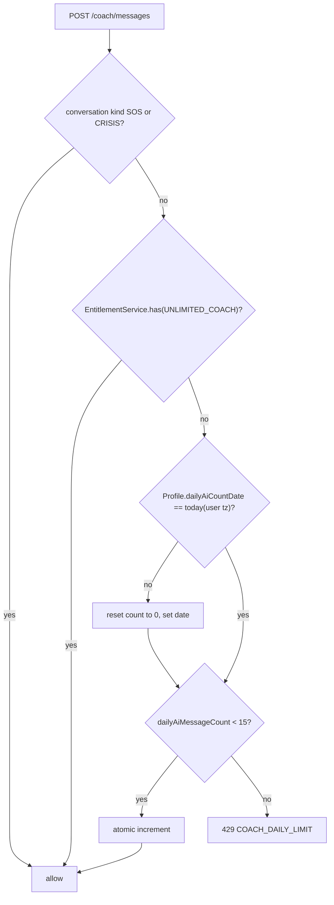
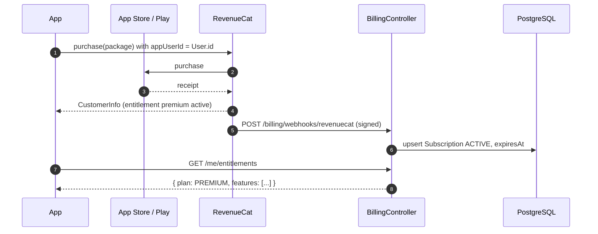
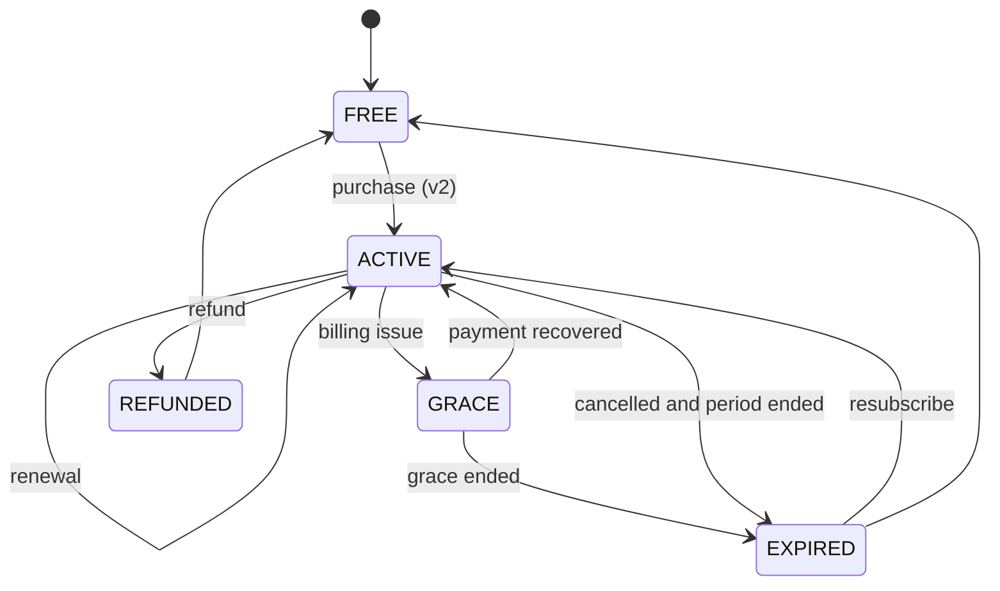

# M15 — Subscriptions & entitlements

## 1. Header

| Field | Value |
| --- | --- |
| ID | M15 |
| Name | Free limits, entitlements, Premium subscriptions |
| Release | **v1**: F-70 (free limits + `EntitlementService`, no payments) · **v2**: F-71 (Premium purchase, paywall, store webhooks) |
| Backend module | `apps/api/src/modules/billing` |
| Flutter feature | `lib/features/paywall` (v2) + `core/entitlements` (v1) |
| Depends on | M01 (user), M07 (message cap), M14 (themes), M18 (secrets for store keys) |
| Used by | M07 (coach cap, voice), M14 (Oasis theme), weekly reflection (v2) |

> **Build only §§ marked v1.** v2 sections are complete so the v1 code leaves the right extension points.

## 2. Purpose

Keep the essential help free forever (tracking, journal, SOS, crisis help, community, nudges) and fund AI costs
with an optional Premium plan. In v1 there are no payments: a single `EntitlementService` decides what a user may
do, so v2 only has to add a purchase source.

## 3. User stories & acceptance criteria

**US-15.1 (v1) — Free coach limit**
- Given a free user, When they send their 16th coach message in a calendar day (user timezone), Then `POST /coach/messages` returns `429 COACH_DAILY_LIMIT` with `details.resetsAt` and the app shows a calm card: "You've used today's 15 messages. Your coach will be back at midnight. SOS and check-ins still work."
- SOS conversations (M10) and crisis conversations (M09) **never** count toward or are blocked by the limit.
- Onboarding conversation (M03) does not count.

**US-15.2 (v1) — Entitlement check**
- Given any gated feature, When code needs to know access, Then it calls `EntitlementService.has(userId, Feature)`; in v1 every user resolves to plan `FREE` (+ `BETA_TESTER` flag may lift the cap via config).

**US-15.3 (v2) — Buy Premium**
- Given the paywall, When the user buys monthly or yearly via App Store / Google Play, Then the app receives the purchase, the backend validates it (via RevenueCat webhook or direct store APIs), `Subscription.status = ACTIVE`, and Premium features unlock within 5 s without restart.

**US-15.4 (v2) — Renewal, grace, expiry, refund**
- Store events update `Subscription.status` (`ACTIVE`, `GRACE`, `EXPIRED`, `REFUNDED`). On `EXPIRED`, Premium features stop at `expiresAt`; nothing the user created is deleted or hidden (journal, history, insights already generated stay readable).

**US-15.5 (v2) — Restore purchases** works on a new phone after sign-in.

## 4. Screens

| Route | Screen | Release |
| --- | --- | --- |
| (inline card) | Daily limit card in coach chat | v1 |
| `/paywall` | Premium paywall | v2 |
| `/me/settings/subscription` | Manage subscription | v2 |

### 4.1 Daily limit card (v1)

```
╭──────────────────────────────────────╮
│ ☾  That's today's 15 messages        │
│ Noor will be back at 00:00.          │
│ In a hard moment? SOS always works.  │
│ [ Open SOS ]   [ Write in journal ]  │
│ (v2:) [ Unlimited with Premium ]     │
╰──────────────────────────────────────╯
```

### 4.2 Paywall (v2)

```
┌──────────────────────────────────────┐
│ ✕                                    │
│        TurnWell Premium              │
│ ✓ Unlimited coach messages           │
│ ✓ Talk to your coach out loud        │
│ ✓ Weekly reflection & deep insights  │
│ ✓ All themes                         │
│ Always free: tracking, SOS, crisis   │
│ help, community, journal.            │
│ ╭────────────────╮ ╭────────────────╮│
│ │ Yearly         │ │ Monthly        ││
│ │ 39.99 / year   │ │ 4.99 / month   ││ ← localized store prices
│ │ save 33%  (•)  │ │           ( )  ││
│ ╰────────────────╯ ╰────────────────╯│
│ [          Continue               ]  │
│ Restore purchases · Terms · Privacy  │
└──────────────────────────────────────┘
```

## 5. Flows

### 5.1 Coach cap check (v1)



### 5.2 Purchase (v2)



## 6. State machine



## 7. Data

- v1: `Profile.dailyAiMessageCount`, `Profile.dailyAiCountDate` (exists). Atomic update:
  ```sql
  UPDATE private.profiles
     SET daily_ai_message_count = CASE WHEN daily_ai_count_date = $today THEN daily_ai_message_count + 1 ELSE 1 END,
         daily_ai_count_date = $today
   WHERE user_id = $1
     AND (daily_ai_count_date <> $today OR daily_ai_count_date IS NULL OR daily_ai_message_count < $limit)
  RETURNING daily_ai_message_count;   -- 0 rows → limit reached
  ```
  (Prisma `$queryRaw`; column names follow the `@map` used in migration.)
- v2: `account.subscriptions` (exists): `userId, platform, productId, status, expiresAt`.

Entitlement matrix:

| Feature key | FREE | PREMIUM (v2) |
| --- | --- | --- |
| `COACH_MESSAGES_PER_DAY` | 15 | unlimited |
| `UNLIMITED_COACH` | ✗ | ✓ |
| `VOICE_COACH` | ✗ | ✓ |
| `WEEKLY_REFLECTION` | ✗ | ✓ |
| `DEEP_INSIGHTS` | ✗ | ✓ |
| `THEME_OASIS` | ✗ | ✓ |
| `SOS`, `CRISIS`, `TRACKING`, `JOURNAL`, `COMMUNITY`, `NUDGES` | ✓ | ✓ |

Product IDs (v2): `turnwell_premium_monthly`, `turnwell_premium_yearly`; entitlement id `premium`.

## 8. API

| Method | Path | Release | Purpose |
| --- | --- | --- | --- |
| GET | `/me/entitlements` | v1 | Plan + limits + usage today |
| POST | `/billing/webhooks/revenuecat` | v2 | Store events (HMAC/Authorization header verified) |
| POST | `/billing/restore` | v2 | Force refresh from RevenueCat |

```json
GET /v1/me/entitlements → 200
{ "plan": "FREE", "features": ["SOS","CRISIS","TRACKING","JOURNAL","COMMUNITY","NUDGES"],
  "limits": { "coachMessagesPerDay": 15 }, "usage": { "coachMessagesToday": 6, "resetsAt": "2026-11-21T00:00:00+01:00" } }
```

Errors: `COACH_DAILY_LIMIT` (429, raised by M07), `BILLING_WEBHOOK_INVALID` (401), `BILLING_UNAVAILABLE` (503).

## 9. Backend design

```ts
export enum Feature { UNLIMITED_COACH = 'UNLIMITED_COACH', VOICE_COACH = 'VOICE_COACH',
  WEEKLY_REFLECTION = 'WEEKLY_REFLECTION', DEEP_INSIGHTS = 'DEEP_INSIGHTS', THEME_OASIS = 'THEME_OASIS' }

@Injectable() export class EntitlementService {
  plan(userId: string): Promise<'FREE' | 'PREMIUM'>;               // v1: FREE (or config override for beta)
  has(userId: string, f: Feature): Promise<boolean>;
  consumeCoachMessage(userId: string, kind: ConversationKind): Promise<{ ok: boolean; count: number; resetsAt: string }>;
  summary(userId: string): Promise<EntitlementsDto>;
}
// v2
@Injectable() export class RevenueCatWebhookService { handle(event: RcEvent): Promise<void>; } // idempotent by event.id
```
`consumeCoachMessage` is called by `CoachService` **before** the LLM call; if the LLM call fails with a server error,
the counter is decremented (compensation).

## 10. Flutter design

```
lib/core/entitlements/
├── entitlements_api.dart
└── entitlements_provider.dart        # AsyncValue<Entitlements>, refreshed on app resume + after 429
lib/features/paywall/                 # v2
├── data/purchases_repository.dart    # purchases_flutter (RevenueCat)
└── presentation/{paywall_screen.dart, manage_subscription_screen.dart}
```
`CoachLimitCard` widget lives in `features/coach/presentation/widgets/` and reads `entitlementsProvider`.
The coach composer shows "6 of 15 today" only after 10 messages (not before — avoid scarcity pressure).

## 11. Edge cases

| Case | Behaviour |
| --- | --- |
| Timezone change mid-day | Day computed with current `User.timezone`; at most one extra reset per day accepted |
| Message rejected by safety → crisis | Not counted |
| LLM error 5xx | Count compensated |
| Webhook arrives before app sync (v2) | Upsert by `userId` (`appUserId`); app refreshes on resume |
| Purchase on iOS, use on Android (v2) | Works via RevenueCat `appUserId = User.id` |

## 12. Security & privacy

- No payment data stored; only `productId`, `status`, `expiresAt`.
- Webhook secret in Secret Manager (`REVENUECAT_WEBHOOK_AUTH`). Reject replay (event id cache 7 days).
- Crisis and SOS help are never paywalled — enforce with a unit test that iterates `ConversationKind`.

## 13. Analytics events

`billing.limit_reached {count}`, `billing.limit_card_action {action: sos|journal|paywall}`;
v2: `billing.paywall_viewed {source}`, `billing.purchase {product, platform}`, `billing.restore`, `billing.expired`.

## 14. Tests

- v1: cap at 15 with concurrent requests (10 parallel → exactly 15 accepted); day rollover; SOS/CRISIS/ONBOARDING exempt; compensation on LLM failure.
- v2: webhook signature, idempotency, each status transition; restore.

## 15. Open questions

- Final prices + regional pricing tiers (MENA) — after beta.
- RevenueCat vs direct `in_app_purchase` + server receipt validation (default: RevenueCat for speed).
- No schema changes needed for v1.
