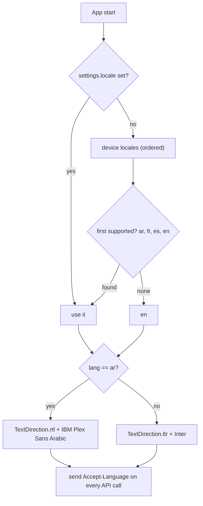
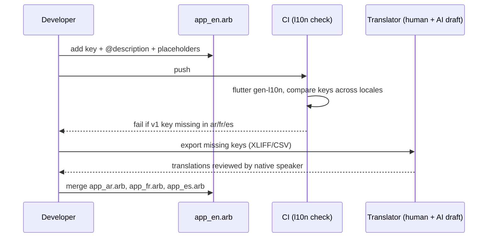
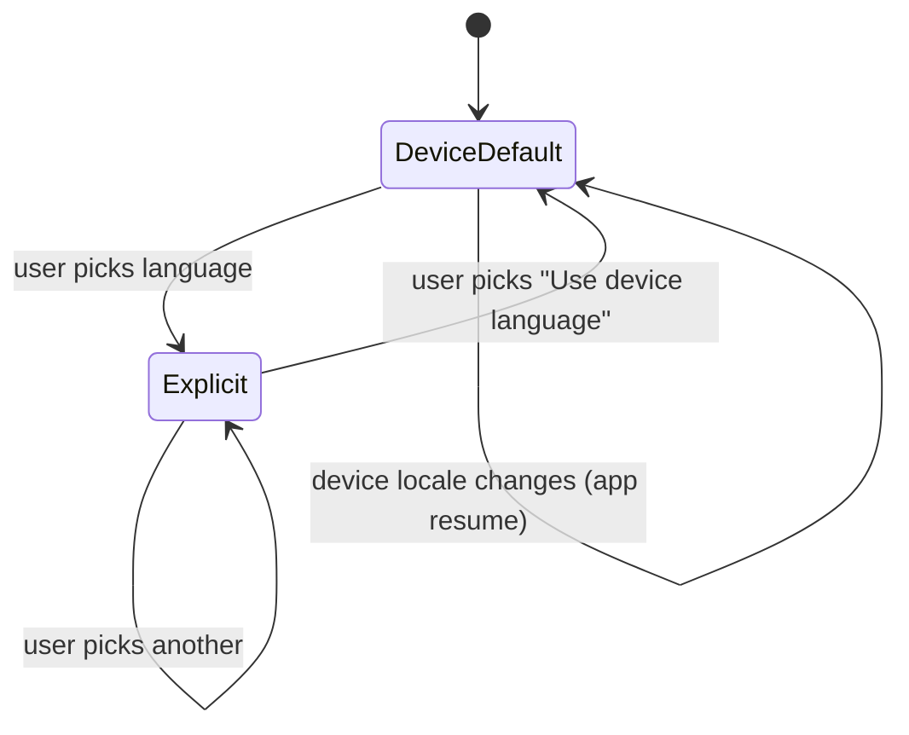

# M16 — Localization

## 1. Header

| Field | Value |
| --- | --- |
| ID | M16 |
| Name | Localization (EN, AR, FR, ES), RTL, pluralization, gendered coach strings |
| Release | **v1**: F-03 · **v2+**: more locales (TR, UR, ID, MS, DE…) |
| Backend | `apps/api/src/common/i18n` (server-side strings: push templates fallbacks, moderation author messages, emails) |
| Flutter | `lib/core/l10n` |
| Depends on | M14 (language setting), M01 (`User.locale`) |
| Used by | every module |

## 2. Purpose

Every user-visible string exists in English, Arabic (RTL), French and Spanish, with English as fallback. Arabic and
French grammar changes with the coach's gender; all four languages need proper plurals. Islamic terms in Sins mode
keep their Arabic word plus a translation. The coach (LLM) answers in the user's locale via the prompt (M07/M08);
this module covers the **UI and server-generated text**.

## 3. User stories & acceptance criteria

- **US-16.1** Given first launch, When the device locale is `ar-*`, `fr-*`, `es-*` or `en-*`, Then that language is used; otherwise English. The language picker is shown on the welcome screen as a small chip.
- **US-16.2** Given Arabic, Then the whole layout is mirrored (nav bar order, back arrows, bubbles, SOS button on the bottom-left), numbers use Western digits by default (setting "Arabic-Indic digits" in v2), and dates use `intl` Arabic formatting.
- **US-16.3** Given coach gender `FEMALE` and locale `ar`, Then strings like "Noor is typing…" / "Noor wrote to you" use feminine verb forms (`تكتب`, `كتبت`); `MALE` → masculine (`يكتب`, `كتب`). French: "Noor est prête" vs "Sami est prêt".
- **US-16.4** Given a count (clean days, urges, replies), Then plural forms are correct: Arabic zero/one/two/few/many/other; FR/ES/EN one/other.
- **US-16.5** Given a key missing in AR/FR/ES, Then the English string is shown and a dev-build warning is logged (no crash). CI fails if any v1 key is missing in a v1 locale.
- **US-16.6** Given Sins mode, Then terms like *tawbah*, *dhikr*, *salah* are shown as the localized word + gloss on first use per screen ("Tawbah (returning to Allah)"); in Arabic only the Arabic word.

## 4. Screens

No dedicated screens besides the language picker (M14 `/me/settings/language`) and the welcome language chip.

```
┌──────────────────────────────────────┐
│ ←  Language                          │
│ (•) Use device language (English)    │
│ ( ) English                          │
│ ( ) العربية                          │ ← each name in its own script
│ ( ) Français                         │
│ ( ) Español                          │
│ Your coach will reply in the chosen  │
│ language.                            │
└──────────────────────────────────────┘
```

RTL mirroring reference (Home):

```
 LTR                                   RTL (ar)
┌───────────────────────────┐         ┌───────────────────────────┐
│ Good evening          (⚙) │         │ (⚙)          مساء الخير  │
│ ◯ 78%  clean days         │         │        أيام نظيفة 78% ◯  │
│ ...                ╭───╮  │         │  ╭───╮                ... │
│                    │SOS│  │         │  │SOS│                    │
│ ⌂  ✦  ◔  ◎  ☺            │         │            ☺  ◎  ◔  ✦  ⌂ │
└───────────────────────────┘         └───────────────────────────┘
```

## 5. Flows





## 6. State machine

Locale state:



## 7. Data

- Files: `lib/core/l10n/app_en.arb` (template), `app_ar.arb`, `app_fr.arb`, `app_es.arb`; `l10n.yaml`:
  ```yaml
  arb-dir: lib/core/l10n
  template-arb-file: app_en.arb
  output-localization-file: app_localizations.dart
  nullable-getter: false
  untranslated-messages-file: build/untranslated.json
  ```
- Key naming: `<feature>_<screen>_<element>` e.g. `tracking_checkIn_title`, `coach_typing`, `sos_ride_start`.
- Server strings: `apps/api/src/common/i18n/{en,ar,fr,es}.json` (push fallbacks, moderation author messages, email verification, crisis card static text).
- `User.locale` stores the full tag (`ar-DZ`); community grouping uses the language part (M12).

### ARB examples

```json
// app_en.arb
{
  "@@locale": "en",
  "home_greeting_evening": "Good evening",
  "progress_cleanDays": "{percent}% clean days",
  "@progress_cleanDays": { "placeholders": { "percent": { "type": "int" } } },
  "sos_urgesPassed": "{count, plural, =0{No urges yet} =1{1 urge passed} other{{count} urges passed}}",
  "@sos_urgesPassed": { "placeholders": { "count": { "type": "int" } } },
  "coach_typing": "{name} is typing…",
  "@coach_typing": { "placeholders": { "name": { "type": "String" } } },
  "coach_ready": "{gender, select, female{{name} is ready} male{{name} is ready} other{{name} is ready}}",
  "@coach_ready": { "placeholders": { "gender": { "type": "String" }, "name": { "type": "String" } } },
  "slip_prompt": "Slipped today? That's okay. What happened?",
  "faith_tawbah": "Tawbah (returning to Allah)"
}
```

```json
// app_ar.arb
{
  "@@locale": "ar",
  "home_greeting_evening": "مساء الخير",
  "progress_cleanDays": "{percent}٪ أيام نظيفة",
  "sos_urgesPassed": "{count, plural, =0{لا رغبات بعد} =1{تجاوزت رغبة واحدة} =2{تجاوزت رغبتين} few{تجاوزت {count} رغبات} many{تجاوزت {count} رغبة} other{تجاوزت {count} رغبة}}",
  "coach_typing": "{gender, select, female{{name} تكتب…} male{{name} يكتب…} other{{name} يكتب…}}",
  "coach_ready": "{gender, select, female{{name} جاهزة} male{{name} جاهز} other{{name} جاهز}}",
  "slip_prompt": "زلّة اليوم؟ لا بأس. ماذا حدث؟",
  "faith_tawbah": "التوبة"
}
```

```json
// app_fr.arb
{
  "@@locale": "fr",
  "coach_typing": "{name} écrit…",
  "coach_ready": "{gender, select, female{{name} est prête} male{{name} est prêt} other{{name} est prêt}}",
  "sos_urgesPassed": "{count, plural, =0{Aucune envie pour l'instant} =1{1 envie surmontée} other{{count} envies surmontées}}",
  "slip_prompt": "Une rechute aujourd'hui ? Ce n'est pas grave. Que s'est-il passé ?"
}
```

Note: in Arabic, `coach_typing` must also be a `select` on gender, so the EN template declares the `gender`
placeholder for it too (EN text ignores it). Rule: **any string that mentions the coach takes `{gender}` and `{name}`.**

## 8. API

- Clients send `Accept-Language: ar-DZ` and `X-Timezone`. Server resolves via `I18nService.resolve(header, user.locale)` → `ar|fr|es|en`.
- No dedicated endpoints. `PATCH /me/profile { locale }` (M14) persists choice.

## 9. Backend design

```ts
@Injectable() export class I18nService {
  resolve(acceptLanguage?: string, stored?: string): 'en' | 'ar' | 'fr' | 'es';
  t(lang: string, key: string, params?: Record<string, string | number>, gender?: 'MALE' | 'FEMALE'): string; // ICU via @formatjs/intl
}
```
- Server messages use ICU MessageFormat (same syntax as ARB) with `intl-messageformat`.
- LLM language rule (M08 prompt block): "Reply in {languageName}. If the user writes in another language, reply in the user's language." Darija/dialects: allowed in replies when the user writes in dialect.

## 10. Flutter design

```
lib/core/l10n/
├── app_en.arb  app_ar.arb  app_fr.arb  app_es.arb
├── l10n.dart                 # extension BuildContext.l10n
├── locale_provider.dart      # Notifier<Locale> (settings + device)
└── terms.dart                # Sins-mode glossary helper (term + gloss)
```

```dart
MaterialApp.router(
  locale: ref.watch(localeProvider),
  supportedLocales: AppLocalizations.supportedLocales,
  localizationsDelegates: AppLocalizations.localizationsDelegates,
  builder: (context, child) => Directionality(
    textDirection: Directionality.of(context), // from locale
    child: child!,
  ),
);
```

RTL rules for developers:
1. Use `EdgeInsetsDirectional`, `AlignmentDirectional`, `PositionedDirectional`, `BorderRadiusDirectional`.
2. Never use `Alignment.centerLeft/right` or `left:/right:` for layout.
3. Icons with direction (`arrow_back`, `chevron_right`, `send`) use `Icon(..., textDirection: ...)` or `Directionality`-aware variants; mirror custom SVGs with `Transform.flip` when RTL.
4. Do **not** mirror: progress ring, clocks, media controls, numbers, the brand logo.
5. Text fields: `textDirection` follows content (`TextDirection` auto via `Bidi`) so mixed Arabic/English input renders correctly.
6. Golden tests in RTL for every screen.

Fonts: Inter (Latin), IBM Plex Sans Arabic (Arabic) bundled in `assets/fonts`, selected by locale in `ThemeData.textTheme`.

## 11. Edge cases

| Case | Behaviour |
| --- | --- |
| Coach name in Latin while locale is Arabic | Wrap name with Unicode isolates (`⁨name⁩`) to keep punctuation correct |
| User writes in Darija | Coach may answer in Darija; UI stays in chosen language |
| Device locale `pt-BR` | English UI; coach answers in English unless the user writes Portuguese |
| Long German-like strings in future | Layout tests at 130% text length (pseudo-locale `en-XA`) |
| Plural `few` missing in AR | CI lint fails |

## 12. Security & privacy

- Translations never contain user data. Translators receive key + description + screenshot only.
- AI-assisted draft translations are allowed but must be reviewed by a native speaker before release, especially safety/crisis strings (M09) which require **two** native reviewers.

## 13. Analytics events

`l10n.locale_resolved {locale, source: device|explicit}`, `l10n.missing_key {key, locale}` (debug/staging only).

## 14. Tests

- CI: key parity across 4 ARB files; ICU syntax check; no hard-coded strings (custom lint on `Text('...')` literals in `features/`).
- Unit: locale resolution order; `I18nService.t` with gender select + Arabic plurals (0, 1, 2, 3, 11, 100).
- Widget/golden: every v1 screen in `ar` RTL and `en` LTR; pseudo-locale overflow test.

## 15. Open questions

- Arabic-Indic digits default for `ar-EG`/Gulf vs Western digits for Maghreb (default v1: Western digits everywhere).
- Darija UI localization (v2?).
- No schema changes.
