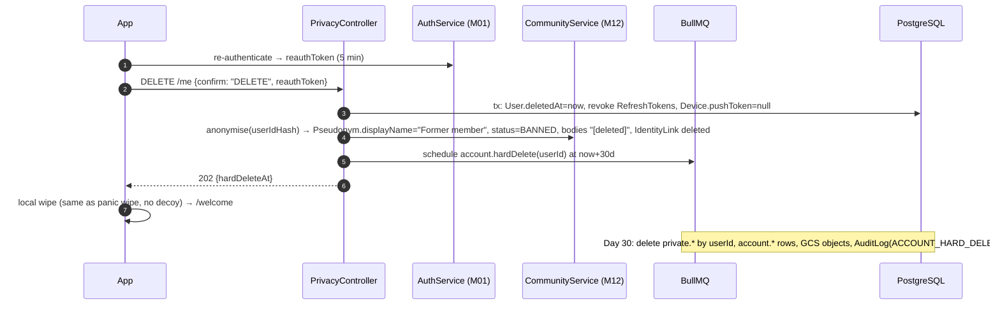
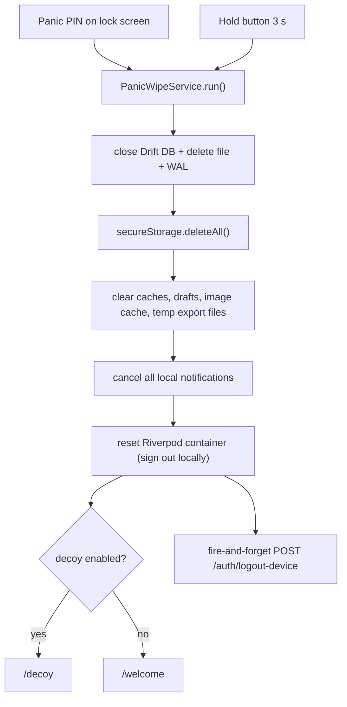
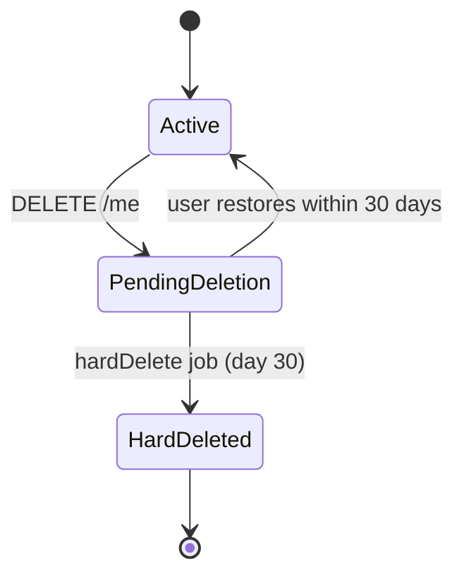
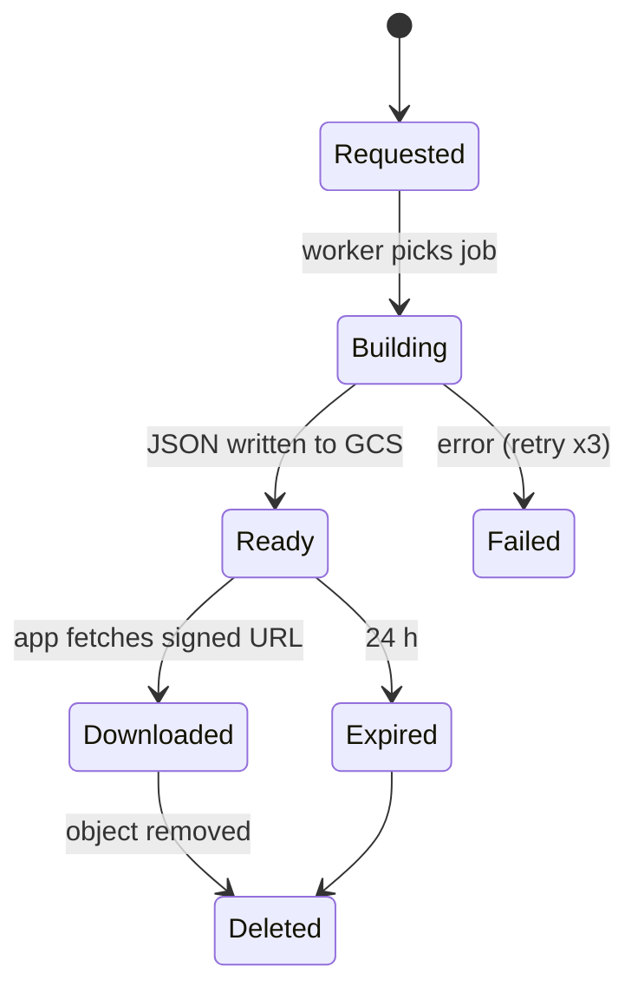

# M17 — Privacy: export, delete account, panic wipe

## 1. Header

| Field | Value |
| --- | --- |
| ID | M17 |
| Name | Data export, account deletion, panic wipe (privacy dashboard v2) |
| Release | **v1**: F-53 (panic wipe), F-54 (export + delete) · **v2**: F-55 (privacy dashboard) |
| Backend module | `apps/api/src/modules/users` (`PrivacyController`, `ExportService`, `DeleteAccountJob`) |
| Flutter feature | `lib/features/privacy` |
| Depends on | M06 (local DB, keys, decryption for export), M01 (re-auth), M02 (PIN/biometric confirm), M12 (anonymise community), M07 (AI data), M11 (unregister devices), M18 (GCS bucket, KMS) |

## 2. Purpose

Give users full control over their data: take everything with them (export), erase everything (delete account),
and erase this phone instantly when they feel unsafe (panic wipe). These features make the privacy promise
verifiable, and are legal requirements (GDPR Art. 15, 17, 20; Algeria Law 18-07).

## 3. User stories & acceptance criteria

**US-17.1 — Export (F-54)**
- Given Privacy › Export my data, When the user confirms with PIN/biometric, Then the app builds the export **on the device**: E2E data (items, check-ins, slips, urges, journal) is decrypted locally; server-side data (profile, plan, AI conversations, AI memory, community posts/replies, nudge settings, safety event counts) is fetched from `POST /me/export` (returns a short-lived signed URL to a JSON file in GCS).
- Then the app produces one ZIP: `turnwell-export-YYYY-MM-DD.zip` with `data.json` (machine-readable) and `report.pdf` (human-readable summary), shared through the OS share sheet. Nothing E2E is ever uploaded for export.
- The server export file is deleted from GCS after 24 h or after download, whichever first.
- Limit: 1 server export per 24 h → `PRIVACY_EXPORT_TOO_SOON`.

**US-17.2 — Delete account (F-54)**
- Given Privacy › Delete account, When the user reads the consequences, types the word shown (localized "DELETE"), and re-authenticates (password or Google/Apple re-sign-in), Then `DELETE /me` marks `User.deletedAt = now`, revokes all tokens, unregisters devices, anonymises community content **immediately**, and the app wipes local data and returns to `/welcome`.
- Within 30 days the `account.hardDelete` job permanently deletes all `account`/`private` rows for that user, `IdentityLink`, and GCS objects. Backups age out within 35 days (M18).
- Given the user signs in again within 30 days, Then they are offered "Restore my account" (clears `deletedAt`; community content stays anonymised).

**US-17.3 — Panic wipe (F-53)**
- Given the panic trigger — (a) entering the **panic PIN** configured in M02 on the lock screen, or (b) Privacy › Panic wipe › hold button 3 s — Then within 1 s the app: deletes the SQLCipher DB file, deletes secure-storage keys, clears caches/drafts, cancels all local notifications, signs out locally, resets the disguise to the chosen decoy state, and shows the decoy screen (if decoy enabled) or the welcome screen.
- No network call is required; when online, the app fires `POST /auth/logout-device` (best effort) to unregister the push token.
- Server data (encrypted) is kept so the user can restore on any device with sign-in + recovery passphrase (M06). The confirmation text says so clearly.
- Panic wipe never shows a confirmation dialog when triggered by panic PIN (speed + discretion).

**US-17.4 — Privacy dashboard (v2, F-55)**: plain-language "what we store, where, who can see it", with counts.

## 4. Screens

| Route | Screen |
| --- | --- |
| `/me/privacy` | Privacy & data hub |
| `/me/privacy/export` | Export |
| `/me/privacy/delete` | Delete account (2 steps) |
| `/me/privacy/panic` | Panic wipe setup + manual wipe |

### 4.1 Hub

```
┌──────────────────────────────────────┐
│ ←  Privacy & data                    │
│ ╭──────────────────────────────────╮ │
│ │ Your journal and tracking are    │ │
│ │ encrypted on this phone. Only    │ │
│ │ you can read them.               │ │
│ │ Your coach chats are never read  │ │
│ │ by people.  [ How it works › ]   │ │
│ ╰──────────────────────────────────╯ │
│ ╭──────────────────────────────────╮ │
│ │ ⇩ Export my data              ›  │ │
│ │ ⚡ Panic wipe                  ›  │ │
│ │ 🗑 Delete my account           ›  │ │ ← danger colour only on final button
│ ╰──────────────────────────────────╯ │
└──────────────────────────────────────┘
```

### 4.2 Export

```
┌──────────────────────────────────────┐
│ ←  Export my data                    │
│ You'll get a file with:              │
│ • Everything you track and your      │
│   journal (decrypted on this phone)  │
│ • Your plan and coach conversations  │
│   from the last 90 days              │
│ • Your community posts and replies   │
│ Keep the file somewhere safe — it is │
│ not encrypted.                       │
│ Format: [✓] Readable PDF [✓] JSON    │
│ [        Create export            ]  │
│ ──────────────────────────────────── │
│ ⟳ Preparing… 60%                     │ ← progress state
└──────────────────────────────────────┘
```

### 4.3 Delete account

```
Step 1                                   Step 2
┌──────────────────────────────────┐    ┌──────────────────────────────────┐
│ ←  Delete my account             │    │ ←  Confirm                       │
│ This will:                       │    │ Type DELETE to confirm           │
│ • Remove your tracking, journal, │    │ ╭──────────────────────────────╮ │
│   coach chats and plan           │    │ │                              │ │
│ • Make your community posts      │    │ ╰──────────────────────────────╯ │
│   anonymous ("[deleted]")        │    │ Then sign in once more.          │
│ • You have 30 days to change     │    │ [ Continue with Google ]         │
│   your mind by signing in again  │    │                                  │
│ Want a copy first? [ Export › ]  │    │ [   Delete my account   ] (red)  │
│ [ Continue ]   [ Keep my account]│    │                                  │
└──────────────────────────────────┘    └──────────────────────────────────┘
```

### 4.4 Panic wipe

```
┌──────────────────────────────────────┐
│ ←  Panic wipe                        │
│ Erase everything on this phone in    │
│ one second. Your encrypted backup    │
│ stays safe — you can restore with    │
│ your recovery passphrase.            │
│ ⚠ No recovery passphrase set yet.    │ ← shown if M06 backup missing
│   [ Set it now › ]                   │
│ Panic PIN   [ Set up › ] (on)        │ ← M02
│ After wipe show: (•) Decoy notes     │
│                  ( ) Welcome screen  │
│        ╭──────────────────────╮      │
│        │  Hold 3 s to wipe    │      │ ← circular hold progress
│        ╰──────────────────────╯      │
└──────────────────────────────────────┘
```

## 5. Flows

### 5.1 Delete account



### 5.2 Panic wipe (device only)



## 6. State machine

Account lifecycle:



Export job:



## 7. Data

- Reads/deletes: every table keyed by `userId` in `account` and `private` schemas; community anonymisation touches `pseudonyms`, `posts`, `replies`, `identity_links`, `reactions` (kept, anonymous).
- GCS bucket `turnwell-exports-<env>` (M18): CMEK-encrypted, lifecycle delete after 1 day, uniform access, signed URLs (15 min) only.
- Server export JSON shape:

```json
{
  "exportVersion": 1,
  "generatedAt": "2026-11-20T21:00:00Z",
  "account": { "authProvider": "GOOGLE", "email": "user@example.com", "locale": "ar-DZ", "timezone": "Africa/Algiers", "createdAt": "…" },
  "profile": { "modes": ["SINS"], "coach": { "name": "Noor", "gender": "FEMALE", "tone": "GENTLE" }, "plan": { } },
  "aiConversations": [ { "kind": "COACH", "createdAt": "…", "messages": [ { "role": "USER", "text": "…", "at": "…" } ] } ],
  "aiMemorySummary": "…",
  "nudgeSettings": { "checkInTime": "21:30", "maxPerDay": 3 },
  "community": { "pseudonym": "QuietCedar42", "posts": [ { "text": "…", "visibility": "PEOPLE_LIKE_ME", "at": "…" } ], "replies": [] },
  "safetyEvents": { "count": 1 },
  "trustedContact": { "name": "…", "channel": "WHATSAPP" }
}
```
The device merges this with local E2E data into `data.json`:
`{ "server": {…}, "device": { "items": [], "checkIns": [], "slips": [], "urges": [], "journal": [] } }`.

## 8. API

| Method | Path | Purpose | Notes |
| --- | --- | --- | --- |
| POST | `/me/export` | Start server export | `202 {jobId}`; 1 / 24 h |
| GET | `/me/export/:jobId` | Status + signed URL when ready | `{status, url?, expiresAt?}` |
| POST | `/auth/reauth` | Get `reauthToken` (M01) | password or provider idToken |
| DELETE | `/me` | Request account deletion | body `{confirm, reauthToken}` → `202 {hardDeleteAt}` |
| POST | `/me/restore` | Cancel deletion (after sign-in) | only when `deletedAt` set and < 30 d |
| POST | `/auth/logout-device` | Unregister current device | best effort from panic wipe |

Errors: `PRIVACY_EXPORT_TOO_SOON` (429, `details.availableAt`), `PRIVACY_REAUTH_REQUIRED` (401),
`PRIVACY_CONFIRM_MISMATCH` (400), `PRIVACY_RESTORE_EXPIRED` (410), `PRIVACY_NOT_PENDING` (409).

## 9. Backend design

```ts
@Injectable() export class ExportService {
  request(userId: string): Promise<{ jobId: string }>;
  status(userId: string, jobId: string): Promise<ExportStatusDto>;
}
@Processor('privacy.export') export class ExportProcessor {
  // decrypts KMS fields (email, profileEnc, planEnc, AiMessage.contentEnc, AiMemory, TrustedContact) in streaming batches
  // community: pseudonym lookup via IdentityLink.userIdHash; bodies decrypted
  // writes gzip JSON to GCS, never to local disk; no content logging
}
@Injectable() export class AccountDeletionService {
  request(userId: string, dto: DeleteMeDto): Promise<{ hardDeleteAt: string }>;
  restore(userId: string): Promise<void>;
}
@Processor('account.hardDelete') export class HardDeleteProcessor {
  // idempotent; order: private.* → community IdentityLink (already gone) → account children → users row → GCS prefix
  // writes AuditLog(ACCOUNT_HARD_DELETED, target=sha256(userId))
}
```
Daily sweeper `account.hardDeleteSweep` re-enqueues any `deletedAt < now-30d` still present.

## 10. Flutter design

```
lib/features/privacy/
├── data/
│   ├── privacy_api.dart
│   ├── export_builder.dart          # merges server JSON + local decrypted data; builds PDF (pdf package) + zip (archive)
│   └── panic_wipe_service.dart      # pure device ops, no awaits on network
├── presentation/
│   ├── providers/{export_controller.dart, delete_account_controller.dart}
│   ├── screens/{privacy_hub_screen.dart, export_screen.dart, delete_account_screen.dart, panic_wipe_screen.dart}
│   └── widgets/{hold_to_confirm_button.dart, consequences_list.dart}
```

```dart
class PanicWipeService {
  Future<void> run({required bool showDecoy}) async {
    await ref.read(appDatabaseProvider).close();
    await deleteDbFiles();                       // db, -wal, -shm
    await const FlutterSecureStorage().deleteAll();
    await clearAppCachesAndTemp();
    await FlutterLocalNotificationsPlugin().cancelAll();
    unawaited(api.logoutDevice().timeout(const Duration(seconds: 3)).catchError((_) {}));
    resetProviderContainer();                    // app restarts router at /decoy or /welcome
  }
}
```
Export temp files are written to the app temp dir and deleted after the share sheet closes.

## 11. Edge cases

| Case | Behaviour |
| --- | --- |
| No recovery passphrase set and user deletes account | Same flow (data deleted anyway) |
| No recovery passphrase and panic wipe | Strong warning "You will lose your tracking and journal permanently" + require hold 5 s instead of 3 (manual trigger only) |
| Export while offline | Device-only export allowed (local data); server part marked "not included — offline" |
| Delete request while subscribed (v2) | Show "Cancel your subscription in the App Store / Play first" link |
| Apple Sign-in user deletes | Also call Apple token revocation endpoint (App Store requirement) |
| Community moderation history | Kept against pseudonym id only (anonymous) for safety audits |
| Legal hold (rare) | Admin flag `legalHold` pauses hardDelete (`User.legalHold`) |

## 12. Security & privacy

- Re-auth required for export and delete; PIN/biometric required to open the Privacy hub actions.
- Export ZIP is plaintext by nature: warn user; offer optional password-protected ZIP (AES-256) — v1 default off.
- Signed URL 15 min, bucket lifecycle 1 day, CMEK; worker service account has `storage.objectCreator` only on that bucket.
- Panic wipe must leave **no** readable trace: DB file deleted, keys deleted (DB unreadable even if file recovery), notification history cancelled.
- Audit: `ACCOUNT_DELETE_REQUESTED`, `ACCOUNT_RESTORED`, `ACCOUNT_HARD_DELETED`, `EXPORT_REQUESTED` (no content).

## 13. Analytics events

`privacy.export_requested`, `privacy.export_completed {durationSec, includedServer(bool)}`,
`privacy.delete_requested`, `privacy.delete_restored`, `privacy.panic_wipe {trigger: pin|button}` (sent only if
the next session signs in again — never sent at wipe time).

## 14. Tests

- Unit: export merge correctness with fixtures; panic wipe removes db/keys/caches (integration test on emulator inspects filesystem).
- E2E: delete → tokens revoked → community anonymised → restore within 30 d → hard delete job deletes all rows (assert zero rows per table for userId).
- Timing: panic wipe < 1 s on mid-range Android (integration benchmark).
- Security: export URL expires; second export within 24 h → 429.

## 15. Open questions

- Include AI conversations older than 90 days? (They no longer exist — retention.) Confirm wording.
- Password-protected export ZIP default on/off.
- Schema: `User.legalHold` is in `schema.prisma`. Export jobs live in Redis (48 h TTL); no table.
