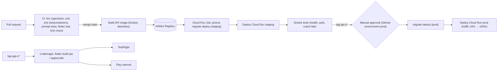
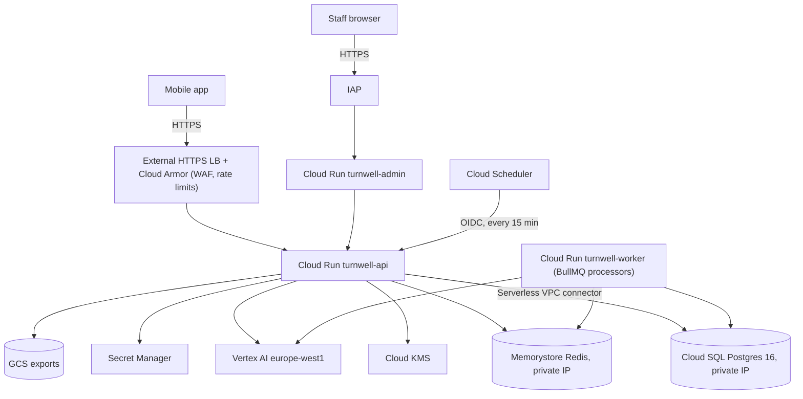
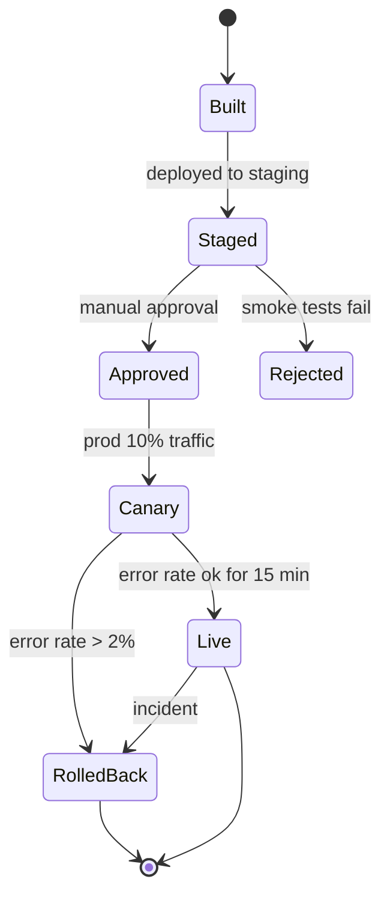

# M18 — Infrastructure & DevOps

## 1. Header

| Field | Value |
| --- | --- |
| ID | M18 |
| Name | GCP infrastructure (Terraform), CI/CD, app builds, environments, monitoring, backups, cost control |
| Release | **v1** |
| Location | `infra/` (Terraform), `.github/workflows/`, `apps/mobile/codemagic.yaml`, `apps/mobile/{ios,android}/fastlane` |
| Depends on | — (foundation for all modules) |
| Used by | all modules |

## 2. Purpose

Run TurnWell on a small, secure, reproducible GCP footprint that one developer can operate: everything in
Terraform, one region (`europe-west1`), least-privilege service accounts, customer-managed encryption keys,
push-to-deploy CI, automated mobile builds, and alerts that wake someone only for real problems
(API down, P1 moderation backlog, crisis-path failures, cost spikes).

## 3. User stories & acceptance criteria

- **US-18.1** Given a clean GCP project, When `terraform apply` runs for `staging`, Then all resources in §7 exist and the API health check `GET /health` returns 200 within 20 min.
- **US-18.2** Given a merge to `main`, When CI passes (lint, tests, prompt tests, migrations check), Then the API image is built, pushed to Artifact Registry, migrations run, and Cloud Run `staging` is updated with zero downtime. Prod deploys on a git tag `api-v*` with manual approval.
- **US-18.3** Given a tag `app-v*`, When Codemagic runs, Then signed iOS (TestFlight) and Android (Play internal track) builds are uploaded.
- **US-18.4** Given the API 5xx rate > 2% for 5 min, or p95 latency > 3 s (excluding SSE), or any crisis-path error, Then the on-call is paged (email + push).
- **US-18.5** Given monthly spend reaches 50/80/100% of budget, Then alerts are sent; at 120% for Vertex AI, the `coach.model` flag falls back to Flash-Lite automatically (crisis path excluded).
- **US-18.6** Given a DB failure, When restoring, Then point-in-time recovery to any minute in the last 7 days is possible; RPO ≤ 5 min, RTO ≤ 2 h.

## 4. Screens

N/A (no app UI). Operational dashboards in Cloud Monitoring:

```
┌ TurnWell — Prod overview ─────────────────────────────────────────────────┐
│ API req/s ▁▂▃▅▃▂   5xx % ▁▁▁▂▁   p95 ms ▂▂▃▂   Cloud Run instances 1-4    │
│ SSE streams open 37   Coach msgs/h 412   Safety L2+ /day 3                  │
│ Vertex tokens/day in 18M out 1.9M   Cost today $4.10 (budget $9/day)        │
│ Moderation queue P1 0 (oldest —)   P2 12 (oldest 5h)                        │
│ DB CPU 22%  connections 41/100   Redis mem 31%   BullMQ failed 0            │
└────────────────────────────────────────────────────────────────────────────┘
```

## 5. Flows

### 5.1 CI/CD



### 5.2 Runtime network



## 6. State machine

Deployment of a release:



## 7. Data (resources)

| Resource | Staging | Prod |
| --- | --- | --- |
| GCP projects | `turnwell-staging` | `turnwell-prod` (+ `turnwell-shared` for Artifact Registry, Terraform state) |
| Region | `europe-west1` | `europe-west1` |
| Cloud Run `turnwell-api` | min 0, max 3, 1 vCPU / 512 MiB | min 1, max 10, 1 vCPU / 1 GiB, concurrency 80, timeout 300 s (SSE) |
| Cloud Run `turnwell-worker` | min 0 | min 1 (BullMQ), no public ingress |
| Cloud Run `turnwell-admin` | IAP | IAP |
| Cloud SQL | `db-g1-small`, 10 GB SSD, backups on | `db-custom-1-3840`, 20 GB SSD autoresize, PITR 7 d, backups 30 d, HA later |
| Memorystore Redis | Basic 1 GB | Basic 1 GB (Standard HA later) |
| GCS buckets | `turnwell-exports-staging`, `turnwell-tfstate` | `turnwell-exports-prod` (lifecycle 1 d, CMEK) |
| KMS key ring `turnwell` | keys: `app-data` (per-user DEK wrap), `community`, `account` | same |
| KMS key ring `identity-link` | key `identity-link` | separate ring, decrypter only `sa-safety`, `sa-legal` |
| KMS key `cmek-storage` | for GCS + Cloud SQL CMEK | same |
| Secret Manager | `JWT_PRIVATE_KEY`, `JWT_PUBLIC_KEY`, `IDENTITY_HMAC_KEY`, `EMAIL_HMAC_KEY`, `GOOGLE_OAUTH_CLIENT_IDS`, `APPLE_*`, `FCM_SERVICE_ACCOUNT`, `REVENUECAT_WEBHOOK_AUTH` (v2), `SENTRY_DSN`, `DATABASE_URL` | same |
| Artifact Registry | `europe-west1-docker.pkg.dev/turnwell-shared/turnwell` | |
| Cloud Scheduler | `nudges-dispatch` */15, `ai-cleanup` daily 03:00, `account-hardDelete-sweep` daily 04:00, `safety-cleanup` weekly | |
| Monitoring | uptime checks, alert policies, dashboards, log-based metrics | |
| Budgets | 150 USD/month staging, 300 USD/month prod (adjust) | |

### Service accounts (least privilege)

| SA | Roles |
| --- | --- |
| `sa-api` | `cloudsql.client`, `secretmanager.secretAccessor` (listed secrets), `cloudkms.cryptoKeyEncrypterDecrypter` on `app-data`, `community`, `account`; `aiplatform.user`; `storage.objectViewer` exports |
| `sa-worker` | same as api + `storage.objectCreator` exports |
| `sa-safety` (Cloud Run identity for safety/legal workloads — v1 may share `sa-api` with **conditional** IAM on identity-link via a separate `turnwell-safety` service) | `cloudkms.cryptoKeyDecrypter` on `identity-link` |
| `sa-scheduler` | `run.invoker` on api `/internal/*` |
| `sa-ci` (GitHub OIDC Workload Identity) | `run.admin`, `artifactregistry.writer`, `iam.serviceAccountUser` on runtime SAs |

> v1 simplification allowed: one Cloud Run service hosting the API, with `SafetyService` and `LegalEscalationService` using a **dedicated KMS client** authenticated as `sa-safety` via service-account impersonation (`roles/iam.serviceAccountTokenCreator` granted to `sa-api` **only** for `sa-safety`), and every impersonation audited (Cloud Audit Logs data access on KMS enabled).

## 8. API

Operational endpoints (not public in OpenAPI for apps):

| Method | Path | Auth | Purpose |
| --- | --- | --- | --- |
| GET | `/health` | none | Liveness (process up) |
| GET | `/health/ready` | none | Readiness: DB, Redis reachable |
| POST | `/internal/nudges/dispatch` | OIDC (`sa-scheduler`) | Cloud Scheduler tick |
| POST | `/internal/jobs/:name` | OIDC | Daily jobs |

Cloud Armor rules: rate limit 300 req/min/IP on `/v1/*`, 20/min on `/v1/auth/*`; block known bad IP lists; geo: none.

## 9. Backend design

### 9.1 Terraform layout

```
infra/
├── modules/
│   ├── network/        # VPC, serverless connector, private service access
│   ├── sql/            # Cloud SQL instance, db, users, PITR, CMEK
│   ├── redis/
│   ├── kms/            # key rings: turnwell, identity-link; keys + IAM bindings
│   ├── secrets/        # secret shells (values added out of band)
│   ├── run_service/    # generic Cloud Run service (image, env, SA, scaling, VPC)
│   ├── scheduler/
│   ├── storage/        # export bucket + lifecycle + CMEK
│   ├── lb_armor/       # HTTPS LB, managed cert api.turnwell.app, Cloud Armor policy
│   ├── iap/
│   ├── monitoring/     # uptime checks, alert policies, dashboards, log metrics
│   ├── budgets/
│   └── wif_github/     # Workload Identity Federation for GitHub Actions
├── envs/
│   ├── staging/{main.tf, variables.tf, terraform.tfvars, backend.tf}
│   └── prod/{main.tf, variables.tf, terraform.tfvars, backend.tf}
└── README.md
```

```hcl
# infra/modules/kms/main.tf (excerpt)
resource "google_kms_key_ring" "app" { name = "turnwell" location = var.region }
resource "google_kms_key_ring" "identity" { name = "identity-link" location = var.region }

resource "google_kms_crypto_key" "app_data" {
  name            = "app-data"
  key_ring        = google_kms_key_ring.app.id
  rotation_period = "7776000s" # 90 days
  lifecycle { prevent_destroy = true }
}
resource "google_kms_crypto_key" "identity_link" {
  name            = "identity-link"
  key_ring        = google_kms_key_ring.identity.id
  rotation_period = "7776000s"
  lifecycle { prevent_destroy = true }
}
resource "google_kms_crypto_key_iam_member" "identity_decrypt_safety" {
  crypto_key_id = google_kms_crypto_key.identity_link.id
  role          = "roles/cloudkms.cryptoKeyDecrypter"
  member        = "serviceAccount:${var.sa_safety_email}"
}
resource "google_kms_crypto_key_iam_member" "identity_encrypt_api" {
  crypto_key_id = google_kms_crypto_key.identity_link.id
  role          = "roles/cloudkms.cryptoKeyEncrypter" # api can create links, not read them
  member        = "serviceAccount:${var.sa_api_email}"
}
```

```hcl
# infra/modules/run_service/main.tf (excerpt)
resource "google_cloud_run_v2_service" "svc" {
  name     = var.name
  location = var.region
  ingress  = var.ingress # INGRESS_TRAFFIC_INTERNAL_LOAD_BALANCER for api
  template {
    service_account = var.service_account
    scaling { min_instance_count = var.min max_instance_count = var.max }
    vpc_access { connector = var.vpc_connector egress = "PRIVATE_RANGES_ONLY" }
    timeout = "300s"
    containers {
      image = var.image
      resources { limits = { cpu = "1", memory = var.memory } cpu_idle = var.min == 0 }
      env { name = "NODE_ENV" value = var.env }
      dynamic "env" {
        for_each = var.secrets
        content {
          name = env.key
          value_source { secret_key_ref { secret = env.value version = "latest" } }
        }
      }
      startup_probe { http_get { path = "/health" } }
      liveness_probe { http_get { path = "/health" } }
    }
  }
}
```

### 9.2 GitHub Actions — API

```yaml
# .github/workflows/api.yml
name: api
on:
  pull_request: { paths: ["apps/api/**", "packages/**", "schema/**"] }
  push:
    branches: [main]
    tags: ["api-v*"]
permissions: { contents: read, id-token: write }
env:
  REGION: europe-west1
  IMAGE: europe-west1-docker.pkg.dev/turnwell-shared/turnwell/api
jobs:
  test:
    runs-on: ubuntu-latest
    steps:
      - uses: actions/checkout@v4
      - uses: pnpm/action-setup@v4
      - uses: actions/setup-node@v4
        with: { node-version: 22, cache: pnpm }
      - run: pnpm install --frozen-lockfile
      - run: pnpm --filter api lint && pnpm --filter api typecheck
      - run: pnpm --filter api prisma validate
      - run: pnpm --filter api test
      - run: pnpm --filter api test:e2e        # testcontainers postgres:16 + redis:7
      - run: pnpm prompt:test --provider=fake   # deterministic; nightly job runs against Vertex staging
      - run: ./scripts/check-no-userid-in-community.sh
  deploy-staging:
    if: github.ref == 'refs/heads/main'
    needs: test
    runs-on: ubuntu-latest
    environment: staging
    steps:
      - uses: actions/checkout@v4
      - uses: google-github-actions/auth@v2
        with:
          workload_identity_provider: ${{ vars.WIF_PROVIDER }}
          service_account: ${{ vars.CI_SA }}
      - uses: google-github-actions/setup-gcloud@v2
      - run: gcloud auth configure-docker europe-west1-docker.pkg.dev -q
      - run: docker build -f apps/api/Dockerfile -t $IMAGE:${{ github.sha }} .
      - run: docker push $IMAGE:${{ github.sha }}
      - run: >
          gcloud run jobs deploy migrate-staging --region $REGION --image $IMAGE:${{ github.sha }}
          --command "npx" --args "prisma,migrate,deploy" --service-account ${{ vars.API_SA }}
          --set-secrets DATABASE_URL=DATABASE_URL:latest --vpc-connector ${{ vars.VPC_CONNECTOR }} --execute-now --wait
      - run: gcloud run deploy turnwell-api --region $REGION --image $IMAGE:${{ github.sha }} --project turnwell-staging
      - run: gcloud run deploy turnwell-worker --region $REGION --image $IMAGE:${{ github.sha }} --project turnwell-staging
      - run: ./scripts/smoke.sh https://api-staging.turnwell.app
  deploy-prod:
    if: startsWith(github.ref, 'refs/tags/api-v')
    needs: test
    runs-on: ubuntu-latest
    environment: production   # requires manual approval in GitHub
    steps:
      - run: echo "same as staging with --project turnwell-prod, then canary"
      - run: gcloud run deploy turnwell-api --region $REGION --image $IMAGE:${GITHUB_SHA} --project turnwell-prod --no-traffic --tag canary
      - run: gcloud run services update-traffic turnwell-api --region $REGION --project turnwell-prod --to-tags canary=10
      # after 15 min healthy (scripts/watch-canary.sh), promote:
      - run: ./scripts/watch-canary.sh && gcloud run services update-traffic turnwell-api --region $REGION --project turnwell-prod --to-latest
```

### 9.3 Mobile builds — Codemagic

```yaml
# apps/mobile/codemagic.yaml (excerpt)
workflows:
  release:
    name: TurnWell release
    triggering: { events: [tag], tag_patterns: [{ pattern: "app-v*" }] }
    environment:
      flutter: stable
      groups: [app_store, play_store, sentry]   # signing + API keys stored in Codemagic
      vars: { API_BASE_URL: "https://api.turnwell.app/v1" }
    scripts:
      - flutter pub get
      - flutter gen-l10n && dart run build_runner build -d
      - flutter test
      - flutter build ipa --release --dart-define=API_BASE_URL=$API_BASE_URL --obfuscate --split-debug-info=build/symbols
      - flutter build appbundle --release --dart-define=API_BASE_URL=$API_BASE_URL --obfuscate --split-debug-info=build/symbols
    publishing:
      app_store_connect: { auth: integration, submit_to_testflight: true }
      google_play: { credentials: $GCLOUD_SERVICE_ACCOUNT_CREDENTIALS, track: internal }
```
Fastlane lanes (`ios/fastlane/Fastfile`, `android/fastlane/Fastfile`) exist for local releases: `beta`, `release`, `metadata` (store listings in 4 languages from `fastlane/metadata/`).

### 9.4 Monitoring & alerts

| Alert | Condition | Severity |
| --- | --- | --- |
| API down | Uptime check `/health/ready` fails 2 of 3 regions for 2 min | page |
| Error rate | 5xx > 2% over 5 min | page |
| Latency | p95 > 3 s (non-SSE) for 10 min | ticket |
| Crisis path | log metric `safety_card_failed` > 0 | page |
| Hotline lookup miss | `hotline_fallback_used` > 20/day | ticket |
| Moderation P1 | oldest P1 report > 45 min | page |
| AI errors | Vertex 5xx/timeouts > 5% over 10 min | page; auto flag `coach.fallback` |
| DB | CPU > 80% 15 min, storage > 80%, connections > 80% | ticket |
| BullMQ | failed jobs > 20/h or queue lag > 10 min | ticket |
| Cost | Budget 50/80/100%; Vertex daily spend > 2× 7-day avg | email |

Logs: structured JSON (pino) → Cloud Logging; **redaction enforced** (02-conventions §4); log retention 30 d; no request bodies.
Errors: Sentry (API + app) with `sendDefaultPii: false`, `beforeSend` scrubber removing message/extra fields.

### 9.5 Backups & DR

- Cloud SQL automated daily backups (30 d) + PITR (7 d). Monthly restore drill into a scratch instance (`scripts/restore-drill.sh`).
- Redis is a cache/queue: jobs are idempotent and re-creatable; no backup.
- KMS keys: `prevent_destroy`, rotation 90 d, old versions kept (never destroyed while data exists).
- Deleted-account backups age out naturally ≤ 35 d (documented in privacy policy).

### 9.6 Cost guardrails

- Budgets per project with Pub/Sub notifications → Cloud Function sets feature flag `coach.model=flash-lite` at 120% of Vertex budget (crisis path keeps its model).
- Per-user daily token ceiling in `LlmGateway` (M08) with alert.
- Cloud Run min instances: 1 only for prod API + worker.

## 10. Flutter design

Build flavours: `dev`, `staging`, `prod` via `--dart-define` (`API_BASE_URL`, `SENTRY_DSN`, `FLAVOR`); separate bundle IDs
`app.turnwell.dev`, `app.turnwell.staging`, `app.turnwell` so all three can be installed side by side.
Certificate pinning: SPKI pins for `api.turnwell.app` (current + backup key) in `core/network/pinning.dart`; pins rotated via app release ≥ 30 days before cert key change.

## 11. Edge cases

| Case | Handling |
| --- | --- |
| Migration fails in prod | Job fails → deploy step not reached; old revision keeps serving. Migrations must be backward-compatible (expand → migrate → contract). |
| Vertex regional outage | `AI_UNAVAILABLE`; crisis path still shows scripted card (no AI dependency) |
| Secret rotation | New version in Secret Manager → redeploy (env pinned to `latest` resolved at start) |
| Cold start on SSE | min 1 instance in prod |
| Scheduler double-fire | Dispatch endpoint idempotent per 15-min slot (Redis lock) |

## 12. Security & privacy

- Private IP for SQL/Redis; no public DB IP. Cloud Armor in front of API. IAP for admin.
- CMEK for Cloud SQL and GCS; app-level envelope encryption on top (M06/M03 data classes).
- Data Access audit logs enabled for KMS and Secret Manager.
- GitHub → GCP via Workload Identity Federation (no JSON keys). Branch protection + required reviews on `main`.
- Dependency scanning (Dependabot), container scanning (Artifact Analysis), `npm audit` in CI.
- Vertex AI: use regional endpoint `europe-west1`; confirm data governance terms (no training on customer data) and request zero-data-retention/abuse-logging exemption if available.

## 13. Analytics events

N/A for user analytics. Operational metrics: `api_requests_total`, `sse_streams_open`, `llm_tokens_total{model,kind}`,
`safety_level_total{level}`, `moderation_queue_age_seconds{priority}`, `nudges_sent_total{kind}`.

## 14. Tests

- `terraform validate` + `tflint` + `checkov` in CI for `infra/**`.
- Smoke script: `/health/ready`, sign-up test user (staging), coach message with `LLM_PROVIDER=fake`, crisis card fixture.
- Monthly restore drill; quarterly IAM review (who can decrypt `identity-link`).
- Load test (k6) before launch: 200 concurrent SSE coach streams, 50 req/s mixed REST.

## 15. Open questions

- Single region acceptable for global users at launch (latency for Asia/Americas)? Default yes; add CDN only for static assets.
- Codemagic vs GitHub Actions macOS runners for iOS (cost).
- Separate Cloud Run service for safety/legal (cleaner IAM) vs impersonation (simpler). Default: impersonation in v1.
- No schema changes.
