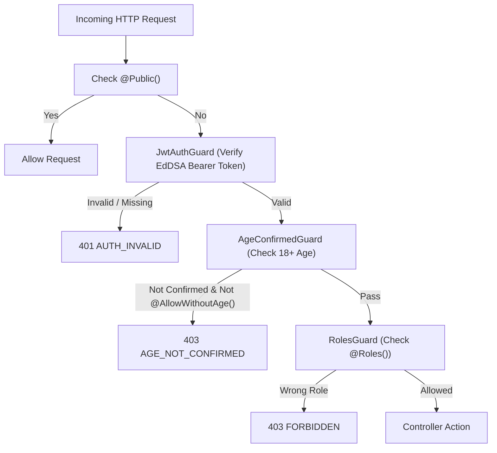

# 0004 — Guards & Decorators Pipeline

## 1. Context & Motivation

To enforce security automatically across all endpoints without repetitive boilerplate, NestJS guards execute sequentially on every incoming request:



All guards and decorators live in [`server/src/common/guards/`](../../server/src/common/guards/) and [`server/src/common/decorators/`](../../server/src/common/decorators/).

---

## 2. Decorators

### 1. `@Public()`
- File: [`server/src/common/decorators/public.decorator.ts`](../../server/src/common/decorators/public.decorator.ts)
- Marks an endpoint as publicly accessible, bypassing `JwtAuthGuard` and `AgeConfirmedGuard`.
- Example: `/health`, `/v1/auth/sign-in`, `/v1/auth/sign-up`.

### 2. `@AllowWithoutAge()`
- File: [`server/src/common/decorators/allow-without-age.decorator.ts`](../../server/src/common/decorators/allow-without-age.decorator.ts)
- Allows authenticated users who have **not yet confirmed their age** to call specific endpoints (e.g., `/v1/me/age-confirmation`, `/v1/auth/sign-out`).

### 3. `@CurrentUser(property?)`
- File: [`server/src/common/decorators/current-user.decorator.ts`](../../server/src/common/decorators/current-user.decorator.ts)
- Extracts the verified JWT payload from `request.user`:
  ```typescript
  @Get('me')
  getMe(@CurrentUser('id') userId: string) { ... }
  ```

### 4. `@Roles(...roles: Role[])`
- File: [`server/src/common/decorators/roles.decorator.ts`](../../server/src/common/decorators/roles.decorator.ts)
- Restricts an endpoint to specific roles (`USER`, `MODERATOR`, `ADMIN`).

---

## 3. The Three Global Guards

### Guard 1: `JwtAuthGuard`
- File: [`server/src/common/guards/jwt-auth.guard.ts`](../../server/src/common/guards/jwt-auth.guard.ts)
- Checks `Reflector` for `@Public()`. If true, permits request.
- Otherwise, extracts `Authorization: Bearer <token>`, verifies signature with `TokenService.verifyAccess()`, and sets:
  ```typescript
  request.user = {
    id: claims.sub,
    role: claims.role,
    ageConfirmed: claims.age,
  };
  ```

### Guard 2: `AgeConfirmedGuard`
- File: [`server/src/common/guards/age-confirmed.guard.ts`](../../server/src/common/guards/age-confirmed.guard.ts)
- Checks if route is `@Public()` or `@AllowWithoutAge()`.
- Otherwise checks `request.user.ageConfirmed`. If `false` or missing, throws `AgeNotConfirmedException` (HTTP 403 `AGE_NOT_CONFIRMED`).

### Guard 3: `RolesGuard`
- File: [`server/src/common/guards/roles.guard.ts`](../../server/src/common/guards/roles.guard.ts)
- Checks `@Roles(...)`. If route specifies required roles, verifies that `request.user.role` matches. Otherwise throws `ForbiddenException` (HTTP 403 `FORBIDDEN`).

---

## 4. Global Registration in `AppModule`

In [`server/src/app.module.ts`](../../server/src/app.module.ts), the guards are registered via `APP_GUARD`:

```typescript
@Module({
  providers: [
    { provide: APP_GUARD, useClass: JwtAuthGuard },
    { provide: APP_GUARD, useClass: AgeConfirmedGuard },
    { provide: APP_GUARD, useClass: RolesGuard },
  ],
})
export class AppModule {}
```
Because of this configuration, **every endpoint is secure by default**. Developers must explicitly add `@Public()` to open a route.

