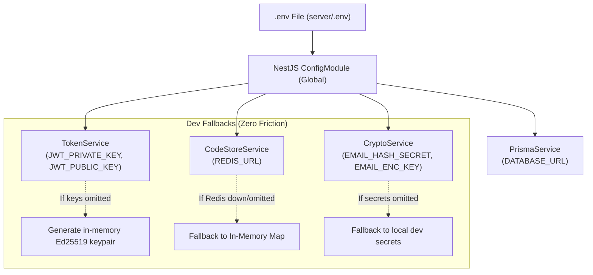

# 0008 — Backend Environment & Configuration

## 1. Context & Motivation

To run the TurnWell NestJS backend locally, in staging, or in production, services require configuration variables for database connectivity, security cryptography keys, token signing, and external integrations (OAuth, AI, Redis).

This chapter documents the environment variable configuration schema ([`server/.env.example`](../../../server/.env.example)), explains the purpose and security profile of each variable, and provides a quick-start guide for local development.

---

## 2. Environment Variables Overview

The table below summarizes all backend environment variables, their purpose, and default behavior in development:

| Variable | Required in Dev? | Default / Fallback | Description |
| --- | --- | --- | --- |
| `NODE_ENV` | Optional | `development` | Runtime environment (`development`, `test`, `production`) |
| `PORT` | Optional | `3000` | Port for the NestJS HTTP listener |
| `DATABASE_URL` | **Yes** (for DB ops) | `postgresql://...` | PostgreSQL connection string for Prisma multi-schema (`account`, `private`, `community`, `system`) |
| `REDIS_URL` | Optional | In-memory fallback | Redis connection for auth OTP code store and rate limiting |
| `EMAIL_HASH_SECRET` | Optional | Built-in dev secret | HMAC-SHA256 secret for one-way email hashing |
| `EMAIL_ENC_KEY` | Optional | Built-in dev secret | AES-256-GCM secret key for email encryption |
| `JWT_PRIVATE_KEY` | Optional | Ephemeral keypair | Ed25519 PKCS#8 private key for signing JWT access tokens |
| `JWT_PUBLIC_KEY` | Optional | Ephemeral keypair | Ed25519 SPKI public key for validating JWT access tokens |
| `GOOGLE_OAUTH_CLIENT_IDS` | Optional | `""` | Comma-separated Google Client IDs for OAuth token validation |
| `APPLE_CLIENT_ID` | Optional | `com.turnwell.app` | Apple Bundle / Service ID for Sign in with Apple |
| `GCP_PROJECT_ID` | Optional | `turnwell-dev` | GCP project ID for Vertex AI (europe-west1) |
| `GCP_REGION` | Optional | `europe-west1` | Target GCP region |
| `FCM_PROJECT_ID` | Optional | `turnwell-dev` | Firebase project ID for push notifications |
| `SENTRY_DSN` | Optional | `""` | Sentry error tracking endpoint |

---

## 3. Configuration Architecture & Zero-Friction Local Dev



### Dev Fallback Highlights
- **In-Memory JWT Keys:** Developers do not need to generate OpenSSL Ed25519 keys just to run tests or local endpoints. `TokenService` automatically detects missing keys in dev and generates an in-memory keypair on module initialization.
- **In-Memory OTP Store:** If Redis is not running locally, `CodeStoreService` logs a warning and stores verification codes in an in-memory map with full TTL and attempt tracking.

---

## 4. Quick-Start Guide

### Step 1: Copy the Environment File
From the project root:
```bash
cp server/.env.example server/.env
```
Or inside `server/`:
```bash
cp .env.example .env
```

### Step 2: Set Up PostgreSQL (Optional for DB-connected dev)
Ensure PostgreSQL 16 is running (e.g. via Docker or Homebrew):
```bash
docker run -d --name turnwell-pg -p 5432:5432 -e POSTGRES_PASSWORD=postgres -e POSTGRES_DB=turnwell postgres:16
```
Push Prisma schemas and generate the client:
```bash
cd server
npx prisma db push
```

### Step 3: Start the Backend Server
```bash
cd server
npm run start:dev
```
The server will start at `http://localhost:3000`. Test the health check endpoint:
```bash
curl http://localhost:3000/health
```

---

## 5. Security & Privacy Rules (AGENTS.md)
1. **Never Commit Secrets:** `.env` is ignored by Git in `.gitignore`. Only `.env.example` is tracked.
2. **Never Log Sensitive Content:** Tokens, passwords, verification codes, and decrypted emails are excluded from production logs.
3. **KMS / Secret Manager in Production:** In staging and production, values for `JWT_PRIVATE_KEY`, `EMAIL_HASH_SECRET`, and `DATABASE_URL` are injected from Google Secret Manager.

