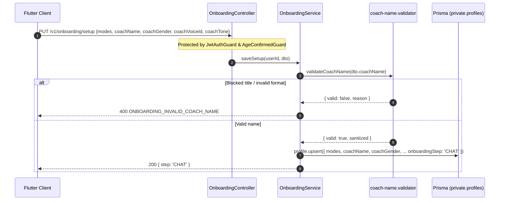

# 0009 — Onboarding Setup & Profile Configuration (M03)

## Overview & Purpose

Before the AI coach can begin an onboarding conversation, the backend must persist the user's chosen recovery focus (**Sins**, **Bad habits**, or **Both**) and coach persona (**name**, **gender**, **voice preset**, **tone**). This belongs to module `M03` (features `F-04` and `F-05`) and writes to the `private.profiles` table.

Critical invariants enforced at this boundary:
1. **Non-Authority Safety (`AGENTS.md` Rule 9):** The coach must never impersonate a medical clinician or religious scholar. Titles across all 4 launch languages (`Sheikh`, `Imam`, `Dr`, `Therapist`, `الشيخ`, `دكتور`, `Docteur`, `Terapeuta`, etc.) are rejected with `ONBOARDING_INVALID_COACH_NAME`.
2. **Unicode-Friendly Validation:** Trimmed length between 2 and 20 characters, Unicode letters (`\p{L}`) and spaces only so Arabic (`نور`), French (`Léa`), and Spanish (`Lucía`) names work seamlessly.
3. **Privacy-Safe Resume Tracking:** Plaintext `Profile.onboardingStep` stores only the workflow marker (`MODE | COACH | CHAT | PLAN | SAFETY | DONE`) without exposing private text content.

---

## Request Lifecycle & Architecture

---

## Core Files Implemented

### 1. Coach Name Validator (`server/src/modules/onboarding/coach-name.validator.ts`)
Performs three sequential checks after whitespace normalization (`trim().replace(/\s+/g, ' ')`):
- **Length Check:** Rejects `< 2` or `> 20` characters (`LENGTH`).
- **Character Check:** Matches `/^[\p{L}\s]+$/u` (`CHARACTERS`), allowing Arabic, Latin, accented characters, and spaces while blocking punctuation and digits.
- **4-Language Blocklist Check:** Strips Arabic tashkeel diacritics (`\u064B-\u065F`, `\u0670`) and checks each token case-insensitively against blocked medical and religious authority titles (`BLOCKED_AUTHORITY`).

### 2. DTO & Endpoints (`dto/onboarding-setup.dto.ts`, `onboarding.controller.ts`)
- **`PUT /v1/onboarding/setup`**:
  - Validates `modes` (`Mode[]`, 1–2 items), `coachName`, `coachGender` (`FEMALE | MALE`), optional `coachVoiceId`, and optional `coachTone` (`GENTLE | BALANCED | FIRM`).
  - Upserts `private.profiles`, deduplicates modes, advances `onboardingStep` to `'CHAT'` (or keeps `'DONE'` if already completed), and returns `{ step }`.
- **`GET /v1/onboarding/state`**:
  - Returns the saved `step`, `onboardingDone`, `modes`, `coachName`, `coachGender`, `coachVoiceId`, and `coachTone` for mid-onboarding resume.

### 3. Error Codes & `/v1/me` Sync
- Added `ONBOARDING_INVALID_COACH_NAME`, `ONBOARDING_ALREADY_DONE`, and `ONBOARDING_NOT_ENOUGH_INFO` to `server/src/common/constants/error-codes.ts`.
- Extended `MeDto` in `server/src/modules/users/users.service.ts` with `onboardingStep` so authenticated mobile clients can accurately resume at `MODE` vs `CHAT` on cold start.

---

## Verification & Tests

1. **Unit Tests:**
   - `coach-name.validator.spec.ts` (4 tests): Valid multi-locale names, length limits, punctuation rejection, and EN/AR/FR/ES authority blocklist enforcement.
   - `onboarding.service.spec.ts` (3 tests): Profile upsert + step advancement, `ONBOARDING_INVALID_COACH_NAME` rejection, and default `MODE` state fallback.
2. **E2E Tests (`server/test/app.e2e-spec.ts`):**
   - Full authenticated test verifying `PUT /v1/onboarding/setup` rejects `'Dr Adam'` with `400 ONBOARDING_INVALID_COACH_NAME`, accepts `'Noor'` with `200 { step: 'CHAT' }`, and `GET /v1/onboarding/state` reads back the saved preferences.
- **Results:** **29/29 unit tests passed**, **7/7 E2E tests passed**, **0 `oxlint` warnings/errors**, and clean `nest build`.

