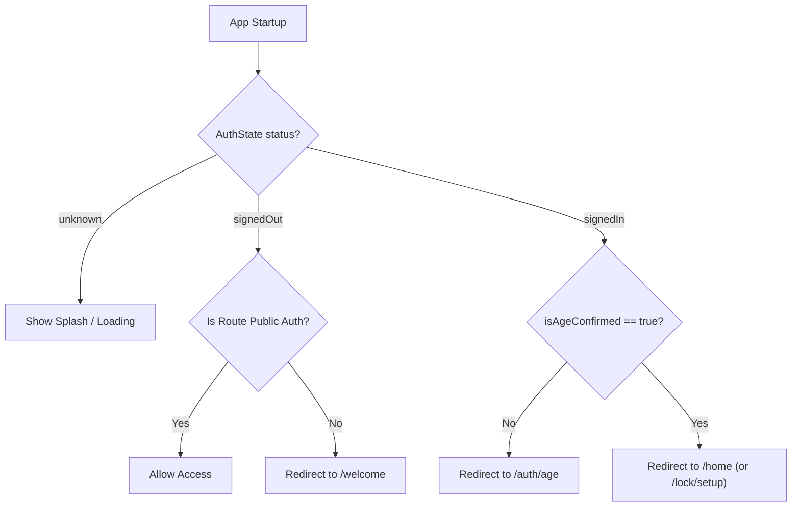

# 0001 — Mobile Foundations, Liquid Glass Design System & Auth UI

## 1. Context & Motivation

TurnWell is a private, AI-coached mobile application designed for iOS and Android using Flutter 3.x (Dart 3).
Following [`AGENTS.md`](../../../AGENTS.md), [`04-design-system.md`](../../turnwell-specs/04-design-system.md), and [`M01-auth-accounts.md`](../../turnwell-specs/modules/M01-auth-accounts.md), the mobile app requires:
1. **Liquid Glass Design System:** Calm, translucent frosted glass cards and animated mesh background gradients (never clinical).
2. **Authentication Flow (F-01 / M01):** Privacy-first welcome screen, email sign-up with an explicit 18+ gate, 6-digit email code verification, sign-in, social OAuth routing, password reset, and session restoration.
3. **Strict Privacy & Security:** Access tokens reside in memory only; refresh tokens are stored in hardware-backed secure storage (`flutter_secure_storage`).
4. **Universal Accessibility:** Universal RTL (Arabic) layout support and Dynamic Type scaling up to 200%.

---

## 2. Architectural Structure

The mobile codebase in [`app/lib/`](../../../app/lib/) follows a feature-first architecture:

```
app/lib/
 ├── main.dart                       # App entry point (ProviderScope)
 ├── app.dart                        # MaterialApp.router, theme tokens, locales
 ├── core/
 │    ├── theme/                     # Liquid glass tokens, GlassSurface, MeshBackground, buttons, inputs
 │    ├── network/                   # Dio client, AuthInterceptor with single-flight refresh lock, TokenStorage
 │    ├── router/                    # GoRouter configuration, redirect guards (AuthGuard, AgeGuard)
 │    └── l10n/                      # Localized strings (EN, AR, FR, ES)
 └── features/
      └── auth/
           ├── domain/               # Entities (Me, AuthState)
           ├── data/                 # AuthRepository (Dio API wrapper, error parser)
           └── presentation/
                ├── providers/       # Riverpod AuthController (Notifier<AuthState>)
                └── screens/         # Welcome, SignUp, VerifyEmail, SignIn, Age, ResetPassword
```

---

## 3. Liquid Glass Design System Implementation

### Theme Tokens (`TwTokens`)
Located at: [`app/lib/core/theme/turnwell_tokens.dart`](../../../app/lib/core/theme/turnwell_tokens.dart)

Registered as a Flutter `ThemeExtension<TwTokens>`, providing exact color and glass values:
- **Dawn Theme:** Sunrise gradient (`#2B2D6E → #6C5B9E → #F7B59B`), gold accent (`#F5B971`), dark ink on-accent (`#2B1A05`), and translucent white glass (`18% fill`, `35% border`, `55% top highlight`).
- **Night Sanctuary Theme:** Midnight gradient (`#070B1A → #121A3A`), violet accent (`#A78BFA`), deep violet on-accent (`#14082E`).
- **Neutral Slip Grey:** Per non-negotiable rule 10 ("No shame UI"), slips are always neutral grey (`#9CA3AF`), never red.

### Glass Surface (`GlassSurface` & `GlassCard`)
Located at: [`app/lib/core/theme/glass_surface.dart`](../../../app/lib/core/theme/glass_surface.dart)

Renders real frosted glass depth via `BackdropFilter(ImageFilter.blur(sigmaX, sigmaY))` with top edge inner gradient highlights:
```dart
ClipRRect(
  borderRadius: BorderRadius.circular(radius),
  child: BackdropFilter(
    filter: ImageFilter.blur(sigmaX: tokens.blurSigma, sigmaY: tokens.blurSigma),
    child: Container(
      padding: padding,
      decoration: BoxDecoration(
        color: tokens.glassFill,
        borderRadius: BorderRadius.circular(radius),
        border: Border.all(color: tokens.glassBorder, width: 1),
        gradient: LinearGradient(
          begin: Alignment.topCenter,
          end: Alignment.center,
          colors: [tokens.glassHighlight.withValues(alpha: 0.25), Colors.transparent],
        ),
      ),
      child: child,
    ),
  ),
);
```

### Animated Mesh Background (`MeshBackground`)
Located at: [`app/lib/core/theme/mesh_background.dart`](../../../app/lib/core/theme/mesh_background.dart)

Animates soft radial blobs moving on a gentle 30-second loop. Automatically pauses when `MediaQuery.disableAnimations` is true to respect reduced motion preferences and prevent infinite test pump timeouts.

---

## 4. Secure Network & Token Management Layer

Located in [`app/lib/core/network/`](../../../app/lib/core/network/):

1. **`TokenStorage` ([`token_storage.dart`](../../../app/lib/core/network/token_storage.dart)):**
   - Access tokens are stored **in memory only** (lost on app close, never saved on disk).
   - Refresh tokens and user IDs are stored in hardware keystores via `FlutterSecureStorage`.
2. **`ApiClient` ([`api_client.dart`](../../../app/lib/core/network/api_client.dart)):**
   - Standardizes HTTP client configuration with base headers (`X-App-Version`, `X-Platform`, `Accept-Language`).
   - Automatically attaches `Authorization: Bearer <token>`.
   - **Single-Flight Refresh Mutex:** If multiple concurrent requests receive HTTP 401, a mutex locks and issues a single `POST /auth/refresh` call. Once renewed, all queued requests are replayed with the new access token.

---

## 5. Navigation & Route Guard Pipeline

Located in [`app/lib/core/router/app_router.dart`](../../../app/lib/core/router/app_router.dart):

`GoRouter` listens to `authControllerProvider` changes via `refreshListenable` and applies the redirection order:



---

## 6. M01 Screen Inventory & User Experience

All auth screens are built with glass surfaces and support English, Arabic (RTL), French, and Spanish:

1. **`/welcome` ([`welcome_screen.dart`](../../../app/lib/features/auth/presentation/screens/welcome_screen.dart)):**
   - Displays sunrise branding mark and 3 glass cards detailing the privacy promises.
   - Primary button $\rightarrow$ `/auth/sign-up`; tertiary button $\rightarrow$ `/auth/sign-in`.
2. **`/auth/sign-up` ([`sign_up_screen.dart`](../../../app/lib/features/auth/presentation/screens/sign_up_screen.dart)):**
   - Email input and password input ($\ge 10$ chars with visibility toggle).
   - Non-negotiable **"I am 18 or older"** checkbox required before submission.
   - Google & Apple social sign-in buttons.
3. **`/auth/verify-email` ([`verify_email_screen.dart`](../../../app/lib/features/auth/presentation/screens/verify_email_screen.dart)):**
   - 6-digit pin code entry with auto-submission upon 6th digit.
   - 60-second countdown cooldown on "Resend code".
4. **`/auth/sign-in` ([`sign_in_screen.dart`](../../../app/lib/features/auth/presentation/screens/sign_in_screen.dart)):**
   - Email and password sign-in with "Forgot password?" navigation.
5. **`/auth/age` ([`age_screen.dart`](../../../app/lib/features/auth/presentation/screens/age_screen.dart)):**
   - 18+ confirmation screen for social sign-ups.
   - Declining (under 18) triggers immediate soft-delete and displays a gentle explanation.
6. **`/auth/reset` ([`reset_password_screen.dart`](../../../app/lib/features/auth/presentation/screens/reset_password_screen.dart)):**
   - Two-step password reset flow (email code dispatch $\rightarrow$ verification code & new password submission).

---

## 7. Testing & Verification

Located in [`app/test/`](../../../app/test/):

| Test Suite | Purpose |
| :--- | :--- |
| [`welcome_screen_test.dart`](../../../app/test/welcome_screen_test.dart) | Verifies Welcome cards, primary/secondary buttons, and Arabic RTL rendering. |
| [`sign_up_screen_test.dart`](../../../app/test/sign_up_screen_test.dart) | Verifies form validation and enforces the 18+ age checkbox before submission. |
| [`auth_repository_test.dart`](../../../app/test/auth_repository_test.dart) | Verifies `TokenStorage` memory separation and `AuthException` error code parsing. |
| [`widget_test.dart`](../../../app/test/widget_test.dart) | Smoke test verifying root app bootstrap and default router location. |

### Running Mobile Checks

```bash
cd app

# 1. Run widget and unit tests
flutter test

# 2. Run Dart static analyzer
flutter analyze
```

All tests pass and the analyzer reports 0 errors and 0 warnings.

