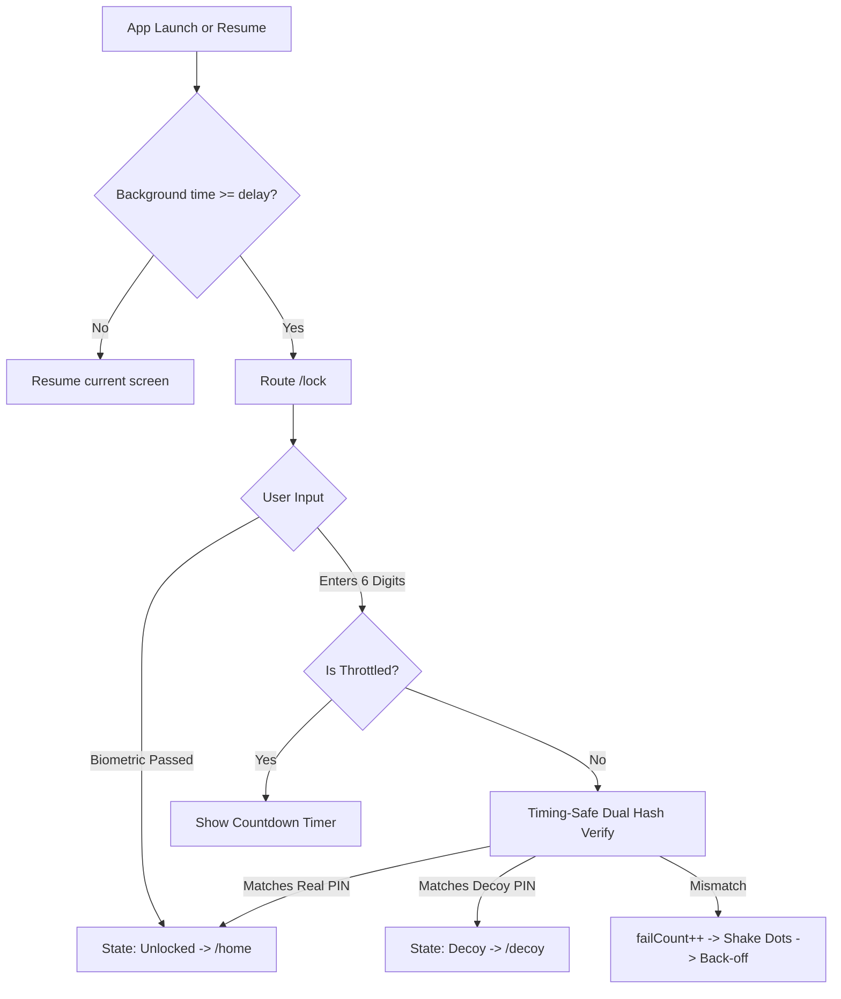

# 0002 — App Lock & Disguise System (M02)

## Overview & Purpose

The **App Lock & Disguise** module (`M02`, covering features `F-02`, `F-50`, `F-51`) is one of TurnWell's foundational privacy pillars. Because TurnWell helps users overcome deeply personal habits and sins, **no unauthorized person who picks up the device must ever see or recognize the app's contents**.

This module runs **100% on-device** (zero API calls or network logging). It provides:
1. **Mandatory 6-digit PIN Lock (`/lock`, `/lock/setup`)**: Protected with cryptographic Argon2id hashing (`m=19456, t=2, p=1`), weak PIN prevention, and timing-safe dual verification.
2. **Biometric Unlock (`local_auth`)**: Fingerprint / Face ID authentication gating entry into the app.
3. **Progressive Throttle Back-Off**: Defends against brute-force attacks with persistent lockout delays (5 fails $\rightarrow$ 30s, 8 fails $\rightarrow$ 5m, 10+ fails $\rightarrow$ 30m) that survive device restarts.
4. **Auto-Lock Lifecycle Observer & Privacy Shield**: Automatically locks the app when backgrounded beyond a configurable threshold (immediate, 1m, 5m, 15m) and covers the UI with an opaque shield during app switcher snapshots.
5. **Decoy PIN & Harmless Mode (`/decoy`)**: Entering a designated decoy PIN unlocks a clean, functional to-do list (stored locally in SharedPreferences) with zero TurnWell branding, completely isolating the user from the real database.
6. **Disguise & Alternate App Icons (`/me/privacy/disguise`)**: Disguises the app as *Daily Notes*, *Calculator*, or *Weather+*.

---

## Architecture & Lifecycle

---

## Core Components & Implementation

### 1. Weak PIN Validation (`lib/features/lock/data/weak_pin_validator.dart`)
Protects users from choosing trivial passcodes by rejecting:
- Non-6-digit input.
- Identical digits (e.g., `000000`, `111111`, `999999`).
- Straight forward sequences (`012345`, `123456`, `234567`, etc.).
- Straight reverse sequences (`987654`, `876543`, `654321`, etc.).
- Repetitive sequences (`121212`, `123123`).

### 2. Argon2id PIN Hasher (`lib/features/lock/data/pin_hasher.dart`)
Per TurnWell crypto conventions, PIN hashes are derived using `cryptography`'s `Argon2id` implementation:
- `parallelism: 1`
- `memory: 19456` KB
- `iterations: 2`
- `hashLength: 32` bytes
- 16-byte cryptographically secure random salt (`Random.secure()`).
- Format: `base64(salt):base64(hash)`.
- Verification uses **constant-time byte comparison** (`_constantTimeEquals`) to mitigate timing side-channel analysis.

### 3. Persistent Lock Storage & Throttling (`lib/features/lock/data/lock_store.dart`)
Using `FlutterSecureStorage`, the store persists:
- `tw.lock.pinHash` & `tw.lock.decoyHash`
- `tw.lock.failCount` & `tw.lock.lockedUntil` (ISO-8601 timestamp)
- `tw.lock.autoLockSec` (`0`, `60`, `300`, `900` seconds; default: `60`)
- `tw.lock.biometric` (`true` / `false`)
- `tw.disguise.icon` (`default`, `notes`, `calculator`, `weather`)

**Throttle Schedule:**
- Failures 1–4: No penalty.
- Failure 5: 30-second penalty.
- Failure 8: 5-minute (300s) penalty.
- Failure 10+: 30-minute (1800s) penalty.

### 4. Decoy To-Dos (`lib/features/lock/data/lock_store.dart` & `decoy_screen.dart`)
Decoy to-dos are stored unencrypted in `SharedPreferences` under `decoy.todos` and pre-seeded with 3 harmless tasks ("Buy milk & groceries", "Call the bank regarding statements", "Pay electricity bill"). The `/decoy` UI is intentionally styled with plain Material components (no liquid glass, no TurnWell marks) so that anyone looking at the phone sees an ordinary, functional to-do application.

### 5. Liquid Glass PinKeypad (`lib/features/lock/presentation/widgets/pin_keypad.dart`)
- 72x72 glass circular keys with light haptic feedback on tap (`HapticFeedback.lightImpact()`).
- **RTL Integrity:** Strictly wrapped in `Directionality(textDirection: TextDirection.ltr)` so that digit positions ($1, 2, 3 \dots 9, 0$) remain in standard Western layout even when the app is running in Arabic.
- Screen reader accessibility semantics ("Digit 1", "Unlock with biometrics", "Delete last digit").

### 6. PinDots (`lib/features/lock/presentation/widgets/pin_dots.dart`)
- 6 indicator dots displaying progress.
- Subtle 300ms multi-stage oscillation shake animation on invalid submission.
- **No Shame UI:** Does **not** turn red on invalid entry; remains neutral with subtle visual and haptic cues.
- Screen reader announcements: `"X of 6 digits entered"`.

### 7. AutoLockObserver & Privacy Overlay (`lib/features/lock/presentation/providers/`)
- `AutoLockObserver` implements `WidgetsBindingObserver`:
  - `inactive`: Activates `privacyOverlayProvider`, drawing an opaque black shield over the app to block snapshot capture by the OS multitasking app switcher.
  - `paused`: Records `_pausedAt = DateTime.now()`. If the user was in decoy mode, resets state immediately to `locked`.
  - `resumed`: Hides the privacy shield. If elapsed time exceeds `autoLockDelaySeconds`, transitions state to `locked`.

### 8. Router Guards (`lib/core/router/app_router.dart`)
`GoRouter` redirects enforce the lock state pipeline:
1. `LockStateDecoy`: Locks the session strictly inside `/decoy`.
2. `LockStateUnconfigured`: Directs newly authenticated users to `/lock/setup`.
3. `LockStateLocked` / `LockStateThrottled`: Directs session to `/lock`.
4. `LockStateUnlocked`: Allows navigation to `/home` or main app destinations while guarding against navigating back into the lock screen.

---

## Verification & Tests

Unit and widget test suites in `app/test/features/lock/` verify the entire feature set:

1. **`weak_pin_validator_test.dart`**:
   - Rejection of short/long/alphanumeric PINs.
   - Rejection of identical sequences (`000000`, `111111`, `555555`).
   - Rejection of consecutive ascending (`012345`, `123456`, `234567`) and descending sequences (`987654`, `654321`).
   - Rejection of repetitive patterns (`121212`, `123123`).
   - Acceptance of secure random PINs (`829104`, `931758`).

2. **`pin_hasher_and_throttle_test.dart`**:
   - Argon2id salt generation and constant-time verification.
   - Distinct salt generation across identical PIN submissions.
   - Back-off throttle delays at thresholds (5 $\rightarrow$ 30s, 8 $\rightarrow$ 300s, 10 $\rightarrow$ 1800s).
   - Reset of throttle state upon successful verification.
   - Pre-seeding, addition, and toggling of decoy to-dos in isolated storage.

3. **`lock_widgets_and_screens_test.dart`**:
   - `PinDots` rendering 6 circles and broadcasting correct screen reader semantics.
   - `PinKeypad` ensuring strict LTR key positioning ($X_1 < X_2 < X_3$) even inside Arabic RTL context.
   - `DecoyScreen` rendering harmless tasks with checkable list tiles.

All 19 tests in the Flutter app pass cleanly (`flutter test`), with 0 analyzer issues (`flutter analyze`).

