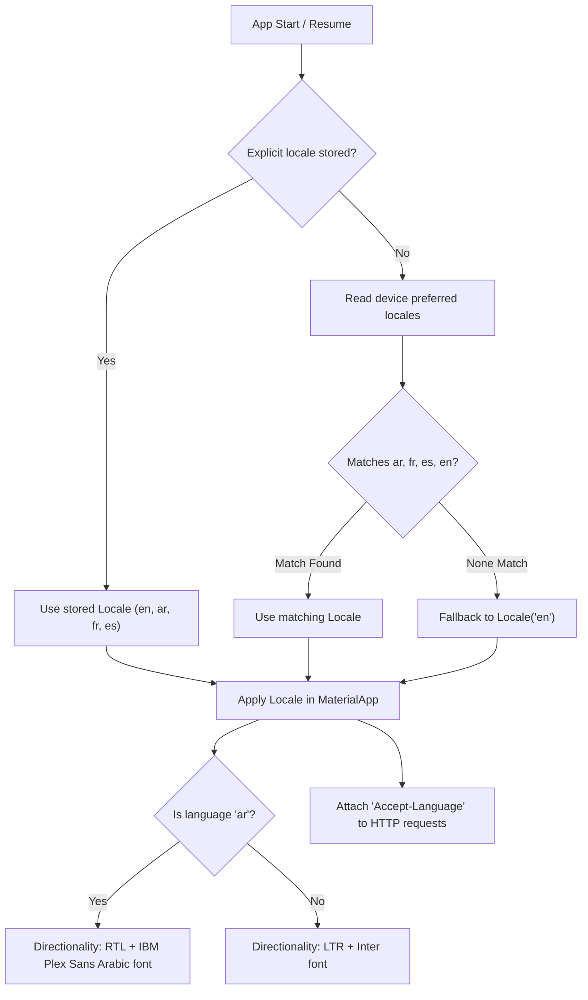

# 0003 — Multi-Language Architecture & ARB Expansion (M16)

## Overview & Purpose

Internationalization (`M16`, feature `F-03`) is critical to TurnWell's global, multicultural mission. TurnWell serves users worldwide across both secular habit recovery and Islamic spiritual renewal. Every user-visible string must exist in:
1. **English (`en`)** — Latin script, LTR, default fallback.
2. **Arabic (`ar`)** — Arabic script, full RTL layout mirroring, Western digits by default, specialized 6-case plural rules (`zero`, `one`, `two`, `few`, `many`, `other`), and gendered grammatical verb/adjective agreement.
3. **French (`fr`)** — Latin script, gender agreement for coach persona (`prête` vs `prêt`).
4. **Spanish (`es`)** — Latin script, gender agreement (`lista` vs `listo`).

This module implements Flutter's official `gen-l10n` toolchain, key parity CI assertions, locale preference persistence, an interactive language picker modal, and matching backend message catalogs.

---

## Architecture & Data Flow



---

## Key Components

### 1. ARB Translation Catalogs (`lib/core/l10n/`)
- `app_en.arb` (Template): Declares all application strings, metadata, parameter types, ICU plurals, and gender selects.
- `app_ar.arb` (Arabic):
  - **Full Arabic Plurals**: Covers all 6 ICU plural cases:
    ```arb
    "sos_urgesPassed": "{count, plural, =0{لا رغبات بعد} =1{تجاوزت رغبة واحدة} =2{تجاوزت رغبتين} few{تجاوزت {count} رغبات} many{تجاوزت {count} رغبة} other{تجاوزت {count} رغبة}}"
    ```
  - **Gendered Coach Forms**:
    ```arb
    "coach_typing": "{gender, select, female{{name} تكتب…} male{{name} يكتب…} other{{name} يكتب…}}"
    "coach_ready": "{gender, select, female{{name} جاهزة} male{{name} جاهز} other{{name} جاهز}}"
    ```
- `app_fr.arb` (French): Feminine/masculine coach agreement (`est prête` vs `est prêt`).
- `app_es.arb` (Spanish): Feminine/masculine coach agreement (`está lista` vs `está listo`).

### 2. Sins-Mode Faith Term Glossing (`lib/core/l10n/terms.dart`)
Under specification `US-16.6`, Islamic concepts require specific contextual glossing:
- In English/French/Spanish: Transliterated term + explanatory gloss on first use (`"Tawbah (returning to Allah)"`, `"Dhikr (remembrance of Allah)"`, `"Salah (prayer)"`).
- In Arabic: Native term without redundant parenthetical gloss (`"التوبة"`, `"الذكر"`, `"الصلاة"`).

### 3. Locale Notifier & Resolution (`lib/core/l10n/locale_provider.dart`)
- **State:** `Notifier<Locale?>` where `null` signifies "Use device language" and an explicit `Locale` represents an override stored in `SharedPreferences` (`tw.settings.locale`).
- **Resolution Algorithm (`resolveLocale`):**
  1. If explicit setting exists $\rightarrow$ use it.
  2. Iterate over user's system device preferences; return first match among `[ar, fr, es, en]`.
  3. Default fallback $\rightarrow$ `Locale('en')`.

### 4. Liquid Glass Language Picker (`lib/core/l10n/language_picker_sheet.dart`)
- Modal bottom sheet displaying each language option in its native script with country flag:
  - 🌐 Use device language (`languageUseDevice`)
  - 🇺🇸 English
  - 🇸🇦 العربية
  - 🇫🇷 Français
  - 🇪🇸 Español
- Integrated directly into `WelcomeScreen` as a glass chip in the top-end corner per specification `US-16.1`.

### 5. Backend Server Parity (`server/src/common/i18n/`)
- `I18nService` with catalogs `{en, ar, fr, es}.json`.
- Resolves language from `Accept-Language` headers and user accounts.
- Formats email notifications (verification codes, password reset) and push templates in the user's preferred language.

---

## Verification & Tests

### 1. Key Parity Tests (`test/core/l10n/arb_parity_test.dart`)
Automated parity test inspecting every non-metadata key in `app_en.arb` against `app_ar.arb`, `app_fr.arb`, and `app_es.arb`. Fails if any key is missing or untranslated.

### 2. ICU Plurals & Gender Tests (`test/core/l10n/icu_and_plurals_test.dart`)
- Validates Arabic plural rules for counts 0, 1, 2, 3, 11, and 100.
- Validates gender-select branches for coach status (`female` vs `male`).
- Validates transliterated glosses vs pure Arabic terms.

### 3. Locale Resolution Tests (`test/core/l10n/locale_provider_test.dart`)
- Validates explicit override priority.
- Validates system preference ordering with unsupported language fallback (e.g., German device with Arabic fallback $\rightarrow$ Arabic).

### 4. Language Picker Widget Tests (`test/core/l10n/language_picker_sheet_test.dart`)
- Verifies that all 5 options are present and tappable.

### 5. Backend Vitest Suite (`server/src/common/i18n/i18n.service.spec.ts`)
- Tests header parsing (`ar-DZ,ar;q=0.9,en;q=0.8` $\rightarrow$ `ar`).
- Tests parameter substitution (`{code}` $\rightarrow$ `'123456'`) in all 4 languages.

**Test Summary:**
- Flutter Mobile: **32 / 32 tests passed** (`flutter test`), 0 issues (`flutter analyze`).
- NestJS Backend: **22 / 22 unit tests passed** (`npm test`), 0 linter issues (`oxlint`).

