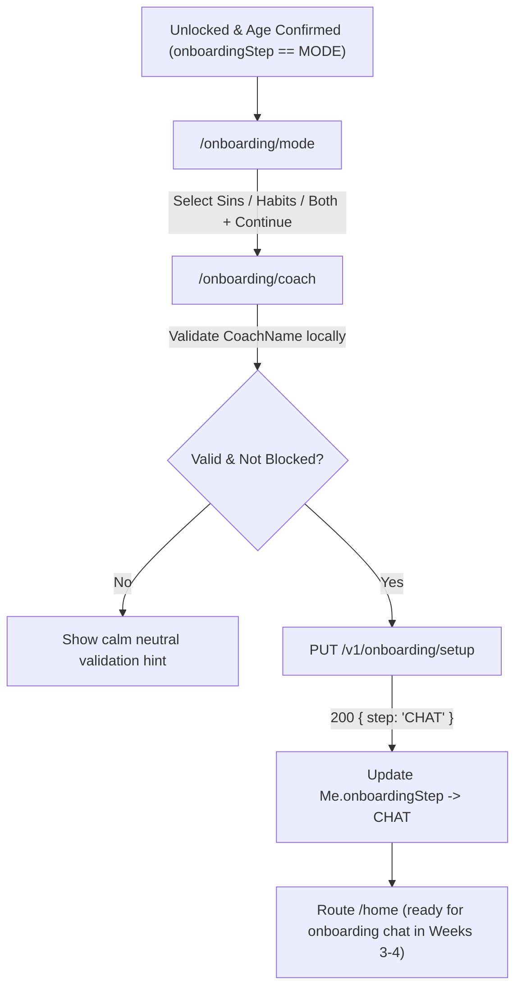

# 0004 — Mode Choice & Coach Setup Screens (M03)

## Overview & Purpose

After unlocking the app for the first time, users configure their recovery focus and personalize their AI coach (`M03`, features `F-04` and `F-05`):
1. **Mode Choice (`/onboarding/mode`):** Secular habit change (**Bad habits**), Islamic spiritual recovery (**Sins**), or **Both**.
2. **Coach Setup (`/onboarding/coach`):** Gender (**Female** / **Male**), voice preset (**Warm** / **Calm** with sample preview), coaching tone (**Gentle** / **Balanced** / **Firm**), and custom name with non-authority safeguards.

Both screens use TurnWell's **Liquid Glass** design system (`MeshBackground`, `GlassSurface`, `GlassButton`, `GlassInput`), support full **Arabic RTL** and Dynamic Type up to 200%, and enforce **No Shame UI** and **AI Non-Authority** rules (`AGENTS.md` Rules 9–12).

---

## Navigation & State Flow

---

## Key Components

### 1. Domain Models & Localized Suggestions (`lib/features/onboarding/domain/onboarding_models.dart`)
- `RecoveryMode` (`SINS`, `HABITS`), `ModeSelectionChoice` (`sins`, `habits`, `both`), `CoachGender` (`FEMALE`, `MALE`), `CoachTone` (`GENTLE`, `BALANCED`, `FIRM`), `CoachVoicePreset` (`warm`, `calm`), and `OnboardingStep`.
- `CoachNameSuggestions.forLocaleAndGender(langCode, gender)` provides culturally natural defaults:
  - **EN:** Noor, Maya / Sam, Adam
  - **AR:** نور, سلمى / آدم, يوسف
  - **FR:** Noor, Léa / Adam, Sami
  - **ES:** Noor, Lucía / Adam, Leo

### 2. Coach Name Validator (`lib/features/onboarding/data/coach_name_validator.dart`)
Mirrors the server's `coach-name.validator.ts` before issuing an HTTP request:
- Ensures 2–20 Unicode letters/spaces (`RegExp(r'^[\p{L}\s]+$', unicode: true)`).
- Rejects medical and religious authority titles across EN/AR/FR/ES (`Sheikh`, `Imam`, `Dr`, `Therapist`, `الشيخ`, `دكتور`, `Docteur`, `Terapeuta`, etc.) without shaming language.

### 3. Mode Selection Screen (`lib/features/onboarding/presentation/screens/mode_screen.dart`)
- Displays 3 selectable glass cards (**Sins**, **Bad habits**, **Both**) with accessibility `Semantics(selected: ...)` annotations.
- Selecting **Sins** or **Both** reveals the subtle Islamic-guided notice (`onboardingModeSinsNotice`): *"Sins mode is guided by Islamic practices. You can switch anytime."*
- **Continue** remains inactive until a mode is chosen.

### 4. Coach Setup Screen (`lib/features/onboarding/presentation/screens/coach_setup_screen.dart`)
- Glowing Coach Avatar Orb displaying the chosen coach's initial.
- Gender chips automatically update the suggested coach name in `TextEditingController` unless the user has manually typed a custom name (`!nameEdited`).
- Voice preset chips (`Warm ▶` / `Calm ▶`) trigger haptic feedback and a 3-second sample preview indicator (`// SPEC-QUESTION` note for bundled TTS audio in v1/v2).
- Tone chips (`Gentle`, `Balanced`, `Firm`) configure `Profile.coachTone`.
- Required AI disclaimer displayed cleanly below the card: *"Your coach is an AI. It is not a therapist or a religious scholar."*

### 5. Localization & Router Integration
- Added 31 ARB keys (`onboardingMode*`, `onboardingCoach*`, `onboardingStep1Of4`, `onboardingStep2Of4`) across `app_en.arb`, `app_ar.arb`, `app_fr.arb`, and `app_es.arb`.
- Updated `GoRouter` (`app/lib/core/router/app_router.dart`) to automatically route newly verified/unlocked users with `onboardingStep == 'MODE'` to `/onboarding/mode`.

---

## Verification & Tests

1. **Validator Unit Tests (`test/features/onboarding/coach_name_validator_test.dart`):**
   - Verified multi-locale valid names (`Noor`, `نور`, `Léa`, `Lucía`, `Adam Ali`).
   - Verified length, symbol/digit, and 4-language authority blocklist rejections.
2. **Screen Widget Tests (`test/features/onboarding/onboarding_screens_test.dart`):**
   - `ModeScreen`: Verified EN LTR and Arabic RTL layouts, Islamic-guided notice toggling on Sins/Both vs Bad habits.
   - `CoachSetupScreen`: Verified AI non-authority disclaimer, automatic suggestion switching between Female (`Noor`) and Male (`Sam`), local authority blocklist error presentation, and `OnboardingRepository.saveSetup()` invocation with mocked repository.
- **Results:** **39/39 Flutter tests passed** (`flutter test`), **0 analyzer issues** (`flutter analyze`).

