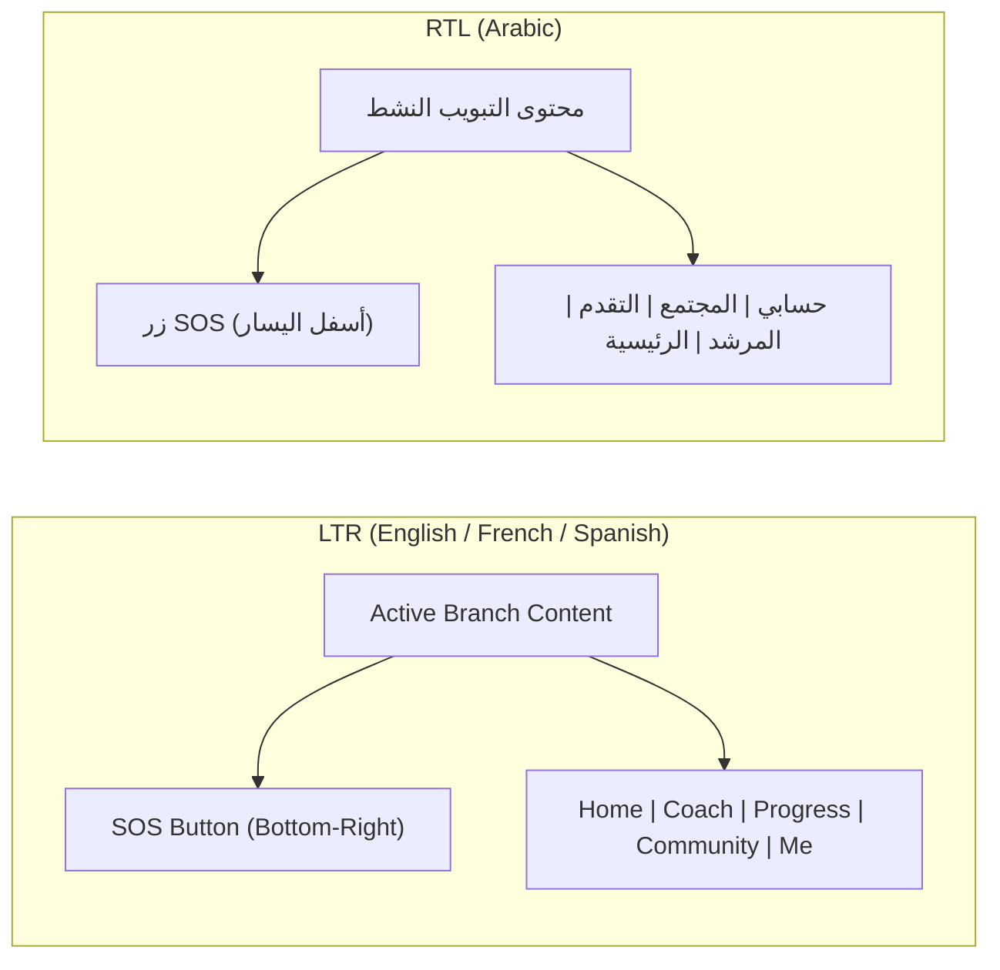

# 0005 — Floating Glass Navigation Shell, SOS Button & Me Hub

## Overview & Purpose

Completing **Week 2** of the MVP build plan (`docs/MVP.md`), this chapter implements the main application navigation container specified in `04-design-system.md`:
1. **`GlassNavBar` (`lib/core/theme/glass_nav_bar.dart`):** Floating frosted-glass bottom navigation bar (16 px from bottom/edges, corner radius 28, active accent pill highlight) hosting the 5 primary destinations: **Home**, **Coach**, **Progress**, **Community**, and **Me**.
2. **`SosButton` (`lib/core/theme/sos_button.dart`):** Floating 64×64 circular emergency urge button with accent glow (`BoxShadow` blur 24 at 40% accent opacity), anchored above the navigation bar and automatically mirrored across LTR/RTL (`PositionedDirectional`).
3. **`AppShell` (`lib/features/shell/presentation/screens/app_shell.dart`):** Stateful `GoRouter` shell preserving branch scroll/state across all 5 tabs over a single shared `MeshBackground`.
4. **`MeScreen` (`lib/features/me/presentation/screens/me_screen.dart`):** Privacy, Lock, Disguise, Language, and Mode/Coach settings hub linking all Week 1–2 user features together.

---

## Architecture & RTL Layout Mirroring

### Blur Budget Compliance (`04-design-system.md` §3)
Because `04-design-system.md` caps blur stacking at **at most 2 blurred layers**, `MeshBackground` now lives once inside `AppShell` while nested tabs (`HomePlaceholderScreen`, `TabPlaceholderScreen`, `MeScreen`) render transparent bodies over it. Sub-routes like `/me/privacy/lock` and `/me/privacy/disguise` mount at root level in `GoRouter` so they open cleanly full-screen without overlapping the bottom bar.

---

## Key Files Implemented

1. **`lib/core/theme/glass_nav_bar.dart`**:
   - Responsive `Expanded` tab slots enforcing ≥ 48×48 touch targets and `TextOverflow.ellipsis` safety for Dynamic Type.
   - `Semantics(selected: isSelected, button: true, label: label)` for screen reader clarity.
2. **`lib/core/theme/sos_button.dart`**:
   - 64×64 accent circle with medium haptic cue and localized screen-reader semantic label (`navSosSemantics`).
3. **`lib/core/router/app_router.dart`**:
   - Replaced standalone `/home` route with `StatefulShellRoute.indexedStack` spanning `/home`, `/coach`, `/progress`, `/community`, and `/me`.
4. **`lib/features/me/presentation/screens/me_screen.dart`**:
   - Direct navigation into `App lock & PIN` (`/me/privacy/lock`), `Disguise & Decoy PIN` (`/me/privacy/disguise`), `Language` (`LanguagePickerSheet`), `Mode & Coach setup` (`/onboarding/mode`), account status, and `Sign out`.
5. **Localized Strings (`app_en.arb`, `app_ar.arb`, `app_fr.arb`, `app_es.arb`)**:
   - Added 15 navigation and Me hub keys across all 4 languages (`nav*`, `me*`, `tabComingSoon`).

---

## Verification & Tests

- **Widget Suite (`test/features/shell/app_shell_test.dart`):**
  - Verifies all 5 tabs and `SosButton` render in English LTR, `SosButton` sits on the trailing right side, tapping tabs switches branches cleanly, and `MeScreen` exposes all Privacy/Disguise/Language entry points.
  - Verifies **Arabic RTL** flips both the `GlassNavBar` tab order (`الرئيسية` to the right of `حسابي`) and `SosButton` horizontal placement (bottom-left).
- **Results:** **41/41 Flutter tests passed** (`flutter test`), **0 analyzer issues** (`flutter analyze`), and **100% ARB key parity** across EN/AR/FR/ES.

